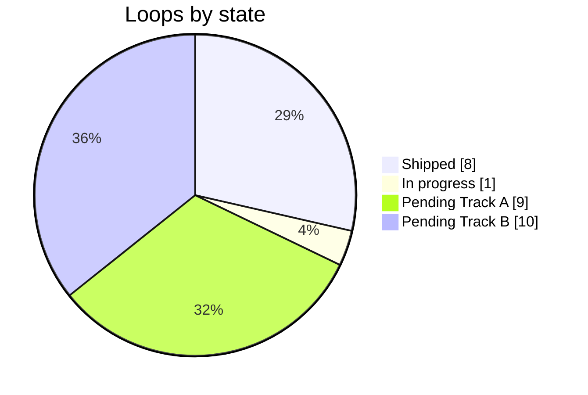

# DNDSheet — Implementation Backlog

## Current state — Build199 (2026-11-08)

📍 *Backlog › Now* — **103 / 219 complete (47.03 %) by this file's rule; raw checkbox count 112 done / 116 open. Start from Handoffs §Start here.**

Closed in Builds 186–200: A9.11, A9.12, A11.0, A11.1, A12.3, A12.6, A13.0, A13.8. Partial tasks keep their item lists in §Build186 grooming. Next order: identity paths for anatomy/phases/languages then A11.2–A11.4 → A13.3–A13.5 → A12.10 a3/d → A13.9 f2 → Pages d4 → partial tasks (A11.7, A11.8, B3.7, B3.6, A11.5/A11.9, A12.8/A12.9). A13.9 g2 needs a design decision first.

---
## Build185 reconciliation — code state versus roadmap (2026-11-08)

📍 *Backlog › Build185* — **Builds 162–184 shipped real features without ticking tasks. This section maps them to task ids so the roadmap describes the code again.**

**Where the code is.** Branch `build185-repairs`: `a7cc729` commits the Builds 162–184 working tree (Codex, then Gemini) as the baseline, unchanged; `68e18bd` is Build185's repairs; the docs commit follows. `statblock-overhaul` still points at `1869921` (Build161) and is the live checkout of another agent; nothing was rewritten there. `a13-9-sheet-density` (Builds 163–166) is **superseded**: its ideas are re-filed below as remaining acceptance for A13.9 and A12.10, its code will not be merged. Backup ref: `refs/backup/build184-wip`.

**Counting rule kept.** A box is ticked only with Done-when proof. Builds 162–184 recorded unit-test and fuzz runs, not the acceptance each task names (migration, undo, export, reload, print, 12-theme proofs). So no task closes here: **95 / 219 complete (43.38%)**, and **12 tasks are partially delivered** (code present, acceptance unproven). The percentage is unchanged on purpose.

### Partial deliveries by task

| Task | Delivered in code (build) | Remaining for Done-when |
|---|---|---|
| **A13.9** sheet density | Horizontal rules gone; Senses beside Languages; zero-indent vitals and interleaved striping (170–182); dark-theme vitals ink fixed and contrast-tested on 12 themes (185) | Items a–h done (186–191): number role, initiative grammar, retired pill CSS, paragon audit, print and 12-theme proofs, side-effect-free paragon rows. Left: f2 PDF/pixel proof, g2 design decision |
| **A12.10** compact spell list | One unified spell cell, "(N/Cadence), Level N:", Hidden cadence (176–181); counted cadences no longer doubled (185) | Items a, a2, b, c done (192–197): shared `spellLevelHeading` in exports, golden exports, live edit and reload proofs. Left: a3 i18n, d print |
| **A12.8 / A12.9** casting sources | Master spellcasting engine with stacked class cards, combined caster level, per-level cadence and action economy (171–176) | Stable-id source/pool model and lossless migration; per-source known/prepared/cantrip metrics with provenance; multiclass slot tests against SRD tables |
| **A12.1 / A12.4** subclass catalogs and picker | Case-insensitive subclass resolver, picker filters for every casting class (175–176) | Subclass persisted and reload-proven (A12.3, 197). Left: expanded-spell plans; invariant tests |
| **A11.7** combat activity routing | Search/Study/Influence/Hide/Tools relocate to Actions, Bonus or Legendary as 2-row plates; Tools action type (169–176) | Undo, export and association tests; redundant economy labels removed without losing facts |
| **A11.8** traversal riders | Speeds rider composer, nine compoundable archetypes, `speeds-traversal.ts` + tests (176) | Migration of existing speeds; phase-change effects; export |
| **A11.5 / A11.9** outcomes and random tables | Multiple description containers per action/trait/reaction with outcome targets and dice tables (171–176) | Up to 4 regions per container, audience/plane filters, overlap/gap diagnostics, print/prose |
| **B3.6** ability-score proposals | Heuristics in `species-and-heuristics.ts` + tests (169–174) | Preview/Apply/Cancel/undo; bound-field interaction |
| **B3.7** species proposals | 73 species and lineages catalog applying size, speed, senses, defenses and traits (169–174) | Preview before apply, provenance, revoke/reapply, user-edit preservation |

### Build186 grooming — fine-grained acceptance per partial task

📍 *Backlog › Build185 › Grooming* — **Each partial task is split into checkable items. A parent task ticks only when all of its items tick. Items are packed by shared files so one build can close several.**

**A13.9 sheet density** — files: `useTextRenderer.ts`, `defense-and-traits-utils.ts`, `app.scss`, `statblock-grammar.scss`
- [x] a. One number role: AC, HP, bloodied, phase HP, pool counts, initiative and lair counts render through `.dnd-num` (`numHtml`); `pill-number` is gone from source and CSS (186)
- [x] b. Initiative ▲▲/▼▼ uses the shared `advHtml` grammar (colour covers value and glyph, tooltip kept); the bespoke `dnd-adv-pill` markup is gone from the initiative renderer (186)
- [x] c. Pool counts read as numbers plus plain words, "3 Pools of 120 HP" (186)
- [x] d. Retired pill CSS deleted (12 rules, 170 lines across `app.scss`, `statblock-grammar.scss`, `WebRenderer.vue`) after a zero-emitter grep; `RetiredPillClasses.test.ts` fails if any of the nine retired classes returns to `src` (187)
- [x] e. Fuzz Step 25 (4-stage paragon + lair) asserts every initiative cell carries a `.dnd-num`, stage and lair values +12/+15/+18/+22/20, five phase-HP numbers, no retired pill classes, and zero font-family/size drift from the host (188); the same audit runs on wotc, printer, lovecraft_golden and art_nouveau × modern and classic, state restored after (189). Pool wording: unit-tested (`ParagonPools.test.ts`) and in the fuzz since item h (190)
- [x] e2. Defect fixed: "N Pools of M HP" never rendered because the renderer tested `typeof poolHp === 'number'` while the model and editor store `number[]`. New pure `describePools` (`paragon-pools.ts`, 5 tests) reads both shapes; equal pools give "3 Pools of 120 HP", unequal pools list "120 (Pool 1) | 90 (Pool 2)" (189)
- [x] h. Fixed: `paragonPhaseRows` no longer writes the store on render. Pure `planParagonPhaseRows` returns the stored rows when they match the pool count (v-model edits land in the store) and detached default rows otherwise; `materializeParagonRows` persists them on the first `focusin` inside a `[data-paragon-phase-row]` (and before the bloodied toggle and sync handlers). Fuzz Step 25 proves pool-only data stays untouched with the editor mounted, "3 Pools of 120 HP" renders with both numbers in the role, and focus materialises 3 rows (190). Side effects removed with it: viewing no longer sets `enabled = true` or renames auto rows. Visible change: a creature with pool HP but no stored stage rows now shows "3 Pools of 80 HP" instead of stage rows the editor invented on view (fuzz Step 20); creatures whose rows were already saved are unchanged
- [x] f. Print proof (computed, not PDF): the help smoke switches CDP to print media and asserts every `.dnd-num` stays at weight ≥ 600 and bloodied numbers stay red-dominant (191). Gap: the smoke's default creature shows no bloodied badge (0 red numbers checked), so the red assertion is vacuous until f2 adds a bloodied fixture. A PDF/pixel comparison of classic and modern stays open as **A13.9 f2**
- [x] g. Help smoke measures initiative advantage and disadvantage ink against the painted background on all 12 themes, ≥ 4.5:1 (191). It found a real defect: on 9 dark themes the top plate is painted white while the inks followed the dark body (1.63:1 and 2.28:1). Fix: `.statblock:not(.theme-printer) .unified-top-plate` uses the light inks. Follow-up **A13.9 g2**: decide whether a white top plate on dark themes is intended (design call), then derive its inks from `--sb-*` tokens

**A12.10 compact spell list** — files: `spell-plate.ts`, text/markdown/LaTeX/Homebrewery exporters
- [x] a. One pure `spellLevelHeading` (`spell-plate.ts`) shared by the web plate rules and `classSpellcastingSlots`, which feeds the Markdown, Homebrewery, improved-initiative and Tarrasque exports. Fixed: exports printed "1st level (3 slots): (1/Day)" with the cadence after the colon and ignored the default refresh; they now read "(3/Long Rest), Level 1:", Hidden and pact rules included. `buildSpellPlate` and the helper share `resourceContext`/`levelResource`; `SpellLevelHeading.test.ts` (4 tests) pins them equal (192). Exception: LaTeX passes level and slots to the template's `\DndMonsterSpellLevel` macro, which typesets its own heading (by design). **a2 done (196):** fuzz Step 51 exports a reset wizard fixture in all five formats and compares against `test/goldens/export-*.txt` (ids/times normalised; `DNDSHEET_UPDATE_GOLDENS=1` rewrites, then review); the goldens exposed and Build196 fixed: Improved Initiative leaked Markdown into plain text ("• > Cantrips (at will) *Fire Bolt*  ", no colon, double spaces) and every format printed "Medium humanoid, " with an empty alignment (`creatureTypeLine`, 3 tests). Found: **a4** Homebrewery Legacy cantrip line lacked the colon v3 has (fixed 197 with `spellLevelHeading`); **a5** resolved (199): not an app defect. `CR` is an index into the CR table and proficiency follows it only through `setCR()`; the Step 51 fixture assigned `CR` directly. Fixture now calls `setCR(12)`; goldens changed on proficiency only. Still open: **a3 done (201):** `spellLevelHeading` takes localised `labels`; exports pass `editor.spellcasting.slot.cantripLabel/levelWord/bonusActionWord`. Was: the export heading is English-only now (the old label used `editor.spellcasting.slot.slotLabel`); move the helper's words into i18n when exports are localised
- [x] b. Spell-plate smoke edits slot 1 from 4 to 2 and reads "(2/Long Rest), Level 1:" without reload (194)
- [x] c. Spell-plate smoke sets level 1 Hidden, waits until `app.monster` storage holds the edit, reloads via CDP and reads "(2 slots), Level 1:" and "(1/Day), Level 3:", with no re-prefixed "(N/1/Day)" (194)
- [ ] d. Print proof

**A11.7 combat routing** — files: `skill-action-groups.ts`, section projection
- [ ] a. Undo/redo of a relocation restores the source section
- [ ] b. Export lists relocated activities once, in their target section
- [ ] c. Economy label removed only where the section already states it (fact-preservation test)

**A11.8 traversal riders** — files: `speeds-traversal.ts`, migration
- [ ] a. Migration of legacy speed strings into riders, round-trip test
- [ ] b. Phase-change rider effect renders and exports
- [ ] c. Freeform fallback preserved verbatim

**B3.7 / B3.6 proposals** — files: `species-and-heuristics.ts`, proposal UI
- [ ] a. Preview diff before apply; Cancel leaves the monster untouched
- [ ] b. Apply is one undo step; revoke/reapply keeps user edits made after apply
- [ ] c. Provenance label on every proposed field
- [ ] d. Bound fields: a proposal never overwrites a live binding (test)

**A11.5 / A11.9 outcomes and tables**
- [ ] a. Cap of 4 regions per container enforced in UI and model
- [ ] b. Audience/plane filters; overlap and gap diagnostics for dice tables
- [ ] c. Print and prose export

**A12.8 / A12.9 casting sources**
- [ ] a. Stable-id source/pool schema plus lossless migration from class/innate/multiclass fields
- [ ] b. Pact, shared and innate pools stay distinct in the resolved projection
- [ ] c. Per-source known/prepared/cantrip metrics with provenance; multiclass slot tests against SRD tables

**A12.1 / A12.4 subclass**
- [ ] a. `subclass` persisted and migrated
- [ ] b. Expanded-spell plans per subclass; invariant tests

**Deployment (GitHub Pages)** — files: `quasar.config.js`, `asset-url.ts`, `WebRenderer.vue`, `A4LayerStudio.vue`
- [x] d1. Pages build from the committed source with `PUBLIC_PATH=/DNDSheet/` and `DNDSHEET_BUILD_DIR=dist-pages`; published to `gh-pages` with `.nojekyll` (193)
- [x] d2. Defect fixed: A4 layer presets and saved layers use root-relative `/homebrew/...` URLs that 404 under a sub-path. `resolveAppAsset`/`appAsset` (3 tests) resolve them against the served base at render time; saved data is not rewritten (193)
- [x] d3. `npm run gate` (`test/gate.mjs`, committed) runs core, lint, build, fuzz, help and spell smokes, the `/DNDSheet/` Pages build, an asset check (base-prefixed index and one `/homebrew/` mask) and the fuzz under the sub-path, with its own static server; logs and `summary.json` in `.gate/` (195)
- [x] d4. First-run notice (App.vue, once per address, `dndsheet.storageHintSeen`) explains that saved work lives per browser and address and how to export/import it (201)

**Gate for every item:** `npm run gate` on the committed tree (A17.3): core, lint 0 errors, build, fuzz, help smoke, spell smoke, Pages build, Pages assets, Pages fuzz.
### Delivered outside any task id (record, then own)

Initiative composer and roll-mode toggles (179–180); HP riders split into regeneration vs temporary HP (179–181); defenses ordering and per-category row splitting (182); custom variables/macros and `DatabaseStudio` (171–173, feeds A10.1); compact nameplate and XP toggles (171–176); A4 layer studio: occlusion order, radial crop knobs, curved gradient bar, per-slider resets (181–184); expanded duration/target/plane catalogs with grouped tooltipped options (184, feeds A13.2). These need owners: A4 layers → **A16.2**, catalogs → **A13.2**, macros → **A10.1**, initiative/HP riders → **A9.13**.

### Defects found while verifying the baseline (fixed in Build185)

1. "(3/1/Day), Level 3": slot count prefixed to a cadence that already carries a count → pure `spellLevelLead`, test first.
2. Metamagic options ended ".,".
3. Dark themes: vitals ink `#58180d` on near-black, about 1.3:1 → theme `--sb-cell-ink`, 16–18:1, guarded by the 12-theme help smoke.
4. Help tooltips lost their "Values:" detail on the Build170 vitals panels.

### Process gaps that caused divergence (now rules in Handoffs §Build185)

- 23 builds lived only as uncommitted files; RC167–182 froze a JSON without a runnable app.
- Only unit tests and the fuzz ran; the spell-plate and help smokes drifted and hid defects 1–4.
- Two agents wrote to one checkout; one agent's side-branch work was absorbed in name only.
- Delivery summaries were prepended to three docs instead of ticking tasks.

### Convergent execution order (replaces §3 "Next")

1. **Prove or finish the partial deliveries before new features**, smallest first: A13.9 (initiative grammar, number role) → A12.10 (export headings, live-edit/reload) → A11.7 → A11.8 → B3.7 → B3.6 → A11.5/A11.9 → A12.8/A12.9.
2. **A16.5 early**: `app.scss` cascade rules fight the grammar (an `#render`-scoped title rule forced defect 3); remove dead blocks before more theme work.
3. **A17.3 now, not last**: fuzz plus both smokes are the per-build gate; add a binding smoke run.
4. Then resume A9.7 → A9.11–A9.13 → A10 in their original order.

---
## Build 184 Delivery Summary (2026-11-06)

- **Release Candidate**: `rc-2.4.3-build-184-flush-headers-radial-resets-stat-balance-and-plate-rows`
- **Build**: `184`
- **Features Shipped**:
  1. **Flush Trait & Action Header Border Alignment**: Unified `.sb-plate.sb-trait-streamlined` and `.sb-single-line` so all `.sb-head` badges sit `0px` flush against the `.sb-plate` frame border while multi-line trait descriptions wrap cleanly beneath the header badge on lines 2+.
  2. **Redundant Cropping Controllers Removed**: Removed duplicate standalone `<dual-knob-crop-slider>` blocks in `A4LayerStudio.vue` (kept the integrated parallel `Crop X` and `Crop Y` sliders on `RadialOffsetController.vue`).
  3. **Exclusive Per-Slider & Per-Knob-Side Reset Buttons**: Added individual reset buttons (`resetX`, `resetY`) next to X/Y offset sliders and 2 per-side reset buttons (`resetCropXMin`, `resetCropXMax`, `resetCropYMin`, `resetCropYMax`) on multivalued `Crop X` and `Crop Y` sliders in `RadialOffsetController.vue` and `DualKnobCropSlider.vue`.
  4. **Auto-Balanced Ability Score, Modifier & Save Grid**: Rebalanced `.dnd-stats-2024 .stat-table` column tracks, padding, and `.save .dnd-adv-pill` arrow spacing so `DEX 18 | +4 | +6 ▲▲` never truncates or collides.
  5. **Composer-Aligned Spell-Like Trait/Action Plate Row Ordering (`Exorcise` & `Astral Binding`)**: Placed `mechItems` (`Charisma Save DC 14`, `Ranged Spell Attack +6`) on Row 1 after `duration` and `scopeItems` on Row 2 in `buildPlateEntry` (`useProcessTokens.ts`).
  6. **Expanded Durations & Categorized Tooltipped Catalogs**: Expanded `DURATIONS`, `TARGET_KINDS`, `TARGET_QUALIFIERS`, `PLANES`, and `AREA_SHAPES` in `action-composer.ts` and added categorized, alphabetically sorted, icon-annotated, color-badged, tooltipped catalogs in `ChainCell.vue` and `BasicsEditor.vue`.
  7. **Contextual Split Riders Toggles**: Added contextual `↳ Sub-Row` toggles directly inside the AC Riders bar and each HP Rider module header in `BasicsEditor.vue`.
- **Verification**: 361/361 unit tests passed, 50/50 live CDP browser fuzz tests passed, Quasar build exit code 0.

---

## Build 181 Delivery Summary (2026-11-02)

- **Release Candidate**: `rc-2.4.3-build-181-occlusion-streamlined-actions-and-unified-spells`
- **Build**: `181`
- **Features Shipped**:
  1. A4 Composition Layer Stack Ordering & Normal Blend Occlusion: dynamic descending zIndex based strictly on `a4Layers` array order, `.statblock-wrapper { z-index: auto }` inside `.a4-page-sheet` isolation context.
  2. Transparent CR nameplate chip on `.cr-main-region` and `.compact-nameplate-row-1 .cn-cr`.
  3. Top-aligned multi-line trait plates (`.sb-plate.sb-trait-streamlined .sb-row > .sb-cell.sb-head` top-aligned with padding-top: 5px).
  4. Streamlined single-row action plates for Multiattack and simple actions (`[Multiattack] [Make 2 Attacks.]`).
  5. Single unified monster spellcasting cell (`.sb-spells-unified-cell`) with interleaved line striping and zero internal row divider lines.
  6. Decoupled regeneration vs temporary hit points (`Gains X of Temporary Hit Points while not Bloodied`).
  7. Defensive CR calculation safeguards against missing `crAnnotation` and `atWill`.
- **Verification**: 357/357 unit tests passed, 50/50 live CDP browser fuzz tests passed, Quasar build exit code 0.

---

## Build161 delivery grouping and next packet

This iteration connects registry → resolver → persisted store → silent materialization/history → shared control → actual editor consumers. Task completion is credited only with the closing evidence below. No requested mechanics are silently dropped or duplicated.

Remaining A9.7 migration, grouped by ownership:
1. Basics: reconcile stable scalar controls beyond the replaced core fields, especially AC/HP submodes, passive/save overrides and phase/initiative controls. Preserve automatic ownership and symbolic/precision exceptions.
2. Studio: route remaining eligible action/trait/reaction scalar controls through stable paths; identity-poor outcome/phase/membership occurrences keep their existing migration owners. Do not treat a target count as attack rolls.
3. Lifecycle: changing mode suspends a binding without deleting it; removing/copying/template-applying an entry must have an explicit overlay ownership policy. Validate reorder/delete/import/undo and extension preservation before marking A9.7 complete.
4. Existing review minors under A9 closeout: allow detach while a field's selector is disabled; refresh history canUndo after discarding current-equal snapshots that yield no older entry. These are recorded follow-ups, not new counted tasks. Earlier158 wording/nonfinite attack test minors remain under their prior owners.
5. Then A9.11 explicit finesse/thrown ability provenance, A9.12 structured-outcome CR, A9.13 roll-count/scaling/conditional-roll contract, and A9.10 closeout. A10 caret completion follows the binding loop. Keep A11/A12/B3 requested systems in dependency order.

Process delta: production Pinia action tests now exercise the same exported actions as the app, including computed-value invalidation and collection identity. The focused browser probe checks actual Apply/Cancel, detach, keyboard undo/redo, reload, narrow layout, attack controls and visible HP projection. Do not substitute core counters for this end-to-end evidence.

## Build160 incremental delta — A9.2 registry work

Delivered pure stable-path reading, numeric descriptors/validation, inspection and stored-context reference dependency policy. No task closes: **88/219 complete, A9.2 active,130 pending;9/28 loops shipped**. Scope stays219. This is foundation work, not the smart-dropdown rollout or saved overlay.

Finish A9.2 in this order before A9.3:
1. Reconcile every A9.0 stable authored leaf against the registry; record unsupported aliases and identity migrations beside their existing owners.
2. Complete complex AC applicability, default-source and OR gates; replace pending mode policy only with focused assertions from actual editor behavior.
3. Complete death-prevention save/burst applicability and review the other registered families' defaults. Symbolic authored values require an explicit migration decision, not scalar replacement.
4. Add a coverage invariant connecting the inventory, descriptor source ownership, gates and reference-source policy. Exercise mode changes, missing optional parents, reordering and ambiguous imports.
5. Only then close A9.2 and begin A9.3 overlay/set-clear/resolve; A9.4 history and A9.5/6 controls remain downstream. Injected live getter contexts need a matching dependency provider before adoption.

Review corrections include disabled-override false cycles, raw/normalized spell ability sources, accessor-backed array entries, literal fallback modes, pool-count activation and symbolic authorship. Earlier158 minor wording/attack fallback test follow-ups remain unchanged under their existing owners.

> **The checklist and the living timeline.** Every loop of the [Product & Architecture Specification](DNDSheet-Professional-Product-and-Architecture-Spec.md) broken into tasks you can tick, in the order they should ship, with the commit that proves each one. Preparation and closing rituals live in the [Development Handoffs](DNDSheet-Development-Handoffs.md).

| | |
|---|---|
| **Version** | Build161 - live numeric bindings - `rc-2.4.3-build-161-live-bindings` - Build160 preserved |
| **Code HEAD** | `6049127`;327core tests,50browser scenarios,focused binding lifecycle,5spell/12help themes,20plate parity;changed binding-code lint clean |
| **Progress** | **9/28 loops shipped - 103/219 tasks complete (47.03%) - 1active/115pending** - Build199: A9.11, A9.12, A11.0, A12.3, A12.6, A13.0, A13.8 closed since Build185; A9.7 active |
| **Now** | Live persisted bindings,history and shared controls delivered on migrated fields;A9.7 remaining inventory/lifecycle sweep active. |
| **Next** | Finish A9.7 numeric consumer/lifecycle migration,then A9.11/A9.12/A9.13 and A9.10 closeout;A10 caret completion follows. |

---

## Build 157 delivery delta — A8 closed, R2 complete

Code `b4eef8e` (16 files, +183/−1363) retires the seven duplicate panels; `38c4738` deletes the orphaned `widgets/AttackPanel.vue` (586 lines) and is byte-neutral — its rebuild matches all 96 shipped files of the release candidate. Four tasks close (A8.5, A8.6, A8.7, A8.8), so loop A8 ships and **R2 · Composes like sentences reaches 36/36**. Progress: **86/216 complete (39.81%) · 0 active · 130 pending · 9/28 loops shipped**. No scope added.

Proof: 274 core tests (+1); production build; 49 browser scenarios (+1) with zero console/runtime errors; 5 spell themes; 12 help themes; focused lint clean. Two-build render parity gives 24/24 identical plates from Build 156 to 157 and fails, as it must, on the deliberate 154 → 156 heading change. LaTeX not compiled.

Next: **A9 · NumericBinding fields**, starting with A9.0. `AttackPanel` is gone, so A9.0's binding inventory reads attack and other numeric leaves from the studio (Handoffs §6.7 lists the files). Existing follow-ups stay open: B4.7–B4.10, A9.11, A9.12, A13.8. Unused i18n keys left by the deleted panels belong to the A13 copy sweep; no new task.

## Build156 delivery delta and next gates

Code `af32093`:10files,+289/-4. A8.5 now has working action display/phase/custom-heading settings,action/lair CR controls,trait sorting and legendary/mythic membership add/remove/cost/repair. Six new core tests and browser Step48 cover these homes. No whole task newly closed or scope added:82/216 complete,A8.5 active,133pending. Historical delivery figures below remain dated records.

Remaining work inside A8.5,dependency ordered:
1. Reconcile every old-panel control with its actual studio home,including reset/template/reorder/delete semantics and ambiguous imported IDs.
2. Capture three representative saved-monster baselines,including custom renderers,missing references,phase policies,manual CR,dual-role memberships and saved templates.
3. Adapt browser paths that still use old panels and prove lifecycle,cancel/undo/reload behavior before deleting those targets.
4. Retire only fully covered panels;retain VillainActionsEditor under BS-26. Prove A8.6 byte-identical fixture output and A8.7 replacement paths,then close A8.5/A8.8. Capability delivery alone does not close retirement.

Proof:273core(+6),productionbuild,48browser scenarios zero console/runtime errors,5spell themes,12help themes,focusedlint clean,Impeccable detector[]. Final review's automatic-CR context defect reproduced red and fixed green,including damage28/DC17 parity and correct target after reorder. No LaTeX compilation. Evaluate156 at http://localhost:9124/index.html?build=156#/. Existing server uses dist/spa;future builds must use a separate output until a successor is ready. Protected155 remains9125 with97verified hashes.

---

## 0. How to use this backlog

📍 *Backlog › 0 Usage* — **Tick a box only when its proof exists; add a task the moment a blindspot turns into work.**

| Symbol | Meaning |
|:--:|---|
| `[x]` | Done — proof recorded (test, probe, screenshot or commit) |
| `[ ]` | Pending |
| `[~]` | In progress (only one loop at a time) |
| `[-]` | Dropped or deferred — reason in the line |
| ✅ ◐ ☐ ⛔ | Loop shipped · in progress · pending · blocked |
| **S / M / L** | Size: S < 1 h · M 1–3 h · L 3–6 h of focused work |

**Rules**
1. Task ids are stable (`A4.3`); never renumber — append (`A4.3b`) when a task splits.
2. A task lists its **target files** and its **proof**; the loop lists its **Done when** in requirement ids from the spec (§14).
3. When a loop closes: tick its tasks, update §1 dashboard and §2 timeline, paste the commit hash in the loop header, and append new tasks discovered during the loop to the right future loop (marked *added A4*).
4. If a fact contradicts the spec, fix the spec first (Handoffs §1.4).

---

## 1. Dashboard

📍 *Backlog › 1 Dashboard* — **Where the overhaul stands, release by release.**

| Release | Loops | Tasks done / total | Status |
|---|---|---:|:--:|
| R1 · Reads right | A0 ✅ · A1 ✅ · A2 ✅ · A3 ✅ · A4 ✅ · A5 ✅ | 49 / 49 | ✅ |
| R2 · Composes like sentences | A6 ✅ · A7 ✅ · A8 ✅ | 36 / 36 | ✅ |
| R3 · Numbers know their source | A9 ◐ · A10 · A11 | 9 / 33 | ◐ |
| R4 · Spellcasting you can trust | A12 | 0 / 11 | ☐ |
| R5 · Explains itself | A13 · A14 · A15 · A16 | 1 / 30 | ☐ |
| R6 · Overhaul release | A17 | 0 / 9 | ☐ |
| R7 · Creator confidence | B1 · B2 · B3 | 0 / 17 | ☐ |
| R8 · Portable output | B4 | 0 / 10 | ☐ |
| R9 · Keep and reuse | B5 · B6 | 0 / 10 | ☐ |
| R10 · Honest breadth | B7 · B8 · B9 · B10 | 0 / 14 | ☐ |
| **Total** | **28 loops** (TrackA167 / TrackB52) | **103 / 219 complete - 1active - 115pending** | **47.03% complete** · 12 partially delivered by Builds 162–184 (see §Build185) |



### 1.1 Defects and blindspots by closing loop

| Loop | Closes defects | Verifies blindspots |
|---|---|---|
| A4 | DEF-01, DEF-02, DEF-03 (data), DEF-04, DEF-15, DEF-16, DEF-17 | BS-04, BS-05, BS-08, BS-17, BS-18 |
| A5 | — | BS-12, BS-14, BS-19, BS-20 |
| A6 | DEF-05 | BS-06, BS-09, BS-10, BS-22, BS-23 |
| A7 ✅ | DEF-12, DEF-19…DEF-25 | BS-39 stays open for A8 (range pairs); BS-40 and BS-41 identified |
| A8 | DEF-08 | BS-26, BS-27 |
| A9 | DEF-09 | BS-06, BS-16, BS-24, BS-25 |
| A10 | — | BS-21, BS-28 |
| A12 | DEF-03 (ruleset), DEF-06, DEF-07 | BS-07, BS-29, BS-30 |
| A13–A16 | DEF-10, DEF-11 | BS-31…BS-35, BS-40 |
| A17 | DEF-13, DEF-14 | BS-03, BS-15, BS-36, BS-37 |
| B1 | — | BS-38 |
| B4 | — | BS-11, BS-13, BS-41 |

---

## 2. Living timeline

📍 *Backlog › 2 Timeline* — **The code's diary: every commit that moved the product, newest last.**

| Date · time | Commit | Loop | What changed for the user | Proof |
|---|---|---|---|---|
| 2026-10-29 06:36 | `52355c2` | A0 | Local working tree frozen before the overhaul (135 files) | git |
| 2026-10-29 07:09 | `574f196` | A1 | Search · Study · Influence · Hide rows; no duplicate Skills row; whole-label ▲▲/▼▼ colour; editor group cards | 10 tests; browser rows |
| 2026-10-29 07:18 | `be0cf3f` | A2 | Formula engine: references, custom formulas, `{…}` macros anywhere; `Function` eval removed | 19 tests; browser probes |
| 2026-10-29 12:42 | — | — | Owner: absorb the v1 plan, rewrite spec/backlog/handoffs to professional depth | message |
| 2026-10-29 12:53 | `c543615` | A3 | Traits/actions/attacks/reactions/legendary as framed plates; theme palettes | 5 tests; theme probe |
| 2026-10-29 13:02 | `b83ee56` | docs | v1 documents versioned in `docs/roadmap/` | git |
| 2026-10-29 | `4c6c1cb` | docs | v2 documents: spec bible, this backlog, handoffs; 32 / 32 Mermaid diagrams parse (Mermaid 11.4.1); ids and tables cross-checked | doc check + consistency script |
| 2026-10-29 | `f35cd6d` | A4 | Class and innate spellcasting plates use shared visual grammar, edition-aware metamagic and cadence catalogs | 111 core tests; build; focused browser smoke across 5 themes |
| 2026-10-29 | `8487335` | A5 | AC/HP/Speed and related rows share the plate grammar; recharge help is accurate; A4 printing no longer emits a blank second page | 115 core tests; production build 135; focused 12-theme contrast/screenshots; 5-theme spell smoke; 33-scenario full UI; one-page A4 PDF |
| 2026-10-29 | `71a8c21` | A6 | Optional action targeting/outcome data, conservative inference, modern plate projection and opt-in 2024-style text export; sample monster data unchanged | Core 124/124; build 136; exhaustive UI 33/33 steps; 0 runtime exceptions |
| 2026-10-29 | `df95179` | A7 · partial build 137 | Added 9 catalog-backed action templates, grouped picker, explicit replacement confirmation, cancel/apply semantics and removed duplicate hard-coded preset/composer routes; configured sample data unchanged | Core 129/129; production build; exhaustive UI 33/33 including Step 32 cancel/apply; 0 runtime exceptions; focused lint 0 errors |
| 2026-10-29 | `761b41a` | A7 · partial build 138 | Deep-cloned nested template values per application; edits to one action cannot mutate the shared catalog or another action | Core 130/130 including catalog isolation regression; production build; exhaustive UI 33/33; 0 runtime exceptions |
| 2026-10-29 | `10f7aa0` | A7 · partial build 146 | Replace destructive role conversion with reviewed compatible moves and explicit cross-model copies. Preserve source fields/references, isolate copy uses/CR, exclude copies from CR; clear mythic links on deletion. | 216 core tests (+51), all 49 role pairs, production build, zero lint errors, full 39-step browser suite (+1), five/twelve-theme smoke; 7 files +240/−97 |
| 2026-10-29 | `d70cc01` | A7 · partial build 145 | Lair projection and exact preview; typed legendary/mythic/lair section drafts; initiative-aware default preamble; mobile pane stacking. A7.3 completed; matrix remains active. | 165 core tests; production build; zero lint errors; 38 browser steps, zero errors; 5-theme spellcasting; 12-theme help; 98-file sealed archive |
| 2026-10-29 | `7f2e572` | A7 · partial build 144 | Added typed trait cadence/display policy and renderer preview as sixth role; fixed live heading spaces and narrow popup fit; kept existing schema/data and archives. Audited checklist states: 67 done, 2 active, 124 pending. | Core 159/159; production build; changed-file lint; browser steps 1–37 with zero console errors/runtime exceptions; five-theme spellcasting and twelve-theme help/contrast |
| 2026-10-29 | `77a18c5` | A7 · partial build 143 | Added a distinct typed reaction projection/patch adapter and editable trigger/usage cells with shared sanitized renderer preview; preserved reaction storage model/collection, configured sample data, and build 142/139 archives. Trait/lair adapters, complete headers, role-wide matrix, and A7 closeout remain open. | Core 152/152; production build; changed-file lint passes; exhaustive browser steps 1–36; spellcasting five themes; help/contrast twelve themes; 0 browser runtime exceptions |
| 2026-10-29 | `54d933e` | A7 · partial build 142 | Added typed chain projection/patches, editable cells and outcomes, action-family editor integration, and preview via existing renderer for action, bonus, legendary, and mythic entries. Trait/reaction/lair adapters and role headers remain open. Build 139 remains preserved. | Core 149/149; production build; focused lint 0 errors/5 warnings; exhaustive browser steps 34–35; spellcasting five themes; help/contrast twelve themes; 0 browser runtime exceptions |
| 2026-10-29 | `98bb899` | A7 · partial build 139 | Added `ROLE_CHAINS` data for action, bonus, trait, reaction, legendary, mythic, and lair roles; descriptors represent structured and legacy fields and encode head → mechanics → scope → outcomes → prose order. No editor UI or preview behavior changed. | Core 133/133 including descriptor-contract tests; build succeeds; full 33-step browser sweep passes with 0 runtime exceptions |
| 2026-10-29 | `ae16b86` | A4 closeout | Hide generic class preamble already represented by the plate; preserve custom preamble; align e2e assertions to semantic badges and no redundant Skills row | Core 111/111; build; focused smoke; full e2e 23/23 groups, 0 runtime exceptions |
| 2026-10-29 | working tree at preserved checkpoint `a6c87e4` | A5 partial | Add shared top-row grammar, delegated help host and dictionary, recharge explanations, theme contrast coverage, and remove 11 repeated cascade style blocks | Core 115/115; production build; help browser smoke (12 themes); spellcasting browser smoke (5 themes); exhaustive e2e 33 scenario steps, 0 runtime exceptions (2026-10-29) |
| 2026-10-30 00:18 | `7f1e4ea` | A7 · build 147 | Opening a file keeps every authored field: the toolbar import runs the shared migration (alphaTraits fixed), pre-v9 upgrades keep existing stat/save/effects/range/uses/trigger, spellcasting policies and legacy language names survive; reaction chain reads usage → name like the plate | Core 222/222 (+6, red first); build; lint 0 errors; 40 browser steps incl. Step 40 (v8-labelled file through Open File, nothing lost, 14/14 seven-role parity, reload) and the Step 35 type matrix (56/56); help 12 themes; spellcasting 5 themes; 97-hash archive |
| 2026-10-30 00:39 | `49edfdf` | A7 ✅ · build 148 | Exports print every role as prose without web markup in either template; HP pills, plates and help hooks never reach a text file; LaTeX and Improved Initiative legendary/mythic keep their mechanics; Improved Initiative mythic crash, multiattack "undefined", repeated Multiattack label, misnested mythic lead and default mythic text fixed | Core 231/231 (+9); build; lint 0 errors; 41 browser steps incl. Step 41 export proof; help 12 themes; spellcasting 5 themes; 97-hash archive; promoted to 9100 (Seraphic Herald, storage hash unchanged) and 9106 |
| 2026-10-30 00:58 | `0dbcd23` | A8 · build 149 | Composer head chips follow the plate word order ("2nd Level Evocation", "Evocation Cantrip"); two-item lists read "a and b" in multiattack and extra-damage prose on the sheet and in every export | Core 234/234 (+3, red first); build; lint 0 errors; 41 browser steps, zero errors; help 12 themes; spellcasting 5 themes; 97-hash archive; promoted to 9100 (Seraphic Herald, storage hash unchanged) and 9106 |
| 2026-10-30 01:23 | `fc21bc1` | A8 · build 150 | Action usage edits the real cadence as one validated policy: recharge range, uses per period, or none | Core 239/239 (+5); build; 42 browser steps (Step 42: edit, cancel, clear, reload) |
| 2026-10-30 01:37 | `d4f1e73` | A8 · build 151 | Classic prose keeps structured metadata and target scope: school/tier, components, duration, qualifiers | Core 244/244 (+5); build; 43 browser steps (Step 43: classic matches modern facts and text exports) |
| 2026-10-30 01:58 | `1b36467` | A8 · build 152 | The studio edits existing attacks in place, keeping ranges, damage, extra damage and references | Core 250/250 (+6); build; 44 browser steps; focused lint 0 errors |
| 2026-10-30 02:14 | `1f57bab` | A8 · build 153 | Multiattack references composed in the studio: repeated occurrences, missing targets, shared rendering | Core 257/257 (+7); build; 45 browser steps |
| 2026-10-30 10:54 | `0ce61c7` | A8 · build 154 | One live sheet replaces the inline previews; one recovery-cadence vocabulary serves every usage editor (A8.13, A8.14) | Core 264 (+7); build; 46 browser steps; lint 0 errors |
| 2026-10-30 11:11 | `46785a0` | A8 · build 155 | Heading order usage → name/components → tier/school, shared by editor, sheet and prose (A8.15) | Core 267 (+3); build; 47 browser steps; lint 0 errors |
| 2026-10-30 11:41 | `af32093` | A8 · build 156 | Studio homes for action display/phase/custom heading, action and lair CR, trait sorting and non-destructive legendary/mythic memberships | Core 273 (+6); build; 48 browser steps; 5 spell / 12 help themes; lint clean |
| 2026-10-30 12:47 | `b4eef8e` · `38c4738` | A8 ✅ · build 157 | Seven duplicate panels retired; reaction templates and four staged section resets live in the studio; orphaned `AttackPanel` deleted (byte-neutral) | Core 274/274 (+1); build; 49 browser steps; two-build parity 24/24 plates with a failing control; 5 spell / 12 help themes; 97-hash archive; promoted to 9100 (Seraphic Herald, storage unchanged) and 9106 |
| 2026-11-07 | `a7cc729` | baseline | Builds 162–184 (Codex, Gemini) committed as one baseline: composers, vitals flow, combat-action routing, spellcasting engine, species catalog, A4 layer studio | 361 core; build; 50 fuzz |
| 2026-11-07 | `68e18bd` | build 185 | Counted spell cadences, metamagic punctuation, dark-theme vitals contrast, vitals help values; smokes realigned to the Build170+ markup | 362 core; build; 50 fuzz; spell 5 themes; help 12 themes |

### 2.1 A4 closing validation: tracked full-suite failures

The first post-A4 full run exposed three stale browser expectations and one real duplicate-preamble behavior. They are all closed at `ae16b86`; the passing rerun supersedes the earlier failing snapshot. Keep the exact contracts as regression coverage:

| E2E step | Observed failure | Owning backlog item | Exit evidence |
|---:|---|---|---|
| 18 | Old test searched for deprecated badge class names | A5.8 ✅ | Test queries `.dnd-adv` and `.dnd-disadv`; full UI suite passes |
| 20 | Old test searched old pill markup; assertion now targets Search row's semantic advantage wrapper and trailing glyph | A5.9 ✅ | Browser test confirms the check value is wrapped and glyph is present |
| 25 | Test required a separate Skills row although configured skills all belong to the four action groups | A15.7 ✅ | Test asserts grouped skills/tools and confirms no redundant Skills heading |
| 32 | Default spellcasting preamble duplicated the class plate's summary and spell list | A4.12 ✅ | Generic prose hidden in web plate; authored custom preamble retained; full e2e passes |

---

## 3. Now · Next · Later

| Now | Next (in order) | Later |
|---|---|---|
| Build185 baseline on `build185-repairs`; 12 tasks partially delivered by Builds 162–184 | Prove or finish partials: A13.9 → A12.10 → A11.7 → A11.8 → B3.7 → B3.6 → A11.5/A11.9 → A12.8/A12.9; A16.5 and A17.3 pulled forward (§Build185) | A9.7 → A9.11–A9.13 → A10; R5 sweeps; Track B |

---

## 4. Track A — Statblock & Authoring Overhaul

📍 *Backlog › 4 Track A* — **Eighteen loops; A0–A6 are done and A7 is actively shipping in bounded slices.**

### R1 · Reads right

#### A0 · Baseline snapshot ✅ `52355c2`

> Freeze the local tree so every later change is reviewable.

| Release | Feature | Depends on | Effort | Actual |
|---|---|---|---|---|
| R1 | QA-01 | — | — | 135 files, +41 791 / −2 884 |

- [x] **A0.1** Commit the untouched local working tree as `snapshot local working tree before statblock overhaul` · S · *proof: `52355c2`*
- [x] **A0.2** Dev server on port 9100 without auto-opening a browser (`DNDSHEET_NO_OPEN=1`; `quasar.config.js` `open` flag, shipped in A1) · S · *proof: `Get-NetTCPConnection -LocalPort 9100`*
- [x] **A0.3** Load the Seraph fixture into the built-in browser (`dnd-fixture-seraph.js`) · S · *proof: stat block renders "SERAPH…"*
- [x] **A0.4** Run the core suite as baseline · S · *proof: `npm test` green*

**Done when:** QA-001 baseline recorded. ✅

---

#### A1 · Check rows + whole-label advantage ✅ `574f196`

> Skills read as the actions that use them; advantage colours the whole label.

| Release | Feature | Depends on | Effort | Actual |
|---|---|---|---|---|
| R1 | SB-02 | A0 | — | 9 files, +868 / −486 |

- [x] **A1.1** `core/domain/skill-action-groups.ts`: catalog `SKILL_ACTION_GROUPS`, `computeSkillGroupLayout`, `mergeIdenticalEntries` · L · *proof: tests*
- [x] **A1.2** `test/core/SkillActionGroups.test.ts` (10 tests) · M
- [x] **A1.3** `components/rendering/advFormat.ts`: `numHtml`, `advHtml`, `condHtml`, `escapeHtml`, `htmlToText` · S
- [x] **A1.4** `useTextRenderer.ts`: saves/skills/tools/defenses with advantage; `actionPassivesGroups` rebuilt on the layout; exports via `htmlToText` · L
- [x] **A1.5** `WebRenderer.vue`: defense prose via `v-html`; group-title tooltips (`dnd-tip`) · S
- [x] **A1.6** `css/statblock-grammar.scss` created (advantage inks per theme, `.dnd-num`, `.q-tooltip.dnd-tip`), imported last in `app.scss` · S
- [x] **A1.7** `SkillsEditor.vue`: group cards from the catalog; economy inheritance; `q-btn-Group` typo fixed · M
- [x] **A1.8** `quasar.config.js`: `open: !process.env.DNDSHEET_NO_OPEN` · S
- [x] **A1.9** Browser verification: rows `Search ACTION 13/+3, (15, +5 Insight)` … no Skills row · S · *proof: probe output*

**Done when:** CHK-001…004, SBG-003 (rows) proven. ✅

---

#### A2 · Formula engine, references and text macros ✅ `be0cf3f`

> One small, safe language for every number.

| Release | Feature | Depends on | Effort | Actual |
|---|---|---|---|---|
| R1 | SB-03 | A0 | — | 8 files, +1 409 / −106 |

- [x] **A2.1** `core/domain/formula.ts`: parser, symbolic dice, styles, traces, suggestions, aliases, 11-group catalog · L
- [x] **A2.2** `test/core/Formula.test.ts` (18 tests) · M
- [x] **A2.3** `core/domain/formula-context.ts`: `formulaContextForMonster(monster, derived)` · S
- [x] **A2.4** `defense-and-traits-utils.ts`: `evaluateSafeFormula` on `evaluateFormula` (no `Function`), `formulaContextFromDynamic`, `formulaDisplayText` · M
- [x] **A2.5** `core/usecases/ProcessTokens.ts`: final `renderFormulaMacros` pass + test · S
- [x] **A2.6** `useProcessTokens.ts`: spell tokens in any context; unknown properties left verbatim (no "undefined") · S
- [x] **A2.7** `MonsterTextEditor.vue`: macro preview argument order fixed · S
- [x] **A2.8** Browser probes: `{CANTRIP_DICE d10}` → `16 (3d10)`, `{spellcasting.attack}` → `+7`, `{8 + PB + CHA_MOD}` → `15` · S

**Done when:** REF-001, REF-003…006 proven. ✅

---

#### A3 · Plate grammar for abilities ✅ `c543615`

> Every ability entry is one framed plate.

| Release | Feature | Depends on | Effort | Actual |
|---|---|---|---|---|
| R1 | SB-01 | A2 | — | 4 files, +494 / −186 |

- [x] **A3.1** `components/rendering/plate.ts`: `plateHtml`, rows/cells/body, `boldNumbers`, `phaseLabel`, stripe threshold · M
- [x] **A3.2** `useProcessTokens.ts`: `buildPlateEntry`, `usageText`, `ATTACK_REACH_LABEL`; trait/action/reaction/attack/multiattack/legendary modern branches · L
- [x] **A3.3** `statblock-grammar.scss`: tokens, `plate-palette` mixin for 12 selectable themes, plate/row/cell/body rules under `#render`, container step-back via `:has()` · M
- [x] **A3.4** `test/core/Plate.test.ts` (5 tests) · S
- [x] **A3.5** Browser: computed styles on WotC + 4 more themes; console clean after reload; lint fixes · S

**Done when:** SBG-001…005 proven (SBG-005 for 5 themes; all 12 selectable themes at A17). ✅

---

#### A4 · Spellcasting plate ✅ `f35cd6d`

> Spellcasting reads like one trait plate: who casts, DC and attack, slots and recovery, preparation, then one row per level.

| Release | Feature | Depends on | Effort | Forecast |
|---|---|---|---|---|
| R1 | SB-04 | A3 ✅ | 1 day | 12 files · +802 / −389 |

- [x] **A4.0** Baseline captured: build succeeds; full e2e reaches steps 1–17 then fails at 18, 20 and 25; failures tracked in A5.8/A5.9/A15.7 · M · *proof: closing packet*
- [x] **A4.1** Spell model fixtures cover pact/full casting, metamagic and innate casting · M · *proof: `test/core/SpellPlate.test.ts`*
- [x] **A4.2** Historical defects reproduced from baseline and closed: duplicate component parentheses, placeholder `x`, stripped connective, cadence/slot labels and ordinal spacing · S · *proof: focused browser smoke*
- [x] **A4.3** `core/domain/catalogs/metamagic.ts`: edition-specific 2014/2024 costs and effect text/source labels · S
- [x] **A4.4** `core/domain/catalogs/cadence.ts`: shared cadence and resource refresh options used by editor/rendering/text renderer · S
- [x] **A4.5** `core/domain/spell-plate.ts`: pure class spellcasting projection and row models · L
- [x] **A4.6** `buildInnateSpellPlate`: separate innate projection · M
- [x] **A4.7** Seven domain test cases cover slot progressions, components, cadence, edition-specific effects and absent values · M
- [x] **A4.8** `WebRenderer.vue`: typed computed model rendered with Vue text bindings; no new `v-html` spell plate path · M
- [x] **A4.9** `statblock-grammar.scss`, `app.scss` and `i18n/en-US/index.ts`: shared plate styles, component punctuation ownership and localized label · S
- [x] **A4.10** Focused browser smoke verifies class + innate plates in five themes; full e2e later passes 23 groups with 0 runtime exceptions · M
- [x] **A4.11** `npm test` 111/111; build passes; targeted lint has 0 errors (existing warnings remain); commit `f35cd6d` · S
- [x] **A4.12** Close browser-discovered duplicate generic preamble: show class preamble only when authored custom text is enabled; preserve custom text; include regression in focused smoke and full fuzz suite · M · *proof: `ae16b86`, Step 32, all 23 e2e groups pass*

**Done when:** SBG-006…009, SPELL-002 (render half), SPELL-005 (2024 costs) proven; DEF-01, DEF-02, DEF-04, DEF-15, DEF-16, DEF-17 closed; DEF-03 data fixed.

---

#### A5 · Row grammar for the top block + head tooltips ✅

> AC, HP, Speed, checks, senses, languages and defenses read as head-and-data rows, and every head explains itself.

| Release | Feature | Depends on | Effort | Forecast |
|---|---|---|---|---|
| R1 | SB-05 | A3 ✅ | 1–2 d | 5 files · +350 / −450 |

- [x] **A5.0** Initial dirty edits preserved; help-key escaping, structural row conversion, CSS consolidation, 12-theme computed contrast, print and BS-12/14/20 regression paths are verified. The historical before-migration screenshot baseline is absent; current final-state screenshots are recorded without claiming before/after pixel parity · M · *proof: core 115/115, production build, focused help/spell browser smokes, exhaustive 33 steps with 0 runtime exceptions*
- [x] **A5.1** `WebRenderer.vue`: convert AC, HP, Speed, saves, defenses, senses, action checks, languages and inventory to `sb-row / sb-cell / sb-head / sb-qual`; retain Vue templates/QTooltips without duplicate help semantics · M · *proof: focused help smoke + full e2e*
- [x] **A5.2** Consolidate shared cascade styling; remove 11 repeated theme-specific `.dnd-cascade-panel` blocks from `app.scss` (15 → 4 matching blocks) · M · *proof: build + theme browser probe*
- [x] **A5.3** Delegated help host supports pointer/focus, Escape, ARIA, viewport clamp, scroll/resize and detach/unmount cleanup · M · *proof: `npm run test:e2e:help`*
- [x] **A5.4** Plain-language dictionary covers top labels, defenses, checks, languages, plate heads, spell fields, Passive, X/Day, Phase, school/tier, scope and recharge. Displayed-value context is shown; computed formula traces are explicitly deferred to A9 because this renderer does not expose reliable source/derivation data · M · *proof: `StatblockHelp` core tests + focused browser smoke*
- [x] **A5.5** Recharge die semantics (D-09): recharge help derives d6/d12/general wording from threshold and does not mutate authored display text · S · *proof: StatblockHelp tests + browser smoke*
- [x] **A5.6** Functional verification passes for 12 selectable themes, >=4.5:1 computed contrast, A4 preview, one-page A4 PDF and full e2e; 12 final-state theme screenshots and A4 preview/PDF evidence are stored in `docs/evidence/a5/`. The historical baseline is absent, so no before/after pixel-parity claim is made · M · *proof: `npm run test:e2e:help`, `pdfinfo` reports 1 A4 page, `npm run test:e2e:spellcasting`, `DNDSHEET_E2E_URL=http://localhost:9100/index.html#/ npm run test:e2e`*
- [x] **A5.7** Close: core tests, touched-file lint, production build, help/spell/full UI checks pass; print sizing fixed so viewport and scaled-stage heights no longer create a blank second A4 page; evidence and roadmap mirrors reconciled · S · *proof: closeout commit recorded in §2*
- [x] **A5.8** Align e2e Step 18 with the shipped semantic classes `.dnd-adv`/`.dnd-disadv`; no renderer change was needed · S · *added A4; proof: `ae16b86`, full e2e pass*
- [x] **A5.9** Align e2e Step 20 with the Search-row check wrapper and trailing glyph rather than deprecated pill classes · S · *added A4; proof: `ae16b86`, full e2e pass*

**Done when:** SBG-010…012, HELP-002, TIP-006 (statblock part) proven. ✅ A5 closed; formula trace work remains under A9 as specified.

---

### R2 · Composes like sentences

#### A6 · Ability composer model and render grammar ✅ `rc-2.4.3-build-136-a6`

> The designer's sentence becomes data; plates, previews and text exports read from it.

| Release | Feature | Depends on | Effort | Forecast |
|---|---|---|---|---|
| R2 | AU-01 | A3 ✅ | 2–4 d | 11 implementation/build files; 5 source files, 5 test files, +~920 / −~15 |

- [x] **A6.0** Inventory: 44 bundled structured attacks; 28 legacy action rows carry no `actionType`/targets/effects; AI ingest fixture previously contained a structured weapon attack only. No committed Seraph fixture existed. Defaults recorded: malformed `<1d0>` means `1d10`; economy remains in its section header · M
- [x] **A6.1** Optional shared domain/UI types added; existing schema version unchanged because optional keys are backward-compatible and migration tests preserve them · S
- [x] **A6.2** `core/domain/ability-grammar.ts`: pure builders, conservative range/target inference, safe sanitation of malformed imported values · L
- [x] **A6.3** Explicit values win; safe legacy inference fills absent fields; ambiguous text stays visible verbatim; no store writes · M
- [x] **A6.4** `text2024(action, context)` outputs attack/save, range, outcomes, and authored prose; exported as opt-in style; no official-rules compliance claim · M
- [x] **A6.5** Modern action plates consume the shared projection; actions without optional fields stay on the legacy render path · M
- [x] **A6.6** `AbilityGrammar.test.ts` 8 cases incl. explicit precedence, legacy preservation, malformed imports, formula-backed counts, and non-mutation; full core suite 124/124 · M
- [x] **A6.7** Old-schema migration and AI-ingest round-trip fixtures prove optional fields survive without schema bump · S
- [x] **A6.8** Built browser suite Step 32 injects a transient Soul Barrage fixture and verifies attack, target, outcome, and authored prose; all 33 scenario steps pass, 0 runtime exceptions · S
- [x] **A6.9** Build 136 created; prior build 135 preserved; code and roadmap state recorded in §2 · S

**Done when:** CMP-001…008, COMP-001 (screen + text), COMP-003 proven; DEF-05 closed. Evidence: focused/core tests, migration/ingest fixtures, production build 136, built-app exhaustive UI 33/33 and zero runtime exceptions. Structured rendering is tested with a temporary browser fixture because the bundled sample templates contain no authored structured actions.

---

#### A7 · Composer chain and templates ✅ `49edfdf` · `rc-2.4.3-build-148-a7-prose-exports`

> Editing an ability is clicking chips in the same order the GM reads them.

| Release | Feature | Depends on | Effort | Forecast |
|---|---|---|---|---|
| R2 | AU-03 | A6 | 3–5 days | Actual: builds 137–148 (2026-10-29 → 30); closing slices 147 (8 files, +194/−236) and 148 (12 files, +372/−333) |

- [x] **A7.0** Pre-flight: map every current field to its future chain home and identify preservation boundaries · M · *proof: audit notes below + implementation diff*
- [x] **A7.1** `src/core/domain/action-composer.ts`: `ROLE_CHAINS` descriptors and shared row precedence for all seven roles; preserve both structured and legacy fields; do not imply UI integration · S · *proof: `test/core/ActionComposer.test.ts` validates role coverage, unique IDs, order, and legacy/structured field coverage*
- [x] **A7.2** `components/editor/composer/ChainCell.vue` and `ChainOutcomesEditor.vue`: typed cell display/editors and outcomes; verify per-kind validation and non-action extension boundaries · L
- [x] **A7.3** Seven role projections integrated, including prose-only lair; legendary pool/preamble, mythic trigger/preamble and lair initiative/preamble have typed section editors. Memberships and unrelated initiative tuning preserved. Proof: `RoleHeaders.test.ts`, browser Step 38; build 145 · L
- [x] **A7.4** All seven projections share existing processing/sanitizing with the stat block; lair web plates are explicitly opt-in and text exporters retain plain processed prose. Browser Steps 35–38 prove modern/classic parity · S
- [x] **A7.5** `ACTION_TEMPLATES` catalog and grouped picker: 9 structured templates, authored casing, template-owned stale-field clearing, stable ID/role/use/recharge/stage/custom-preamble/CR preservation · M · *proof: `test/core/ActionTemplates.test.ts`; browser Step 32*
- [x] **A7.6** Remove the "Quick Attack Composer" strip and hard-coded preset buttons (DEF-12); require explicit confirmation before replacing an existing action · S · *proof: browser Step 32 cancel + apply paths*
- [x] **A7.7a** Catalog unit + browser tests: known/unknown template behavior, reset semantics, original-object immutability, nested catalog isolation, preservation boundaries, replacement cancel/apply · M · *proof: core 130/130; exhaustive UI 33/33; 0 runtime exceptions*
- [x] **A7.7b** Seven-role studio proofs. Build 146: 49-pair role-transition matrix with review/cancel, copies, CR exclusion, references, reload and deletion cleanup (Step 39). Build 147: v8–v11 field-complete preservation over default-shaped action/trait/reaction/lair records plus an unknown nested legacy key, migration idempotence, edit → save → reload without drift, seven-role row order and preview parity (`ComposerPreservation.test.ts`, Step 40). Build 148: format-level Markdown/Homebrewery/LaTeX/Improved Initiative export proof for every role in both templates (`ExportMarkup.test.ts`, Step 41) · M
- [x] **A7.8** Browser + close: candidates 147 and 148 frozen, hashed, tagged and promoted (9100 over the configured sample, 9106 latest); CMP-009…011 reconciled below; docs ritual · S

**A7.0 field ownership map (observed in `ActionsEditor.vue`):**

| Existing editor data | Future chain / role home | Template behavior in builds 137–138 |
|---|---|---|
| action identity, role arrays, bonus action, legendary/mythic membership and cost | role/header adapter; storage collections stay unchanged | preserved |
| name, description, action type, source/reach/attack bonus, save/stat/DC, target count/kind/qualifier/range/area/planes, outcomes/riders, damage effects | head, mechanics, scope, outcomes, prose cells | replaced from catalog; fields owned by a template but unspecified are cleared |
| school, tier, components, duration, delivery | head / metadata cells | replaced from catalog |
| limited use, recharge, stage pool, custom preamble, CR annotation | role/header or policy controls | preserved; no template silently changes economy or CR policy |
| existing UI-only prose/presets and calculated CR synchronization | prose and template workflow; CR recomputed after confirmed application | replaced only after confirmation; CR annotation retained |

**A7.7a verification scope:** known template paths, unknown IDs, stale-field clearing, input immutability, nested template/catalog isolation, and shared data separation are unit tested. Browser evidence covers replacement cancel/apply. Template range strings and structured range data agree; the ranged weapon template is explicitly 80 ft. because the current model cannot represent a long-range pair. Do not describe it as 80/320 until the model and renderer support both values. No persisted schema or configured sample-data edits were made.

**A7.2–A7.4 integration boundary at build 145:** Four roles use `composer-chain.ts`/`MonsterAction`; reactions use `reaction-composer.ts`; traits use `trait-composer.ts` plus `TraitCadenceEditor.vue` and `TraitDisplaySettings.vue`. Each adapter writes its own existing collection and shares the production renderer. Trait policy preserves custom headings and conditional tag semantics; phase choices are bounded; live text is not trimmed per keystroke. Lair remains a prose-only persisted entry with a readonly role projection and shared web preview. Typed section headers are integrated; complete old-save/conversion proofs remain open. Runtime deletion of required schema fields is not a supported test fixture; exercise old saves through the existing import normalizer.

**A7 adapter closure ledger (sub-capabilities, not extra roadmap tasks):**

| Scope | Status / proof | Next action |
|---|---|---|
| Action / bonus / legendary / mythic entry models | Integrated; existing unit and browser matrix retained | Verify surviving header/context fields before A8 retirement |
| Reaction | Integrated; typed trigger/uses and Step 36 parity/focus | Retain regression in all-role closeout |
| Trait | Integrated; seven domain tests + Step 37 draft/policy/preview/persistence proof | Retain legacy partial-annotation inclusion and live-text regressions |
| Lair | Integrated: readonly role identity, prose/CR editing, shared preview; Step 38 | Retain no-invented-name and modern/classic parity regressions |
| Role headers | Integrated: pure drafts/validation/patches for legendary/mythic/lair; Step 38 | Retain Apply-time memberships and unrelated configuration; old panels remain until A8 parity gate |
| Cross-role conversion | Build 146: all 49 pairs tested. Shared action family patches in place; different models create independent reviewed copies with original retained. Builds 147–148 close the old-save and export gates | Keep Step 39 as regression |
| Release serving | Frozen archives with SHA256SUMS: 148 at 9100 (configured Seraphic Herald origin) and 9106 (latest), exact 148 at 9113, 147 at 9112, 146 at 9110, 145 at 9109, 144 at 9107, 143 at 9108, 142 at 9105, 139 moved to 9114 | Verify IPv4/IPv6 serve the same archive; never bind evaluation to mutable dist; 9111 serves an unverified, untagged Codex staging folder for build 147 — ignore it |

**A7 closing reconciliation (builds 147–148):**

| Acceptance | Evidence | Known boundary |
|---|---|---|
| CMP-009 chain order = plate order | Seven projections follow the shared row precedence (`ComposerPreservation.test.ts`); action and reaction head orders asserted (`ActionComposer`, `ReactionComposer` tests, Steps 36 and 40); preview = sheet markup for every role (Steps 35–40) | Inside the head cell the plate prints "2nd Level Evocation" while the chips read Evocation · 2nd Level → A8.10 |
| CMP-010 preview uses the plate | Same per-entry renderer and sanitizer as the sheet; identical markup in both templates for all seven roles (Step 40, 14/14); identical computed styles across 12 themes × 2 templates × 2 rule styles (Step 35, 56/56) | — |
| CMP-011 catalog templates keep authored casing | `ActionTemplates.test.ts`; Step 32 | — |
| DEF-12 | Closed by A7.6 (hard-coded presets removed) | Existing saved names keep the author's casing (e.g. the sample's "Veil Of Radiance") |
| Old saves | v8–v11 fixtures, unknown legacy keys, toolbar import through the shared migration (Step 40) | The browser witness is current-shaped data labelled v8; genuinely old files stay covered by `MigrateMonsterSchema.test.ts` |
| Text exports | Prose projection + one export boundary (spec D-18); Step 41 | Plain text, HTML and Foundry use their own core projections; Improved Initiative/Tarrasque actions and reactions still come from raw descriptions (BS-41 → B4.7) |

**Done when:** CMP-009…011 proven for every supported role and adapter; DEF-12 closed; all A7.1–A7.7b proofs present; build/browser candidate published; handoff close packet reconciled. ✅ Closed at build 148 (`49edfdf`); reconciliation above.

---

#### A8 · One Actions module ✅ `b4eef8e` · `rc-2.4.3-build-157-one-actions-module`

> Every ability role lives in the studio; duplicate panels retire.

| Release | Feature | Depends on | Effort | Forecast |
|---|---|---|---|---|
| R2 | AU-03 | A7 | 3–5 d | 12 files · +650 / −1 400 |

- [x] **A8.0** Capability matrix: for each legacy panel list every field and its studio home; decide villain actions and CR cards (BS-26, BS-27) · M
- [x] **A8.1** Role headers: Legendary (pool, preamble), Mythic (trigger, pool), Lair (initiative, preamble) · M · *delivered early in A7 build 145 (`RoleHeaderEditor`, Step 38) — confirmed by A8.0 at build 150*
- [x] **A8.2** Attack role: `AttackPanel` structured fields as chain cells (reach/range, targets, damage dice/type/bonus, extra damage, effect DC). Build 152: full distinct-model adapter, six core cases and browser Step 44; all legacy panels retained pending retirement gates · L
- [x] **A8.3** Multiattack role: stable-ID reference controls with missing-target warning and repair; add/remove exact occurrence, move, search, repeated uses, shared custom rendering/postscript and preview. Build 153: seven core cases and browser Step 45 · M
- [x] **A8.4** Reaction trigger chip; trait limited-use, recharge-section and conditional-trigger chips · M · *delivered early in A7 builds 143–144 (Steps 36–37) — confirmed by A8.0 at build 150*
- [x] **A8.5** `MonsterBuilder.vue`: unmount `TraitsEditor`, `AttacksEditor`, `MultiattackEditor`, `ReactionsEditor`, `LegendaryActionsEditor`, `MythicActionsEditor`, `LairActionsEditor`; retain `VillainActionsEditor` per BS-26/A8.0; delete the components (git keeps history) · M · *Build 156 shipped the capability homes; build 157 (`b4eef8e`) added reaction-template saving and four staged section resets, then retired the seven panels (14 modules); `38c4738` deleted the orphaned `widgets/AttackPanel.vue`.*
- [x] **A8.6** Fixture diff: three saved monsters render byte-identical plates before/after · M · *build 157: `test/retirement-render-parity.mjs` replays six saved monsters (the evaluator's Seraphic Herald byte-exact) — 24/24 plates identical from Build 156 to 157, reload round trips and dangling references unchanged; the 154 → 156 control fails as it must*
- [x] **A8.7** e2e adjustments for removed panels · S · *build 157: Step 48 asserts the retired panel is gone; Step 49 covers the studio-only editor, reaction templates and the four resets; 49/49 steps green*
- [x] **A8.9** Usage cell edits the real economy as one typed editor — Recharge X–Y · N/Day · N per rest · none. Build 150 fixes the mismatch between displayed limited uses and free recharge text; one validated editor owns competing cadence fields (*added A7*) · M
- [x] **A8.10** Head chips follow the plate's word order: a spell level leads its school ("2nd Level Evocation"), a cantrip follows it ("Evocation Cantrip") (*added A7*) · S · *proof: `ComposerChain.test.ts` head-order case (red first); build 149*
- [x] **A8.11** Classic structured prose keeps school/tier, components, duration and target qualifiers. Shared `abilityHeader` feeds modern headers and `text2024`; attack-only and utility scope is no longer dropped. Proof: five metadata tests, core export assertions, browser Step 43 (16 parity comparisons + 6 text downloads), build 151 · M
- [x] **A8.12** List grammar: `listJoin` (now `rendering/list-join.ts`) reads "x and y" for two items and keeps the serial comma for three or more; multiattack and extra-damage prose on the sheet and in exports (*added A7*) · S · *proof: `ListJoin.test.ts` (red first); 41 browser steps; build 149*
- [x] **A8.8** Close: commit `one actions module: studio covers every role, duplicate panels retired`, docs ritual · S · *`b4eef8e` and the build 157 docs ritual*

**Done when:** CMP-012…015, UX-006, COMP-002 proven; DEF-08 closed; builder mounts ≤ 14 panels.

---

### R3 · Numbers know their source

#### A9 · NumericBinding fields ◐

> Pick `PB`, `CHA_MOD`, `HIT_DICE`… from grouped lists or write one formula — the value stays right.

| Release | Feature | Depends on | Effort | Forecast |
|---|---|---|---|---|
| R3 | AU-02 | A2 ✅ (A8 for studio cells) | 3–5 d | 9 files · +1 300 / −800 |

- [x] **A9.0** Pre-flight: confirm Font Awesome 6 in `quasar.config.js` extras (BS-24); design stable-id field paths `attacks[id=…]` (BS-25); refresh the binding inventory beyond the historical 18-field subset, including CR154-05 consumers; decide decimals out of scope (BS-16) · M
- [x] **A9.1** `formula.ts`: `literal` binding variant, `dependencyOrder`, `detectCycles` + tests · M
- [x] **A9.2** `core/domain/catalogs/field-types.ts`: path → `{ type, style, groups, min, max }` + invariants test · M · **Build161 verified**
- [x] **A9.3** `monster-store.ts`: `bindings` state (optional), `setBinding`, `clearBinding`, `resolveBindings` (one pass, equality check, cycle report) · L
- [x] **A9.4** History ledger skips patches flagged `historySilent` · S
- [x] **A9.5** `components/kit/useBindings.ts`: read/write binding for a path, live value, trace, error · M
- [x] **A9.6** `components/kit/FormulaField.vue`: states §8.1, grouped options with icons/colours/values, "ƒ Custom formula…" first, trace HelpTip, broken state · L
- [ ] **A9.7** **Active Build161: remaining inventory/lifecycle sweep** Replace the inventory-confirmed `BasicsEditor` and studio/`AttackComposer` numeric consumers (`AttackPanel` was deleted in157); delete `DynamicReferenceSelect.vue` · M
- [x] **A9.8** `test/core/Bindings.test.ts`: order, cycles, failure keeps value, no-op patch, unbind · M
- [x] **A9.9** Browser sequence §8.5: CHA 20 → 22, DCs follow; undo once; reload keeps bindings · S
- [x] **A9.11** Structured weapon attacks resolve their bonus by reach: ranged → DEX, finesse → the better of STR and DEX, melee → STR; today every structured weapon attack uses STR (*added A7*) · S — weaponAttackAbility (structured-attack.ts) with ranged, finesse, thrown and explicit-ability tests in StructuredAttack.test.ts; ticked on audit (197)
- [x] **A9.12** CR estimate reads structured outcome damage (formulas in `outcomes`), not only description text; prove with an action that has no damage in its prose (*added A7*) · M — structuredOutcomeDamage (strongest hit/failure outcome, damage clauses averaged via the formula grammar) feeds multiattack rounds and lists unannotated actions; an explicit CR annotation still wins; 4 tests incl. a prose-free 6d6 breath = 21 (198)
- [ ] **A9.10** Close: commit `numeric fields bind to references or formulas and stay in sync`, docs ritual · S

**Done when:** BND-001…008, REF-001 (fields), REF-002 (store revision) proven; DEF-09 closed.

---

#### A10 · Caret intellisense and macro menus ☐

> Type `{` anywhere: the catalog opens at the caret with live values; toolbar menus list the same catalog.

| Release | Feature | Depends on | Effort | Forecast |
|---|---|---|---|---|
| R3 | AU-04 | A9 | 3–4 d | 7 files · +1 150 / −440 |

- [ ] **A10.0** Pre-flight: locate the bottom strip (BS-21); confirm `QEditor` content element API (BS-28); inventory the 7 toolbar menus and `useTokens.ts` categories · S
- [ ] **A10.1** `MACRO_CATALOG` = `FORMULA_REFS` + `CONTEXT_TOKENS` (`{action.*}`, `{attack.*}`, `{spellcasting.*}`, `{multiattack.*}`) with tips and groups · M
- [ ] **A10.2** `components/kit/useCompletion.ts`: triggers, token boundary, ranking, caret rect (contenteditable + input mirror) · L
- [ ] **A10.3** `components/kit/CompletionMenu.vue`: listbox, ARIA combobox wiring, flip near viewport edge, keyboard · M
- [ ] **A10.4** `MonsterTextEditor.vue`: integrate completion; insert with `insertText`; caret restore · M
- [ ] **A10.5** Toolbar macro menus generated from the catalog (replace the 7 hand-written dropdowns) · M
- [ ] **A10.6** `FormulaField` formula mode uses the same completion · S
- [ ] **A10.7** Remove the bottom intellisense strip · S
- [ ] **A10.8** Tests (ranking, token boundary) + browser checks + close: commit `caret intellisense for macros and formulas; menus from one catalog` · M

**Done when:** ITL-001…008 proven.

---

#### A11 · Binding sweep ☐

> Every remaining number that has a source can be bound.

| Release | Feature | Depends on | Effort | Forecast |
|---|---|---|---|---|
| R3 | AU-02 | A9 | 1–3 d | ≈ 10 files · ±300 |

- [x] **A11.0** Inventory script: all `type="number"` inputs (CR-154 static snapshot: 83 markers, not a semantic field count) with file, model path and label · S — `test/inventory.mjs` writes `DNDSheet-Control-Inventory.md`: 56 number inputs today (83 markers in the CR-154 snapshot) (199)
- [x] **A11.1** Classify each: literal-only · binding-capable · derived (read-only) — table in the closing packet · M — `test/inventory.mjs` classifies all 53 remaining number inputs in `DNDSheet-Control-Inventory.md`: 41 literal (presentation 23, character sheet 11, tracker 2, spell data 2, CR annotation 1, slot table 1), 7 composer drafts owned by composer apply, 6 blocked on identity migration (anatomy parts, paragon phases, language rows); none derived (200)
- [ ] **A11.2** Register binding-capable paths in `field-types.ts` · S — progress (200): the three migrated paths were already registered; the 6 blocked inputs need stable-id paths for `anatomy`, `paragonConfig.phaseConfigs` and legacy language rows first (field-types A9.2 note)
- [ ] **A11.3** Migrate binding-capable inputs panel by panel to `FormulaField` · M — progress (200): `spellcasting.level`, `spellcasting.classes[id=*].level` and `sensesList[id=*].observationMinutes` now use `FormulaField` (side effects kept via `@applied`); remaining binding-capable inputs are blocked (see A11.2)
- [ ] **A11.4** Audit: no option array of bare integers remains; close: commit `remaining numeric fields accept references and formulas` · S

**Done when:** BND-009, BND-002 (global) proven.

---

### R4 · Spellcasting you can trust

#### A12 · Spellcasting authoring accuracy ☐

> Any casting class and subclass, legal candidates, honest counters, subclass spells always prepared.

| Release | Feature | Depends on | Effort | Forecast |
|---|---|---|---|---|
| R4 | AU-05 | A4, A9 | 4–6 d | 7 files · +1 400 / −300 |

- [ ] **A12.0** Pre-flight research and checks: SRD 5.2.1 class tables (cantrips, prepared, slots), expanded spell lists of the SRD subclasses, multiclass slot table (BS-29, BS-30); reproduce BS-07 (subclass lost on reload) · L
- [ ] **A12.1** Catalogs: `CASTER_PROGRESSIONS` (2014/2024), `SUBCLASS_CATALOG` (all casting classes, `source`), `SUBCLASS_SPELLS` (SRD only) + invariants tests · L
- [ ] **A12.2** `computeSpellMetrics(spellcasting, ruleset)` → `SpellMetricResult` (`ok/unavailable/error`) + tests · M
- [x] **A12.3** Persist subclasses: `spellcasting.subclass?` and `classes[].subclass`; replace the component-local ref · S — store-backed computed since Builds 175–176; spell-plate smoke proves `spellcasting.subclass` survives reload (197)
- [ ] **A12.4** `ClassCastingEditor.vue`: subclass picker for every class; counters per §8.4; expanded spells auto-add/remove as an explicit plan; cadence pickers from `CADENCE_LABELS` (Long Rest everywhere); error state replaces 3/4/1 defaults · L
- [x] **A12.5** Candidate filtering by class and subclass; custom spells allowed and labelled custom · M — class lists always include custom spells ("(custom)") and the subclass's own spells ("(subclass)"); `catalogs/subclass-spells.ts` holds the SRD 5.2 Fiend, Life and Devotion lists (203)
- [x] **A12.6** Ruleset-aware metamagic costs in editor and plate · S — plate since Build176 (`metamagicCost`, tested); editor option labels show the 2014/2024 cost, stored value stays the name (197)
- [ ] **A12.7** Tests + browser (reload, Fiend Patron, over-limit, metric failure) + close: commit `spellcasting: persisted subclasses, honest counters, subclass spells always prepared` · M

**Done when:** SPELL-001…008 proven; DEF-06, DEF-07 closed; BS-07 closed.

---

### R5 · Explains itself

#### A13 · Interaction kit: CatalogSelect, HelpTip, audits ☐

> One dropdown anatomy, one tooltip grammar, two audits that keep them honest.

| Release | Feature | Depends on | Effort | Forecast |
|---|---|---|---|---|
| R5 | UX-01, UX-02 | A9 | 3–4 d | 10 files · +1 700 |

- [x] **A13.0** Pre-flight: export a control inventory (file, control, label, has tooltip?) — the coverage baseline (≈ 17 %) · S — measured 70 / 559 controls with a `<q-tooltip>` = 12.5 % (static, `test/inventory.mjs`) (199)
- [ ] **A13.1** `components/kit/CatalogSelect.vue` (+ component tests: order law, custom first, search, keyboard, headers) · L
- [ ] **A13.2** Enumeration catalogs: sizes, creature types, alignments, damage types, conditions, languages, senses, skills, tools, schools, spell levels, recharge, roles · L
- [x] **A13.3** `components/kit/HelpTip.vue`, `v-help` directive, generalised delegated host (from A5) · M — `v-help` (201) and `HelpTip.vue` focusable icon (202); the sheet keeps its delegated `statblock-help` host — progress (201): `v-help` directive (`src/boot/help.ts`: native tooltip + `aria-description`) adopted on 15 Senses controls; coverage 12.5 % → 15.2 %. Left: `HelpTip.vue` icon component, delegated host
- [ ] **A13.4** `i18n/en-US/help.ts` skeleton with keys for every control; full copy for Identity, Defenses and Checks panels · M
- [x] **A13.5** `tools/audit-help.mjs` + floor file + `npm run audit:help` · M — `test/audit-help.mjs`, floor `test/help-floor.txt` = 35 %, `npm run audit:help` (202)
- [ ] **A13.6** `css/fit.scss` utilities + `tools/qa/overflow-probe.js` + `npm run audit:fit` · M
- [x] **A13.8** Verify BS-40 under CR-154: delegated help, print and global `.statblock` selectors target the sole rendered sheet; no inline composer preview DOM; record the decision (*added A7*) · S — decision: one sheet. Only `WebRenderer.vue` renders `.statblock`; fuzz Step 46 asserts no `[data-composer-preview]`/attack/multiattack preview DOM; help smoke and the print probe target `#render .statblock` (199)
- [ ] **A13.7** Close: commit `interaction kit: catalog selects, help tips, coverage and fit audits`, docs ritual · S

**Done when:** SEL-002…008, TIP-002…005, TIP-007, QA-005 proven.

---

#### A14 · Sweep 1 — Basics split, kit, fit ☐

> The biggest panel becomes six readable ones, fully explained and never cropped.

| Release | Feature | Depends on | Effort | Forecast |
|---|---|---|---|---|
| R5 | UX-01…03 | A13 | 4–6 d | 8 files · +3 000 / −3 300 |

- [ ] **A14.1** Split `BasicsEditor.vue` (4 445 LOC) into `editor/basics/` Identity, Defenses, HitPoints, Paragon, Abilities, Lore — pure moves, fixture diff · L
- [ ] **A14.2** Replace its 71 `q-select` with `CatalogSelect` (or exemptions with reasons) · L
- [ ] **A14.3** HelpTips on every control; short labels (§4.7) · M
- [ ] **A14.4** Fit: responsive grids; overflow probe = 0 across the matrix · M
- [ ] **A14.5** Keyboard pass of the Basics flow · S
- [ ] **A14.6** Close: commit `basics editor split into six panels with catalog selects and help tips` · S

**Done when:** SEL-001, TIP-001, FIT-001…003 proven for Basics.

---

#### A15 · Sweep 2 — casting, checks, senses, defenses ☐

> The rules-heavy panels speak the kit.

| Release | Feature | Depends on | Effort | Forecast |
|---|---|---|---|---|
| R5 | UX-01…03 | A13, A12 | 3–4 d | 10 files · +900 / −600 |

- [ ] **A15.1** `ClassCastingEditor`, `SpellcastingEditor`, `AtWillCastingEditor`: kit adoption, tips, fit · L
- [ ] **A15.2** `SkillsEditor`, `SavesEditor`: kit adoption, tips, fit · M — tips done (202); fit pass left
- [ ] **A15.3** `SensesEditor`, `SpeedsEditor`, `ResistancesEditor`, `InventoryEditor`: kit adoption, tips, fit · M — tips on Senses, Speeds, Resistances (201–202); Inventory tips and fit left
- [ ] **A15.4** Audit: help coverage and overflow for these panels · S
- [ ] **A15.5** Keyboard pass · S
- [ ] **A15.6** Close: commit `casting, checks, senses and defenses panels adopt the interaction kit` · S
- [x] **A15.7** Align e2e Step 25 with intentional grouping: skills in Search/Study/Influence/Hide do not create a duplicate Skills row; assert grouped skill/tool content and no redundant Skills heading · S · *added A4; proof: `ae16b86`, full e2e pass*

**Done when:** SEL-001, TIP-001, FIT-001…003 proven for these panels.

---

#### A16 · Sweep 3 — studio, A4, toolbar, CSS cleanup ☐

> The last surfaces join the kit; dead CSS leaves.

| Release | Feature | Depends on | Effort | Forecast |
|---|---|---|---|---|
| R5 | UX-01…03 | A13, A8 | 3–4 d | 12 files · +900 / −1 400 |

- [ ] **A16.1** Actions Studio and composer chips: kit adoption and tips · M — tips on usage, cadence and display settings (203); chips left
- [ ] **A16.2** `A4LayerStudio.vue` (fixed canvas exempt with scroll affordance, BS-35), `MainLayout.vue` toolbar tips · M — A4 studio tips (203); toolbar tips and scroll affordance left
- [ ] **A16.3** Remaining panels (Regional, Anatomy, Encounter Dynamics, Villain if kept) · M
- [ ] **A16.4** Splitter minimum widths (FIT-004) · S
- [ ] **A16.5** `app.scss` cleanup: delete legacy `.action-composite-*`, `.zebra-stripe-text`, `.trait > div:first-of-type` and cascade blocks whose markup is gone; `!important` < 200 · L
- [ ] **A16.6** Global audits: help coverage = 1.00, overflow = 0 · S
- [ ] **A16.7** Close: commit `studio, layout and toolbar adopt the kit; legacy statblock css removed` · S

**Done when:** SEL-001, TIP-001, FIT-001…005 proven app-wide; DEF-10, DEF-11 closed.

---

### R6 · Overhaul release

#### A17 · Hardening and release ☐

> Prove it all at once, write down only what is proven, tag it.

| Release | Feature | Depends on | Effort | Forecast |
|---|---|---|---|---|
| R6 | QA-01 | A4…A16 | 2–3 d | 12 files · +1 300 / −400 |

- [ ] **A17.1** `test/fixtures/monsters/*.json` (Seraph, pact, full, innate, legacy actions) used by node tests and probes · M
- [ ] **A17.2** Move QA helpers from `%TEMP%` to `tools/qa/` (shot, splice, fixture loader, overflow probe, doc check) · S
- [ ] **A17.3** Update `test/exhaustive-ui-fuzz.js` to the plate grammar and the unified studio; locate headless Chrome (BS-36) · L
- [ ] **A17.4** Theme matrix: 12 selectable themes × fixture, computed contrast table (SBG-005) · M
- [ ] **A17.5** Budgets: keystroke → preview, completion, select open, resolver pass (§15.4) · M
- [ ] **A17.6** `npx quasar build` clean · S
- [ ] **A17.7** Rewrite `STACK_STATE.md` and the README feature list from evidence (DEF-14, BS-03) · M
- [ ] **A17.8** Profile macro rendering on a 5 000-character description (BS-15); screenshot storage policy (BS-37) · S
- [ ] **A17.9** Release: annotated local tag `v2.5.0-statblock`, release notes, docs ritual · S

**Done when:** QA-001…006, SBG-005 (12 selectable themes), NFR-001 (Track A paths) proven; DEF-13, DEF-14 closed.

---

## 5. Track B — Product Foundations

📍 *Backlog › 5 Track B* — **The v1 plan's ten packages, re-sequenced after the overhaul and wired to what it built.** Task lines cite their v1 ids (`TASK-0xx`) for continuity.

### R7 · Creator confidence

#### B1 · Document identity and revision ☐

| Release | Feature | Depends on | Effort |
|---|---|---|---|
| R7 | F-00 | A17 | 5–10 d |

- [ ] **B1.1** Decision record: envelope, `MonsterId`, `envelopeVersion` vs `saveVersion`, `contentRevision`, provenance and presentation ownership (TASK-007) · M
- [ ] **B1.2** Session adapter around `monster-store` exposing id and revision; stores holding monster copies inventoried (BS-38) (TASK-008) · L
- [ ] **B1.3** Revision increments on edit/undo/redo; resolver patches excluded; no duplicate history entries (TASK-009) · M
- [ ] **B1.4** One canonical type owner (`core/domain/types.ts`), `components/models.ts` re-exports (TASK-010) · M
- [ ] **B1.5** Tests: same-name ids, monotonic revision, stale proposal rejected; close (TASK-011) · M

**Done when:** DOM-002, DOM-003 (contract), DATA-001 (envelope) proven.

#### B2 · Checks and safe repair ☐

| Release | Feature | Depends on | Effort |
|---|---|---|---|
| R7 | F-05 | B1 | 5–10 d |

- [ ] **B2.1** Inventory lint codes, fixable flags and real operations; add Track A families: broken binding, prepared over limit, dangling multiattack reference, unknown macro (TASK-012) · M
- [ ] **B2.2** Issue-target registry: `fieldPath` → mounted control (scroll, expand, focus) (TASK-013) · L
- [ ] **B2.3** Checks states (current/stale/failed/empty) and honest copy (TASK-014) · M
- [ ] **B2.4** Repair preview → apply as one command and one undo (TASK-015) · L
- [ ] **B2.5** Recheck on the new revision; export policy for blocking errors; close (TASK-016) · M

**Done when:** UX-003, DOM-001, DOM-003 proven.

#### B3 · CR breakdown and preview-first tuner ☐

| Release | Feature | Depends on | Effort |
|---|---|---|---|
| R7 | F-06 | B1 | 3–7 d |

- [ ] **B3.1** Map each recommendation to the fields it writes; confirm attack-bonus behaviour (TASK-017) · M
- [ ] **B3.2** Transient `AutoTuneSession` with selection (TASK-018) · M
- [ ] **B3.3** Before/after preview and stale guard (TASK-019) · M
- [ ] **B3.4** Apply selected changes as one undoable command (TASK-020) · M
- [ ] **B3.5** Prefer tuning **sources** (PB, ability scores) when fields are bound (AU-02); close · S

**Done when:** DOM-001, DOM-003 (tuner) proven.

### R8 · Portable output

#### B4 · Export preview and capability report ☐

| Release | Feature | Depends on | Effort |
|---|---|---|---|
| R8 | F-08 | B1, A6 | 5–10 d |

- [ ] **B4.1** Inventory every export target: source, transforms, omissions, MIME, filename (TASK-021) · M
- [ ] **B4.2** `ExportCapability` / `ExportResult` contract with source revision (TASK-022) · M
- [ ] **B4.3** Fixtures across targets: Soul Barrage, Veil, spell plates, check rows (TASK-023) · M
- [ ] **B4.4** Text targets use `text2024` and check-row text; HTML/PNG embed the grammar CSS (BS-11, BS-13) (TASK-024) · L
- [ ] **B4.5** Preview dialog with omissions; Spellcasting placement option (D-02) (TASK-025) · M
- [ ] **B4.7** Improved Initiative and Tarrasque build actions, bonus actions, reactions (with triggers) and traits from the shared prose projection and `splitEntryLead`, as their legendary/mythic entries already do (BS-41) (*added A7*) · M
- [ ] **B4.8** Tarrasque legendary entries and header values (senses, languages, defences) cross the export boundary (*added A7*) · S
- [ ] **B4.9** LaTeX escapes raw monster strings — name, size/type/alignment, AC type, attack names and types — with the boundary's escaping (*added A7*) · S
- [ ] **B4.10** Markdown and Homebrewery omit empty header lines (Saving Throws, Senses, Languages) and the dangling comma when alignment is empty (*added A7*) · S
- [ ] **B4.6** Round-trip `.5emm.json`; close · S

**Done when:** DATA-002, SEC-001, COMP-001…002 proven.

### R9 · Keep and reuse

#### B5 · Repository and recovery ☐

| Release | Feature | Depends on | Effort |
|---|---|---|---|
| R9 | F-07 | B1 | 8–15 d |

- [ ] **B5.1** Inventory Pinia keys, `dndsheet_monster_` LocalStorage, IndexedDB and all writers (TASK-026) · M
- [ ] **B5.2** Decision: startup backend selection, migration, quota, rollback (TASK-027) · M
- [ ] **B5.3** Repository wiring and truthful save status (TASK-028) · L
- [ ] **B5.4** Migrate sources one by one with verify-then-mark (TASK-029) · L
- [ ] **B5.5** Backup, restore, failed-write recovery (TASK-030) · L
- [ ] **B5.6** Browser failure scenarios; close (TASK-031) · M

**Done when:** DATA-001, DATA-003, NFR-003, SEC-002, ARC-002 proven.

#### B6 · Local creature library ☐

| Release | Feature | Depends on | Effort |
|---|---|---|---|
| R9 | F-02 | B5 | 3–6 d |

- [ ] **B6.1** Summary index and query model (TASK-032) · M
- [ ] **B6.2** Open, create, duplicate (new ids, remapped bindings), rename (TASK-033) · L
- [ ] **B6.3** Delete/archive with recovery (TASK-034) · M
- [ ] **B6.4** Empty/loading/error/large-list/keyboard states; close (TASK-035) · M

**Done when:** DOM-002, UX-004 proven.

### R10 · Honest breadth

#### B7 · Workspace: toolbar, navigator, narrow mode, presets ☐

| Release | Feature | Depends on | Effort |
|---|---|---|---|
| R10 | F-01 · F-03 · F-12 | A16 | 4–8 d |

- [ ] **B7.1** Toolbar groups: document · editing · context · presentation menu (TASK-047) · M
- [ ] **B7.2** Section registry and sticky section strip with focus targets (TASK-045) · L
- [ ] **B7.3** Narrow Editor / Stat block tabs (TASK-046) · M
- [ ] **B7.4** Presets Screen · Ink saver · Art plate over existing settings (TASK-048) · M
- [ ] **B7.5** Keyboard, 200 % zoom, reduced motion spot checks; close · S

**Done when:** UX-001, UX-002, UX-005, NFR-004 proven.

#### B8 · Rules provenance ☐

| Release | Feature | Depends on | Effort |
|---|---|---|---|
| R10 | F-09 | B1 | 2–4 d |

- [ ] **B8.1** Provenance on the envelope; legacy = unknown (TASK-055) · M
- [ ] **B8.2** `resolveRulesPolicy(document)` feeds ruleset-aware catalogs (metamagic, progressions) (TASK-056) · M
- [ ] **B8.3** Tests: style/theme switches leave rules untouched; close · S

**Done when:** DOM-004 proven.

#### B9 · Combat identity and snapshots ☐

| Release | Feature | Depends on | Effort |
|---|---|---|---|
| R10 | F-10 | B1 | 2–5 d |

- [ ] **B9.1** Stable combatant ids; active-index migration; removal policy (TASK-057) · M
- [ ] **B9.2** Snapshot at add; encounter edits never touch the source (TASK-058) · M
- [ ] **B9.3** Sort/remove/turn/reload scenarios; close (TASK-059) · M

**Done when:** DOM-005 proven.

#### B10 · Character truth and final documentation ☐

| Release | Feature | Depends on | Effort |
|---|---|---|---|
| R10 | F-11 | all | 2–5 d |

- [ ] **B10.1** Decide reference-only scope or required inputs for derived values (TASK-060) · S
- [ ] **B10.2** AC/speed provenance or visible estimate labels (TASK-061) · M
- [ ] **B10.3** README, STACK_STATE and feature matrix regenerated from release evidence; close (TASK-062) · M

**Done when:** DOM-006, PRD-002…003, REL-002 proven.

---

## 6. Parking lot (unscheduled ideas)

| Idea | Why parked | Revisit when |
|---|---|---|
| Side help panel for the focused control (long rules text) | Complements HelpTip; not required for coverage | after A16 |
| Macro syntax highlighting inside the rich editor | contenteditable complexity | after A10 metrics |
| 2014 ↔ 2024 rules conversion with a loss report | Large rules surface; provenance first | after B8 |
| Pixel-diff visual regression automation | Probe + manual matrix sufficient for now | after A17 |
| Per-document presentation presets | Preference-scope decision pending | after B7 |
| CR annotation cards moved into Checks | Depends on BS-27 | after B2 |
| Help dictionary localisation | English only today (BS-33) | on request |

---

## 7. Crosswalk — v1 task ids

| v1 tasks | v2 tasks |
|---|---|
| TASK-001…006 (baseline, reproduction) | A0 ✅ · A4.0 · A4.2 · A17.3 · A17.7 |
| TASK-007…011 | B1.1…B1.5 |
| TASK-012…016 | B2.1…B2.5 |
| TASK-017…020 | B3.1…B3.4 |
| TASK-021…025 | B4.1…B4.5 (fixtures and semantic adapter partly in A6) |
| TASK-026…031 | B5.1…B5.6 |
| TASK-032…035 | B6.1…B6.4 |
| TASK-036…041 (spellcasting) | A4 · A12 |
| TASK-042…044 (visual tokens, overflow, tooltips) | A5 · A13…A16 |
| TASK-045…048 (navigator, narrow, toolbar, presets) | B7.1…B7.4 |
| TASK-049…054 (typed references, completion, ability grammar) | A6 · A9 · A10 · A11 |
| TASK-055…056 | B8.1…B8.2 |
| TASK-057…059 | B9.1…B9.3 |
| TASK-060…062 | B10.1…B10.3 |


## Build 145 — section context and lair integration contract

This release completes adapter integration, not the A7 acceptance matrix. Use this section with the companion backlog task A7.7b and handoff preparation below.

| User workflow | Owner / function | Contract and alternatives |
|---|---|---|
| Read/edit a lair entry | `ComposerChain.vue`, `lairChainView`, existing description editor | Readonly “Lair Action” identity; persisted `LairAction` keeps ID/prose/CR only. Rejected alternative: fabricate a name/action schema that would break old data. |
| Edit legendary economy | `RoleHeaderEditor.vue` → `roleHeaderDraft/validateRoleHeader/roleHeaderPatch` | Whole pool 0–99; custom switch and preamble. Defaults remain defaults; no per-entry duplication. |
| Edit mythic context | Same section editor, mythic descriptor | Trait name/recharge/trigger description and preamble; optional prose stays optional. Existing action IDs/costs retained. |
| Edit lair context | Same section editor, lair descriptor | Whole initiative 0–40, default 20; preserve other initiative settings. `{LAIR_INITIATIVE}` drives default preamble, including 0. Custom text is never rewritten to match initiative. |
| Apply or cancel | Local primitive draft → validation → current-store patch | Invalid numbers disable Apply. Cancel writes nothing. Apply spreads current collections/configuration, retaining intervening membership changes. Old panels remain during A7; A8 must retire duplicates only after capability parity. |
| Preview/export | `processLairAction(context, monster, web=false)` | WebRenderer and composer explicitly opt into modern cards; classic and text projections retain processed prose. HTML export leakage found in review was removed before promotion; exhaustive export-format verification remains a named closeout gate. |
| Work at narrow widths | `MonsterBuilder.vue` scoped screen styles | At ≤599px, editor and preview stack; desktop splitter remains. Browser checks use 375px; print rules unaffected. |

```mermaid
sequenceDiagram
  actor Author
  participant UI as RoleHeaderEditor
  participant Core as role-headers pure functions
  participant Store as Existing Pinia monster
  participant View as Preview and sheet
  Author->>UI: Expand section
  UI->>Core: roleHeaderDraft(current monster)
  Core-->>UI: Primitive isolated draft
  Author->>UI: Edit fields
  UI->>Core: validateRoleHeader(role, draft)
  alt Invalid
    Core-->>UI: Visible error; Apply disabled
  else Apply
    UI->>Core: roleHeaderPatch(current monster, role, draft)
    Core-->>UI: Patch preserving current memberships/config
    UI->>Store: Apply patch through existing persistence
    Store-->>View: Recompute tokens and sanitized rendering
  else Cancel
    UI-->>Author: Close without store mutation
  end
```

### Build 145 preparation record (superseded by Build 146 gate ledger)

1. Inventory every actual field in all seven source models and conversion factories; map each to editor, renderer, export and persistence ownership. Include IDs, role arrays, costs, CR inclusion/manual overrides, recharge/stage data, trait grouping and legacy values.
2. Build table-driven conversion cases for every allowed source/destination. Explicitly preserve or disclose incompatible data; do not silently discard fields. Retain source objects and stable references where the workflow requires them.
3. Exercise normalized old-save fixtures, unchanged save/reload, reorder, role movement, deletion and keyboard paths. Add format-level Markdown/Homebrewery/LaTeX lair export cases; source review alone is insufficient export proof.
4. Retain core and browser Steps 35–38; verify default/custom initiative semantics, Apply/Cancel, membership preservation and real narrow layout. Check stacking also in character mode and with maximum-width stat blocks before calling responsive coverage comprehensive.
5. Before A7.8, reconcile evidence against CMP-009…011. If any field lacks a verified home, keep A7 open. A8 removal follows verified capability parity; A9 provenance remains downstream.

Preparation: load executing-plans, verification-before-completion, relevant model/functional-core guidance, code review and UX-copy skills; read this contract, A7 ownership map, the conversion factory call sites, and current handoff. Research external APIs only if this slice introduces one. Close with measured diff, exact code/tag/archive, test boundaries, preservation evidence and synchronized status in all three documents. Never claim infinite scalability, zero defects or future-proofing as an established property.

### A7.7b refined gate ledger after Build 146

| Gate | Evidence / status | Fine-grained remaining work |
|---|---|---|
| Role-transition policy | Complete for all 49 pairs; `RoleTransition.test.ts`; browser Step 39 cancel/apply/copy/refs/reload/deletion | Retain tests; no destructive cross-model conversion may return through legacy panels |
| Field ownership and old saves | Partially covered by existing adapter and preservation tests | Inventory each `MonsterAction`, `MonsterTrait`, `MonsterReaction`, `LairAction` field; load normalized old-save fixtures; verify no-edit and edit/save/reload; inspect unknown legacy fields; verify all seven display orders |
| Export semantics | Web/plain separation reviewed, format-level proof still pending | Assert Markdown, Homebrewery and LaTeX lair output excludes `sb-plate` HTML in modern mode; verify expected prose/tokens and non-action role output; fix at shared projection boundary if needed |
| Release closeout | Pending A7.8 | Close only after the two remaining gates; reconcile CMP-009…011, capability parity, artifacts and handoff. Do not retire panels early |

Delivery delta: +51 deterministic core checks and +1 integrated browser scenario; 7 production/test/build files, +240/−97 lines; removed the delete/recreate conversion path. Top-level task totals remain 68/193, because A7.7b is still active rather than falsely closed. This is completed shipping behavior inside an open acceptance task, not additional roadmap scope.

## A8 capability audit and execution gates — Build 150

The normative field map and BS-26/27 decisions are in the Specification's matching Build 150 audit. Completing A8.0 means inventory and decisions are complete, not that every replacement has shipped.

| Remaining task | Ordered actionable work and acceptance |
|---|---|
| A8.11 ✅ | Build 151: authored metadata sentence after the lead, complete attack-only/utility scope, shared header facts. Step 43 proves both templates/rule layouts and primary text exports; retain this regression suite |
| A8.2 ✅ | Build 152 adapts the existing `DndAttack` model (not `MonsterAction`); cover normal/long/reach range separately, proficiency/stat/overrides, primary/alternate/additional damage, effect save, phase, custom renderer and references |
| A8.3 ✅ | Add/remove/reorder repeated attack/action IDs; surface dangling references; preserve custom multiattack renderer and postscript; do not infer references from names |
| A8.5 | Before unmounting, add every missing studio home: action phase/custom-heading policy, action/lair CR cards, trait alpha-sort control, association add/remove for existing attacks/actions in legendary/mythic lists, and existing reset/template/reorder/delete semantics. Keep Villain/Bloodied panel by decision BS-26. Recount 21 → 14 top-level modules after seven retirements |
| A8.6 | Capture three real saved monsters before retirement; require byte-identical rendered plates after retirement with no-op save/reload and reference integrity |
| A8.7/8 | Update selectors only for intentionally retired panels; retain behavior assertions; full browser/theme checks and immutable candidate before closing A8 |

**Closed in this packet:** A8.0 inventory/decisions; A8.1 existing section-header fields (Step 38); A8.4 existing reaction/trait cadence/trigger/grouping controls (Steps 36–37); A8.9 actual action cadence (Step 42 and `ActionUsage.test.ts`). No new top-level tasks were added; the remaining task count drops by four.

## Build 151 backlog grooming — A8.11 closed

- Closed one existing task without adding roadmap scope: 77/204 complete, 127 pending. Existing attack/multiattack/retirement gates retain their IDs and priority.
- Next A8.2 should start with `DndAttack` ownership, including normal/long/reach ranges and primary/alternate/additional damage. Do not force those fields through the simpler action schema. Reuse the shared metadata and targeting grammar where the source models genuinely agree.
- Keep Step 43 and all five metadata cases as regression gates for A8.2/A8.3 and retirement fixtures. A8.6 compares within the same candidate before/after panel retirement; it must not compare build-150 text to the intentionally enriched build-151 classic text and classify the new authored facts as a regression.
- Portable-format breadth remains B4 work. This packet verifies toolbar Markdown, Homebrewery and LaTeX outputs plus existing core 2024 text assertions; it does not claim compilation of exported LaTeX or a redesign of every VTT/legacy-2014 exporter.

## Build 152 backlog grooming — A8.2 closed

Delta: one existing task closed; 77 → 78 complete, 127 → 126 pending, total 204 unchanged. Six new core cases and one browser scenario. Loop A8 remains active; no retirement claimed.

Next A8.3 execution groups (existing scope, not new task IDs):
1. Map `Multiattack` IDs, repeated ordered `attacks[]`/`actions[]`, list operations, custom renderer and postscript ownership. Use current source types; test fixtures must include both arrays.
2. Build stable-ID reference chips using existing attack/action collections and renderer. Preserve repeats and authored order; show missing references explicitly. Keep deletion cleanup owned by the store.
3. Test add/remove/reorder/rename/deletion and missing targets; exact preview/prose parity, primary exports, reload, keyboard and narrow layout. Retain all 44 browser scenarios.
4. Complete A8.3 before A8.5 association controls, action/lair CR cards and panel retirement; use A8.0 matrix to prevent hidden capability loss. Do not introduce a second persisted attack schema.

Review correction: shared styles previously lived in the scoped action component. Both adapters now import one scoped CSS source, and Step 44 checks computed typography and responsive layout as well as innerHTML. This is a regression gate for later adapters.

## Build 153 backlog grooming — A8.3 closed

Delta: 78 → 79 complete, 126 → 125 pending; total 204 unchanged. A8 remains active with four pending task IDs (A8.5–A8.8). Seven pure cases and one browser scenario added. The old A8.5 parenthetical suggesting VillainActionsEditor retirement contradicted BS-26; it now explicitly retains that panel.

A8.5 execution groups, in dependency order (existing scope; no new top-level tasks):
1. Capture three valid fixture baselines within the next candidate before removing panels; include structured/custom abilities, attacks/multiattack duplicates, all special memberships and CR/phase controls. Keep Build 153 immutable.
2. Complete action `stagePool`, `customPreamble` and CR annotation homes; lair CR annotation and reset; trait alpha-sort. Reuse current model fields and existing CR components/calculation ownership. Preserve dormant/manual settings.
3. Complete legendary/mythic association add/remove for existing attack/action IDs, per-membership cost and source editing. Removing an association must preserve the source record and other memberships; deleting the source follows existing cleanup. Show and repair missing membership IDs.
4. Update source capability matrix and browser assertions for every retiring panel. Integrate A8.7 test replacements in the same candidate; do not land a release whose tests still depend on removed panels.
5. Unmount/delete exactly TraitsEditor, AttacksEditor, MultiattackEditor, ReactionsEditor, LegendaryActionsEditor, MythicActionsEditor and LairActionsEditor only after parity. Keep VillainActionsEditor and owning-entry CR controls. Expected top-level module count: 21 → 14.
6. Execute A8.6 three-fixture byte parity before/after removal within that candidate, complete A8.7 browser checks and A8.8 closeout. A8 does not ship on the strength of the new adapters alone.

Regression gates: retain Step 45 occurrence-sensitive removal, ID repair, rename propagation, four markup/computed-type comparisons, custom text retention, postscript, three text downloads, mobile, reload, source-deletion cleanup and zero/only-multiattack empty states. Renderer collation preserves first-seen order and safely counts numeric/prototype-like IDs; published grammar still totals repeated IDs rather than promising arbitrary attack/action interleaving.

## CR-154 additions and revised execution order

The 2026-10-30 request adds twelve tasks (11 Track A, 1 Track B). Prior baseline: 79/204. New baseline before delivery: 79/216, 137 pending. Do not describe the denominator increase as a regression or hide it by changing old completions. Historical A7/A8 preview proofs remain historical; CMP-010's duplicate UI is superseded by CR154-01.

- [x] **A8.13** Single rendered surface: remove inline preview DOM/computations from action/reaction/trait/lair, attack and multiattack composers; plain Role select; direct authoritative-sheet regression checks across existing templates/themes, keyboard and mobile. Preserve role-transition semantics · M
- [x] **A8.14** Canonical cadence identity/aliases/catalog and compact one-use rest label; current usage editors and action/reaction/trait projections share formatting; unknown saved rates preserved, milestone/interval distinctions documented and tested. Formula-bound counts remain A9/A11 work · M
- [x] **A8.15** Superseding head grammar: usage → name/components → tier/school; shared editor/web/prose projection with old metadata preserved. Scope shortening retains all mechanical quantities; roll count remains separate A9.13 work · M
- [ ] **A9.13** Independent roll-count/scaling/conditional-roll contract and bindings; distinguish target count, beam count and damage multiplier; explicit level/HD/custom source with provenance; roll versus save advantage/disadvantage; migration and export tests · L
- [ ] **A11.5** Outcome clauses: hit/miss/success/failure/custom, recipient predicates and stable result-reference graph; vertical/horizontal/inline presentation independent of mechanics; empty/invalid/cycle and export tests · L — progress (207–208): stable clause ids, recipient, result references with missing/self/cycle diagnostics, presentation field (inline/vertical/horizontal) in editor, statblock and text prose; remaining: export goldens and tests
- [ ] **A11.6** Shared reaction mechanics plus trigger and typed availability sets; adapters/migration preserve reaction IDs/prose/uses and legacy stagePool. Every action-family editing capability has a reaction counterpart where meaningful · L
- [ ] **A11.7** Combat activity section routing: Search/Study/Influence/Hide and authored groups own economy/cost/trigger; section projection removes redundant economy labels without losing facts; associations/undo/export tests · L
- [ ] **A11.8** Compound traversal permissions/costs and Dash/Dodge/Disengage riders; phase-change effect, authored conditions and freeform fallback; safe migration and rendering tests · L
- [ ] **A12.8** Stable-ID casting-source/resource-pool model, source ownership adapters and lossless migration from existing class/innate/multiclass fields; Pact/shared/innate pools kept distinct; one resolved casting projection · L
- [ ] **A12.9** Source-based authoring cards, per-source spell lists and known/prepared/cantrip metrics with provenance/error states; ruleset-aware multiclass calculations, catalog/custom coverage, reload and export proofs · L
- [ ] **A13.9** Sheet density/layout: Senses and Languages adjacent under scores; remove redundant horizontal rules; replace initiative pill with consistent minimal text/icon/color; classic/modern/12-theme/print and accessibility proofs · M
- [ ] **B3.6** Ability-score proposals: point buy, arrays, seeded rolling/custom creature heuristics, source/ruleset labels, preview/Apply/Cancel/undo, bound-field interaction and deterministic tests · L

A9.0/A11.0 inventories now include every integer consumer, including limited uses, roll counts, outcome values and nested fields; A13.0 inventories every dropdown. Alphabetical order applies within semantic groups, with explicit numeric/chronological/custom-first exceptions. A12.0–7 remain prerequisites for accurate metrics/catalogs, not substitutes for source ownership. A8.5 existing phase controls remain required before retirement; multi-pool availability expansion lands after bindings under A11.6.

Current next execution: A8.5; A8.13/A8.14 shipped in154 and A8.15 in155. Every new slice refreshes source map, failure fixtures, preservation/migration matrix and release gates before code changes. Read Specification CR-154 and Handoffs CR-154 together.

### Build 154 closing delta and backlog grooming

Baseline 79/204 → scope revision 79/216 → delivery 81/216. Completed +2, scope +12, remaining 125 → 135 (twelve added minus two delivered). The percentage change reflects expanded scope, not lost work. Eight loops remain shipped; A8 stays active. Track A now 165 tasks, Track B 51. A8.15 is the next independent visible-value slice before completing A8.5 retirement and A8.6/7/8 closeout.

Static source inventory on this candidate: 83 numeric-input markers and 187 native/Quasar select markers across 37 Vue files. Dynamic fields, reference-only controls and semantic duplicates require the A9/A11/A13 path inventory; these counts do not imply 83 binding-capable fields. Current formula support is not declared universal. Reaction studio retains its legacy cadence edit shape until A11.6, while its printed cadence already shares the formatter.

A8.13 evidence: preview DOM/computations removed from all three composers, preview-only CSS removed, selected role badge removed; existing review/cancel semantics retained. Browser Steps 35–45 now verify expected authored facts on the real sheet and its 56 theme/style cases, not sheet-against-itself equality. Step 46 asserts no duplicate local stat blocks and checks category options and canceled transition.

A8.14 evidence: pure cadence definitions/aliases/formatter; grouped current action/trait rate controls, shared metadata for existing legacy/casting rate consumers; short/long/rest one-use labels compact, multiple counts retained. Seven core cases cover catalog/order/aliases/unknowns/traits/core token projection. Step 46 checks requested cadence breadth, native groups, unknown saved option, bloodied and ten-minute labels, six action/trait/reaction sheet projections, three text exports and reload. Explicit trait timing/manual tag overrides are retained; this is a vocabulary/formatting foundation, not an encounter resource engine.

Next A8.15 preparation: map head field ownership in `ROLE_CHAINS`, `composer-chain`, `abilityHeader`, modern plate construction and prose projection. Specify one head view (usage, name with components, tier/school), update current expected-order tests intentionally, preserve cadence/metadata/formulas and all supported text exports. Do not infer rolls from target count. After that, resume A8.5's exact capability matrix and the retirement proof packet.

### Build 154 evaluation-address boundary

Build 154 is sealed/tagged and available at **http://localhost:9123/index.html#/**. The main evaluation addresses 9100/9106 remain on protected Build 153, as does its exact address 9121. Automatic approval review rejected the attempted running-server replacement with a generic “blocked by policy” response and no detailed reason; no replacement was performed. The safe delivery is the separately served candidate. Its browser origin has separate local storage; existing main-origin monster data was not reset or overwritten. Do not claim the candidate automatically shares that browser storage or that the main address already serves 154.

## Build 155 delivery delta and groomed next work

A8.15 delivered at `46785a0`: 9 code/test/build files, +89/-27 lines. No schema or numerical-policy change. 81/216 -> **82/216 (37.96%)**, remaining135 -> **134**; one task delivered, zero added. R2 advances31/36 ->32/36; eight loops remain shipped. Historic Build154 figures above are retained as dated evidence.

Proof:267 core tests (+3); production build;47 browser scenarios (new Step47:16 role/style/template combinations,3 toolbar downloads, cantrip wording, custom-component escaping and unchanged-model assertion);5-theme spellcasting and12-theme help. Final fresh review found escaping and encoding regressions; both corrected with tests before release. Focused lint0errors/5existingwarnings. LaTeX content checked, not compiled.

Next A8.5 work packages, in dependency order (acceptance details, not additional counted tasks):
- Inventory every control and association owned by each proposed retired panel, including paragon phase, legendary/mythic/lair cost, trigger and section controls.
- Provide a functional studio home for each existing capability. Keep the source panel mounted until that capability and saved-data round trip are proven; no destructive trimming to satisfy a panel count.
- Verify reference selection, removal, reorder, missing-reference recovery, undo/cancel and reload with three representative saved monsters. Compare against **Build155**, the new deliberate heading baseline.
- Retire only covered panels; retain Villain Actions under BS-26. Capture A8.6 fixture parity and A8.7 real browser paths before A8.8 closes the loop.

Broader roll counts, formulas, outcome policies, phase availability expansion, traversal riders, casting sources, score generation and sheet density remain under their CR154 task IDs; no duplicate new scope was added.

## Recovery sync — working tree after Build 157

Build157/A8 closure supersedes the interrupted retirement checkpoint. Repository HEAD is `9a37339` (documentation), with implementation `b4eef8e` and byte-neutral cleanup `38c4738`. The release tag exists. Current roadmap remains **86/216 complete (39.81%),9/28 loops shipped,130 remaining**; this sync awards no additional completion.

Uncommitted work is preserved separately from the release:
- `ability-grammar.ts`: target-count noun agreement, including coordinated target nouns and qualifiers.
- `AbilityGrammar.test.ts` and `ExportStatblock.test.ts`: added wording/export assertions.
- New `structured-attack.ts` and `StructuredAttack.test.ts`: proposed shared attack-bonus policy and cases. The helper is **not consumed by production rendering or exports yet**; current callers still compute bonuses separately.

Resume in this order:
1. Review the existing uncommitted diff and settle its intended scope; retain authored/custom wording and explicit values. Do not restart completed panel retirement or overwrite these files.
2. Complete the attack-bonus consumer map: shared web/prose rendering, ComposerChain context and core exports. Review reach/ability defaults, explicit overrides, formula compatibility and custom/homebrew exceptions before adopting the proposed helper.
3. Validate wording and attack-bonus work together with focused regressions, full core suite, production build and actual sheet/export/browser checks. No fresh pass or release claim is made for these edits by this recovery sync.
4. If independently complete, preserve157 and publish a successor with evidence and aligned docs. Then begin A9.0 numeric-field/source/constraint inventory and A9.1 bindings/cycle behavior in roadmap order.

Release routing in the latest handoff records157 at9100/9106 and frozen156 at9127; the old candidate157 subpath is superseded. Those endpoint/storage claims were not revalidated during this read-only recovery audit. Do not use the older failing scratch smoke log as the final157 result; the committed handoff records its corrected portable parity and49-scenario closeout. Build future candidates outside the serving output. No code changes,tests or deployments performed in this sync.

## CR-158 scope delta and groomed execution

The screenshot request expands existing owners as mapped in the Specification's CR-158 table. Three independently deliverable gaps require new IDs;existing requirements are not duplicated.

- [ ] **A11.9** Declarative random-outcome tables:stable row/range/clause IDs,dice-expression validation,overlap/gap diagnostics,authored fallback,explicit-roll-only behavior,accessible table/print/prose output and saved-data migration tests. Depends on A11.5 and numeric/result-reference foundations · L — progress (205–206): `random-table.ts` domain (dice validation, gap/overlap diagnostics, explicit-roll lookup, prose/markdown, legacy text parser), Random tables editor, statblock section and Homebrewery export; remaining: legacy migration wiring, print/other exports, tests
- [ ] **A12.10** Compact spell-list projection:flowing spell text rather than per-spell cells,live resource amounts,amount/cadence before level,display-only hidden cadence,components/ritual/concentration,source-owned grouping and all web/print/prose/reload proofs. Depends on A12.8–9;no fabricated counters · M
- [ ] **B3.7** Species-derived proposals:ruleset/source packages,stable inherited grant provenance,selective score/trait/spell proposals,preview/Apply/Cancel/undo,duplicate/reapply/revoke policy and preservation of user edits. Reuse casting grant contracts;do not assume species always grants ASIs · L

Existing-task acceptance expansion:
1. A11.6 separates recovery cadence,availability state and activation trigger,including while/when bloodied and explicit HP0/HP1 predicates;reaction mechanics stay shared plus trigger and phase-set availability.
2. A9.0 inventories every numeric leaf and field-specific constraints;A9.13 separates tier-driven roll count,target count,damage scaling,range/origin/planes and conditional advantage/disadvantage.
3. A11.5 supports N containers with up to4regions each,vertical/horizontal/2×2/inline layouts,audience/type/attitude/plane filters,shared results and unsectorized trailing prose.
4. A12.9 covers source-owned sorcery points,known/prepared/cantrip/per-day metrics and expanded/granted spell distinctions with provenance.
5. A13.9 covers adjacent Senses/Languages,redundant dividers and semantic typography across the whole sheet;A13–16 select inventory enforces shared catalogs and accessible rich help.
6. A11.7/8 own combat-group section routing and compound traversal/riders;B3.6 owns score generation independently of species proposals.

Scope accounting:previous86/216 -> **86/219 (39.27%),133remaining**;three added,zero newly closed whole tasks. TrackA167,TrackB52. R3 total33,R4 total11,R7 total17;other totals unchanged. The percentage change is expanded requested scope,not lost implementation.

Immediate delivered slice:inherited noun agreement and shared structured attack-bonus resolution across composer context,sheet/prose and2024coreexports. A9.11 remains pending for explicit finesse/thrown/ability provenance;this delivery earns no premature task closure. Next A9.0 pre-flight before expanding bindings. Keep A8/R2 closed.

Final-review follow-ups within existing owners:custom comma-separated noun heads can be partly inflected;extend the contextual grammar cases before broader recipient-language work. Add explicit nonfinite bonus/override fallback cases when extending A9.11's resolver contract. These are deferred minor coverage/wording findings,not new counted tasks.

## Build158 closing evidence

Delivered `f958cd4`,9files +174/-20. Inherited WIP is integrated rather than abandoned.279core tests(+5),productionbuild,50browser scenarios(+1) zero console/runtime errors,5spell themes,12help themes;focusedlint0errors/5existingwarnings. Step50 covers16role/style/template cases,composer parity,liveDEX changes,explicit0override and3toolbar downloads. Final import cleanup rebuild matches all97build files byte-for-byte;candidate output was not rebuilt during browser validation. LaTeX content checked,not compiled.

Release158 uses http://localhost:9124/candidate158/index.html#/ on the existing preview server with a versioned asset base;root/predecessor files are preserved. It shares9124browser storage,so the configured evaluation copy remains available;no main-origin monster data reset or transfer occurred. Source defaults are not a universal finesse/thrown inference;explicit overrides retain priority. A9.11 remains pending. No beam-count/outcome-grid/casting-source/species UI is claimed delivered.

Final independent source review found no blocking regressions. Deferred minors remain the comma-separated custom-noun edge and dedicated nonfinite fallback test cases,recorded in CR158. Next execute A9.0 inventory and its pre-flight contract;retain the new outcome/casting/species tasks under their specified dependencies. Progress86/219,133remaining;three added scope items and zero prematurely closed tasks.

## Build159 delivery and next dependency gates

A9.0 inventory and policy decisions are complete;A9.1 literal variant,dependency order and cycle diagnostics are implemented. Close only these two tasks after recorded validation. Scope stays219;progress becomes88/219(40.18%),131remaining,9/28loops shipped. A9 remains open;this is not completion of the numeric-binding UI.

Next actionable groups:
1. **A9.2 field registry:**translate the full inventory into descriptors with semantic units,bounds,editable-mode gates,sentinel rules,allowed references and transitive authored-source paths. Define safe stable-ID parsing without eval/prototype traversal. Missing/ambiguous IDs must fail;identity-poor outcome/phase/membership fields stay explicitly unsupported until their existing migration owners land.
2. **A9.3/4 overlay and history:**optional lossless bindings map,set/clear/apply equality checks,last-good values,explicit cycle/error reports and source-first one-pass resolution. Preserve extension fields and avoid reactive loops. Silent derived patches must not flood undo history.
3. **A9.5/6 UI:**one reactive adapter and accessible contextual FormulaField,custom formula first,literals/references/live values/trace/invalid drafts. No arbitrary prose guessing.
4. **A9.7–9 rollout/proof:**replace current BasicsEditor controls and AttackComposer/extra-damage consumers;AttackPanel was deleted in157 and is not an implementation target. Preserve sample data,undo,reorder,missing-source behavior,reload and export equality.
5. A9.11 explicit finesse/thrown ability provenance and A9.12 structured CR remain open. No roll-count/outcome/casting/species scope is duplicated.

Review corrections reproduced red→green:finite literals such as1e-7/1e21 bypass parser notation;ref bindings reject numeric strings/formula expressions. A9.1 has seven dedicated tests;A9.8 still owns complete store/no-op/unbind/failure integration tests later.

### Build159 verified closeout

Code2b45cff:3files,+164/-4. A9.0 andA9.1 close;88/219(40.18%),131remaining,9/28loops shipped,no scope growth.286coretests(+7),productionbuild,50browser scenarios zero console/runtime errors,5spell/12help themes;5saved fixtures/20byte-identical plates versus158,reloads/dangling references stable. Focusedlint0errors/5existingwarnings. No LaTeX compilation. Two fresh-review findings fixed red-to-green;no new deferred minors.

Frozen159 and protected158 each have verified hash manifests. Evaluator http://localhost:9124/candidate159/index.html#/ uses existingserver/versioned assets and retains its configured VeilofRadiance sample storage;main-origin data untouched. No serverprocess replacement. A9.2 next;do not mark store bindings,live source propagation,history or smart-dropdown rollout complete from these pure foundation tests. The required source-map callback is an explicit dependency,not a hidden default that silently ignores cycles.


### Build160 verified closeout

Code `656c164`:9files,+663/-1. Pure registry/path/inspection/source safety;28new core tests,314total passing. Production build succeeds;50browser scenarios pass with zero console/runtime errors;5spell themes and12help themes pass. Five saved monsters produce20byte-identical plates versus159;reload round trips and dangling references remain stable. Focused lint is clean:0errors/0warnings. Production build retains pre-existing warnings elsewhere. LaTeX not compiled.

Six concrete source-review findings corrected with failing-then-passing regressions;no new minor review findings deferred. Complex mode applicability remains an explicit blocked gate under A9.2,not completed functionality. Earlier158 minor follow-ups remain in their existing owners. No whole task closes,no scope added:88/219(40.18%),A9.2active,130pending,131remaining,9/28loops shipped.

Evaluate http://localhost:9124/candidate160/index.html#/. Frozen tag `rc-2.4.3-build-160-field-registry`;new160 and protected159 each97verified hashes. Served index and entry assets match localhost/IPv4/IPv6 bytes. Existing server preserved;no process replacement. In-app browser confirms Build160,My New Monster and its Veil of Radiance sample. Origin storage retained,not reset or transferred. This successor has no new visible dropdown controls;finish A9.2 complex mode/coverage reconciliation before A9.3 overlay adoption.


### Build161 verified closeout

Implementation `6049127`:30files,+814/-714,including removal of the619-line flattening selector. Seven tasks close:A9.2,A9.3,A9.4,A9.5,A9.6,A9.8,A9.9. Progress **95/219(43.38%),A9.7active,123pending,124remaining;9/28loops shipped**. Delta **+7completed,-7remaining,zero new scope**. A9 is9/14;R3 is9/33. A9.7 and the mechanics/closeout tasks keep the loop open.

Evidence:327core tests(+13);productionbuild;50exhaustive browser scenarios with zero runtime/console errors;5spell themes;12help themes;five saved monsters/20byte-identical plates versus160,reload and dangling-reference parity. Focused browser flow passes actual Apply/Cancel,live DC propagation,rejected fractional/dice/cyclic drafts,detach,keyboard undo/redo,reload,attack edit matrix,narrow input layout and visible HP synchronization. It holds the remote-font request stalled throughout. Changed binding-code lint is clean;existing warnings elsewhere remain. No LaTeX compilation.

The first provisional browser attempts were rejected,not counted as successful evidence. Failing regressions corrected integer rounding,overlay-key merging,nested computed invalidation and record replacement;popup tests now wait for the previous cell menu to close rather than racing transitions. Final tests ran on frozen output. Independent source review found no blockers;two minor disabled-detach/history-boundary follow-ups remain under A9closeout.

Evaluate http://localhost:9124/candidate161/index.html#/. Tag `rc-2.4.3-build-161-live-bindings`;new161 and protected160 each97verified hashes. Index/entry assets match across localhost/IPv4/IPv6. Existing server unchanged. In-app verification shows Build161 with the configured My New Monster/Veil of Radiance sample retained;headless test witnesses never replaced that origin data. No broader outcome/casting/species implementation is claimed. Resume the grouped A9.7 migration packet above.

---

## Build 183 — Backlog Grooming & Delivery Ledger

- [x] **B183.1** Inline-block `.sb-head` and inline `.sb-body` flow for `.sb-plate.sb-trait-streamlined` so multi-line trait descriptions wrap to `x = 0` directly beneath the trait header badge (`src/css/statblock-grammar.scss`, `src/components/rendering/useProcessTokens.ts`).
- [x] **B183.2** A4 Layer normal blend occlusion (top-of-backgrounds insertion + descending `z-index` + removal of opaque fallback background) and hardware SVG `<feColorMatrix>` luminance-to-alpha filters (`#a4-luminance-to-alpha`, `#a4-luminance-to-alpha-invert`) for `grayscaleAsAlpha` on opaque PNG/JPG layers (`src/components/rendering/WebRenderer.vue`, `src/components/editor/A4LayerStudio.vue`).
- [x] **B183.3** Interactive Gradient Bar with multi-stop color keys, double-click `%` stop editing, and draggable SVG Falloff Curve overlay (`src/core/domain/gradient-curve.ts`, `src/components/editor/widgets/GradientOverlayController.vue`).
- [x] **B183.4** Radial controller with X/Y values inside horizontal/vertical slider knobs, double-click inline editing, and parallel Horizontal/Vertical Cropping (`Crop X` / `Crop Y`) sliders (`src/components/editor/widgets/RadialOffsetController.vue`, `src/components/editor/widgets/DualKnobCropSlider.vue`).
- [x] **B183.5** Compact single-row header/scope/mechanics plate for physical attacks (`Slam`) and hierarchical 3-row plate for spell-like traits/actions (`Exorcise, Abjuration Cantrip (V, S) | 1 round` on Row 1, `scope | mechanics` on Row 2, outcomes on Row 3) (`src/components/rendering/useProcessTokens.ts`).
- [x] **B183.6** Indented relatable rider rows (`↳`) with one row per rider for Speed (`splitSpeedRiderRows` including `Hide`), HP (`splitHpRiderRows` separating `Bloodied`, `Temp HP`, `Regeneration`, `Death Prevention`, `DT`, `DR`), and AC (`splitAcRiderRows` separating each conditional AC note, trigger save, on-miss, on-hit, and AC invulnerability) (`src/components/rendering/useTextRenderer.ts`, `src/core/domain/defense-and-traits-utils.ts`, `src/components/editor/SpeedsEditor.vue`, `src/components/rendering/WebRenderer.vue`).
- [x] **B183.7** Target count and noun rendering across structured/legacy attacks and actions (`scopePhrase` fallback to `target`/`targets`, `normalizeTargeting` empty-string guard, `FormulaField.vue` blur/input commit and target count presets, `reactionChainView` object formatting) (`src/core/domain/ability-grammar.ts`, `src/components/kit/FormulaField.vue`, `src/core/domain/reaction-composer.ts`).
- [x] **B183.8** Category-level and card-level fold/unfold controls in `ActionsEditor.vue` using `v-show` to preserve `<composer-chain>` DOM hierarchy (`src/components/editor/ActionsEditor.vue`).
- [x] **B183.9** Unit test suite (`test/core/Build183Features.test.ts`, 361/361 passing) and full 50-step live browser E2E verification (`node test/exhaustive-ui-fuzz.js`).
