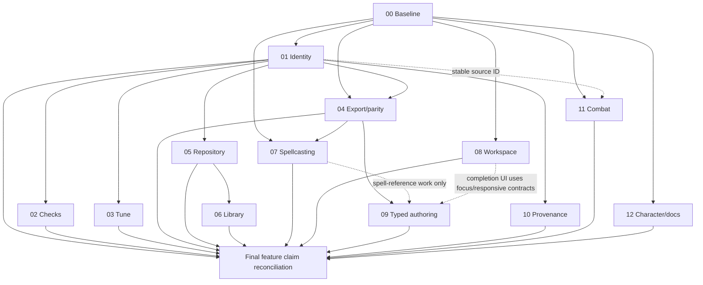

# DNDSheet Implementation Backlog

**Role:** Trackable work queue derived from [the authoritative Product and Architecture Specification](DNDSheet-Professional-Product-and-Architecture-Spec.md). This file owns task IDs, order, dependencies, status, estimates and closure evidence; it does not redefine product contracts.

**Baseline:** 2026-10-29; `F:\AI_Resources\DNDSheet`, branch `statblock-overhaul`, revision `be0cf3f`. **Worktree overlay to preserve:** modified `src/components/rendering/useProcessTokens.ts`; untracked `src/components/rendering/plate.ts`. No app, build or tests were run for this documentation turn. Screenshot reproduction is open. This roadmap has 13 delivery loops; the two newly assigned packages WP-11 and WP-12 are additional scope beyond WP-00–WP-10, not replacements for existing package IDs.

## Use and status rules

- Begin each loop using [Development Handoffs](DNDSheet-Development-Handoffs.md), then execute its task IDs in order.
- `[x]` means done with evidence at a named revision; `[ ]` pending; `[~]` in progress; `[-]` deliberately deferred. “Planned” or “source file exists” is not done.
- Every task records phase (0 setup, 1 foundation, 2 core, 3 integration, 4 polish), sequential/parallel status, dependency, expected files, and acceptance criteria. Estimates are engineer-days for one engineer; loop forecasts include integration/verification at the owning seam. `SEQ` is default; mark `[P]` only after confirming no file/state/output conflict.
- Estimates are forecasts, not calendar promises. Re-estimate after Loop 00; do not sum overlapping file estimates.
- If source evidence changes a requirement, update the spec first, then this backlog and handoffs.

| Loop | Work package / theme | User value | Dependencies | Forecast (engineer-days) |
|---|---|---|---|---:|
| 00 | WP-00 evidence and screenshot baseline | Know which defect exists in which runtime and record | none | 2–4 engineer-days |
| 01 | WP-01 document identity/revision | Safe references and stale-result handling | 00 | 5–10 engineer-days |
| 02 | WP-02 checks/repair | Reach and safely repair structural issues | 01 | 5–10 engineer-days |
| 03 | WP-03 CR tuning | Reversible mechanical exploration | 01 | 3–7 engineer-days |
| 04 | WP-06 export + F-04 semantic parity proof | Same ability meaning across outputs | 00, 01 | 5–10 engineer-days |
| 05 | WP-04 persistence/recovery | Truthful durable save and recovery | 01 | 8–15 engineer-days |
| 06 | WP-05 local library | Find and reuse separate records | 05 | 3–6 engineer-days |
| 07 | WP-11 spellcasting accuracy/projection | Trust counts, class/subclass options and output | 00, 04 | 4–9 engineer-days |
| 08 | WP-09 workspace; F-01/F-03/F-12/F-13 toolbar, visual/accessibility | Readable, operable workflows at supported widths | 00 | 7–13 engineer-days |
| 09 | WP-12 F-04 typed references/effect grammar | Dynamic authoring without a giant menu or brittle prose | 04 and 07; 08 for accessible completion UI | 8–16 engineer-days |
| 10 | WP-07 rules provenance | No false edition/conversion claims | 01 | 2–4 engineer-days |
| 11 | WP-08 combat identity/snapshot | Table use without source-sheet side effects | 00, 01 where IDs apply | 2–5 engineer-days |
| 12 | WP-10 character boundary/final docs | Accurate capability claims | 00; final feature matrix after applicable release evidence | 2–5 engineer-days |

## Loop 00 — Baseline, preserve renderer work, reproduce screenshots (WP-00)

**Exit:** Exact app/runtime and fixture evidence recorded; no component fix is assigned from a screenshot alone.

| ID / status | Phase, mode, dependencies | Action; likely files | Acceptance |
|---|---|---|---|
| TASK-001 `[x]` | 0, SEQ; none | Capture status/HEAD. Evidence: repository status, plan §§2/29.1. | Branch, `be0cf3f`, modified `useProcessTokens.ts` and untracked `plate.ts` recorded; no source modified. |
| TASK-002 `[~]` | 0, SEQ; 001 | Preserve and record prior read-only renderer audit. Files: the two renderer paths; plan §2.1 E-14. | Changes kept intact and effects documented. Review current ownership/full diff before any related edit; ownership remains unconfirmed. |
| TASK-003 `[ ]` | 0, SEQ; 002 | Run baseline app/build/test under documented project workflow. Files: `package.json`, `README.md`, `STACK_STATE.md`; proposed evidence record. | Exact commands/environment/result and limitations recorded; historical pass claims not treated as current proof. |
| TASK-004 `[ ]` | 0, SEQ; 003 | Reproduce skill grouping/Insight display. Files: `skill-action-groups.ts`, `useTextRenderer.ts`, `WebRenderer.vue`, `SkillsEditor.vue`, `test/core/SkillActionGroups.test.ts`. | Capture exact record/key/ID/flags/source revision; identify data, grouping, projection, stale runtime or screenshot mismatch. |
| TASK-005 `[ ]` | 0, SEQ; 003 | Reproduce Soul Barrage and Veil of Radiance as separate entries. Files: `ActionsEditor.vue`, `MonsterTextEditor.vue`, `useTextRenderer.ts`, `useProcessTokens.ts`, `WebRenderer.vue`, adapters. | Fixture captures ID, role, structured fields, prose, mode, revision and expected output; never presume screenshots depict one record. |
| TASK-006 `[ ]` | 0, SEQ; 004–005 | Close baseline packet and revise assumptions. Files: plan §§2,24,29–31; proposed `docs/spec/verification-baseline.md`. | Record viewport/theme, data, runtime, outcomes, WIP and unknowns; WP-01 is Ready only after review. |

## Loop 01 — Identity and revision boundary (WP-01)

**Exit:** Existing editing remains usable; identity/revision semantics are settled without a repository cutover.

| ID / status | Phase, mode, dependencies | Action; likely files | Acceptance |
|---|---|---|---|
| TASK-007 `[ ]` | 1, SEQ; 006 | Decide ID/envelope/version/provenance/presentation ownership. Files: `core/domain/types.ts`, `components/models.ts`, `MigrateMonsterSchema.ts`; plan §26.4. | Distinguish `MonsterDocumentId`, `envelopeVersion`, legacy `saveVersion`, monotonic `contentRevision`; schema bump only if serialization requires. |
| TASK-008 `[ ]` | 1, SEQ; 007 | Wrap current Monster store in document session adapter. Files: proposed `MonsterDocument.ts`, `monster-store.ts`, application/session boundary. | Identity/revision exposed without requiring all 21 panels or pure core functions to change signatures. |
| TASK-009 `[ ]` | 1, SEQ; 008 | Define semantic edit/undo/redo and stale-result boundaries. Files: history composable/ledger and store; verify actual path. | Accepted edit/undo/redo increments revision; presentation-only does not; subscription does not duplicate snapshots. Preserve current debounce/cap until justified. |
| TASK-010 `[ ]` | 1, SEQ; 007 | Reconcile duplicate UI/core model imports. Files: `types.ts`, `components/models.ts`, audited callers. | One canonical type owner with narrow compatibility exports; no mass rename. |
| TASK-011 `[ ]` | 4, SEQ; 008–010 | Add identity/revision/migration coverage. Files: `test/core/MigrateMonsterSchema.test.ts`, `HistoryLedger.test.ts`, new session tests. | Same-name records distinct; migration preserves source; undo revisions monotonic; stale apply rejected. |

## Loop 02 — Checks, focus navigation, safe repair (WP-02)

**Exit:** An actionable issue targets a real field; repairs preview, apply once, undo and recheck current revision.

| ID / status | Phase, mode, dependencies | Action; likely files | Acceptance |
|---|---|---|---|
| TASK-012 `[ ]` | 0–1, SEQ; 011 | Inventory lint IDs, fixable flags and concrete operations. Files: `LintMonster.ts`, `MonsterLintDialog.vue`, `CrFooter.vue`, `LintMonster.test.ts`. | Every issue maps to severity/entity/field/op; reconcile current mismatch where dialog applies only multiattack repairs. |
| TASK-013 `[ ]` | 2, SEQ; 012 | Create issue-target registry. Files: proposed registry, `MonsterBuilder.vue`, only needed editor panels. | Stable entity ID + field path resolves to mounted control or explicit no-target reason; focus and scroll work. |
| TASK-014 `[ ]` | 2, SEQ; 013 | Define Checks loading/current/stale/empty/error/non-fixable states and copy. Files: dialog/footer/copy catalogue. | No false promise that all flagged issues can be auto-fixed; error retains last result marked stale. |
| TASK-015 `[ ]` | 2–3, SEQ; 012–014 | Add preview/apply for safe repair operations. Files: use case/application operation/history. | Base revision/precondition validated; cancel does not mutate; one repair is one undo entry; unsupported fix stays informational. |
| TASK-016 `[ ]` | 3–4, SEQ; 015 | Integrate recheck and export policy. Files: Checks and export entry point. | Recheck binds new revision; stale action blocked; only explicit structural target-invalid cases block export, with override/recovery behavior. |

## Loop 03 — CR breakdown and preview-first tuner (WP-03)

**Exit:** Preview is dialog-local and revision-bound; cancel is inert; selected apply is one undoable transaction.

| ID / status | Phase, mode, dependencies | Action; likely files | Acceptance |
|---|---|---|---|
| TASK-017 `[ ]` | 0–1, SEQ; 011 | Inventory recommendation-to-field mapping and calculation assumptions. Files: `AutoTuneCr.ts`, `AutoTuneDialog.vue`, `AutoTuneCr.test.ts`. | Every recommendation explains target field; inspect attack-bonus behavior; do not duplicate/alter math without evidence. |
| TASK-018 `[ ]` | 2, SEQ; 017 | Add transient tune session and selected patch. Files: dialog/view model/application boundary. | Preview mutates no Monster data; affected fields and estimate are visible. |
| TASK-019 `[ ]` | 2–3, SEQ; 008,018 | Add before/after preview and stale state. Files: dialog; renderer preview only if needed. | `baseRevision` checked; changed document requires refresh; no balance guarantee. |
| TASK-020 `[ ]` | 3–4, SEQ; 009,019 | Apply selected patch as one reversible operation. Files: tune command, store/session/history. | Only shown fields change; one undo restores; redo reapplies; cancel leaves content revision unchanged. |

## Loop 04 — Export parity and semantic projection proof (WP-06; F-04 foundation)

**Exit:** One authored record has a stable semantic interpretation across preview/print/claimed export targets; preserve plate work.

| ID / status | Phase, mode, dependencies | Action; likely files | Acceptance |
|---|---|---|---|
| TASK-021 `[ ]` | 0, SEQ; 006,011 | Inventory export paths/capabilities. Files: `DownloadButton.vue` (verify path), `ExportStatblock.ts`, renderer adapters. | Record target, source, transforms, omissions, MIME, filename and fixture coverage. |
| TASK-022 `[ ]` | 1–2, SEQ; 021 | Define target capability/result contract. Files: export use case/UI and proposed DTO. | Each target reports supported fields, transforms, omissions, source revision and failure; no silent substitute. |
| TASK-023 `[ ]` | 1, SEQ; 005,021 | Add stable complex-action fixtures. Files: `ExportStatblock.test.ts`, `ProcessTokens.test.ts`, new projection fixtures. | Soul Barrage and Veil examples separate; role, structured effect, prose, order, tokens and sanitation asserted. |
| TASK-024 `[ ]` | 1–2, SEQ; 023 | Prototype read-only adapter for one attack and one save/effect entry. Files: core types/UI models, `ActionsEditor.vue`, `AttackPanel.vue`, renderer. | Stable ID/order/raw text/unknown fields preserved; no stored-schema migration. |
| TASK-025 `[ ]` | 2–4, SEQ; 022–024 | Correct earliest demonstrated defect and ship bounded export parity. Files: only proven faulty layer; plate paths require diff review. | Fixture and live UI agree on same revision; no source mutation; focused verification recorded. |

## Loop 05 — Durable repository and recovery (WP-04)

**Exit:** One session-selected backend per record; `Saved` means a confirmed write; failure retains draft and offers recovery.

| ID / status | Phase, mode, dependencies | Action; likely files | Acceptance |
|---|---|---|---|
| TASK-026 `[ ]` | 0, SEQ; 011 | Inventory Pinia persistence, LocalStorage prefix, IndexedDB and writers. Files: stores, `StoragePort.ts`, adapters, all discovered callers. | Source list, versions, writer and callsite table; no hidden adapter construction assumed. |
| TASK-027 `[ ]` | 1, SEQ; 026 | Decide backend selection, migration, conflict, quota, rollback. Files: ADR proposed; ports/adapters. | Select backend at startup; failures never silently switch writer; source remains until verified migration/cleanup. |
| TASK-028 `[ ]` | 2–3, SEQ; 008,027 | Wire document repository and truthful save status. Files: port/adapters, composition root, store/session, status UI. | Save binds ID+revision; only committed write says Saved; failed write keeps draft, retry/recovery; UI never instantiates adapter. |
| TASK-029 `[ ]` | 3, SEQ; 028 | Migrate current data source-by-source. Files: migration/import/backup adapters and fixtures. | Enumerate, validate, copy, verify IDs/counts/content hashes; preserve source on error. |
| TASK-030 `[ ]` | 3–4, SEQ; 029 | Implement backup, restore, failed-write recovery. Files: services/dialogs/copy. | Full prevalidation, duplicate-ID policy, atomic commit and unsaved-draft recovery. |
| TASK-031 `[ ]` | 4, SEQ; 030 | Verify browser persistence failure modes. Files: integration tests/evidence. | Write/reopen, quota, blocked upgrade, corruption, interrupted migration and multi-tab policy recorded for supported browsers. |

## Loop 06 — Local creature library (WP-05)

**Exit:** All operations use immutable IDs; same-name records stay distinct; deletion/replacement is recoverable.

| ID / status | Phase, mode, dependencies | Action; likely files | Acceptance |
|---|---|---|---|
| TASK-032 `[ ]` | 1–2, SEQ; 028 | Define summary/index/query model. Files: repository, library view model. | Search/sort/filter/recency do not identify by name or needlessly render all full documents. |
| TASK-033 `[ ]` | 2–3, SEQ; 032 | Build open/create/duplicate/rename. Files: drawer/route, repository, dirty guard. | Rename keeps ID; duplicate creates ID; dirty switch offers save/discard/cancel; stale writer cannot overwrite another record. |
| TASK-034 `[ ]` | 2–3, SEQ; 027,032 | Implement delete/archive and recovery policy. Files: repository/library/backup. | Named affected record, explicit recovery period/path; no silent permanent deletion. |
| TASK-035 `[ ]` | 4, SEQ; 033–034 | Close empty/loading/error/large-list/accessibility states. Files: library components and responsive behavior. | Keyboard/narrow states verified; multiple same-name fixture stays distinct. |

## Loop 07 — Spellcasting data truth and projection (WP-11; F-14)

**Exit:** Metrics failure is explicit; selected/allowed/granted/remaining are distinct; source coverage and output parity are honest.

| ID / status | Phase, mode, dependencies | Action; likely files | Acceptance |
|---|---|---|---|
| TASK-036 `[ ]` | 0–1, SEQ; 006,023 | Audit class/subclass/spell data coverage and provenance/rights. Files: `ClassCastingEditor.vue`, `useSpellLevels.ts`, spell data, `AutoSyncSpellcasting.ts`, license sources. | Coverage report; do not claim complete/official without evidence and redistribution permission. |
| TASK-037 `[ ]` | 2, SEQ; 036 | Replace plausible metrics fallback with explicit error/unavailable result. Files: `ClassCastingEditor.vue`, metric use case, `AutoSyncSpellcasting.test.ts`. | Error cannot display default 3/4/1 as valid; successful existing calculations preserved. |
| TASK-038 `[ ]` | 1–2, SEQ; 036 | Model selected/allowed/granted/remaining metrics and provenance. Files: spell types/view model/component/tests. | Every count defines source; overrides are labeled; granted spell allowance behavior explicit. |
| TASK-039 `[ ]` | 2–3, SEQ; 036,038 | Use subclass-aware candidates where curated data supports it. Files: class editor, spell candidate/data service, `SearchableSpellSelect.vue` if callsite verified. | Level/class/subclass/source filtering; custom entries remain usable and visibly custom. |
| TASK-040 `[ ]` | 2–3, SEQ; 038,039 | Build compact spellcasting view model and renderer. Files: `SpellcastingEditor.vue`, `ClassCastingEditor.vue`, `useTextRenderer.ts`, `WebRenderer.vue`, `statblock-grammar.scss`. | Summary/count/level rows align; deterministic wrap/print; trait placement retained; Long Rest retained. |
| TASK-041 `[ ]` | 4, SEQ; 040 | Define duplicate/cadence semantics and fixtures. Files: spellcasting tests/projections. | Repetition policy explicit; per-spell/per-level cadence consistent; no silent dedupe. |

## Loop 08 — Navigable, readable and accessible workspace (WP-09; F-01/F-03/F-12/F-13)

**Exit:** Supported widths/zoom/long content remain readable and operable; color/hover never carries required meaning alone.

| ID / status | Phase, mode, dependencies | Action; likely files | Acceptance |
|---|---|---|---|
| TASK-042 `[ ]` | 1, SEQ; 006 | Define semantic visual tokens/cell grammar. Files: `statblock-grammar.scss`, `app.scss`, Quasar variables, `WebRenderer.vue`; plate only after diff review. | Panel/header/cell/label/value/status/focus/advantage grammar and theme mapping documented. |
| TASK-043 `[ ]` | 2, SEQ; 042 | Audit and fix overflow by shared pattern. Files: builder, proven-affected components/widgets, renderer/styles. | Viewport/zoom/long-text matrix has no clipping/overlap; no unrelated cleanup. |
| TASK-044 `[ ]` | 2, SEQ; 042 | Audit labels, accessible names, tooltips and contextual help. Files: affected editors/widgets/shell. | Concise visible labels; icon accessible names; help works on focus/touch; no mass tooltips or hover-only errors. |
| TASK-045 `[ ]` | 2–3, SEQ; 043 | Add section navigator and keyboard focus targets. Files: `MonsterBuilder.vue`, section registry and panel headings. | Order matches panels; each section can be reached and focused; collapsing/scrolling cannot hide the current section. Issue-to-field targeting remains owned by WP-02 TASK-013. |
| TASK-046 `[ ]` | 3–4, SEQ; 043–045 | Add narrow Editor/Preview mode and usability evidence. Files: builder/layout/styles. | Wide split, narrow switch, 200% zoom, keyboard, touch, screen-reader spot checks and print reviewed. |
| TASK-047 `[ ]` | 2, SEQ; 006,044 | Reorganize shell toolbar into primary and contextual groups. Files: `MainLayout.vue`, action menus, responsive styles. | Create/Open, status, Checks and Export are findable; appearance controls remain contextual; keyboard order and narrow layout are verified. |
| TASK-048 `[ ]` | 3–4, SEQ; 042,046 | Add Screen/Ink saver/Art plate presets over current presentation controls. Files: `editor-store.ts`, `A4LayerStudio.vue`, `WebRenderer.vue`, print styles. | Preset change leaves Monster semantics unchanged; reset and missing-art fallback work; screen/print scale and content remain readable. |

## Loop 09 — Typed references, inline completion and ability grammar (WP-12; F-04 evolution)

**Exit:** A measured field family gains safe references/completion; manual values/prose and legacy inputs still work.

| ID / status | Phase, mode, dependencies | Action; likely files | Acceptance |
|---|---|---|---|
| TASK-049 `[ ]` | 0–1, SEQ; 024,036 | Inventory number/token fields by semantic type/unit/scope. Files: domain types, editors, `formula.ts`, `useProcessTokens.ts`, `DynamicReferenceSelect.vue`. | Classify scalar/override/derived/dice/reference/formula/imported text and expected type; do not default every integer to a dropdown. |
| TASK-050 `[ ]` | 1, SEQ; 049 | Decide grammar and alternatives. Files: plan decision record, proposed language contract. | Precedence, types, units, scope, serialization, invalid/stale/unknown semantics; arbitrary JS/eval excluded. |
| TASK-051 `[ ]` | 1–2, SEQ; 050 | Build typed catalog for one high-value field family. Files: proposed catalog and one editor family. | Stable IDs, filtered suggestions, provenance; literal remains first class; formula only in supported fields. |
| TASK-052 `[ ]` | 2, SEQ; 051 | Implement pure evaluator/dependency diagnostics. Files: core evaluator and tests. | Deterministic; cycle/missing/type/unit errors visible; never substitute zero; revision-bound results. |
| TASK-053 `[ ]` | 2–3, SEQ; 051–052, 044, 046 | Add caret completion and accessible preview. Files: `MonsterTextEditor.vue` and editor bridge. | Insert at caret, keyboard accept/dismiss, context filtering, accessible announcement, prose editing preserved; uses Loop 08 focus/label/responsive contracts. |
| TASK-054 `[ ]` | 3–4, SEQ; 024,053 | Prove role/ability legacy round-trip before broader migration. Files: adapters/import/export/schema only if needed. | Role-specific triggers/cost/order/IDs/unknown fields preserved; structured edits cannot overwrite prose; no schema bump without decision. |

## Loop 10 — Rules provenance and presentation separation (WP-07)

| ID / status | Phase, mode, dependencies | Action; likely files | Acceptance |
|---|---|---|---|
| TASK-055 `[ ]` | 1, SEQ; 007 | Define explicit/imported/inferred/unknown rules provenance. Files: domain/import/settings and decision record. | No unsupported conversion claim; custom and unknown remain distinct. |
| TASK-056 `[ ]` | 2–4, SEQ; 055 | Surface provenance and test style independence. Files: settings, migration only if needed, export report. | Legacy stays unknown; theme leaves mechanics unchanged; export names only supported provenance. |

## Loop 11 — Combat identity and encounter snapshots (WP-08)

| ID / status | Phase, mode, dependencies | Action; likely files | Acceptance |
|---|---|---|---|
| TASK-057 `[ ]` | 1, SEQ; 006,007 | Define stable combatant ID and active-index migration. Files: `CombatTracker.ts`, `combat-store.ts`, domain/migration fixtures. | Deterministic legacy mapping and active-actor removal policy. |
| TASK-058 `[ ]` | 2–3, SEQ; 057 | Snapshot authored statblock at encounter add. Files: combat store/usecase/drawer/persistence. | Combat damage/conditions never mutate source; deleted source does not disable snapshot play. |
| TASK-059 `[ ]` | 4, SEQ; 058 | Verify sort/remove/turn/reload behavior. Files: `test/core/CombatTracker.test.ts` and UI scenarios. | Tie/reorder/remove active actor/advance/reload cases match declared semantics. |

## Loop 12 — Character contract and final release documentation (WP-10)

| ID / status | Phase, mode, dependencies | Action; likely files | Acceptance |
|---|---|---|---|
| TASK-060 `[ ]` | 1, SEQ; 006 | Decide reference-only scope or required inputs for derived values. Files: character types/store/editor/sheet. | Character claims bounded; AC/speed source requirements explicit. |
| TASK-061 `[ ]` | 2–3, SEQ; 060 | Add value provenance or truthful unset/assumption state. Files: character domain/store/sheet/editor. | No fabricated values; manual/import overrides are visible and reversible. |
| TASK-062 `[ ]` | 4, SEQ; 003, 016, 020, 025, 031, 035, 041, 046, 047–048, 054, 056, 059, 061 | Refresh README/STACK_STATE/feature matrix for verified behavior. Files: `README.md`, `STACK_STATE.md`, release record/changelog. | Claims match exact released revision; limitations, local data, spell/action behavior, accessibility, and exports match evidence; unshipped features remain labeled planned. |

## Dependency lattice

### Release cut lines

- **R0 Evidence:** Loop 00.
- **R1 Creator confidence:** Loops 01–03. Checks/tuning do not wait for library.
- **R2 Portable output:** Loop 04; may ship before repository cutover if local export is complete.
- **R3 Keep/reuse:** Loops 05–06.
- **R4 Trustworthy authoring and presentation:** Loops 07–09; each feature closes its F-14/F-01/F-03/F-12/F-13/F-04 criteria.
- **R5 Honest breadth:** Loops 10–12; character work may begin after baseline, while final documentation waits for applicable completed feature evidence.

**Whole roadmap forecast:** 56–114 engineer-days (sum of the 13 loop forecasts), roughly 11–23 five-day focused engineering weeks for one engineer, excluding product-decision and release-operation delays. Re-estimate each loop after its entry evidence; overlapping file-count estimates are not additive. The plan §24.1 carries the same estimate range. R1 (Loops 01–03) is 13–27 engineer-days after R0.

At every loop close, record revision, actual files, evidence, defects deferred, rollback point and next-loop readiness. No incomplete item is silently rolled forward. For loop preparation and closure requirements, use [Development Handoffs](DNDSheet-Development-Handoffs.md).

