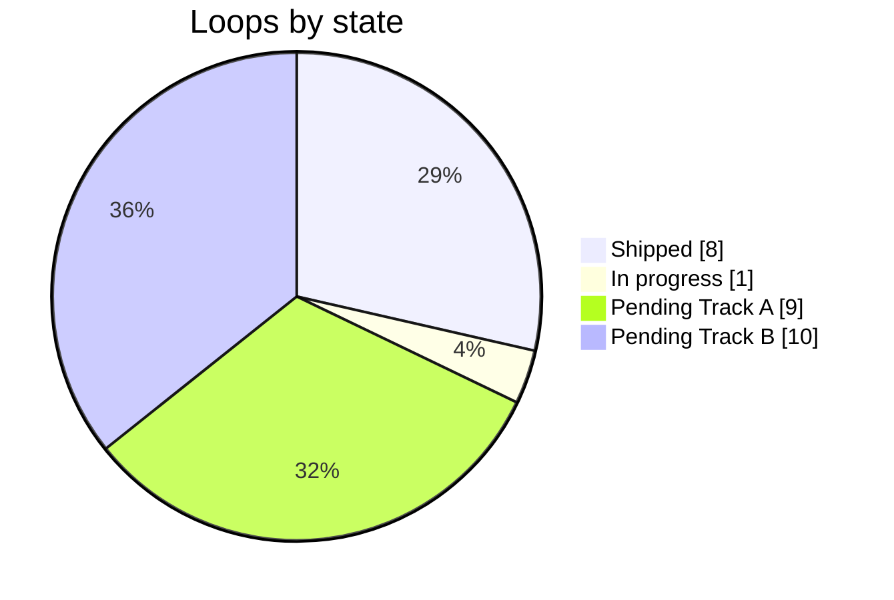

# DNDSheet — Implementation Backlog

> **The checklist and the living timeline.** Every loop of the [Product & Architecture Specification](DNDSheet-Professional-Product-and-Architecture-Spec.md) broken into tasks you can tick, in the order they should ship, with the commit that proves each one. Preparation and closing rituals live in the [Development Handoffs](DNDSheet-Development-Handoffs.md).

| | |
|---|---|
| **Version** | v2.4.3 build 149 · 2026-10-30 · A8 opened with composer polish · `rc-2.4.3-build-149-a8-plate-word-order` |
| **Code HEAD** | `0dbcd23` head chips follow the plate word order; two-item lists read "a and b" · A7 closed at `49edfdf` (build 148) · archives 148/147/146/145/144/143/142/139 retained · 234 core tests, production build, focused lint (0 errors), 41 browser steps and theme checks pass |
| **Progress** | **8 / 28 loops shipped** · **72 / 204 tasks done** (35.29 %) · **0 active** · **132 pending** · A8 ◐ |
| **Now** | A8 ◐ build 149: A8.10 (head chips in plate word order) and A8.12 (two-item list grammar) shipped. Candidate 149 is served on 9100 over the configured Seraphic Herald sample and on 9106. |
| **Next** | A8.0 capability matrix (confirm and tick A8.1/A8.4), then A8.9 usage editor and A8.11 classic prose parity before any panel retirement. |

---

## 0. How to use this backlog

📍 *Backlog › 0 Usage* — **Tick a box only when its proof exists; add a task the moment a blindspot turns into work.**

| Symbol | Meaning |
|:--:|---|
| `[x]` | Done — proof recorded (test, probe, screenshot or commit) |
| `[ ]` | Pending |
| `[~]` | In progress (only one loop at a time) |
| `[-]` | Dropped or deferred — reason in the line |
| ✅ ◐ ☐ ⛔ | Loop shipped · in progress · pending · blocked |
| **S / M / L** | Size: S < 1 h · M 1–3 h · L 3–6 h of focused work |

**Rules**
1. Task ids are stable (`A4.3`); never renumber — append (`A4.3b`) when a task splits.
2. A task lists its **target files** and its **proof**; the loop lists its **Done when** in requirement ids from the spec (§14).
3. When a loop closes: tick its tasks, update §1 dashboard and §2 timeline, paste the commit hash in the loop header, and append new tasks discovered during the loop to the right future loop (marked *added A4*).
4. If a fact contradicts the spec, fix the spec first (Handoffs §1.4).

---

## 1. Dashboard

📍 *Backlog › 1 Dashboard* — **Where the overhaul stands, release by release.**

| Release | Loops | Tasks done / total | Status |
|---|---|---:|:--:|
| R1 · Reads right | A0 ✅ · A1 ✅ · A2 ✅ · A3 ✅ · A4 ✅ · A5 ✅ | 49 / 49 | ✅ |
| R2 · Composes like sentences | A6 ✅ · A7 ✅ · A8 ◐ | 22 / 33 | ◐ |
| R3 · Numbers know their source | A9 · A10 · A11 | 0 / 27 | ☐ |
| R4 · Spellcasting you can trust | A12 | 0 / 8 | ☐ |
| R5 · Explains itself | A13 · A14 · A15 · A16 | 1 / 29 | ☐ |
| R6 · Overhaul release | A17 | 0 / 9 | ☐ |
| R7 · Creator confidence | B1 · B2 · B3 | 0 / 15 | ☐ |
| R8 · Portable output | B4 | 0 / 10 | ☐ |
| R9 · Keep and reuse | B5 · B6 | 0 / 10 | ☐ |
| R10 · Honest breadth | B7 · B8 · B9 · B10 | 0 / 14 | ☐ |
| **Total** | **28 loops** (Track A 154 tasks · Track B 50) | **72 / 204 complete · 0 active · 132 pending** | **35.29 % complete · 64.71 % remaining** |



### 1.1 Defects and blindspots by closing loop

| Loop | Closes defects | Verifies blindspots |
|---|---|---|
| A4 | DEF-01, DEF-02, DEF-03 (data), DEF-04, DEF-15, DEF-16, DEF-17 | BS-04, BS-05, BS-08, BS-17, BS-18 |
| A5 | — | BS-12, BS-14, BS-19, BS-20 |
| A6 | DEF-05 | BS-06, BS-09, BS-10, BS-22, BS-23 |
| A7 ✅ | DEF-12, DEF-19…DEF-25 | BS-39 stays open for A8 (range pairs); BS-40 and BS-41 identified |
| A8 | DEF-08 | BS-26, BS-27 |
| A9 | DEF-09 | BS-06, BS-16, BS-24, BS-25 |
| A10 | — | BS-21, BS-28 |
| A12 | DEF-03 (ruleset), DEF-06, DEF-07 | BS-07, BS-29, BS-30 |
| A13–A16 | DEF-10, DEF-11 | BS-31…BS-35, BS-40 |
| A17 | DEF-13, DEF-14 | BS-03, BS-15, BS-36, BS-37 |
| B1 | — | BS-38 |
| B4 | — | BS-11, BS-13, BS-41 |

---

## 2. Living timeline

📍 *Backlog › 2 Timeline* — **The code's diary: every commit that moved the product, newest last.**

| Date · time | Commit | Loop | What changed for the user | Proof |
|---|---|---|---|---|
| 2026-10-29 06:36 | `52355c2` | A0 | Local working tree frozen before the overhaul (135 files) | git |
| 2026-10-29 07:09 | `574f196` | A1 | Search · Study · Influence · Hide rows; no duplicate Skills row; whole-label ▲▲/▼▼ colour; editor group cards | 10 tests; browser rows |
| 2026-10-29 07:18 | `be0cf3f` | A2 | Formula engine: references, custom formulas, `{…}` macros anywhere; `Function` eval removed | 19 tests; browser probes |
| 2026-10-29 12:42 | — | — | Owner: absorb the v1 plan, rewrite spec/backlog/handoffs to professional depth | message |
| 2026-10-29 12:53 | `c543615` | A3 | Traits/actions/attacks/reactions/legendary as framed plates; theme palettes | 5 tests; theme probe |
| 2026-10-29 13:02 | `b83ee56` | docs | v1 documents versioned in `docs/roadmap/` | git |
| 2026-10-29 | `4c6c1cb` | docs | v2 documents: spec bible, this backlog, handoffs; 32 / 32 Mermaid diagrams parse (Mermaid 11.4.1); ids and tables cross-checked | doc check + consistency script |
| 2026-10-29 | `f35cd6d` | A4 | Class and innate spellcasting plates use shared visual grammar, edition-aware metamagic and cadence catalogs | 111 core tests; build; focused browser smoke across 5 themes |
| 2026-10-29 | `8487335` | A5 | AC/HP/Speed and related rows share the plate grammar; recharge help is accurate; A4 printing no longer emits a blank second page | 115 core tests; production build 135; focused 12-theme contrast/screenshots; 5-theme spell smoke; 33-scenario full UI; one-page A4 PDF |
| 2026-10-29 | `71a8c21` | A6 | Optional action targeting/outcome data, conservative inference, modern plate projection and opt-in 2024-style text export; sample monster data unchanged | Core 124/124; build 136; exhaustive UI 33/33 steps; 0 runtime exceptions |
| 2026-10-29 | `df95179` | A7 · partial build 137 | Added 9 catalog-backed action templates, grouped picker, explicit replacement confirmation, cancel/apply semantics and removed duplicate hard-coded preset/composer routes; configured sample data unchanged | Core 129/129; production build; exhaustive UI 33/33 including Step 32 cancel/apply; 0 runtime exceptions; focused lint 0 errors |
| 2026-10-29 | `761b41a` | A7 · partial build 138 | Deep-cloned nested template values per application; edits to one action cannot mutate the shared catalog or another action | Core 130/130 including catalog isolation regression; production build; exhaustive UI 33/33; 0 runtime exceptions |
| 2026-10-29 | `10f7aa0` | A7 · partial build 146 | Replace destructive role conversion with reviewed compatible moves and explicit cross-model copies. Preserve source fields/references, isolate copy uses/CR, exclude copies from CR; clear mythic links on deletion. | 216 core tests (+51), all 49 role pairs, production build, zero lint errors, full 39-step browser suite (+1), five/twelve-theme smoke; 7 files +240/−97 |
| 2026-10-29 | `d70cc01` | A7 · partial build 145 | Lair projection and exact preview; typed legendary/mythic/lair section drafts; initiative-aware default preamble; mobile pane stacking. A7.3 completed; matrix remains active. | 165 core tests; production build; zero lint errors; 38 browser steps, zero errors; 5-theme spellcasting; 12-theme help; 98-file sealed archive |
| 2026-10-29 | `7f2e572` | A7 · partial build 144 | Added typed trait cadence/display policy and renderer preview as sixth role; fixed live heading spaces and narrow popup fit; kept existing schema/data and archives. Audited checklist states: 67 done, 2 active, 124 pending. | Core 159/159; production build; changed-file lint; browser steps 1–37 with zero console errors/runtime exceptions; five-theme spellcasting and twelve-theme help/contrast |
| 2026-10-29 | `77a18c5` | A7 · partial build 143 | Added a distinct typed reaction projection/patch adapter and editable trigger/usage cells with shared sanitized renderer preview; preserved reaction storage model/collection, configured sample data, and build 142/139 archives. Trait/lair adapters, complete headers, role-wide matrix, and A7 closeout remain open. | Core 152/152; production build; changed-file lint passes; exhaustive browser steps 1–36; spellcasting five themes; help/contrast twelve themes; 0 browser runtime exceptions |
| 2026-10-29 | `54d933e` | A7 · partial build 142 | Added typed chain projection/patches, editable cells and outcomes, action-family editor integration, and preview via existing renderer for action, bonus, legendary, and mythic entries. Trait/reaction/lair adapters and role headers remain open. Build 139 remains preserved. | Core 149/149; production build; focused lint 0 errors/5 warnings; exhaustive browser steps 34–35; spellcasting five themes; help/contrast twelve themes; 0 browser runtime exceptions |
| 2026-10-29 | `98bb899` | A7 · partial build 139 | Added `ROLE_CHAINS` data for action, bonus, trait, reaction, legendary, mythic, and lair roles; descriptors represent structured and legacy fields and encode head → mechanics → scope → outcomes → prose order. No editor UI or preview behavior changed. | Core 133/133 including descriptor-contract tests; build succeeds; full 33-step browser sweep passes with 0 runtime exceptions |
| 2026-10-29 | `ae16b86` | A4 closeout | Hide generic class preamble already represented by the plate; preserve custom preamble; align e2e assertions to semantic badges and no redundant Skills row | Core 111/111; build; focused smoke; full e2e 23/23 groups, 0 runtime exceptions |
| 2026-10-29 | working tree at preserved checkpoint `a6c87e4` | A5 partial | Add shared top-row grammar, delegated help host and dictionary, recharge explanations, theme contrast coverage, and remove 11 repeated cascade style blocks | Core 115/115; production build; help browser smoke (12 themes); spellcasting browser smoke (5 themes); exhaustive e2e 33 scenario steps, 0 runtime exceptions (2026-10-29) |
| 2026-10-30 00:18 | `7f1e4ea` | A7 · build 147 | Opening a file keeps every authored field: the toolbar import runs the shared migration (alphaTraits fixed), pre-v9 upgrades keep existing stat/save/effects/range/uses/trigger, spellcasting policies and legacy language names survive; reaction chain reads usage → name like the plate | Core 222/222 (+6, red first); build; lint 0 errors; 40 browser steps incl. Step 40 (v8-labelled file through Open File, nothing lost, 14/14 seven-role parity, reload) and the Step 35 type matrix (56/56); help 12 themes; spellcasting 5 themes; 97-hash archive |
| 2026-10-30 00:39 | `49edfdf` | A7 ✅ · build 148 | Exports print every role as prose without web markup in either template; HP pills, plates and help hooks never reach a text file; LaTeX and Improved Initiative legendary/mythic keep their mechanics; Improved Initiative mythic crash, multiattack "undefined", repeated Multiattack label, misnested mythic lead and default mythic text fixed | Core 231/231 (+9); build; lint 0 errors; 41 browser steps incl. Step 41 export proof; help 12 themes; spellcasting 5 themes; 97-hash archive; promoted to 9100 (Seraphic Herald, storage hash unchanged) and 9106 |
| 2026-10-30 00:58 | `0dbcd23` | A8 · build 149 | Composer head chips follow the plate word order ("2nd Level Evocation", "Evocation Cantrip"); two-item lists read "a and b" in multiattack and extra-damage prose on the sheet and in every export | Core 234/234 (+3, red first); build; lint 0 errors; 41 browser steps, zero errors; help 12 themes; spellcasting 5 themes; 97-hash archive; promoted to 9100 (Seraphic Herald, storage hash unchanged) and 9106 |

### 2.1 A4 closing validation: tracked full-suite failures

The first post-A4 full run exposed three stale browser expectations and one real duplicate-preamble behavior. They are all closed at `ae16b86`; the passing rerun supersedes the earlier failing snapshot. Keep the exact contracts as regression coverage:

| E2E step | Observed failure | Owning backlog item | Exit evidence |
|---:|---|---|---|
| 18 | Old test searched for deprecated badge class names | A5.8 ✅ | Test queries `.dnd-adv` and `.dnd-disadv`; full UI suite passes |
| 20 | Old test searched old pill markup; assertion now targets Search row's semantic advantage wrapper and trailing glyph | A5.9 ✅ | Browser test confirms the check value is wrapped and glyph is present |
| 25 | Test required a separate Skills row although configured skills all belong to the four action groups | A15.7 ✅ | Test asserts grouped skills/tools and confirms no redundant Skills heading |
| 32 | Default spellcasting preamble duplicated the class plate's summary and spell list | A4.12 ✅ | Generic prose hidden in web plate; authored custom preamble retained; full e2e passes |

---

## 3. Now · Next · Later

| Now | Next (in order) | Later |
|---|---|---|
| A8 ◐ build 149: head chips in plate word order (A8.10) and two-item list grammar (A8.12) shipped on top of A7 ✅ | **A8.0** capability matrix (tick A8.1/A8.4 if covered) → A8.9 usage editor → A8.11 classic prose parity → panel retirement | A9…A17 (R3–R6), then Track B (R7–R10) |

---

## 4. Track A — Statblock & Authoring Overhaul

📍 *Backlog › 4 Track A* — **Eighteen loops; A0–A6 are done and A7 is actively shipping in bounded slices.**

### R1 · Reads right

#### A0 · Baseline snapshot ✅ `52355c2`

> Freeze the local tree so every later change is reviewable.

| Release | Feature | Depends on | Effort | Actual |
|---|---|---|---|---|
| R1 | QA-01 | — | — | 135 files, +41 791 / −2 884 |

- [x] **A0.1** Commit the untouched local working tree as `snapshot local working tree before statblock overhaul` · S · *proof: `52355c2`*
- [x] **A0.2** Dev server on port 9100 without auto-opening a browser (`DNDSHEET_NO_OPEN=1`; `quasar.config.js` `open` flag, shipped in A1) · S · *proof: `Get-NetTCPConnection -LocalPort 9100`*
- [x] **A0.3** Load the Seraph fixture into the built-in browser (`dnd-fixture-seraph.js`) · S · *proof: stat block renders "SERAPH…"*
- [x] **A0.4** Run the core suite as baseline · S · *proof: `npm test` green*

**Done when:** QA-001 baseline recorded. ✅

---

#### A1 · Check rows + whole-label advantage ✅ `574f196`

> Skills read as the actions that use them; advantage colours the whole label.

| Release | Feature | Depends on | Effort | Actual |
|---|---|---|---|---|
| R1 | SB-02 | A0 | — | 9 files, +868 / −486 |

- [x] **A1.1** `core/domain/skill-action-groups.ts`: catalog `SKILL_ACTION_GROUPS`, `computeSkillGroupLayout`, `mergeIdenticalEntries` · L · *proof: tests*
- [x] **A1.2** `test/core/SkillActionGroups.test.ts` (10 tests) · M
- [x] **A1.3** `components/rendering/advFormat.ts`: `numHtml`, `advHtml`, `condHtml`, `escapeHtml`, `htmlToText` · S
- [x] **A1.4** `useTextRenderer.ts`: saves/skills/tools/defenses with advantage; `actionPassivesGroups` rebuilt on the layout; exports via `htmlToText` · L
- [x] **A1.5** `WebRenderer.vue`: defense prose via `v-html`; group-title tooltips (`dnd-tip`) · S
- [x] **A1.6** `css/statblock-grammar.scss` created (advantage inks per theme, `.dnd-num`, `.q-tooltip.dnd-tip`), imported last in `app.scss` · S
- [x] **A1.7** `SkillsEditor.vue`: group cards from the catalog; economy inheritance; `q-btn-Group` typo fixed · M
- [x] **A1.8** `quasar.config.js`: `open: !process.env.DNDSHEET_NO_OPEN` · S
- [x] **A1.9** Browser verification: rows `Search ACTION 13/+3, (15, +5 Insight)` … no Skills row · S · *proof: probe output*

**Done when:** CHK-001…004, SBG-003 (rows) proven. ✅

---

#### A2 · Formula engine, references and text macros ✅ `be0cf3f`

> One small, safe language for every number.

| Release | Feature | Depends on | Effort | Actual |
|---|---|---|---|---|
| R1 | SB-03 | A0 | — | 8 files, +1 409 / −106 |

- [x] **A2.1** `core/domain/formula.ts`: parser, symbolic dice, styles, traces, suggestions, aliases, 11-group catalog · L
- [x] **A2.2** `test/core/Formula.test.ts` (18 tests) · M
- [x] **A2.3** `core/domain/formula-context.ts`: `formulaContextForMonster(monster, derived)` · S
- [x] **A2.4** `defense-and-traits-utils.ts`: `evaluateSafeFormula` on `evaluateFormula` (no `Function`), `formulaContextFromDynamic`, `formulaDisplayText` · M
- [x] **A2.5** `core/usecases/ProcessTokens.ts`: final `renderFormulaMacros` pass + test · S
- [x] **A2.6** `useProcessTokens.ts`: spell tokens in any context; unknown properties left verbatim (no "undefined") · S
- [x] **A2.7** `MonsterTextEditor.vue`: macro preview argument order fixed · S
- [x] **A2.8** Browser probes: `{CANTRIP_DICE d10}` → `16 (3d10)`, `{spellcasting.attack}` → `+7`, `{8 + PB + CHA_MOD}` → `15` · S

**Done when:** REF-001, REF-003…006 proven. ✅

---

#### A3 · Plate grammar for abilities ✅ `c543615`

> Every ability entry is one framed plate.

| Release | Feature | Depends on | Effort | Actual |
|---|---|---|---|---|
| R1 | SB-01 | A2 | — | 4 files, +494 / −186 |

- [x] **A3.1** `components/rendering/plate.ts`: `plateHtml`, rows/cells/body, `boldNumbers`, `phaseLabel`, stripe threshold · M
- [x] **A3.2** `useProcessTokens.ts`: `buildPlateEntry`, `usageText`, `ATTACK_REACH_LABEL`; trait/action/reaction/attack/multiattack/legendary modern branches · L
- [x] **A3.3** `statblock-grammar.scss`: tokens, `plate-palette` mixin for 12 selectable themes, plate/row/cell/body rules under `#render`, container step-back via `:has()` · M
- [x] **A3.4** `test/core/Plate.test.ts` (5 tests) · S
- [x] **A3.5** Browser: computed styles on WotC + 4 more themes; console clean after reload; lint fixes · S

**Done when:** SBG-001…005 proven (SBG-005 for 5 themes; all 12 selectable themes at A17). ✅

---

#### A4 · Spellcasting plate ✅ `f35cd6d`

> Spellcasting reads like one trait plate: who casts, DC and attack, slots and recovery, preparation, then one row per level.

| Release | Feature | Depends on | Effort | Forecast |
|---|---|---|---|---|
| R1 | SB-04 | A3 ✅ | 1 day | 12 files · +802 / −389 |

- [x] **A4.0** Baseline captured: build succeeds; full e2e reaches steps 1–17 then fails at 18, 20 and 25; failures tracked in A5.8/A5.9/A15.7 · M · *proof: closing packet*
- [x] **A4.1** Spell model fixtures cover pact/full casting, metamagic and innate casting · M · *proof: `test/core/SpellPlate.test.ts`*
- [x] **A4.2** Historical defects reproduced from baseline and closed: duplicate component parentheses, placeholder `x`, stripped connective, cadence/slot labels and ordinal spacing · S · *proof: focused browser smoke*
- [x] **A4.3** `core/domain/catalogs/metamagic.ts`: edition-specific 2014/2024 costs and effect text/source labels · S
- [x] **A4.4** `core/domain/catalogs/cadence.ts`: shared cadence and resource refresh options used by editor/rendering/text renderer · S
- [x] **A4.5** `core/domain/spell-plate.ts`: pure class spellcasting projection and row models · L
- [x] **A4.6** `buildInnateSpellPlate`: separate innate projection · M
- [x] **A4.7** Seven domain test cases cover slot progressions, components, cadence, edition-specific effects and absent values · M
- [x] **A4.8** `WebRenderer.vue`: typed computed model rendered with Vue text bindings; no new `v-html` spell plate path · M
- [x] **A4.9** `statblock-grammar.scss`, `app.scss` and `i18n/en-US/index.ts`: shared plate styles, component punctuation ownership and localized label · S
- [x] **A4.10** Focused browser smoke verifies class + innate plates in five themes; full e2e later passes 23 groups with 0 runtime exceptions · M
- [x] **A4.11** `npm test` 111/111; build passes; targeted lint has 0 errors (existing warnings remain); commit `f35cd6d` · S
- [x] **A4.12** Close browser-discovered duplicate generic preamble: show class preamble only when authored custom text is enabled; preserve custom text; include regression in focused smoke and full fuzz suite · M · *proof: `ae16b86`, Step 32, all 23 e2e groups pass*

**Done when:** SBG-006…009, SPELL-002 (render half), SPELL-005 (2024 costs) proven; DEF-01, DEF-02, DEF-04, DEF-15, DEF-16, DEF-17 closed; DEF-03 data fixed.

---

#### A5 · Row grammar for the top block + head tooltips ✅

> AC, HP, Speed, checks, senses, languages and defenses read as head-and-data rows, and every head explains itself.

| Release | Feature | Depends on | Effort | Forecast |
|---|---|---|---|---|
| R1 | SB-05 | A3 ✅ | 1–2 d | 5 files · +350 / −450 |

- [x] **A5.0** Initial dirty edits preserved; help-key escaping, structural row conversion, CSS consolidation, 12-theme computed contrast, print and BS-12/14/20 regression paths are verified. The historical before-migration screenshot baseline is absent; current final-state screenshots are recorded without claiming before/after pixel parity · M · *proof: core 115/115, production build, focused help/spell browser smokes, exhaustive 33 steps with 0 runtime exceptions*
- [x] **A5.1** `WebRenderer.vue`: convert AC, HP, Speed, saves, defenses, senses, action checks, languages and inventory to `sb-row / sb-cell / sb-head / sb-qual`; retain Vue templates/QTooltips without duplicate help semantics · M · *proof: focused help smoke + full e2e*
- [x] **A5.2** Consolidate shared cascade styling; remove 11 repeated theme-specific `.dnd-cascade-panel` blocks from `app.scss` (15 → 4 matching blocks) · M · *proof: build + theme browser probe*
- [x] **A5.3** Delegated help host supports pointer/focus, Escape, ARIA, viewport clamp, scroll/resize and detach/unmount cleanup · M · *proof: `npm run test:e2e:help`*
- [x] **A5.4** Plain-language dictionary covers top labels, defenses, checks, languages, plate heads, spell fields, Passive, X/Day, Phase, school/tier, scope and recharge. Displayed-value context is shown; computed formula traces are explicitly deferred to A9 because this renderer does not expose reliable source/derivation data · M · *proof: `StatblockHelp` core tests + focused browser smoke*
- [x] **A5.5** Recharge die semantics (D-09): recharge help derives d6/d12/general wording from threshold and does not mutate authored display text · S · *proof: StatblockHelp tests + browser smoke*
- [x] **A5.6** Functional verification passes for 12 selectable themes, >=4.5:1 computed contrast, A4 preview, one-page A4 PDF and full e2e; 12 final-state theme screenshots and A4 preview/PDF evidence are stored in `docs/evidence/a5/`. The historical baseline is absent, so no before/after pixel-parity claim is made · M · *proof: `npm run test:e2e:help`, `pdfinfo` reports 1 A4 page, `npm run test:e2e:spellcasting`, `DNDSHEET_E2E_URL=http://localhost:9100/index.html#/ npm run test:e2e`*
- [x] **A5.7** Close: core tests, touched-file lint, production build, help/spell/full UI checks pass; print sizing fixed so viewport and scaled-stage heights no longer create a blank second A4 page; evidence and roadmap mirrors reconciled · S · *proof: closeout commit recorded in §2*
- [x] **A5.8** Align e2e Step 18 with the shipped semantic classes `.dnd-adv`/`.dnd-disadv`; no renderer change was needed · S · *added A4; proof: `ae16b86`, full e2e pass*
- [x] **A5.9** Align e2e Step 20 with the Search-row check wrapper and trailing glyph rather than deprecated pill classes · S · *added A4; proof: `ae16b86`, full e2e pass*

**Done when:** SBG-010…012, HELP-002, TIP-006 (statblock part) proven. ✅ A5 closed; formula trace work remains under A9 as specified.

---

### R2 · Composes like sentences

#### A6 · Ability composer model and render grammar ✅ `rc-2.4.3-build-136-a6`

> The designer's sentence becomes data; plates, previews and text exports read from it.

| Release | Feature | Depends on | Effort | Forecast |
|---|---|---|---|---|
| R2 | AU-01 | A3 ✅ | 2–4 d | 11 implementation/build files; 5 source files, 5 test files, +~920 / −~15 |

- [x] **A6.0** Inventory: 44 bundled structured attacks; 28 legacy action rows carry no `actionType`/targets/effects; AI ingest fixture previously contained a structured weapon attack only. No committed Seraph fixture existed. Defaults recorded: malformed `<1d0>` means `1d10`; economy remains in its section header · M
- [x] **A6.1** Optional shared domain/UI types added; existing schema version unchanged because optional keys are backward-compatible and migration tests preserve them · S
- [x] **A6.2** `core/domain/ability-grammar.ts`: pure builders, conservative range/target inference, safe sanitation of malformed imported values · L
- [x] **A6.3** Explicit values win; safe legacy inference fills absent fields; ambiguous text stays visible verbatim; no store writes · M
- [x] **A6.4** `text2024(action, context)` outputs attack/save, range, outcomes, and authored prose; exported as opt-in style; no official-rules compliance claim · M
- [x] **A6.5** Modern action plates consume the shared projection; actions without optional fields stay on the legacy render path · M
- [x] **A6.6** `AbilityGrammar.test.ts` 8 cases incl. explicit precedence, legacy preservation, malformed imports, formula-backed counts, and non-mutation; full core suite 124/124 · M
- [x] **A6.7** Old-schema migration and AI-ingest round-trip fixtures prove optional fields survive without schema bump · S
- [x] **A6.8** Built browser suite Step 32 injects a transient Soul Barrage fixture and verifies attack, target, outcome, and authored prose; all 33 scenario steps pass, 0 runtime exceptions · S
- [x] **A6.9** Build 136 created; prior build 135 preserved; code and roadmap state recorded in §2 · S

**Done when:** CMP-001…008, COMP-001 (screen + text), COMP-003 proven; DEF-05 closed. Evidence: focused/core tests, migration/ingest fixtures, production build 136, built-app exhaustive UI 33/33 and zero runtime exceptions. Structured rendering is tested with a temporary browser fixture because the bundled sample templates contain no authored structured actions.

---

#### A7 · Composer chain and templates ✅ `49edfdf` · `rc-2.4.3-build-148-a7-prose-exports`

> Editing an ability is clicking chips in the same order the GM reads them.

| Release | Feature | Depends on | Effort | Forecast |
|---|---|---|---|---|
| R2 | AU-03 | A6 | 3–5 days | Actual: builds 137–148 (2026-10-29 → 30); closing slices 147 (8 files, +194/−236) and 148 (12 files, +372/−333) |

- [x] **A7.0** Pre-flight: map every current field to its future chain home and identify preservation boundaries · M · *proof: audit notes below + implementation diff*
- [x] **A7.1** `src/core/domain/action-composer.ts`: `ROLE_CHAINS` descriptors and shared row precedence for all seven roles; preserve both structured and legacy fields; do not imply UI integration · S · *proof: `test/core/ActionComposer.test.ts` validates role coverage, unique IDs, order, and legacy/structured field coverage*
- [x] **A7.2** `components/editor/composer/ChainCell.vue` and `ChainOutcomesEditor.vue`: typed cell display/editors and outcomes; verify per-kind validation and non-action extension boundaries · L
- [x] **A7.3** Seven role projections integrated, including prose-only lair; legendary pool/preamble, mythic trigger/preamble and lair initiative/preamble have typed section editors. Memberships and unrelated initiative tuning preserved. Proof: `RoleHeaders.test.ts`, browser Step 38; build 145 · L
- [x] **A7.4** All seven projections share existing processing/sanitizing with the stat block; lair web plates are explicitly opt-in and text exporters retain plain processed prose. Browser Steps 35–38 prove modern/classic parity · S
- [x] **A7.5** `ACTION_TEMPLATES` catalog and grouped picker: 9 structured templates, authored casing, template-owned stale-field clearing, stable ID/role/use/recharge/stage/custom-preamble/CR preservation · M · *proof: `test/core/ActionTemplates.test.ts`; browser Step 32*
- [x] **A7.6** Remove the "Quick Attack Composer" strip and hard-coded preset buttons (DEF-12); require explicit confirmation before replacing an existing action · S · *proof: browser Step 32 cancel + apply paths*
- [x] **A7.7a** Catalog unit + browser tests: known/unknown template behavior, reset semantics, original-object immutability, nested catalog isolation, preservation boundaries, replacement cancel/apply · M · *proof: core 130/130; exhaustive UI 33/33; 0 runtime exceptions*
- [x] **A7.7b** Seven-role studio proofs. Build 146: 49-pair role-transition matrix with review/cancel, copies, CR exclusion, references, reload and deletion cleanup (Step 39). Build 147: v8–v11 field-complete preservation over default-shaped action/trait/reaction/lair records plus an unknown nested legacy key, migration idempotence, edit → save → reload without drift, seven-role row order and preview parity (`ComposerPreservation.test.ts`, Step 40). Build 148: format-level Markdown/Homebrewery/LaTeX/Improved Initiative export proof for every role in both templates (`ExportMarkup.test.ts`, Step 41) · M
- [x] **A7.8** Browser + close: candidates 147 and 148 frozen, hashed, tagged and promoted (9100 over the configured sample, 9106 latest); CMP-009…011 reconciled below; docs ritual · S

**A7.0 field ownership map (observed in `ActionsEditor.vue`):**

| Existing editor data | Future chain / role home | Template behavior in builds 137–138 |
|---|---|---|
| action identity, role arrays, bonus action, legendary/mythic membership and cost | role/header adapter; storage collections stay unchanged | preserved |
| name, description, action type, source/reach/attack bonus, save/stat/DC, target count/kind/qualifier/range/area/planes, outcomes/riders, damage effects | head, mechanics, scope, outcomes, prose cells | replaced from catalog; fields owned by a template but unspecified are cleared |
| school, tier, components, duration, delivery | head / metadata cells | replaced from catalog |
| limited use, recharge, stage pool, custom preamble, CR annotation | role/header or policy controls | preserved; no template silently changes economy or CR policy |
| existing UI-only prose/presets and calculated CR synchronization | prose and template workflow; CR recomputed after confirmed application | replaced only after confirmation; CR annotation retained |

**A7.7a verification scope:** known template paths, unknown IDs, stale-field clearing, input immutability, nested template/catalog isolation, and shared data separation are unit tested. Browser evidence covers replacement cancel/apply. Template range strings and structured range data agree; the ranged weapon template is explicitly 80 ft. because the current model cannot represent a long-range pair. Do not describe it as 80/320 until the model and renderer support both values. No persisted schema or configured sample-data edits were made.

**A7.2–A7.4 integration boundary at build 145:** Four roles use `composer-chain.ts`/`MonsterAction`; reactions use `reaction-composer.ts`; traits use `trait-composer.ts` plus `TraitCadenceEditor.vue` and `TraitDisplaySettings.vue`. Each adapter writes its own existing collection and shares the production renderer. Trait policy preserves custom headings and conditional tag semantics; phase choices are bounded; live text is not trimmed per keystroke. Lair remains a prose-only persisted entry with a readonly role projection and shared web preview. Typed section headers are integrated; complete old-save/conversion proofs remain open. Runtime deletion of required schema fields is not a supported test fixture; exercise old saves through the existing import normalizer.

**A7 adapter closure ledger (sub-capabilities, not extra roadmap tasks):**

| Scope | Status / proof | Next action |
|---|---|---|
| Action / bonus / legendary / mythic entry models | Integrated; existing unit and browser matrix retained | Verify surviving header/context fields before A8 retirement |
| Reaction | Integrated; typed trigger/uses and Step 36 parity/focus | Retain regression in all-role closeout |
| Trait | Integrated; seven domain tests + Step 37 draft/policy/preview/persistence proof | Retain legacy partial-annotation inclusion and live-text regressions |
| Lair | Integrated: readonly role identity, prose/CR editing, shared preview; Step 38 | Retain no-invented-name and modern/classic parity regressions |
| Role headers | Integrated: pure drafts/validation/patches for legendary/mythic/lair; Step 38 | Retain Apply-time memberships and unrelated configuration; old panels remain until A8 parity gate |
| Cross-role conversion | Build 146: all 49 pairs tested. Shared action family patches in place; different models create independent reviewed copies with original retained. Builds 147–148 close the old-save and export gates | Keep Step 39 as regression |
| Release serving | Frozen archives with SHA256SUMS: 148 at 9100 (configured Seraphic Herald origin) and 9106 (latest), exact 148 at 9113, 147 at 9112, 146 at 9110, 145 at 9109, 144 at 9107, 143 at 9108, 142 at 9105, 139 moved to 9114 | Verify IPv4/IPv6 serve the same archive; never bind evaluation to mutable dist; 9111 serves an unverified, untagged Codex staging folder for build 147 — ignore it |

**A7 closing reconciliation (builds 147–148):**

| Acceptance | Evidence | Known boundary |
|---|---|---|
| CMP-009 chain order = plate order | Seven projections follow the shared row precedence (`ComposerPreservation.test.ts`); action and reaction head orders asserted (`ActionComposer`, `ReactionComposer` tests, Steps 36 and 40); preview = sheet markup for every role (Steps 35–40) | Inside the head cell the plate prints "2nd Level Evocation" while the chips read Evocation · 2nd Level → A8.10 |
| CMP-010 preview uses the plate | Same per-entry renderer and sanitizer as the sheet; identical markup in both templates for all seven roles (Step 40, 14/14); identical computed styles across 12 themes × 2 templates × 2 rule styles (Step 35, 56/56) | — |
| CMP-011 catalog templates keep authored casing | `ActionTemplates.test.ts`; Step 32 | — |
| DEF-12 | Closed by A7.6 (hard-coded presets removed) | Existing saved names keep the author's casing (e.g. the sample's "Veil Of Radiance") |
| Old saves | v8–v11 fixtures, unknown legacy keys, toolbar import through the shared migration (Step 40) | The browser witness is current-shaped data labelled v8; genuinely old files stay covered by `MigrateMonsterSchema.test.ts` |
| Text exports | Prose projection + one export boundary (spec D-18); Step 41 | Plain text, HTML and Foundry use their own core projections; Improved Initiative/Tarrasque actions and reactions still come from raw descriptions (BS-41 → B4.7) |

**Done when:** CMP-009…011 proven for every supported role and adapter; DEF-12 closed; all A7.1–A7.7b proofs present; build/browser candidate published; handoff close packet reconciled. ✅ Closed at build 148 (`49edfdf`); reconciliation above.

---

#### A8 · One Actions module ◐ `0dbcd23` · `rc-2.4.3-build-149-a8-plate-word-order` (partial)

> Every ability role lives in the studio; duplicate panels retire.

| Release | Feature | Depends on | Effort | Forecast |
|---|---|---|---|---|
| R2 | AU-03 | A7 | 3–5 d | 12 files · +650 / −1 400 |

- [ ] **A8.0** Capability matrix: for each legacy panel list every field and its studio home; decide villain actions and CR cards (BS-26, BS-27) · M
- [ ] **A8.1** Role headers: Legendary (pool, preamble), Mythic (trigger, pool), Lair (initiative, preamble) · M · *delivered early in A7 build 145 (`RoleHeaderEditor`, Step 38) — confirm at A8.0, then tick*
- [ ] **A8.2** Attack role: `AttackPanel` structured fields as chain cells (reach/range, targets, damage dice/type/bonus, extra damage, effect DC) · L
- [ ] **A8.3** Multiattack role: reference chips by id with ⚠ for dangling targets · M
- [ ] **A8.4** Reaction trigger chip; trait limited-use, recharge-section and conditional-trigger chips · M · *delivered early in A7 builds 143–144 (Steps 36–37) — confirm at A8.0, then tick*
- [ ] **A8.5** `MonsterBuilder.vue`: unmount `TraitsEditor`, `AttacksEditor`, `MultiattackEditor`, `ReactionsEditor`, `LegendaryActionsEditor`, `MythicActionsEditor`, `LairActionsEditor` (+ `VillainActionsEditor` per A8.0); delete the components (git keeps history) · M
- [ ] **A8.6** Fixture diff: three saved monsters render byte-identical plates before/after · M
- [ ] **A8.7** e2e adjustments for removed panels · S
- [ ] **A8.9** Usage cell edits the real economy as one typed editor — Recharge X–Y · N/Day · N per rest · none. Today the chip shows "3/Day" from limited use while Apply writes free recharge text (*added A7*) · M
- [x] **A8.10** Head chips follow the plate's word order: a spell level leads its school ("2nd Level Evocation"), a cantrip follows it ("Evocation Cantrip") (*added A7*) · S · *proof: `ComposerChain.test.ts` head-order case (red first); build 149*
- [ ] **A8.11** Classic prose parity: `text2024` omits school/level, components, duration and target qualifiers that the modern plate prints for structured abilities; decide placement per field and prove both templates (*added A7*) · M
- [x] **A8.12** List grammar: `listJoin` (now `rendering/list-join.ts`) reads "x and y" for two items and keeps the serial comma for three or more; multiattack and extra-damage prose on the sheet and in exports (*added A7*) · S · *proof: `ListJoin.test.ts` (red first); 41 browser steps; build 149*
- [ ] **A8.8** Close: commit `one actions module: studio covers every role, duplicate panels retired`, docs ritual · S

**Done when:** CMP-012…015, UX-006, COMP-002 proven; DEF-08 closed; builder mounts ≤ 14 panels.

---

### R3 · Numbers know their source

#### A9 · NumericBinding fields ☐

> Pick `PB`, `CHA_MOD`, `HIT_DICE`… from grouped lists or write one formula — the value stays right.

| Release | Feature | Depends on | Effort | Forecast |
|---|---|---|---|---|
| R3 | AU-02 | A2 ✅ (A8 for studio cells) | 3–5 d | 9 files · +1 300 / −800 |

- [ ] **A9.0** Pre-flight: confirm Font Awesome 6 in `quasar.config.js` extras (BS-24); design stable-id field paths `attacks[id=…]` (BS-25); list the 18 current fields; decide decimals out of scope (BS-16) · M
- [ ] **A9.1** `formula.ts`: `literal` binding variant, `dependencyOrder`, `detectCycles` + tests · M
- [ ] **A9.2** `core/domain/catalogs/field-types.ts`: path → `{ type, style, groups, min, max }` + invariants test · M
- [ ] **A9.3** `monster-store.ts`: `bindings` state (optional), `setBinding`, `clearBinding`, `resolveBindings` (one pass, equality check, cycle report) · L
- [ ] **A9.4** History ledger skips patches flagged `historySilent` · S
- [ ] **A9.5** `components/kit/useBindings.ts`: read/write binding for a path, live value, trace, error · M
- [ ] **A9.6** `components/kit/FormulaField.vue`: states §8.1, grouped options with icons/colours/values, "ƒ Custom formula…" first, trace HelpTip, broken state · L
- [ ] **A9.7** Replace the 6 `BasicsEditor` tags and 7 `AttackPanel` tags; delete `DynamicReferenceSelect.vue` · M
- [ ] **A9.8** `test/core/Bindings.test.ts`: order, cycles, failure keeps value, no-op patch, unbind · M
- [ ] **A9.9** Browser sequence §8.5: CHA 20 → 22, DCs follow; undo once; reload keeps bindings · S
- [ ] **A9.11** Structured weapon attacks resolve their bonus by reach: ranged → DEX, finesse → the better of STR and DEX, melee → STR; today every structured weapon attack uses STR (*added A7*) · S
- [ ] **A9.12** CR estimate reads structured outcome damage (formulas in `outcomes`), not only description text; prove with an action that has no damage in its prose (*added A7*) · M
- [ ] **A9.10** Close: commit `numeric fields bind to references or formulas and stay in sync`, docs ritual · S

**Done when:** BND-001…008, REF-001 (fields), REF-002 (store revision) proven; DEF-09 closed.

---

#### A10 · Caret intellisense and macro menus ☐

> Type `{` anywhere: the catalog opens at the caret with live values; toolbar menus list the same catalog.

| Release | Feature | Depends on | Effort | Forecast |
|---|---|---|---|---|
| R3 | AU-04 | A9 | 3–4 d | 7 files · +1 150 / −440 |

- [ ] **A10.0** Pre-flight: locate the bottom strip (BS-21); confirm `QEditor` content element API (BS-28); inventory the 7 toolbar menus and `useTokens.ts` categories · S
- [ ] **A10.1** `MACRO_CATALOG` = `FORMULA_REFS` + `CONTEXT_TOKENS` (`{action.*}`, `{attack.*}`, `{spellcasting.*}`, `{multiattack.*}`) with tips and groups · M
- [ ] **A10.2** `components/kit/useCompletion.ts`: triggers, token boundary, ranking, caret rect (contenteditable + input mirror) · L
- [ ] **A10.3** `components/kit/CompletionMenu.vue`: listbox, ARIA combobox wiring, flip near viewport edge, keyboard · M
- [ ] **A10.4** `MonsterTextEditor.vue`: integrate completion; insert with `insertText`; caret restore · M
- [ ] **A10.5** Toolbar macro menus generated from the catalog (replace the 7 hand-written dropdowns) · M
- [ ] **A10.6** `FormulaField` formula mode uses the same completion · S
- [ ] **A10.7** Remove the bottom intellisense strip · S
- [ ] **A10.8** Tests (ranking, token boundary) + browser checks + close: commit `caret intellisense for macros and formulas; menus from one catalog` · M

**Done when:** ITL-001…008 proven.

---

#### A11 · Binding sweep ☐

> Every remaining number that has a source can be bound.

| Release | Feature | Depends on | Effort | Forecast |
|---|---|---|---|---|
| R3 | AU-02 | A9 | 1–3 d | ≈ 10 files · ±300 |

- [ ] **A11.0** Inventory script: all `type="number"` inputs (77) with file, model path and label · S
- [ ] **A11.1** Classify each: literal-only · binding-capable · derived (read-only) — table in the closing packet · M
- [ ] **A11.2** Register binding-capable paths in `field-types.ts` · S
- [ ] **A11.3** Migrate binding-capable inputs panel by panel to `FormulaField` · M
- [ ] **A11.4** Audit: no option array of bare integers remains; close: commit `remaining numeric fields accept references and formulas` · S

**Done when:** BND-009, BND-002 (global) proven.

---

### R4 · Spellcasting you can trust

#### A12 · Spellcasting authoring accuracy ☐

> Any casting class and subclass, legal candidates, honest counters, subclass spells always prepared.

| Release | Feature | Depends on | Effort | Forecast |
|---|---|---|---|---|
| R4 | AU-05 | A4, A9 | 4–6 d | 7 files · +1 400 / −300 |

- [ ] **A12.0** Pre-flight research and checks: SRD 5.2.1 class tables (cantrips, prepared, slots), expanded spell lists of the SRD subclasses, multiclass slot table (BS-29, BS-30); reproduce BS-07 (subclass lost on reload) · L
- [ ] **A12.1** Catalogs: `CASTER_PROGRESSIONS` (2014/2024), `SUBCLASS_CATALOG` (all casting classes, `source`), `SUBCLASS_SPELLS` (SRD only) + invariants tests · L
- [ ] **A12.2** `computeSpellMetrics(spellcasting, ruleset)` → `SpellMetricResult` (`ok/unavailable/error`) + tests · M
- [ ] **A12.3** Persist subclasses: `spellcasting.subclass?` and `classes[].subclass`; replace the component-local ref · S
- [ ] **A12.4** `ClassCastingEditor.vue`: subclass picker for every class; counters per §8.4; expanded spells auto-add/remove as an explicit plan; cadence pickers from `CADENCE_LABELS` (Long Rest everywhere); error state replaces 3/4/1 defaults · L
- [ ] **A12.5** Candidate filtering by class and subclass; custom spells allowed and labelled custom · M
- [ ] **A12.6** Ruleset-aware metamagic costs in editor and plate · S
- [ ] **A12.7** Tests + browser (reload, Fiend Patron, over-limit, metric failure) + close: commit `spellcasting: persisted subclasses, honest counters, subclass spells always prepared` · M

**Done when:** SPELL-001…008 proven; DEF-06, DEF-07 closed; BS-07 closed.

---

### R5 · Explains itself

#### A13 · Interaction kit: CatalogSelect, HelpTip, audits ☐

> One dropdown anatomy, one tooltip grammar, two audits that keep them honest.

| Release | Feature | Depends on | Effort | Forecast |
|---|---|---|---|---|
| R5 | UX-01, UX-02 | A9 | 3–4 d | 10 files · +1 700 |

- [ ] **A13.0** Pre-flight: export a control inventory (file, control, label, has tooltip?) — the coverage baseline (≈ 17 %) · S
- [ ] **A13.1** `components/kit/CatalogSelect.vue` (+ component tests: order law, custom first, search, keyboard, headers) · L
- [ ] **A13.2** Enumeration catalogs: sizes, creature types, alignments, damage types, conditions, languages, senses, skills, tools, schools, spell levels, recharge, roles · L
- [ ] **A13.3** `components/kit/HelpTip.vue`, `v-help` directive, generalised delegated host (from A5) · M
- [ ] **A13.4** `i18n/en-US/help.ts` skeleton with keys for every control; full copy for Identity, Defenses and Checks panels · M
- [ ] **A13.5** `tools/audit-help.mjs` + floor file + `npm run audit:help` · M
- [ ] **A13.6** `css/fit.scss` utilities + `tools/qa/overflow-probe.js` + `npm run audit:fit` · M
- [ ] **A13.8** Verify BS-40: the delegated help host, print rules and every global `.statblock` selector either ignore composer previews or include them on purpose; record the decision (*added A7*) · S
- [ ] **A13.7** Close: commit `interaction kit: catalog selects, help tips, coverage and fit audits`, docs ritual · S

**Done when:** SEL-002…008, TIP-002…005, TIP-007, QA-005 proven.

---

#### A14 · Sweep 1 — Basics split, kit, fit ☐

> The biggest panel becomes six readable ones, fully explained and never cropped.

| Release | Feature | Depends on | Effort | Forecast |
|---|---|---|---|---|
| R5 | UX-01…03 | A13 | 4–6 d | 8 files · +3 000 / −3 300 |

- [ ] **A14.1** Split `BasicsEditor.vue` (4 445 LOC) into `editor/basics/` Identity, Defenses, HitPoints, Paragon, Abilities, Lore — pure moves, fixture diff · L
- [ ] **A14.2** Replace its 71 `q-select` with `CatalogSelect` (or exemptions with reasons) · L
- [ ] **A14.3** HelpTips on every control; short labels (§4.7) · M
- [ ] **A14.4** Fit: responsive grids; overflow probe = 0 across the matrix · M
- [ ] **A14.5** Keyboard pass of the Basics flow · S
- [ ] **A14.6** Close: commit `basics editor split into six panels with catalog selects and help tips` · S

**Done when:** SEL-001, TIP-001, FIT-001…003 proven for Basics.

---

#### A15 · Sweep 2 — casting, checks, senses, defenses ☐

> The rules-heavy panels speak the kit.

| Release | Feature | Depends on | Effort | Forecast |
|---|---|---|---|---|
| R5 | UX-01…03 | A13, A12 | 3–4 d | 10 files · +900 / −600 |

- [ ] **A15.1** `ClassCastingEditor`, `SpellcastingEditor`, `AtWillCastingEditor`: kit adoption, tips, fit · L
- [ ] **A15.2** `SkillsEditor`, `SavesEditor`: kit adoption, tips, fit · M
- [ ] **A15.3** `SensesEditor`, `SpeedsEditor`, `ResistancesEditor`, `InventoryEditor`: kit adoption, tips, fit · M
- [ ] **A15.4** Audit: help coverage and overflow for these panels · S
- [ ] **A15.5** Keyboard pass · S
- [ ] **A15.6** Close: commit `casting, checks, senses and defenses panels adopt the interaction kit` · S
- [x] **A15.7** Align e2e Step 25 with intentional grouping: skills in Search/Study/Influence/Hide do not create a duplicate Skills row; assert grouped skill/tool content and no redundant Skills heading · S · *added A4; proof: `ae16b86`, full e2e pass*

**Done when:** SEL-001, TIP-001, FIT-001…003 proven for these panels.

---

#### A16 · Sweep 3 — studio, A4, toolbar, CSS cleanup ☐

> The last surfaces join the kit; dead CSS leaves.

| Release | Feature | Depends on | Effort | Forecast |
|---|---|---|---|---|
| R5 | UX-01…03 | A13, A8 | 3–4 d | 12 files · +900 / −1 400 |

- [ ] **A16.1** Actions Studio and composer chips: kit adoption and tips · M
- [ ] **A16.2** `A4LayerStudio.vue` (fixed canvas exempt with scroll affordance, BS-35), `MainLayout.vue` toolbar tips · M
- [ ] **A16.3** Remaining panels (Regional, Anatomy, Encounter Dynamics, Villain if kept) · M
- [ ] **A16.4** Splitter minimum widths (FIT-004) · S
- [ ] **A16.5** `app.scss` cleanup: delete legacy `.action-composite-*`, `.zebra-stripe-text`, `.trait > div:first-of-type` and cascade blocks whose markup is gone; `!important` < 200 · L
- [ ] **A16.6** Global audits: help coverage = 1.00, overflow = 0 · S
- [ ] **A16.7** Close: commit `studio, layout and toolbar adopt the kit; legacy statblock css removed` · S

**Done when:** SEL-001, TIP-001, FIT-001…005 proven app-wide; DEF-10, DEF-11 closed.

---

### R6 · Overhaul release

#### A17 · Hardening and release ☐

> Prove it all at once, write down only what is proven, tag it.

| Release | Feature | Depends on | Effort | Forecast |
|---|---|---|---|---|
| R6 | QA-01 | A4…A16 | 2–3 d | 12 files · +1 300 / −400 |

- [ ] **A17.1** `test/fixtures/monsters/*.json` (Seraph, pact, full, innate, legacy actions) used by node tests and probes · M
- [ ] **A17.2** Move QA helpers from `%TEMP%` to `tools/qa/` (shot, splice, fixture loader, overflow probe, doc check) · S
- [ ] **A17.3** Update `test/exhaustive-ui-fuzz.js` to the plate grammar and the unified studio; locate headless Chrome (BS-36) · L
- [ ] **A17.4** Theme matrix: 12 selectable themes × fixture, computed contrast table (SBG-005) · M
- [ ] **A17.5** Budgets: keystroke → preview, completion, select open, resolver pass (§15.4) · M
- [ ] **A17.6** `npx quasar build` clean · S
- [ ] **A17.7** Rewrite `STACK_STATE.md` and the README feature list from evidence (DEF-14, BS-03) · M
- [ ] **A17.8** Profile macro rendering on a 5 000-character description (BS-15); screenshot storage policy (BS-37) · S
- [ ] **A17.9** Release: annotated local tag `v2.5.0-statblock`, release notes, docs ritual · S

**Done when:** QA-001…006, SBG-005 (12 selectable themes), NFR-001 (Track A paths) proven; DEF-13, DEF-14 closed.

---

## 5. Track B — Product Foundations

📍 *Backlog › 5 Track B* — **The v1 plan's ten packages, re-sequenced after the overhaul and wired to what it built.** Task lines cite their v1 ids (`TASK-0xx`) for continuity.

### R7 · Creator confidence

#### B1 · Document identity and revision ☐

| Release | Feature | Depends on | Effort |
|---|---|---|---|
| R7 | F-00 | A17 | 5–10 d |

- [ ] **B1.1** Decision record: envelope, `MonsterId`, `envelopeVersion` vs `saveVersion`, `contentRevision`, provenance and presentation ownership (TASK-007) · M
- [ ] **B1.2** Session adapter around `monster-store` exposing id and revision; stores holding monster copies inventoried (BS-38) (TASK-008) · L
- [ ] **B1.3** Revision increments on edit/undo/redo; resolver patches excluded; no duplicate history entries (TASK-009) · M
- [ ] **B1.4** One canonical type owner (`core/domain/types.ts`), `components/models.ts` re-exports (TASK-010) · M
- [ ] **B1.5** Tests: same-name ids, monotonic revision, stale proposal rejected; close (TASK-011) · M

**Done when:** DOM-002, DOM-003 (contract), DATA-001 (envelope) proven.

#### B2 · Checks and safe repair ☐

| Release | Feature | Depends on | Effort |
|---|---|---|---|
| R7 | F-05 | B1 | 5–10 d |

- [ ] **B2.1** Inventory lint codes, fixable flags and real operations; add Track A families: broken binding, prepared over limit, dangling multiattack reference, unknown macro (TASK-012) · M
- [ ] **B2.2** Issue-target registry: `fieldPath` → mounted control (scroll, expand, focus) (TASK-013) · L
- [ ] **B2.3** Checks states (current/stale/failed/empty) and honest copy (TASK-014) · M
- [ ] **B2.4** Repair preview → apply as one command and one undo (TASK-015) · L
- [ ] **B2.5** Recheck on the new revision; export policy for blocking errors; close (TASK-016) · M

**Done when:** UX-003, DOM-001, DOM-003 proven.

#### B3 · CR breakdown and preview-first tuner ☐

| Release | Feature | Depends on | Effort |
|---|---|---|---|
| R7 | F-06 | B1 | 3–7 d |

- [ ] **B3.1** Map each recommendation to the fields it writes; confirm attack-bonus behaviour (TASK-017) · M
- [ ] **B3.2** Transient `AutoTuneSession` with selection (TASK-018) · M
- [ ] **B3.3** Before/after preview and stale guard (TASK-019) · M
- [ ] **B3.4** Apply selected changes as one undoable command (TASK-020) · M
- [ ] **B3.5** Prefer tuning **sources** (PB, ability scores) when fields are bound (AU-02); close · S

**Done when:** DOM-001, DOM-003 (tuner) proven.

### R8 · Portable output

#### B4 · Export preview and capability report ☐

| Release | Feature | Depends on | Effort |
|---|---|---|---|
| R8 | F-08 | B1, A6 | 5–10 d |

- [ ] **B4.1** Inventory every export target: source, transforms, omissions, MIME, filename (TASK-021) · M
- [ ] **B4.2** `ExportCapability` / `ExportResult` contract with source revision (TASK-022) · M
- [ ] **B4.3** Fixtures across targets: Soul Barrage, Veil, spell plates, check rows (TASK-023) · M
- [ ] **B4.4** Text targets use `text2024` and check-row text; HTML/PNG embed the grammar CSS (BS-11, BS-13) (TASK-024) · L
- [ ] **B4.5** Preview dialog with omissions; Spellcasting placement option (D-02) (TASK-025) · M
- [ ] **B4.7** Improved Initiative and Tarrasque build actions, bonus actions, reactions (with triggers) and traits from the shared prose projection and `splitEntryLead`, as their legendary/mythic entries already do (BS-41) (*added A7*) · M
- [ ] **B4.8** Tarrasque legendary entries and header values (senses, languages, defences) cross the export boundary (*added A7*) · S
- [ ] **B4.9** LaTeX escapes raw monster strings — name, size/type/alignment, AC type, attack names and types — with the boundary's escaping (*added A7*) · S
- [ ] **B4.10** Markdown and Homebrewery omit empty header lines (Saving Throws, Senses, Languages) and the dangling comma when alignment is empty (*added A7*) · S
- [ ] **B4.6** Round-trip `.5emm.json`; close · S

**Done when:** DATA-002, SEC-001, COMP-001…002 proven.

### R9 · Keep and reuse

#### B5 · Repository and recovery ☐

| Release | Feature | Depends on | Effort |
|---|---|---|---|
| R9 | F-07 | B1 | 8–15 d |

- [ ] **B5.1** Inventory Pinia keys, `dndsheet_monster_` LocalStorage, IndexedDB and all writers (TASK-026) · M
- [ ] **B5.2** Decision: startup backend selection, migration, quota, rollback (TASK-027) · M
- [ ] **B5.3** Repository wiring and truthful save status (TASK-028) · L
- [ ] **B5.4** Migrate sources one by one with verify-then-mark (TASK-029) · L
- [ ] **B5.5** Backup, restore, failed-write recovery (TASK-030) · L
- [ ] **B5.6** Browser failure scenarios; close (TASK-031) · M

**Done when:** DATA-001, DATA-003, NFR-003, SEC-002, ARC-002 proven.

#### B6 · Local creature library ☐

| Release | Feature | Depends on | Effort |
|---|---|---|---|
| R9 | F-02 | B5 | 3–6 d |

- [ ] **B6.1** Summary index and query model (TASK-032) · M
- [ ] **B6.2** Open, create, duplicate (new ids, remapped bindings), rename (TASK-033) · L
- [ ] **B6.3** Delete/archive with recovery (TASK-034) · M
- [ ] **B6.4** Empty/loading/error/large-list/keyboard states; close (TASK-035) · M

**Done when:** DOM-002, UX-004 proven.

### R10 · Honest breadth

#### B7 · Workspace: toolbar, navigator, narrow mode, presets ☐

| Release | Feature | Depends on | Effort |
|---|---|---|---|
| R10 | F-01 · F-03 · F-12 | A16 | 4–8 d |

- [ ] **B7.1** Toolbar groups: document · editing · context · presentation menu (TASK-047) · M
- [ ] **B7.2** Section registry and sticky section strip with focus targets (TASK-045) · L
- [ ] **B7.3** Narrow Editor / Stat block tabs (TASK-046) · M
- [ ] **B7.4** Presets Screen · Ink saver · Art plate over existing settings (TASK-048) · M
- [ ] **B7.5** Keyboard, 200 % zoom, reduced motion spot checks; close · S

**Done when:** UX-001, UX-002, UX-005, NFR-004 proven.

#### B8 · Rules provenance ☐

| Release | Feature | Depends on | Effort |
|---|---|---|---|
| R10 | F-09 | B1 | 2–4 d |

- [ ] **B8.1** Provenance on the envelope; legacy = unknown (TASK-055) · M
- [ ] **B8.2** `resolveRulesPolicy(document)` feeds ruleset-aware catalogs (metamagic, progressions) (TASK-056) · M
- [ ] **B8.3** Tests: style/theme switches leave rules untouched; close · S

**Done when:** DOM-004 proven.

#### B9 · Combat identity and snapshots ☐

| Release | Feature | Depends on | Effort |
|---|---|---|---|
| R10 | F-10 | B1 | 2–5 d |

- [ ] **B9.1** Stable combatant ids; active-index migration; removal policy (TASK-057) · M
- [ ] **B9.2** Snapshot at add; encounter edits never touch the source (TASK-058) · M
- [ ] **B9.3** Sort/remove/turn/reload scenarios; close (TASK-059) · M

**Done when:** DOM-005 proven.

#### B10 · Character truth and final documentation ☐

| Release | Feature | Depends on | Effort |
|---|---|---|---|
| R10 | F-11 | all | 2–5 d |

- [ ] **B10.1** Decide reference-only scope or required inputs for derived values (TASK-060) · S
- [ ] **B10.2** AC/speed provenance or visible estimate labels (TASK-061) · M
- [ ] **B10.3** README, STACK_STATE and feature matrix regenerated from release evidence; close (TASK-062) · M

**Done when:** DOM-006, PRD-002…003, REL-002 proven.

---

## 6. Parking lot (unscheduled ideas)

| Idea | Why parked | Revisit when |
|---|---|---|
| Side help panel for the focused control (long rules text) | Complements HelpTip; not required for coverage | after A16 |
| Macro syntax highlighting inside the rich editor | contenteditable complexity | after A10 metrics |
| 2014 ↔ 2024 rules conversion with a loss report | Large rules surface; provenance first | after B8 |
| Pixel-diff visual regression automation | Probe + manual matrix sufficient for now | after A17 |
| Per-document presentation presets | Preference-scope decision pending | after B7 |
| CR annotation cards moved into Checks | Depends on BS-27 | after B2 |
| Help dictionary localisation | English only today (BS-33) | on request |

---

## 7. Crosswalk — v1 task ids

| v1 tasks | v2 tasks |
|---|---|
| TASK-001…006 (baseline, reproduction) | A0 ✅ · A4.0 · A4.2 · A17.3 · A17.7 |
| TASK-007…011 | B1.1…B1.5 |
| TASK-012…016 | B2.1…B2.5 |
| TASK-017…020 | B3.1…B3.4 |
| TASK-021…025 | B4.1…B4.5 (fixtures and semantic adapter partly in A6) |
| TASK-026…031 | B5.1…B5.6 |
| TASK-032…035 | B6.1…B6.4 |
| TASK-036…041 (spellcasting) | A4 · A12 |
| TASK-042…044 (visual tokens, overflow, tooltips) | A5 · A13…A16 |
| TASK-045…048 (navigator, narrow, toolbar, presets) | B7.1…B7.4 |
| TASK-049…054 (typed references, completion, ability grammar) | A6 · A9 · A10 · A11 |
| TASK-055…056 | B8.1…B8.2 |
| TASK-057…059 | B9.1…B9.3 |
| TASK-060…062 | B10.1…B10.3 |


## Build 145 — section context and lair integration contract

This release completes adapter integration, not the A7 acceptance matrix. Use this section with the companion backlog task A7.7b and handoff preparation below.

| User workflow | Owner / function | Contract and alternatives |
|---|---|---|
| Read/edit a lair entry | `ComposerChain.vue`, `lairChainView`, existing description editor | Readonly “Lair Action” identity; persisted `LairAction` keeps ID/prose/CR only. Rejected alternative: fabricate a name/action schema that would break old data. |
| Edit legendary economy | `RoleHeaderEditor.vue` → `roleHeaderDraft/validateRoleHeader/roleHeaderPatch` | Whole pool 0–99; custom switch and preamble. Defaults remain defaults; no per-entry duplication. |
| Edit mythic context | Same section editor, mythic descriptor | Trait name/recharge/trigger description and preamble; optional prose stays optional. Existing action IDs/costs retained. |
| Edit lair context | Same section editor, lair descriptor | Whole initiative 0–40, default 20; preserve other initiative settings. `{LAIR_INITIATIVE}` drives default preamble, including 0. Custom text is never rewritten to match initiative. |
| Apply or cancel | Local primitive draft → validation → current-store patch | Invalid numbers disable Apply. Cancel writes nothing. Apply spreads current collections/configuration, retaining intervening membership changes. Old panels remain during A7; A8 must retire duplicates only after capability parity. |
| Preview/export | `processLairAction(context, monster, web=false)` | WebRenderer and composer explicitly opt into modern cards; classic and text projections retain processed prose. HTML export leakage found in review was removed before promotion; exhaustive export-format verification remains a named closeout gate. |
| Work at narrow widths | `MonsterBuilder.vue` scoped screen styles | At ≤599px, editor and preview stack; desktop splitter remains. Browser checks use 375px; print rules unaffected. |

```mermaid
sequenceDiagram
  actor Author
  participant UI as RoleHeaderEditor
  participant Core as role-headers pure functions
  participant Store as Existing Pinia monster
  participant View as Preview and sheet
  Author->>UI: Expand section
  UI->>Core: roleHeaderDraft(current monster)
  Core-->>UI: Primitive isolated draft
  Author->>UI: Edit fields
  UI->>Core: validateRoleHeader(role, draft)
  alt Invalid
    Core-->>UI: Visible error; Apply disabled
  else Apply
    UI->>Core: roleHeaderPatch(current monster, role, draft)
    Core-->>UI: Patch preserving current memberships/config
    UI->>Store: Apply patch through existing persistence
    Store-->>View: Recompute tokens and sanitized rendering
  else Cancel
    UI-->>Author: Close without store mutation
  end
```

### Build 145 preparation record (superseded by Build 146 gate ledger)

1. Inventory every actual field in all seven source models and conversion factories; map each to editor, renderer, export and persistence ownership. Include IDs, role arrays, costs, CR inclusion/manual overrides, recharge/stage data, trait grouping and legacy values.
2. Build table-driven conversion cases for every allowed source/destination. Explicitly preserve or disclose incompatible data; do not silently discard fields. Retain source objects and stable references where the workflow requires them.
3. Exercise normalized old-save fixtures, unchanged save/reload, reorder, role movement, deletion and keyboard paths. Add format-level Markdown/Homebrewery/LaTeX lair export cases; source review alone is insufficient export proof.
4. Retain core and browser Steps 35–38; verify default/custom initiative semantics, Apply/Cancel, membership preservation and real narrow layout. Check stacking also in character mode and with maximum-width stat blocks before calling responsive coverage comprehensive.
5. Before A7.8, reconcile evidence against CMP-009…011. If any field lacks a verified home, keep A7 open. A8 removal follows verified capability parity; A9 provenance remains downstream.

Preparation: load executing-plans, verification-before-completion, relevant model/functional-core guidance, code review and UX-copy skills; read this contract, A7 ownership map, the conversion factory call sites, and current handoff. Research external APIs only if this slice introduces one. Close with measured diff, exact code/tag/archive, test boundaries, preservation evidence and synchronized status in all three documents. Never claim infinite scalability, zero defects or future-proofing as an established property.

### A7.7b refined gate ledger after Build 146

| Gate | Evidence / status | Fine-grained remaining work |
|---|---|---|
| Role-transition policy | Complete for all 49 pairs; `RoleTransition.test.ts`; browser Step 39 cancel/apply/copy/refs/reload/deletion | Retain tests; no destructive cross-model conversion may return through legacy panels |
| Field ownership and old saves | Partially covered by existing adapter and preservation tests | Inventory each `MonsterAction`, `MonsterTrait`, `MonsterReaction`, `LairAction` field; load normalized old-save fixtures; verify no-edit and edit/save/reload; inspect unknown legacy fields; verify all seven display orders |
| Export semantics | Web/plain separation reviewed, format-level proof still pending | Assert Markdown, Homebrewery and LaTeX lair output excludes `sb-plate` HTML in modern mode; verify expected prose/tokens and non-action role output; fix at shared projection boundary if needed |
| Release closeout | Pending A7.8 | Close only after the two remaining gates; reconcile CMP-009…011, capability parity, artifacts and handoff. Do not retire panels early |

Delivery delta: +51 deterministic core checks and +1 integrated browser scenario; 7 production/test/build files, +240/−97 lines; removed the delete/recreate conversion path. Top-level task totals remain 68/193, because A7.7b is still active rather than falsely closed. This is completed shipping behavior inside an open acceptance task, not additional roadmap scope.
