# DNDSheet — Product & Architecture Specification

> **The roadmap bible.** One source of truth for *what* DNDSheet becomes, *why* it must, and *how* every layer changes — from the pixel on the stat block, through the composable that projects it, down to the pure function that computes it, and back up to the promise it serves.

| | |
|---|---|
| **Version** | v2.4.3 build 157 · 2026-10-30 · one actions module · `rc-2.4.3-build-157-one-actions-module` · Build 156 preserved |
| **Code HEAD** | `38c4738` (retirement `b4eef8e`); 274 core tests, production build, 49 browser scenarios, 24-plate two-build parity, 5 spell themes, 12 help themes; focused lint clean |
| **Product** | Local fork of *Falindrith's D&D Monster Maker* v2.4.3 — Vue 3 · Quasar 2 · Pinia (persisted) · Vite · Node 22 |
| **Progress** | **9 / 28 loops shipped** · **86 / 216 tasks complete (39.81%)** · **0 active · 130 pending** · A8 ✅ · R2 ✅ |
| **Companions** | 📋 [Implementation Backlog](DNDSheet-Implementation-Backlog.md) — the checklist and living timeline · 🧭 [Development Handoffs](DNDSheet-Development-Handoffs.md) — how every loop starts armed and ends documented |
| **Normative words** | **MUST** = release requirement · **SHOULD** = default unless a decision record says otherwise · **MAY** = optional |

---

## Build 157 retirement contract — A8.5–A8.8 ✅

The Actions & Traits Studio is now the only editor for every ability role. Seven duplicate panels are unmounted and deleted — `TraitsEditor`, `AttacksEditor` (and its orphaned `widgets/AttackPanel`), `MultiattackEditor`, `ReactionsEditor`, `LegendaryActionsEditor`, `MythicActionsEditor` and `LairActionsEditor`; git keeps their history. `VillainActionsEditor` stays under BS-26, so the editor recounts 21 → 14 top-level modules. No store, schema, renderer or export code changed.

| Last legacy-only capability | Studio home | Invariant |
|---|---|---|
| Reaction templates | Save button on each reaction entry → `addCustomReaction`, the same dialog actions and traits use | The template keeps trigger, uses/rate and prose but never the source id; applying it adds a new reaction |
| Section default text | Reset on the legendary preamble, the mythic trigger description and preamble, and the lair preamble (`ROLE_HEADER_RESETS`) | Reset edits only the section draft; Cancel discards it; Apply writes the same `presets.*` text the old panels wrote |
| Section settings reach | Legendary, mythic and lair section settings appear under All whenever that section has members | A section made only of attack or action memberships stays configurable |

Retirement is render-neutral by construction: the deleted panels held no watchers or mount-time writes, only user-triggered handlers.

**A8.6 proof.** `test/retirement-render-parity.mjs` replays saved monsters through the real `app.monster` hydration path in two builds and compares the live sheet in 2014/2024 × modern/classic. From Build 156 to 157, six monsters give 24/24 byte-identical plates, stable reload round trips and unchanged dangling references: the evaluator's Seraphic Herald (byte-exact), the A7 preservation witness, an edge witness (dual-role membership, a dangling member with extension metadata, phase policy, custom heading, manual CR, custom multiattack prose), Knight, Archmage and Ancient Green Dragon. Run from Build 154 to 156, the same harness flags the deliberate CR154-06 heading change on 8 plates, so it can fail.

**A8.7 proof.** Step 48 asserts the retired panel is gone. Step 49 drives the studio-only editor, reaction template save and apply, and all four resets; a control run with reset disabled fails 4/4.

**Limits.** The parity corpus is six monsters, one of them user-authored: strong evidence, not an exhaustive corpus. LaTeX output was not compiled. Strings used only by the deleted panels remain in i18n as unused keys. Resets are now staged until Apply, where the old panels wrote immediately; this matches the section-settings draft and is deliberate.

## Build156 capability ownership contract — A8.5

This updates the Build150 gap map without authorizing premature panel retirement. No source schema or numerical-binding semantics change;legacy panels remain mounted until their independent fixture/lifecycle gates pass.

| User operation | Policy and adapter | Required invariant |
|---|---|---|
| Action phase/custom heading | entryDisplayPatch returns only stagePool/customPreamble;EntryDisplaySettings resolves stable source ID;shared bounded phase options retain saved values | Description,mechanics,cadence and CR retained;no implicit encounter automation |
| Action/lair CR | Existing CR card/parser;stable-ID wrapper and ID/index key;both automatic initialization and lock toggle receive action effects/save context | Reorder cannot redirect new settings;inclusion retained;damage28/DC17 calculation matches across controls |
| Trait sorting | Studio exposes existing alphaTraits setting | Projection preference changes without reordering source records |
| Legendary/mythic membership | Pure associationChoices/associationPatch;grouped alphabetized source picker;add/remove/cost/repair apply membership-only patches | Unlink preserves source and other-role references;repair preserves cost/extension metadata |

Data path:source ID -> live computed lookup -> validated small policy patch -> Pinia -> existing sheet/CR/export projection -> persistence. New memberships reject missing/ambiguous sources and duplicates in that role. Cost accepts safe positive integers. A first legendary membership enables the existing default pool3 only when count0,explained inline. Existing duplicate membership occurrences retain their order;current synchronous operations guard index+source ID. No persistent occurrence UUID or queued-concurrency guarantee is introduced. Before future asynchronous editing,add stable occurrence identity.

Acceptance:invalid/stale changes rejected;source content retained;cross-role membership survives unlink;missing repair preserves cost;automatic CR controls agree for effects/save override;settings target correct ID after reorder;reload retains state. Six added core cases and Step48 cover these paths. Exhaustive retirement corpus and export convergence remain existing roadmap gates.

---

## 0. How to read this codex

📍 *Spec › 0 Reading guide*

### 0.1 Three zoom levels

| Zoom | Time | Read | You leave knowing |
|---|---|---|---|
| 🛰 **Orbit** | 5 min | §1 Product · §11 Delivery map | What the product promises, what shipped, what is next |
| ✈ **Flight** | 30 min | §1–§8 headers and diagrams · dossier headers in §9–§10 | The architecture, the models and the order of work |
| 🔬 **Ground** | as needed | One dossier end-to-end (§9.x / §10.x) + its backlog loop + its handoff card | Exactly what to build, how to prove it, what can go wrong |

Every section opens with a **breadcrumb** (📍) and a one-line **promise** in bold; the paragraphs under it only unpack that promise — stop reading the moment you have what you need.

### 0.2 Icon legend — the never-changing interface

| Icon | Means | Appears in |
|:--:|---|---|
| 🎯 | **Value** — the user outcome, in one sentence | every dossier |
| 🔎 | **Evidence** — what we observed in code, browser or rules text | every dossier |
| 🧩 | **Concept** — the idea, framed as the user would describe it | every dossier |
| 🛠 | **Techniques** — how it is built (patterns, APIs, algorithms) | every dossier |
| ⚖ | **Alternatives** — options weighed, with the decision marked ✅ | every dossier |
| 🖼 | **Wireframe** — ASCII mock-up of the target UI | UI dossiers |
| 🧬 | **Model** — UML class/state view of entities, variables, functions | every dossier |
| 🔀 | **Flow** — data flow or sequence diagram | every dossier |
| 🧱 | **Layers** — what changes in UI → view-model → domain → data | every dossier |
| 🧪 | **Acceptance** — Given/When/Then criteria and the tests that prove them | every dossier |
| 📏 | **Impact** — files touched, LOC forecast, risk | every dossier |
| 🔗 | **Dependencies** — loops and features that must exist first | every dossier |
| ⚠ | **Risk / caveat** | dossiers, §13 |
| 🕳 | **Blindspot** — something not yet verified; checked at loop start | dossiers, handoffs |
| 💭 | **Insight / hypothesis** — a designer's note, not a requirement | anywhere |
| ✅ ☐ ◐ ⛔ | shipped · pending · in progress · blocked | status columns |

### 0.3 Dossier anatomy

Every feature in §9 and §10 uses the **same body, in the same order**, so a reader can jump to "the 🧪 part" of any feature without reading the rest:

```text
### <ID> — <Name>
> one-line promise (the "header propaganda")
Status · Track · Loop(s) · Requirements
🎯 Value   🔎 Evidence   🧩 Concept   🛠 Techniques   ⚖ Alternatives (✅ decision)
🖼 Wireframe   🧬 Model   🔀 Flow   🧱 Layers   🧪 Acceptance   📏 Impact   🔗 Dependencies   ⚠ Risks   🕳 Blindspots
```

Deep dives that most readers can skip are folded inside `<details>` blocks.

### 0.4 Identifier scheme

| Prefix | Kind | Example | Owner document |
|---|---|---|---|
| `A`, `B` | **Track** — A = Statblock & Authoring Overhaul (owner's specification, active branch); B = Product Foundations (absorbed from the v1 plan) | Track A | Spec §11 |
| `SB-` `AU-` `UX-` `QA-` | **Feature** in Track A — statblock grammar, authoring, interaction system, quality | `AU-02` NumericBinding field | Spec §9 |
| `F-` | **Feature** in Track B (v1 numbering kept for continuity) | `F-07` save & recovery | Spec §10 |
| `A0`…`A17`, `B1`…`B10` | **Loop** — one increment that ships user value | `A4` spellcasting plate | Backlog |
| `A4.1` | **Task** inside a loop | `A4.3` metamagic row | Backlog |
| `REQ-*` families | **Requirement** (testable statement) | `SBG-003` | Spec §14 |
| `D-` | **Decision** record | `D-05` integer fields use reference pickers | Spec §13.3 |
| `R-` | **Risk** | `R-04` binding write-back loop | Spec §13.1 |
| `BS-` | **Blindspot** to verify | `BS-07` subclass not persisted | Spec §13.2 / Handoffs |
| `DEF-` | **Verified defect** | `DEF-03` 2014 metamagic costs | Spec §2.3 |
| `W-` | **Wireframe** | `W-05` Actions Studio | Spec §3 / dossiers |

Feature ids carry **two** digits (`UX-01`), requirement ids **three** (`UX-001`); the families never mix.

### 0.5 Authority and update rule

1. **This specification wins** on product intent, contracts, architecture and acceptance. The **backlog** wins on task IDs, order and status. The **handoffs** win on loop preparation and closing evidence.
2. A loop that discovers a new fact **updates this spec first**, then the backlog, then the handoff card — in that order, before the loop is closed, and commits the mirror right after the code (see Handoffs §1.4).
3. `✅ shipped` requires a commit hash and recorded evidence. A design that exists only on paper is `☐`.

---

## 1. Product

📍 *Spec › 1 Product* — **DNDSheet turns a creature idea into a table-ready, self-explaining stat block whose every number knows where it came from.**

### 1.1 Promise

> Compose a creature the way a designer thinks — *"three creatures it can see within 120 ft, ranged spell attack, on hit radiant damage"* — and get back a stat block that reads like the official books, explains itself on hover, recalculates when its sources change, and leaves the editable source intact.

DNDSheet stays a **local-first creator and lightweight table companion**. It is not a campaign manager, a virtual tabletop, a cloud service or a complete character builder.

### 1.2 Users and jobs

| User | Job to be done | Pain today (evidence §2.3) | Outcome after this roadmap | Features |
|---|---|---|---|---|
| 🧙 **Creature designer** (homebrewer, DM prepping) | Build a distinctive monster with correct numbers | Numbers typed by hand drift from their sources; dropdowns list bare integers; long editor with duplicated panels | Numbers bound to sources (PB, ability mods, HD), one Actions Studio, a composer that writes the sentence | AU-01…AU-05, UX-01…UX-03 |
| 🎲 **GM at the table** | Read a stat block fast mid-combat | Dense prose, inconsistent emphasis, numbers buried in text | Plate grammar: crimson heads, bold numbers, colored advantage, striped long text | SB-01…SB-05 |
| 📚 **Rules-minded author** | Trust that skills, spells and metamagic follow the rules edition | 2014 metamagic costs, cadence mislabels, no subclass spell data | Ruleset-aware catalogs, provenance labels, honest counters | AU-05, F-09, F-14 |
| 🗃 **Archivist** | Keep, find, export and restore creatures | One working document, export fidelity unknown | Repository, library, capability-reported exports (Track B) | F-02, F-07, F-08 |

### 1.3 Value pillars

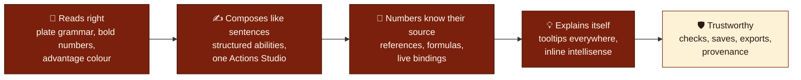

Pillars 1–4 are **Track A** (the owner's overhaul, in delivery); pillar 5 is **Track B** (foundations, specified in §10).

### 1.4 Guardrails (apply to every loop)

| # | Guardrail | Why |
|---|---|---|
| G-1 | Monster authoring stays the home route; the live preview stays visible on wide screens and one tap away on narrow ones. | The edit-and-see loop *is* the product. |
| G-2 | Automation never silently overwrites authored content — bindings, presets, repairs and tuning are explicit and undoable. | Creator agency; no surprise data loss. |
| G-3 | A formula that fails **never** becomes a plausible number (no silent `0`, no default `3/4/1`). | Wrong numbers are worse than visible errors (`REF-001`). |
| G-4 | Rules facts come from a cited source (SRD 5.1/5.2.1, PHB'24 glossary) or are labelled **custom**/**owner decision**. | Rules trust; licensing. |
| G-5 | Appearance never changes mechanics; ruleset never changes appearance. | Separation of concerns (`DOM-004`, `UX-005`). |
| G-6 | Every loop ships a working slice — no button that waits for a later loop. | Incremental delivery (`REL-001`). |
| G-7 | Work stays **local**: git on the device, no cloud storage of code or documents, **no AI-attribution trailers in commits**. | Owner rule. |
| G-8 | Existing data loads unchanged: new fields are optional with defaults; no schema bump without a migration and a decision record. | Backwards compatibility (`DATA-001`). |

### 1.5 Non-goals

Full character generation; campaign/VTT/multiplayer; accounts or sync; replacing Vue/Quasar/Pinia; a general-purpose scripting language for monsters (formulas stay a small safe grammar); claiming official completeness of non-SRD content.

---

## 2. Ground truth

📍 *Spec › 2 Ground truth* — **Baseline measurements are from `c543615`; A4 implementation evidence is from `f35cd6d`. Anything else is labelled as a prediction or a blindspot.**

### 2.1 The codebase in numbers

Measured 2026-10-29 with PowerShell over `src/` and `test/` (physical lines, blanks and comments included; JSON counted for data).

| Layer | Folders | Files | LOC | Share |
|---|---|---:|---:|---:|
| **Presentation** | `components/*`, `pages`, `layouts`, `boot`, `router` | 96 | 33 979 | 56 % |
| ↳ editor panels + widgets | `components/editor` (+`widgets`) | 37 | 17 130 | 28 % |
| ↳ renderer & projections | `components/rendering` | 13 | 7 373 | 12 % |
| **State** | `stores` (6 persisted keys `app.*`) | 9 | 2 553 | 4 % |
| **Core** (pure TS) | `core/domain`, `core/usecases`, `core/ports`, `core/adapters` | 21 | 9 514 | 16 % |
| **Rules & content data** | `data`, `data/schema`, `data/templates` | 45 | 11 514 | 19 % |
| **Styles** | `css` (app 2 031 · grammar 313 · variables) | 3 | 2 368 | 4 % |
| **i18n** | `i18n/en-US` | 2 | 799 | 1 % |
| **Tests** | `test/core` (17 suites · 103 tests) · `test/exhaustive-ui-fuzz.js` (CDP e2e) | 18 | 4 985 | — |

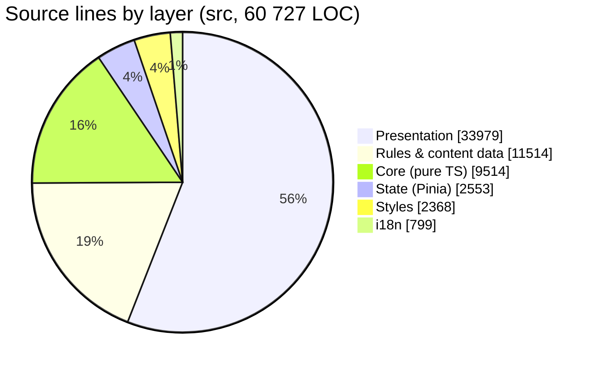

**Hotspots** — the files most loops will touch (LOC · controls · debt signals):

| File | LOC | `q-select` | number inputs | `q-tooltip` | Debt signal |
|---|---:|---:|---:|---:|---|
| `components/editor/BasicsEditor.vue` | 4 445 | 71 | 16 | 2 | Largest file; 6 reference fields; tooltip coverage ≈ 3 % |
| `components/rendering/WebRenderer.vue` | 2 337 | 0 | 0 | 12 | Template + spell plate logic inline; 22 `!important` |
| `components/rendering/useTextRenderer.ts` | 1 601 | — | — | — | 12 `any` |
| `core/domain/defense-and-traits-utils.ts` | 1 612 | — | — | — | 10 `any` |
| `stores/monster-store.ts` | 1 595 | — | — | — | Store imports UI/render helpers |
| `components/editor/A4LayerStudio.vue` | 1 416 | 9 | 11 | 6 | Presentation-only panel inside the editor list |
| `components/rendering/useProcessTokens.ts` | 1 140 | — | — | — | Now emits plate markup (A3) |
| `components/editor/SkillsEditor.vue` | 1 111 | 9 | 0 | 14 | Rebuilt on the group model (A1) |
| `components/editor/ClassCastingEditor.vue` | 1 056 | 16 | 7 | 19 | Subclass state local (BS-07); fallback metrics (DEF-06) |
| `core/domain/formula.ts` | 1 058 | — | — | — | New in A2, 18 tests |
| `components/editor/ActionsEditor.vue` | 944 | 8 | 1 | 14 | Already a role-tabbed studio; legacy panels still mounted |
| `components/editor/widgets/DynamicReferenceSelect.vue` | 619 | 1 | 0 | 1 | Flat integer lists 0…100 (DEF-10) |
| `components/editor/widgets/AttackPanel.vue` | 586 | — | — | — | 7 reference fields |
| `components/editor/MonsterTextEditor.vue` | 411 | 0 | 0 | 0 | 7 token dropdown menus in the toolbar |
| `css/app.scss` | 2 031 | — | — | — | **496 `!important`** — specificity debt |

**Interactive controls across 61 `.vue` files:** 259 `q-btn` · 188 `q-input` (77 numeric) · 188 `q-select` · 98 toggles ⇒ **733 controls, 123 `q-tooltip` ≈ 17 % coverage**. The reference picker is used by only 13 tags — 6 in `BasicsEditor` (PB, the six ability scores, AC, Hit Dice, HP bonus, Bloodied override) and 7 per attack in `AttackPanel` (bonus, reach, close/long range, effect DC, damage dice count, damage bonus) — **18 bindable fields** in all.

### 2.2 What shipped since the baseline

| Loop | Commit | Files | Δ LOC | User-visible result | Evidence |
|---|---|---:|---:|---|---|
| A0 Baseline | `52355c2` | 135 | +41 791 / −2 884 | Local working tree frozen before the overhaul | git snapshot |
| A1 Check rows | `574f196` | 9 | +868 / −486 | `Search · Study · Influence · Hide` rows, no duplicate Skills row, whole-label ▲▲/▼▼ colour | 10 tests; browser rows: `Search ACTION 13/+3, (15, +5 Insight)` |
| A2 Formula engine | `be0cf3f` | 8 | +1 409 / −106 | References, custom formulas and `{…}` macros anywhere in text; no `eval` | 18 + 1 tests; browser: `{CANTRIP_DICE d10}` → `16 (3d10)` |
| A3 Plate grammar | `c543615` | 4 | +494 / −186 | Traits, actions, attacks, reactions and legendary entries render as framed plates | 5 tests; computed styles across 5 themes |
| A4 Spellcasting plate | `f35cd6d` | 12 | +802 / −389 | Class and innate casting use edition-aware catalogs and the shared spell-plate grammar; editor and renderer share cadence and metamagic data | 111 core tests; production build; focused Chrome smoke across 5 themes |
| A4 closeout follow-up | `ae16b86` | 3 | +12 / −10 | Web preview omits generic spellcasting boilerplate already represented by the plate; custom preambles remain supported; regression checks match semantic UI contracts | 111 core tests; build; focused five-theme spell smoke; all 23 e2e groups pass |
| Docs v1 import | `b83ee56` | 3 | +2 805 | v1 roadmap versioned in `docs/roadmap/` | git |

At `ae16b86`, **111 / 111 core tests pass**, the production build succeeds, the focused `npm run test:e2e:spellcasting` passes across five themes, and `npm run test:e2e` passes all 23 grouped UI checks with zero runtime exceptions. The full browser pass confirmed the advantage/disadvantage grammar, intended absence of a redundant Skills row, custom-vs-default spellcasting preamble behavior, and A4 plate appearance. ESLint has 0 errors on the touched paths; existing warnings remain.

### 2.3 Verified defects and gaps (the defect register)

Each defect has a source location and the loop that closes it. *Verified* means reproduced in code or the running app at `c543615`.

| ID | Defect | Where | Closes in |
|---|---|---|---|
| DEF-01 | Spellcasting rendered in its own panel markup, not the plate grammar; inner panels nested | historical `WebRenderer.vue` ≈ L516–614 | A4 ✅ `f35cd6d` |
| DEF-02 | Cadence mapped `long_rest` → "Daily"; `1_day`/`2_day`/`3_day` rendered nothing | historical renderer cadence map | A4 ✅ `f35cd6d` |
| DEF-03 | Metamagic costs were 2014 values (Heightened 3, Seeking 2, Twinned "1/lvl"); 2024 PHB uses 2, 1, 1 | historical renderer map; edition-specific catalog now owns costs and effect summaries | A4 ✅ catalog data · A12 remains ruleset/editor breadth |
| DEF-04 | Missing i18n key `monster.spellcasting.stat` (console warning on every render) | `i18n/en-US/index.ts` | A4 ✅ `f35cd6d` |
| DEF-05 | Attack plates print `Spell Attack +7` — reach (`Melee`/`Ranged`) is not modelled | `MonsterAction` lacks `attackReach` | A6 |
| DEF-06 | Spell metrics `catch` returns plausible defaults (3 cantrips, 4 prepared, slot level 1) | `ClassCastingEditor.vue` ≈ L762 | A12 |
| DEF-07 | No subclass → spell data; "expanded spells" cannot be added automatically | `data/spells.json` has `class[]` only | A12 |
| DEF-08 | Builder mounts 21 panels; 8 duplicate roles already present in the Actions Studio | `MonsterBuilder.vue` L37–57 | A8 |
| DEF-09 | Reference picker lists flat integers 0…100 and emits numbers, losing the formula | `DynamicReferenceSelect.vue` | A9 |
| DEF-10 | Tooltip coverage ≈ 17 % of interactive controls | 61 `.vue` files | A13–A16 |
| DEF-11 | Specificity debt: 496 `!important` in `app.scss`; legacy `.trait > div:first-of-type {display:inline}` | `css/app.scss`, `WebRenderer.vue` L1696 | A3 (contained) · A16 (cleanup) |
| DEF-12 | Preset names are title-cased by hand ("Veil Of Radiance") | `ActionsEditor.vue` L211 | A7 ✅ closed by A7.6 (build 137 `df95179`): presets come from the catalog with authored casing |
| DEF-13 | CDP e2e expects pre-plate markup in places (`.action-composite-pill` first cell text) | `test/exhaustive-ui-fuzz.js` L2360 | A17 |
| DEF-14 | `STACK_STATE.md` claims "100 % complete" for features the owner's review found broken | `STACK_STATE.md` | A17 |
| DEF-15 | Metamagic "flexible casting" row printed a literal **x** placeholder | historical `WebRenderer.vue` L585–590 | A4 ✅ removed; no unsupported conversion is invented |
| DEF-16 | Metamagic option costs stripped the word "to" from user-facing phrasing | historical `WebRenderer.vue` L592–595 | A4 ✅ replaced with explicit catalog cost phrases |
| DEF-17 | Class-casting components rendered doubled parentheses "((V, S))" | historical template and badge pseudo-elements | A4 ✅ one visible formatter; pseudo-parentheses neutralized |
| DEF-18 | Generic class-spellcasting prose duplicates the summary and spell list after migration to the plate | default `presets.classSpellcasting` was rendered below the new plate | A4 closeout ✅ `ae16b86`; keep authored custom preambles |
| DEF-19 | Opening a saved file ran a private copy of the migration: it set `alphaTrait` instead of `alphaTraits`, and pre-v9 upgrades overwrote existing stat, save, effects, range, limited-use and trigger values | `useFileLoader.ts` updateMonster; `MigrateMonsterSchema.ts` v9 step | A7 ✅ build 147 `7f1e4ea`: file import uses the shared migration; existing values are kept |
| DEF-20 | Library, import and ingest normalisation rebuilt spellcasting from a fixed key list, dropping optional policies (pact resource, cadence maps, classes) | `MigrateMonsterSchema.ts` spellcasting block | A7 ✅ build 147: unknown and optional keys survive |
| DEF-21 | Legacy language strings lost the letters "it" inside words ("Gith" → "Gh") and received time-based ids | `MigrateMonsterSchema.ts` languages block | A7 ✅ build 147: anchored parsing, stable `lang-legacy-N` ids |
| DEF-22 | With the Modern Modular template, Markdown, Homebrewery and LaTeX exports contained web plate HTML; every export leaked the HP number-pill markup | text exporters shared the web projection | A7 ✅ build 148 `49edfdf`: exports use the prose projection and one export boundary (D-18) |
| DEF-23 | LaTeX and Improved Initiative legendary/mythic entries printed only the description, dropping structured rolls, saves and outcomes; Improved Initiative crashed on any mythic action | `useLatexRenderer.ts`, `useImprovedInitRenderer.ts` | A7 ✅ build 148: entries come from the shared prose projection; the rpgtex legendary list is kept |
| DEF-24 | A multiattack made only of actions ended "followed by , and undefined"; Markdown printed the Multiattack label twice | `useProcessTokens.ts` multiattack join; Markdown templates | A7 ✅ build 148 |
| DEF-25 | The mythic trait lead closed its tags out of order (`</b></i>`); the default mythic trigger text contained `{}NAME}` | `useProcessTokens.ts`; `monster-store.ts` default | A7 ✅ build 148 |

### 2.4 Inherited facts from the v1 audit (still true)

| ID | Fact | Consequence |
|---|---|---|
| E-04 | `CrFooter` mounts `MonsterLintDialog` and `AutoTuneDialog`; auto-fix writes only `multiattacks`; tuner writes CR/PB/AC/HP directly | Track B improves, never re-mounts (F-05, F-06) |
| E-05 | `StoragePort`, `LocalStorageAdapter`, `IndexedDbStorageAdapter` exist but are not composed into the app | F-07 composes one backend per session |
| E-07 | Two model owners: `core/domain/types.ts` (1 391 LOC) and `components/models.ts` (1 122 LOC) | One canonical owner, compatibility re-exports (B1) |
| E-08 | Character sheet hard-codes AC `10 + DEX` and speed `30 ft.` | F-11 labels or derives |
| E-10 | Combat active turn is an index into a sorted array | F-10 uses a stable ID |
| E-11 | `CURRENT_MONSTER_VERSION = 11`; sequential pure migrations | New fields stay optional; no bump without D-record |

### 2.5 Predictions and how they will be confirmed

| Prediction | Confidence | Confirmed by |
|---|:--:|---|
| Binding numeric fields to references removes most hand-recalculation after a CR/PB change | High | A9 acceptance: change CHA, all bound DCs update in one render |
| One Actions Studio shortens the editor by ≈ 8 panels without losing capability | High | A8 capability matrix: every legacy panel feature has a studio home |
| Caret-anchored completion is faster than the token dropdowns for frequent macros | Medium | A10: time-to-insert for 5 common macros, before/after |
| Tooltip coverage can reach 100 % without clutter if labels are short and tips are structured | Medium | A13 coverage script + owner review of three panels |
| Subclass-expanded spell lists are needed mostly for SRD subclasses + custom entries | Medium | A12 data audit; owner confirms which non-SRD subclasses need manual lists |

### 2.6 Open questions for the owner

| # | Question | Default if unanswered |
|---|---|---|
| Q-1 | Ordinal scales (size, CR, spell level, die size) in dropdowns: natural order or alphabetical? | Natural order for ordinal scales, alphabetical everywhere else (D-07) |
| Q-2 | Should text exports (Markdown/Homebrewery) place Spellcasting under **Actions** (PHB'24 layout) or as a **trait** like the web renderer? | Renderer: trait (owner); text exports: Actions (RAW) with a toggle (D-02) |
| Q-3 | Is "Recharge 4–12" a d12 recharge die (homebrew) or a typo for 4–6? | Support any recharge die; tooltip states "roll 1d12" (D-09) |
| Q-4 | Which non-SRD subclasses need curated expanded-spell lists vs. user-entered lists? | SRD 12 curated; others name-only + custom list (D-13) |
| Q-5 | Track order: finish Track A before Track B, or interleave B1/B2 earlier? | Track A first; B-loops pulled forward only on request (§11) |

---

## 3. Experience architecture

📍 *Spec › 3 Experience* — **One screen, two halves: you edit on the left, the stat block answers on the right; everything else is a drawer, a dialog or a tooltip away.**

### 3.1 Information architecture (target)

```text
DNDSheet
├── 🏠 Builder (default route "/")                       ← the edit-and-see loop
│   ├── Editor column (sectioned, ≈ 13 panels after A8; 21 today)
│   │   ├── Identity ─ name, size, type, alignment, CR/PB
│   │   ├── Defenses ─ AC, HP & Hit Dice, Paragon/phases, speeds
│   │   ├── Abilities & saves
│   │   ├── Checks ─ Search · Study · Influence · Hide · Tools
│   │   ├── Senses, languages, damage & condition defenses
│   │   ├── Spellcasting ─ class casting, innate casting, metamagic
│   │   ├── ⚔ Actions Studio ─ traits, actions, bonus, reactions, legendary, mythic, lair (+ attacks & multiattack)
│   │   └── Lore & extras ─ inventory, anatomy, regional effects, encounter dynamics, villain actions
│   ├── Stat block column ─ WebRenderer (+ theme, template, zoom, A4)
│   └── Footer ─ CR estimate, checks, undo count
├── 📚 Spells ("/spells")      ─ custom spell catalog
├── 🧱 Templates ("/templates") ─ reusable entries
├── ⚔ Combat drawer           ─ encounter tracker
├── 👤 Character mode          ─ lightweight reference sheet (scoped by F-11)
└── 🛠 Reset ("/reset")        ─ error correction
```

Track B adds a **Library** destination (F-02) and an **Export preview** dialog (F-08); neither replaces the Builder.

### 3.2 Core journey — compose an ability (Track A)

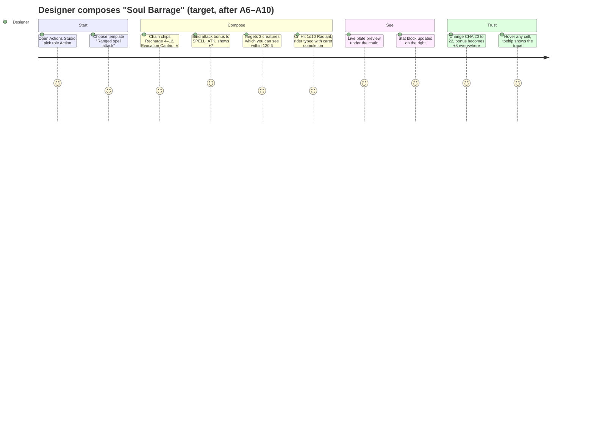

### 3.3 Screen and panel inventory

| ID | Surface | Purpose | Changes in this roadmap |
|---|---|---|---|
| SCR-01 | Builder / editor column | Author the creature | Section index (B7), panel sweeps (A14–A16), 21 → ≈ 13 panels (A8) |
| SCR-02 | Builder / stat block | Read the creature | Plate & row grammar (A3–A5), tooltips on every cell head (A5) |
| SCR-03 | Actions Studio | Author every ability role | Composer chain (A7), role variants (A8), caret completion (A10) |
| SCR-04 | Spellcasting editor | Class & innate casting | Persisted subclasses, counters, expanded spells (A12) |
| SCR-05 | NumericBinding field (widget) | Any number that can follow a source | New anatomy (A9) replacing `DynamicReferenceSelect` |
| SCR-06 | Text editor (widget) | Rich descriptions with macros | Caret completion, catalog menus (A10) |
| SCR-07 | Footer: CR & checks | Estimate and validate | Track B (F-05, F-06) |
| SCR-08 | Export menu | Leave the app | Track B (F-08) |
| SCR-09 | Combat drawer | Run the encounter | Track B (F-10) |
| SCR-10 | Character mode | Player reference | Track B (F-11) |

### 3.4 Global wireframes

**W-01 · Builder, desktop ≥ 1280 px (target after A8 + A13–A16)**

```text
┌──────────────────────────────────────────────────────────────────────────────────────────────┐
│ ☰ DNDSheet  ＋New ▾  📂Open  ⬇Export ▾   ↶ ↷   ●Saved   ⚠Checks 2   CR 4 ▸   Monster ▾  WotC ▾ │
├───────────────────────────────────────────┬──────────────────────────────────────────────────┤
│ EDITOR                         🔎 field…  │ STAT BLOCK                    Fit ▾  − 100% +  🖨 │
│ Identity · Defenses · Abilities · Checks  │ ╔══════════════════════════════════════════════╗ │
│ Spells · ⚔Studio · Lore                   │ ║ SERAPHIC HERALD                   CR 4 · +2  ║ │
│                                           │ ║ Medium Celestial, Lawful Good                ║ │
│ ▼ Defenses                          ⚠ 1   │ ╟────┬─────────────────────────────────────────╢ │
│   AC ⓘ   [ 15 │🔗 10 + DEX_MOD + 4  ▾]    │ ║ AC │ 15 (Natural Armor)                      ║ │
│   HD ⓘ   [ 15 ] d [ 8 ▾]   HP 112         │ ║ HP │ 112 / 56 Bloodied (15d8 + 45)           ║ │
│   Bonus ⓘ[ 45 │🔗 HD × CON_MOD      ▾]    │ ╟────┴──────┬────────┬────────────────────────╢ │
│ ▶ Abilities                               │ ║ Search    │ ACTION │ 13/+3, (15, +5 Insight) ║ │
│ ▼ ⚔ Actions Studio                    7   │ ║ Hide      │ BONUS  │ 11/+1, (13, +3 Sleight) ║ │
│   All · Traits 2 · Actions 3 · Bonus 1 …  │ ║ ┏RECHARGE 4–12·EVOCATION CANTRIP Soul Barrage┓║ │
│   ┌ Soul Barrage ───────────── ⧉ ⋮ ┐      │ ║ ┃Ranged Spell Attack +7│3 creatures … 120ft┃║ │
│   │ chain: ⟨Recharge 4–12⟩⟨Evocation⟩…│      │ ║ ┃On Hit: Takes 5 (1d10) Radiant damage …   ┃║ │
│   └────────────────────────────────┘      │ ║ ┗━━━━━━━━━━━━━━━━━━━━━━━━━━━━━━━━━━━━━━━━━━━┛║ │
├───────────────────────────────────────────┴──────────────────────────────────────────────────┤
│ CR 4 (Off 4 · Def 3) · ⚠ 2 checks · ↶ 12 changes                                             │
└──────────────────────────────────────────────────────────────────────────────────────────────┘
```

**W-02 · Builder, narrow < 768 px (B7)** — the splitter becomes explicit tabs; nothing is squeezed.

```text
┌────────────────────────────────┐
│ ☰ DNDSheet   ●Saved   ⚠2   ⋮   │
│ [ Editor ]  [ Stat block ]     │
├────────────────────────────────┤
│ Identity · Defenses · …  →     │
│ ▼ Defenses                     │
│ AC ⓘ [ 15 │🔗 10+DEX_MOD+4 ▾]  │
│ HD ⓘ [15] d [8 ▾]              │
├────────────────────────────────┤
│ CR 4 · ⚠ 2 · ↶ 12              │
└────────────────────────────────┘
```

**W-02b · Stat block anatomy (target after A5)** — every multi-cell surface obeys one grammar (§4.2).

```text
╔══════════════════════════════════════════════════════════════════════╗
║ SERAPHIC HERALD                             CR 4 · PB +2 · Init +1  ║ ← top plate
║ Medium Celestial, Lawful Good                                        ║
╟──────────┬───────────────────────────────────────────────────────────╢
║ AC       │ 15 (Natural Armor)                                        ║ ← row: head │ data
║ HP       │ 112 / 56 Bloodied (15d8 + 45)                             ║
║ Speed    │ 30 ft., Fly 60 ft.                                        ║
╟──────────┼───────────┬───────────────────────────────────────────────╢
║ Search   │ ACTION    │ 13/+3, (15, +5 Insight)                       ║ ← check rows (A1 ✅)
║ Study    │ ACTION    │ 11/+1, (13, +3 Investigation; 18, +3 Religion ▲▲) ║
║ Influence│ ACTION    │ 15/+5, (17, +7 Persuasion)                    ║
║ Hide     │ BONUS ACT.│ 11/+1, (13, +3 Sleight of Hand)               ║
╟──────────┴───────────┴───────────────────────────────────────────────╢
║ TRAITS                                                               ║
║ ┏━ PHASE FINAL · RECHARGE 4–12 · EVOCATION CANTRIP  Soul Barrage (V, S) ━┓ ║ ← plate (A3 ✅)
║ ┃ Ranged Spell Attack +7 │ 3 creatures which you can see within 120ft of you ┃ ║
║ ┃ On Hit: Takes 5 (1d10) Radiant damage, if all attacks hit the same …    ┃ ║
║ ┗━━━━━━━━━━━━━━━━━━━━━━━━━━━━━━━━━━━━━━━━━━━━━━━━━━━━━━━━━━━━━━━━━━━━━━━━┛ ║
║ ┏━ 15th Level Arcane Caster (CHA) ┃ Spell Save 15, Spell Attack +7 ┃ …  ━┓ ║ ← spell plate (A4)
║ ┃ Metamagic ┃ 2 to cast a Cantrip as a Bonus Action, 1 Increase …        ┃ ║
║ ┃ Cantrips  ┃ Sacred Flame (V, S), Light (V, M)                          ┃ ║
║ ┃ 1st Level · 4 · Per Long Rest ┃ Bless (V, S, M), Shield of Faith (V, S, M) ┃ ║
║ ┗━━━━━━━━━━━━━━━━━━━━━━━━━━━━━━━━━━━━━━━━━━━━━━━━━━━━━━━━━━━━━━━━━━━━━━━━┛ ║
╚══════════════════════════════════════════════════════════════════════╝
```

Feature-specific wireframes live in their dossiers: W-03 check rows (SB-02), W-04 spell plate (SB-04), W-05 Actions Studio (AU-01/AU-03), W-06 NumericBinding field (AU-02), W-07 caret completion (AU-04), W-08 CatalogSelect (UX-01), W-09 HelpTip (UX-02), W-10 class casting editor (AU-05).

---

## 4. Design language

📍 *Spec › 4 Design language* — **Meaning first, decoration second: headers are crimson, data is parchment, numbers are bold, advantage is green, and every theme maps the same roles to its own colours.**

### 4.1 Semantic tokens

Tokens are CSS custom properties on `.statblock` (see `src/css/statblock-grammar.scss`). Components reference **roles**, never raw colours; each theme supplies the values.

| Token | Role | Default (classic) | WotC | Printer | Lovecraft Golden (dark) |
|---|---|---|---|---|---|
| `--sb-frame` | thick outer frame of plates and rows | `#7a200d` | `#58180d` | `#000` | `#d4af37` |
| `--sb-head-bg` / `--sb-head-ink` | header cell | `#7a200d` / `#fff8ec` | `#58180d` / `#fdf1dc` | `#000` / `#fff` | `#d4af37` / `#0c0f12` |
| `--sb-cell-bg` / `--sb-cell-ink` | data cell | `#fdf1d6` / `#2b1b12` | `#fbf2e3` / `#2c0e08` | `#fff` / `#000` | `#161b22` / `#e6edf3` |
| `--sb-rule` | divider between cells | frame @ 35–45 % | frame @ 45 % | black @ 45 % | gold @ 45 % |
| `--sb-body-bg` / `--sb-stripe` | description body / reading stripe | parchment / frame @ 7 % | | white / black @ 6 % | panel / gold @ 8 % |
| `--dnd-adv-ink` / `--dnd-disadv-ink` | advantage / disadvantage ink | `#1d6b29` / `#a8211a` | same | black / black | `#7ee08a` / `#ff8a80` |

The application defines **12 selectable themes** (`wotc` is the default, plus `printer`, `art_nouveau`, `art_deco`, six `lovecraft_*`, and two `dwarves_*`). The plate grammar currently defines matching palettes through one SCSS mixin `plate-palette(...)`; adding a theme means adding it to the editor's `VisualTheme` union, theme selector, and palette. Contrast target: head text ≥ 4.5 : 1 against `--sb-head-bg` (verified palettes in A3: crimson/white 11.7 : 1, gold/near-black 8.4 : 1).

### 4.2 Statblock grammar

**The law of plates:** *one frame, one head, data in order of consequence, description last.*

| Element | Class | Rule |
|---|---|---|
| Plate | `.sb-plate` | Block, 2 px `--sb-frame` border, radius 4 px; the entry container (`.trait`, `.action`, …) steps back (no own frame) |
| Row | `.sb-row` | Flex row that **wraps**; the last cell grows to fill the line |
| Head cell | `.sb-cell.sb-head` | First cell; crimson; holds qualifiers + name |
| Qualifier chip | `.sb-qual.phase-cell` · `.recharge-cell` | Small caps chip inside the head (phase, usage) |
| Discipline | `.sb-qual.school-cell` | "EVOCATION CANTRIP", "3RD LEVEL EVOCATION" (PHB'24 order) |
| Name | `.sb-name` | Bold, authored casing preserved |
| Components | `.sb-qual.sb-comp` | `(V, S, M)` in natural case |
| Data cell | `.sb-cell` | Parchment; mechanics, then scope, then extra |
| Body | `.sb-body` | Description; **striped** (`.sb-striped`) when visible text > 110 chars; line-height 1.5 rem so stripes align with lines |
| Number | `.dnd-num` | Bold, tabular numerals — in every cell, row and body |
| Advantage | `.dnd-adv` / `.dnd-disadv` | Whole label coloured, numbers stay bold, `▲▲`/`▼▼` glyph, `title` explains why |

**Cell precedence (left → right), never reordered by content:**

```text
HEAD [ phase · usage · discipline · NAME (components) duration ] → MECHANICS [ attack | save ] → SCOPE [ targets · range · area ] → EXTRA [ trigger · cost · notes ]
```

<details><summary>💭 Why this order</summary>

It follows the reading order a GM uses mid-combat: *can I use it now?* (phase, recharge) → *what is it?* (school, name, components) → *how does it resolve?* (attack or save, the number to roll against) → *who does it hit?* (targets, range) → *what else?* (trigger, cost). It is also the order of the owner's composer specification (§9 AU-01), so the editor chain and the rendered plate read identically.
</details>

### 4.3 Colour semantics — scopes

Editor colours come from catalogs, not from components. The formula catalog (`FORMULA_GROUPS`, A2) already assigns each scope an icon and a Quasar colour; every picker, chip and tooltip reuses it.

| Scope (catalog group) | Icon (Font Awesome 6) | Colour token | Examples |
|---|---|---|---|
| Ability Modifiers | `fa-plus-minus` | `teal-6` | `CHA_MOD` |
| Ability Scores | `fa-dice-d20` | `teal-8` | `CHA` |
| Armor & Initiative | `fa-shield-halved` | `blue-grey-6` | `AC`, `INIT` |
| Attack Bonuses | `fa-crosshairs` | `red-7` | `ATK_STR` (alias `A:STR`) |
| Challenge & Legendary | `fa-dragon` | `brown-6` | `CR`, `LEGENDARY` |
| Hit Points & Hit Dice | `fa-heart-pulse` | `red-5` | `HP`, `HD`, `HIT_DIE`, `BLOODIED` |
| Movement & Senses | `fa-person-running` | `green-7` | `SPEED`, `PASSIVE_PERCEPTION` |
| Proficiency | `fa-graduation-cap` | `amber-8` | `PB` |
| Save DCs | `fa-bullseye` | `deep-orange-7` | `DC_CHA` (alias `DC:CHA`) |
| Saving Throws | `fa-shield` | `indigo-5` | `SAVE_DEX` |
| Spellcasting | `fa-hat-wizard` | `purple-6` | `SPELL_DC`, `SPELL_ATK`, `CANTRIP_DICE` |

Status colours are reserved and never reused for scopes: **green** advantage/success, **red** disadvantage/error, **amber** warning/stale, **blue** information/reference link. Colour is never the only signal (`VIS-002`): every status also has an icon, glyph or word.

### 4.4 Iconography

| Concept | Icon | Concept | Icon |
|---|---|---|---|
| Bound to a reference | 🔗 `fa-link` | Custom formula | ƒ `fa-function` |
| Literal (unbound) value | `fa-hashtag` | Error / broken binding | `fa-triangle-exclamation` |
| Help available | ⓘ `fa-circle-info` | Rules source | `fa-book` |
| Action economy: Action / Bonus / Reaction | `fa-bolt` / `fa-forward` / `fa-rotate-left` | Legendary / Mythic / Lair | `fa-crown` / `fa-star` / `fa-dungeon` |
| Recharge | `fa-dice-six` | Limited use (X/Day) | `fa-calendar-day` |

### 4.5 Tooltip grammar (HelpTip)

Every tooltip has the same four-line skeleton; lines that do not apply are omitted.

```text
┌──────────────────────────────────────────────┐
│ ● SPELL SAVE DC                 Spellcasting │  ← title in scope colour · scope tag
│ The DC targets roll against your spells.     │  ← what (≤ 1 sentence)
│ 8 + PB[+2] + CHA_MOD[+5] = 15                │  ← how (live trace, numbers gold)
│ 📖 PHB'24 · Spellcasting · Esc to close      │  ← source · keyboard hint
└──────────────────────────────────────────────┘
```

Rules: opens on hover **and** keyboard focus, stays while hovered, closes with `Esc` (WCAG 1.4.13); touch opens via the ⓘ affordance; never the only place an error or required action appears (`HELP-001`).

### 4.6 Select grammar (CatalogSelect)

```text
[ 🔗 PB  +2                         ▾ ]      ← closed: bound chip shows ref + live value
┌──────────────────────────────────────┐
│ 🔎 type to filter…                   │
│ ƒ Custom formula…                    │      ← always first, exactly once
│ ── ABILITY MODIFIERS ─────── teal ── │      ← sticky group header, alphabetical groups
│   ± CHA_MOD  Charisma modifier   +5  │      ← icon · id · label · live value
│   ± CON_MOD  Constitution mod.   +3  │      ← alphabetical items inside a group
│ ── PROFICIENCY ─────────── amber ─── │
│   🎓 PB      Proficiency bonus   +2  │
└──────────────────────────────────────┘
```

Ordering law (D-07): groups and items alphabetical; **ordinal scales keep natural order** (size, CR, spell level, die size) because alphabetical would scramble them ("Gargantuan, Huge, Large…").

### 4.7 Copy rules

Short labels (≤ 14 characters, e.g. "Bonus", "Reach", "Save DC") with the full name in the HelpTip title; sentence case; rules terms capitalised as in PHB'24 (Bloodied, Prone, Long Rest); numbers with units unspaced in plates (`120ft`) as the owner specified, spaced in exported prose (`120 ft.`).

---

## 5. System architecture

📍 *Spec › 5 Architecture* — **A modular monolith with a pure core: rules live in catalogs, algorithms live in pure functions, Vue only arranges and explains them.**

### 5.1 As-is (measured at `c543615`)

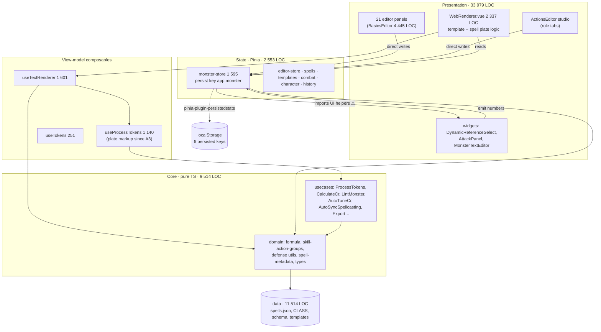

**Observed couplings to unwind (in the loops that touch them):** the store imports UI/render helpers (E-07); spell-plate logic sits inside a 2 337-line SFC (A4 extracts it); 21 panels write the store directly (kept — G-6 forbids a flag-day rewrite); numbers reach the store already flattened, so their source is lost (A9 adds bindings).

### 5.2 To-be lattice — outer to inner

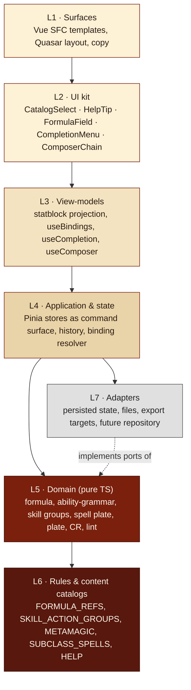

| Layer | Owns | MUST NOT import | Test style |
|---|---|---|---|
| L1 Surfaces | layout, copy keys, which kit component goes where | domain internals directly (use L3) | e2e/CDP, visual matrix |
| L2 UI kit | interaction anatomy, accessibility, keyboard | stores (props/emits only) | component tests (props → DOM) |
| L3 View-models | projections and reactive glue | Quasar components | unit tests with fixture monsters |
| L4 Application | mutations, history, resolution order, persistence wiring | Vue components | unit tests on store actions |
| L5 Domain | algorithms, invariants | Vue, Quasar, Pinia, DOM, `window` | node:test, pure |
| L6 Catalogs | rules facts, labels, tooltips, icons, colours, sources | anything but types | catalog invariants (sorted, unique, tipped) |
| L7 Adapters | browser/file/format specifics | UI | contract tests |

### 5.3 Human logic versus machine code

The owner's rules choices (which skills belong to Study, what Quickened Spell costs, which spells a Fiend Patron gains) are **data**; the machinery that applies them is **code**. Keeping them apart lets the rules change without touching algorithms, and lets tests guard both.

| Concern | Lives in | Shape | Example |
|---|---|---|---|
| Rules facts | L6 catalog | typed table with `source` and `ruleset` | `SKILL_ACTION_GROUPS.study = [arcana, history, investigation, medicine ◆, nature, religion]` (◆ owner decision D-01) |
| Labels, short labels, tooltips | L6 catalog / i18n | `{ id, label, short, tip, source }` | `FORMULA_REFS.SPELL_DC.tip` |
| Visual semantics | L6 catalog | `{ icon, color }` per scope | `FORMULA_GROUPS.spellcasting → fa-hat-wizard, purple-6` |
| Algorithms | L5 pure functions | input → output, no side effects | `evaluateFormula`, `computeSkillGroupLayout`, `plateHtml` |
| Arrangement | L1/L2 templates | slots, order, responsive rules | `ComposerChain` cell order = §4.2 precedence |

💭 *Catalog tests are cheap insurance:* the formula catalog test already asserts sorted groups, unique ids/aliases and a tooltip for every reference; every new catalog (metamagic, subclass spells, help dictionary) gets the same guard.

### 5.4 Module map — current to target

| Today | Target | Loop | Why |
|---|---|---|---|
| Spell plate computed + template in `WebRenderer.vue` | `core/domain/spell-plate.ts` (pure projection) + Vue text-bound plate rows | A4 ✅ | Typed text rendering avoids introducing a second `v-html` path; shared grammar styles |
| Top rows markup scattered in `WebRenderer.vue` | `components/rendering/rows.ts` (row builders) | A5 | One grammar for AC/HP/Speed/Saves/Checks/Senses |
| Ability phrases built inline in `useProcessTokens.ts` | `core/domain/ability-grammar.ts` (infer + phrase) | A6 | Shared by renderer, composer preview and text export |
| Quick Attack Composer strip in `ActionsEditor.vue` | `components/editor/composer/ComposerChain.vue` + `ChainCell.vue` | A7 | The editor speaks the plate's grammar |
| 8 role panels mounted beside the studio | Studio role variants; panels retired | A8 | One Actions module (DEF-08) |
| `widgets/DynamicReferenceSelect.vue` (flat ints) | `components/kit/FormulaField.vue` + `useBindings.ts` + `monster.bindings` | A9 | Numbers keep their source |
| Token dropdowns + bottom strip | `components/kit/CompletionMenu.vue` + `useCompletion.ts`; menus from catalogs | A10 | Caret-anchored intellisense |
| Ad hoc `q-select` + `q-tooltip` per panel | `components/kit/CatalogSelect.vue`, `HelpTip.vue`, `i18n/en-US/help.ts` | A13 | One anatomy, 100 % help coverage |
| `BasicsEditor.vue` 4 445 LOC | `components/editor/basics/*.vue` (Identity, Defenses, HitPoints, Paragon, Abilities) | A14 | Reviewable units, fewer regressions |
| Hand-written metamagic map in renderer | `core/domain/catalogs/metamagic.ts` (2014/2024 costs) | A4 → A12 | Ruleset-aware data |
| — | `core/domain/catalogs/subclass-spells.ts` (SRD-backed) | A12 | Expanded spells (DEF-07) |

### 5.5 Migration strategy

**Strangler fig per surface.** Each loop replaces one surface end-to-end (data → domain → view-model → UI → CSS → tests) and deletes what it replaced in the same loop; nothing waits for a global refactor.

| Rule | Mechanism |
|---|---|
| Old saves keep loading | New fields optional with defaults in `defaultMonster()`; `bindings` absent ⇒ literals |
| No schema bump without a decision | `CURRENT_MONSTER_VERSION = 11` stays until a loop records D-xx with a migration and fixtures |
| Persisted state | `app.monster` keeps its shape; new keys are additive; history ignores resolver patches |
| CSS | New grammar scoped under `#render .statblock` with tokens; legacy `!important` blocks deleted only when their markup is gone (A16) |
| Tests travel with code | Every extracted builder ships with a `test/core/*.test.ts` |

### 5.6 Cross-cutting concerns

| Concern | Rule | Where enforced |
|---|---|---|
| HTML safety | All authored text reaching `v-html` passes `sanitizeWebString`; builders escape attributes (`plate.ts` `attr()`), never interpolate raw user HTML into attributes | L3 builders, `WebRenderer` |
| Performance | Formula context built once per render pass; memoise projections on store revision; NFR budget p95 ≤ 100 ms keystroke-to-preview | L3, measured in A17 |
| Accessibility | Kit components implement WAI-ARIA patterns (combobox, listbox, tooltip); focus visible on all themes | L2, audited A13–A16 |
| Theming | Components use role tokens only; themes supply values | §4.1 |
| i18n | Copy in `i18n/en-US`; help dictionary keyed by control id | L6 |

---

## 6. Domain model

📍 *Spec › 6 Domain model* — **Every entity, variable and function the overhaul touches, drawn once, named once.**

### 6.1 Monster aggregate (overview)

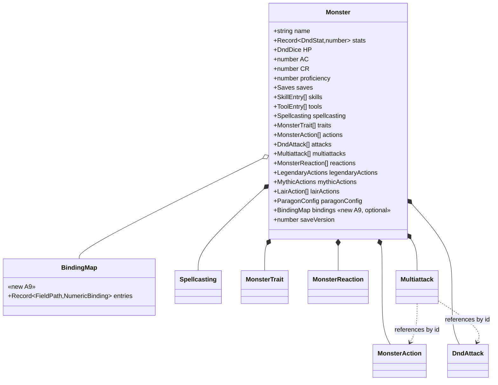

### 6.2 Formula, references and bindings (shipped A2, extended A9)

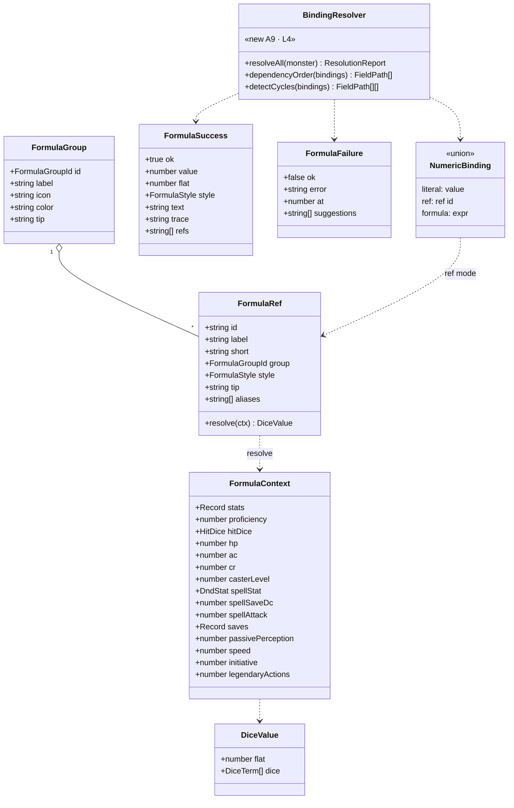

**Shipped API (`core/domain/formula.ts`):** `parseFormula`, `evaluateFormula(src, ctx, {style})`, `resolveNumeric(input, ctx, {fallback, style})`, `renderFormulaMacros(html, ctx)`, `suggestFormulaRefs(query)`, `normalizeLegacyFormula`, `buildFormulaContext(monsterLike, derived)`, `formatDiceValue`, `describeBinding`, `bindingSource`, `isNumericBinding`; catalogs `FORMULA_GROUPS` (11 groups) and `FORMULA_REFS` (49 references, 84 aliases: 6 ability scores, 6 modifiers, 6 attack bonuses, 6 save DCs, 6 saving throws, 7 hit-point/hit-dice values, 5 spellcasting, 2 armor/initiative, 2 movement/senses, 2 challenge/legendary, 1 proficiency). A9 adds the `literal` variant to `NumericBinding` (today `ref | formula`).

**Grammar (EBNF, shipped):**

```text
expr    = term { ("+" | "-") term } ;
term    = factor { ("*" | "/") factor } ;
factor  = ["+" | "-"] atom [ "d" atom ] ;          (* "PBd6", "(PB + 1)d6", "HD d HD_DIE" *)
atom    = number | dice | ref | call | "(" expr ")" ;
dice    = [count] "d" size ;                         (* "2d6", "d20" *)
call    = fname "(" expr { "," expr } ")" ;          (* min max floor ceil round abs half avg mod *)
ref     = IDENT | "{" IDENT "}" | IDENT ":" IDENT ;  (* CHA_MOD, {PB}, DC:CHA, A:STR *)
```

Dice stay symbolic through `+ − ×`; division collapses dice to their average; the final value floors; a leading `+` requests bonus style (`+4`).

### 6.3 Check rows (shipped A1)

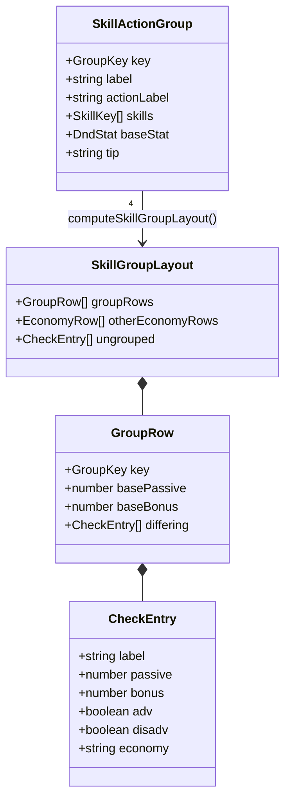

Groups: **Search** (Insight, Perception, Survival — WIS) · **Study** (Arcana, History, Investigation, Medicine ◆, Nature, Religion — INT) · **Influence** (Animal Handling, Deception, Intimidation, Performance, Persuasion — CHA) · **Hide** (Stealth + Acrobatics ◆, Athletics ◆, Sleight of Hand ◆ — DEX, Bonus Action economy when configured). ◆ = owner decision D-01 (PHB'24 RAW puts Medicine in Search and only Stealth in Hide). Rows always render; only entries that differ from the group base appear in parentheses; identical entries merge (`mergeIdenticalEntries`).

### 6.4 Plate projection (shipped A3)

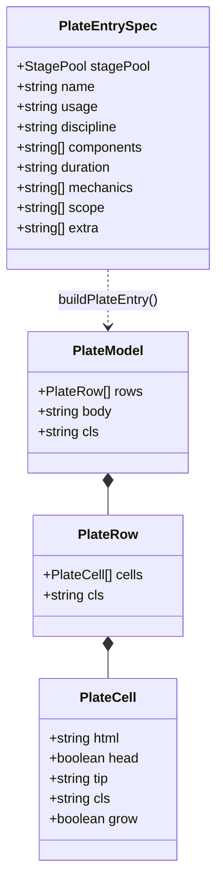

Functions: `plateHtml(model)`, `plateRowHtml`, `plateCellHtml` (drops empty cells, escapes tooltips), `plateBodyHtml` (stripes > 110 visible chars), `boldNumbers(text)`, `phaseLabel(phaseName, stage)`, `shouldStripe`, `plainTextLength`.

### 6.5 Ability model (target, A6)

The owner's composer sentence becomes data. Existing fields stay; new ones are optional.

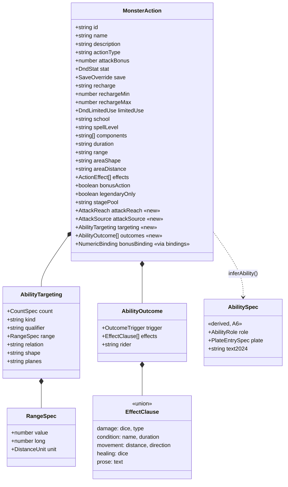

`AttackReach = melee | ranged | melee_or_ranged` · `AttackSource = weapon | spell` · `CountSpec = number | 'all' | 'each' | NumericBinding` · `DistanceUnit = 'ft' | 'mi'` · `OutcomeTrigger = hit | miss | hit_or_miss | failure | success | failure_or_success | trigger | always` · `AbilityRole = trait | action | bonus_action | reaction | legendary | mythic | lair`.

**Inference for legacy entries** (no data change): reach = `ranged` when the range text holds a distance ≥ 10 ft or the words "range"/"ranged"; `melee` for "touch"/"reach"/≤ 5 ft; otherwise unknown (cell prints without reach). Targets parse `"<n> creature(s) …"` from `targetsText`/`range`; unknown text passes through verbatim as the scope cell.

### 6.6 Spellcasting model (A4 render, A12 authoring)

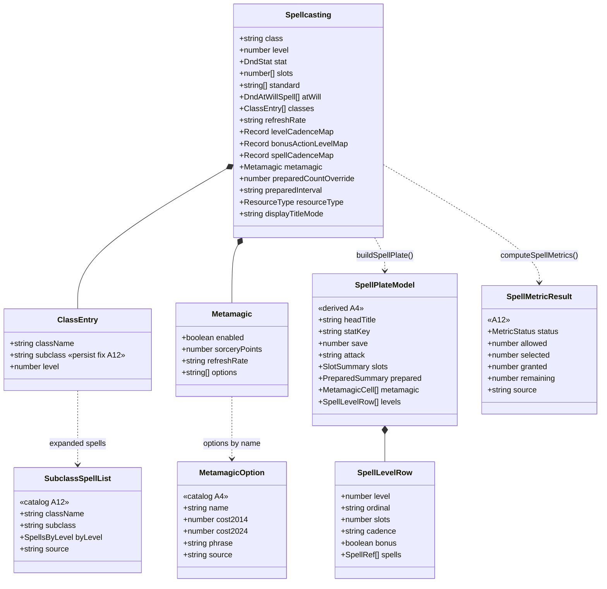

### 6.7 UI kit contracts (A9, A10, A13)

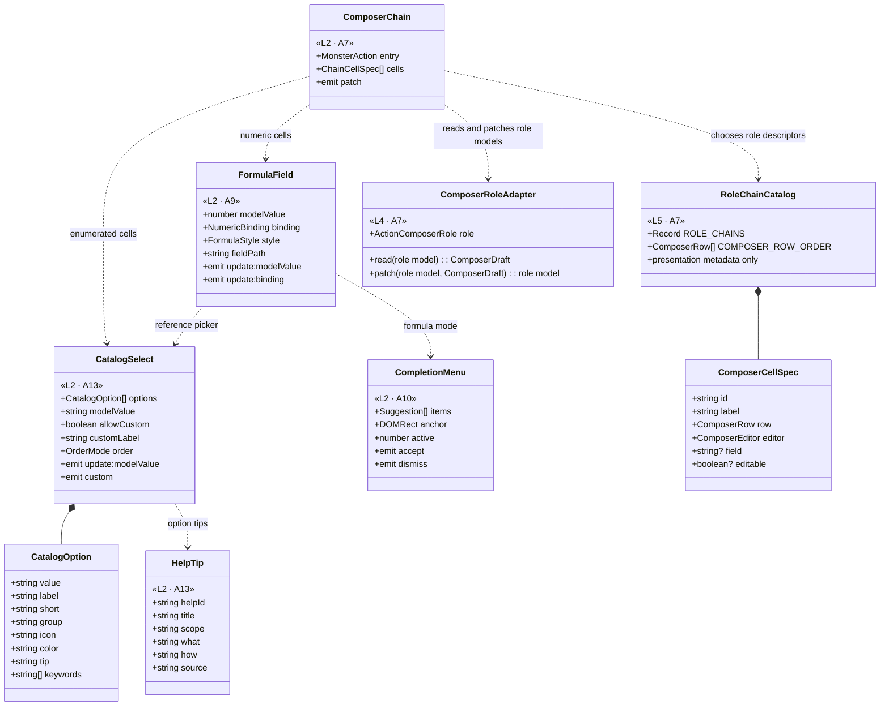

### 6.8 State variables (owner, persistence, invariants)

| Variable | Type | Owner | Persisted | Invariant |
|---|---|---|:--:|---|
| `monster.*` authored fields | Monster | monster-store | `app.monster` | Only explicit edits, presets, resolver write-back |
| `monster.bindings` | `Record<FieldPath, NumericBinding>` | monster-store (A9) | yes | Every key is a valid numeric field path; no cycles survive resolution |
| `monster.actions[i].targeting/outcomes/attackReach/attackSource` | optional structs | monster-store (A6) | yes when explicitly authored/imported | Omission is supported; safe display inference is pure and never writes back; malformed optional data is ignored/sanitized; no schema bump |
| `monster.spellcasting.classes[i].subclass` | string | monster-store (A12) | yes | Survives reload (BS-07 fix) |
| `editorStore.visualTheme` / `visualTemplate` | enums | editor-store | `app.editor` | Never changes mechanics (G-5) |
| `history ledger` | `HistoryLedger<Monster>(50)` | history-store | no | One snapshot per user intent; resolver patches excluded (A9) |
| Completion state | `{ open, query, anchor, active }` | `useCompletion` (A10) | no | Closed on blur, `Esc`, accept |
| Help coverage ratio | number | `scripts/audit-help` (A13) | report | Never decreases between commits |

### 6.9 Function contracts

| Function | Layer | Pure | Contract | Tests |
|---|---|:--:|---|---|
| `computeSkillGroupLayout({stats, skills, groupActionTypes})` | L5 | ✓ | Always 4 group rows; grouped skills never in the ungrouped row | `SkillActionGroups.test.ts` (10) |
| `evaluateFormula(src, ctx, opts)` | L5 | ✓ | Never throws; failure has `at` + suggestions; no `eval` | `Formula.test.ts` (18) |
| `renderFormulaMacros(html, ctx)` | L5 | ✓ | Renders known refs/formulas; leaves unknown and context tokens intact | `Formula.test.ts`, `ProcessTokens.test.ts` |
| `plateHtml(model)` | L3 (pure) | ✓ | Head first, empty cells dropped, attributes escaped | `Plate.test.ts` (5) |
| `buildSpellPlate(monster, ctx)` | L3 (pure) | ✓ | Slot counts per level; pact = slots of highest level; cadence labels from catalog | A4: `SpellPlate.test.ts` |
| `inferAbility(action)` | L5 | ✓ | Explicit fields win; safe legacy inference fills absent cells; ambiguous text remains raw; never mutates | A6: `AbilityGrammar.test.ts` |
| `text2024(action, context)` | L5 | ✓ | Emits the app's opt-in 2024-style attack/save/outcome text; this contract is not a claim of official-rules certification | A6: grammar/export tests |
| `resolveBindings(monster)` | L4 | ✓ (returns patch) | Topological order; cycles reported; failures keep last value + flag | A9: `Bindings.test.ts` |
| `rankCompletions(query, context)` | L3 | ✓ | Exact > prefix > label > fuzzy; ≤ 50 items | A10 |
| `computeSpellMetrics(spellcasting, ruleset)` | L5 | ✓ | Returns `unavailable`/`error` instead of defaults | A12 |
| `auditHelpCoverage(files)` | tooling | ✓ | Lists interactive controls lacking help | A13 |

---

## 7. Data flows

📍 *Spec › 7 Data flows* — **Data moves one way: edit → store → derive → project → render → export; nothing downstream writes upstream except the binding resolver, and it writes through the store like a user would.**

### 7.1 Context (level 0)

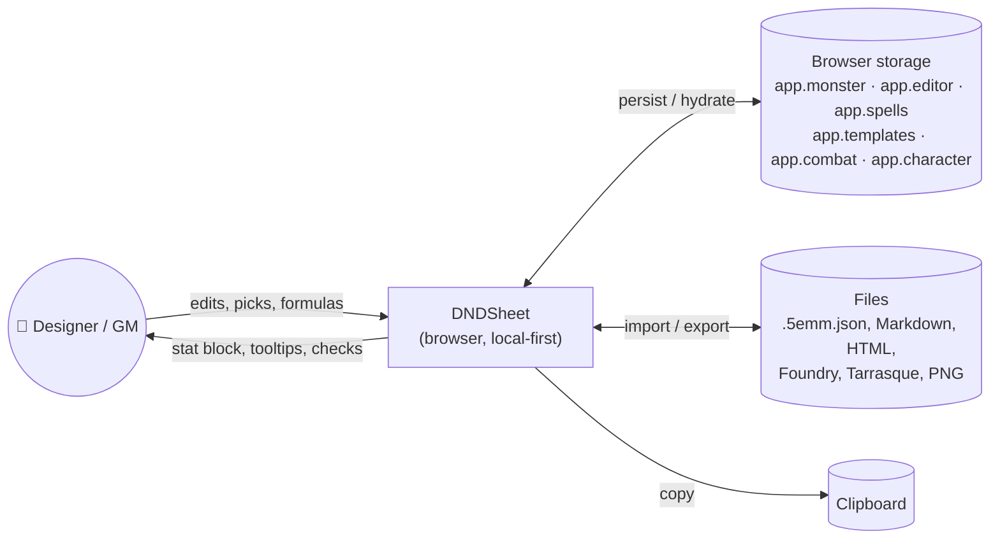

### 7.2 Edit → derive → render (level 1, target)

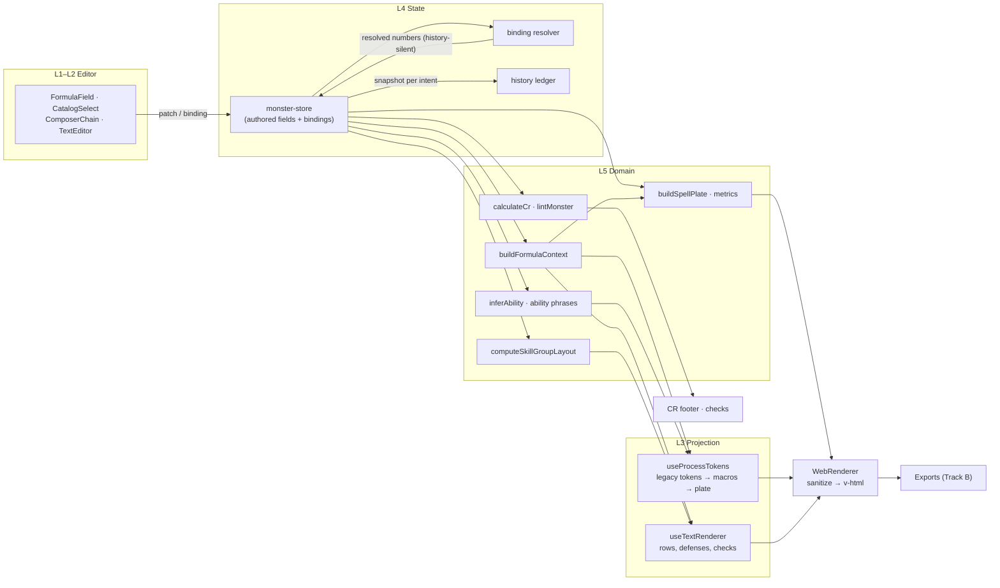

**Flow invariants:** (1) derivations are pure and recomputed from the same store revision; (2) the resolver is the only automatic writer and its patches are excluded from undo history; (3) exports consume the same projections as the screen (no second interpretation, `COMP-001`).

### 7.3 Text and macro pipeline (shipped A2 + A3)

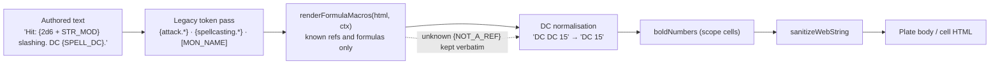

Example: `Hit: {2d6 + STR_MOD} slashing. DC {SPELL_DC}. {action.name} {NOT_A_REF}` → `Hit: 11 (2d6 + 4) slashing. DC 15. {action.name} {NOT_A_REF}` (from `Formula.test.ts`).

### 7.4 Binding resolution (A9)

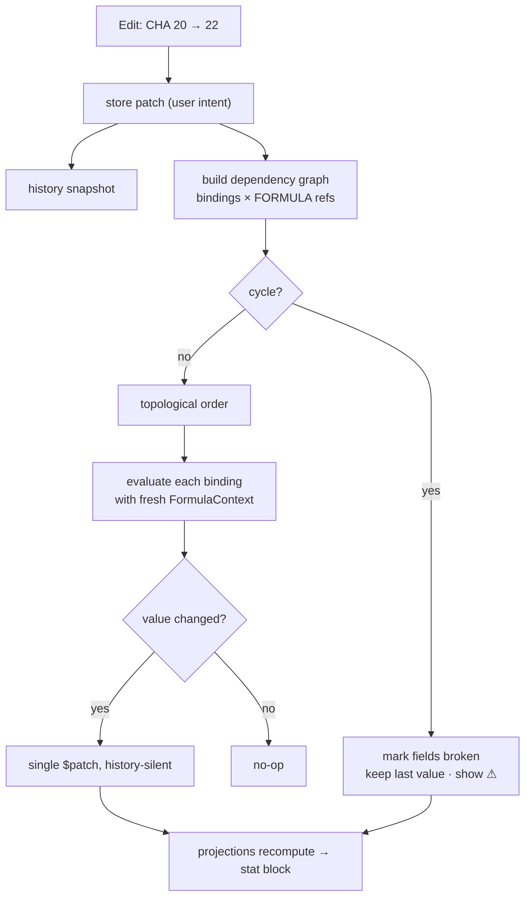

### 7.5 Composer → plate → text (A6–A7)

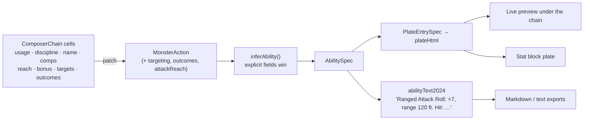

### 7.6 Spellcasting projection (A4, A12)

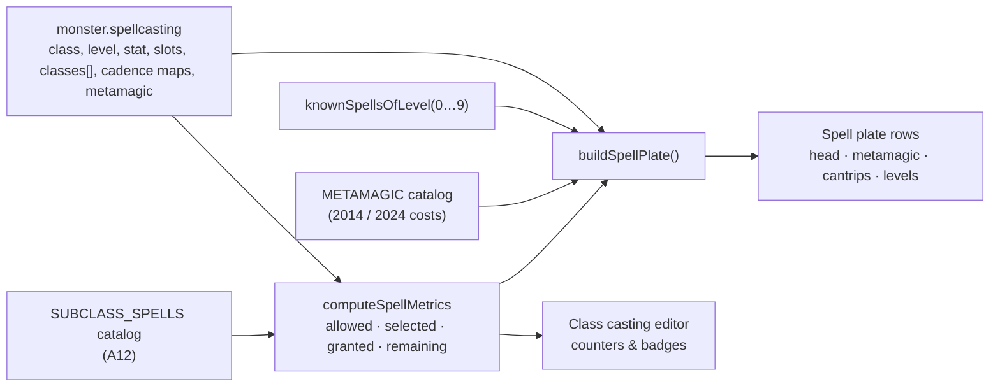

### 7.7 Caret completion (A10)

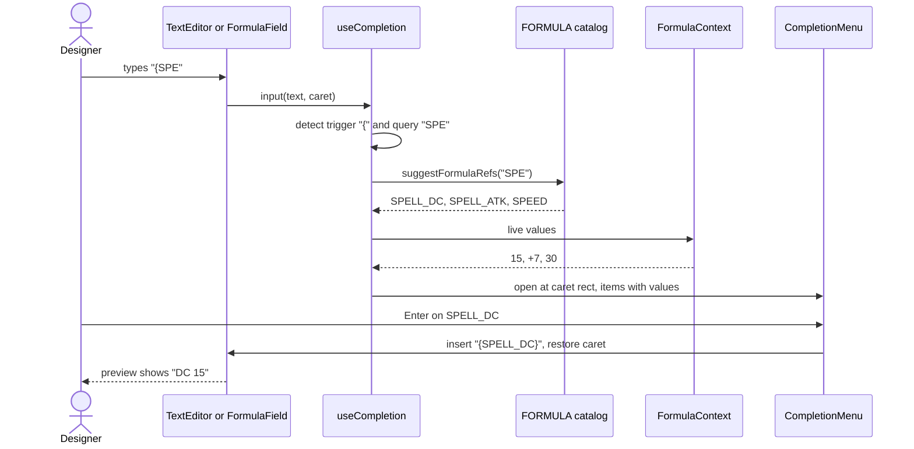

---

## 8. Behaviour

📍 *Spec › 8 Behaviour* — **Every interactive element has a finite set of states; each state has a look, a meaning and an exit.**

### 8.1 FormulaField (A9)

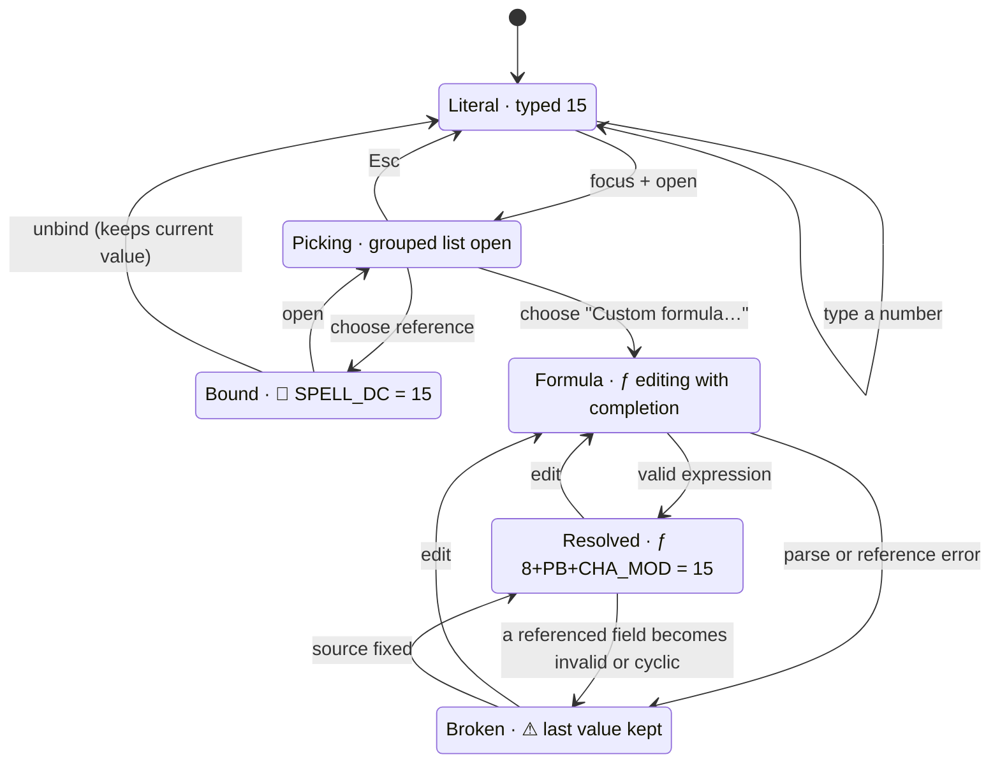

| State | Visual | Tooltip (HelpTip) | Store effect |
|---|---|---|---|
| Literal | `#` icon, plain number | "Typed value. Pick a reference to keep it in sync." | field = number, no binding |
| Bound | 🔗 chip `SPELL_DC` + value | trace `8 + PB[+2] + CHA_MOD[+5] = 15` | binding `{mode:'ref'}`; field = resolved |
| Resolved | ƒ chip with expression | trace + group colours | binding `{mode:'formula'}`; field = resolved |
| Broken | red outline, ⚠, last value greyed | error message with position + suggestions | binding kept; field keeps last good value; check raised (F-05) |

### 8.2 CompletionMenu (A10)

```mermaid
stateDiagram-v2
  [*] --> Closed
  Closed --> Open: trigger typed ("{" in text, identifier in formula)
  Closed --> Open: Ctrl+Space
  Open --> Open: type narrows · arrows move
  Open --> Empty: no match
  Empty --> Open: query changes
  Open --> Closed: Enter or Tab inserts
  Open --> Closed: Esc · blur · caret leaves token
  Empty --> Closed: Esc · blur
```

ARIA: input has `role="combobox"`, `aria-expanded`, `aria-activedescendant`; menu is `role="listbox"` with `role="option"` items; announcement "3 suggestions" via live region.

### 8.3 Composer chain cell (A7)

```mermaid
stateDiagram-v2
  [*] --> Empty
  state "Empty · placeholder chip" as Empty
  state "Set · rendered like the plate" as Set
  state "Editing · picker or field open" as Editing
  state "Invalid · red underline" as Invalid
  Empty --> Editing: click / Enter
  Set --> Editing: click / Enter
  Editing --> Set: valid value
  Editing --> Invalid: invalid value
  Invalid --> Editing: fix
  Editing --> Empty: clear
  Set --> Empty: remove (✕)
```

### 8.4 Spell counters (A12)

```mermaid
stateDiagram-v2
  [*] --> Computing
  Computing --> Under: selected < allowed
  Computing --> Full: selected = allowed
  Computing --> Over: selected > allowed
  Computing --> Unavailable: class or level unknown
  Computing --> Error: calculation failed
  Under --> Computing: selection or level changes
  Full --> Computing: selection or level changes
  Over --> Computing: selection or level changes
  Unavailable --> Computing: inputs completed
  Error --> Computing: retry
```

| State | Badge | Colour | Copy |
|---|---|---|---|
| Under | `5 / 7 prepared · 2 left` | neutral | "2 more spells can be prepared." |
| Full | `7 / 7 prepared` | green | "Preparation limit reached." |
| Over | `9 / 7 prepared` | amber ⚠ | "2 over the limit — allowed, but flagged by Checks." |
| Unavailable | `— / ? prepared` | grey | "Choose class and level to see the limit." |
| Error | `⚠ limit unavailable` | red | "Couldn't compute the limit; your selection is unchanged." (DEF-06 fix) |

Expanded (subclass) spells show as `+3 always prepared` and never count toward the limit.

### 8.5 Sequence — one edit, every number follows (A9)

```mermaid
sequenceDiagram
  actor U as Designer
  participant B as Basics · CHA field
  participant S as monster-store
  participant R as binding resolver
  participant H as history
  participant W as WebRenderer
  U->>B: CHA 20 → 22
  B->>S: patch stats.CHA = 22
  S->>H: snapshot (user intent)
  S->>R: resolveAll()
  R->>R: order: CHA_MOD → SPELL_DC → action DCs
  R->>S: $patch {spellcasting.save: 16, actions[2].save: 16} (history-silent)
  S-->>W: reactive update
  W-->>U: plates show "Charisma Save 16", "Spell Save 16"
  U->>H: Ctrl+Z
  H->>S: restore snapshot (CHA 20)
  S->>R: resolveAll() → values back to 15
```

### 8.6 Sequence — compose an attack (A6 + A7)

```mermaid
sequenceDiagram
  actor U as Designer
  participant C as ComposerChain
  participant A as MonsterAction
  participant G as ability-grammar
  participant P as plate.ts
  participant V as Preview + stat block
  U->>C: pick template "Ranged spell attack"
  C->>A: attackSource=spell, attackReach=ranged, bonus 🔗 SPELL_ATK
  U->>C: targets = 3 creatures · which you can see · 120 ft · of you
  C->>A: targeting {count 3, kind creature, qualifier, range 120 ft, relation of you}
  U->>C: On Hit = 1d10 Radiant + rider text
  C->>A: outcomes [hit: damage 1d10 radiant, rider]
  A->>G: inferAbility(action)
  G->>P: PlateEntrySpec
  P-->>V: head · "Ranged Spell Attack +7" · "3 creatures which you can see within 120ft of you" · body "On Hit: …"
```

---

## 9. Track A — Statblock & Authoring Overhaul (feature dossiers)

📍 *Spec › 9 Track A* — **The owner's specification, turned into fourteen dossiers that each say what to build, why, how, and how we will know it works.**

| ID | Feature | Pillar | Loops | Status |
|---|---|---|---|:--:|
| SB-01 | Plate grammar for abilities | 📖 Reads right | A3 ✅ · A16 cleanup | ✅ |
| SB-02 | Check rows: Search · Study · Influence · Hide | 📖 | A1 ✅ | ✅ |
| SB-03 | Formula engine, references and text macros | 🔗 Numbers know their source | A2 ✅ | ✅ |
| SB-04 | Spellcasting plate | 📖 | A4 | ☐ |
| SB-05 | Row grammar for the top block + head tooltips | 📖 💡 | A5 | ☐ |
| AU-01 | Ability composer model and render grammar | ✍ Composes like sentences | A6 | ✅ build 136 |
| AU-02 | NumericBinding fields (reference pickers + custom formula) | 🔗 | A9 · A11 | ☐ |
| AU-03 | Actions Studio: composer chain and one Actions module | ✍ | A7 · A8 | ◐ A7 in progress |
| AU-04 | Inline intellisense and macro menus | 💡 | A10 | ☐ |
| AU-05 | Spellcasting authoring accuracy | ✍ 📚 | A12 | ☐ |
| UX-01 | CatalogSelect — one dropdown anatomy | 💡 | A13 → A14–A16 | ☐ |
| UX-02 | HelpTip — rich tooltips on every control | 💡 | A13 → A14–A16 | ☐ |
| UX-03 | Fit — no cropped, overlapping or overflowing UI | 💡 | A14–A16 | ☐ |
| QA-01 | Overhaul verification harness | 🛡 | A17 (+ every loop) | ◐ |

---

### SB-01 — Plate grammar for abilities

> **Every trait, action, attack, reaction and legendary entry is one framed plate: crimson head, parchment data, bold numbers, description last.**

**Status** ✅ shipped `c543615` (A3) · follow-ups A5 (head tooltips), A16 (legacy CSS removal), A17 (e2e) · **Requirements** `SBG-001…005`, `VIS-002`

**🎯 Value** — A GM finds *can I use it, what is it, what do I roll, who does it hit* in one left-to-right glance, identically for every role.

**🔎 Evidence** — Before A3 the header was three separate "composite pills" (identity · mechanics · scope) whose head cell rendered parchment because a legacy `!important` rule won; the plate container was forced `display:inline` by `.trait > div:first-of-type`. After A3 (browser probe, WotC theme): head `rgb(88,24,13)` on `rgb(253,241,220)`, data cells `rgb(251,242,227)`, container frame removed, stripes `24px/48px` aligned with `line-height 24px`.

**🧩 Concept** — *One frame, one head, data in order of consequence, description last* (§4.2). The head carries the qualifiers that gate use (phase, recharge/uses), the discipline (school + tier), the **name** and its components; data cells carry the mechanics (attack or save), then the scope (targets, range, area), then extras (trigger, cost).

**🛠 Techniques**
- Pure HTML builder `components/rendering/plate.ts` (no Vue import) → one projection for screen, print and HTML export.
- `buildPlateEntry(monster, spec, body)` in `useProcessTokens.ts` maps every modern branch (trait, action, reaction, attack, multiattack, legendary) to a `PlateEntrySpec`.
- CSS grammar in `statblock-grammar.scss`, scoped `#render .statblock …` so an id outranks legacy class-level `!important`; containers step back with `:is(.trait,.action,.attack,.multiattack):has(> .sb-plate)`.
- Reading stripes: `repeating-linear-gradient` with band height = line-height (1.5 rem) and zero top padding so stripes sit on lines; threshold 110 visible characters (`plainTextLength` strips tags/entities).
- Compatibility classes (`action-composite-pill`, `name-cell`, `phase-cell`, `zebra-stripe-text`) kept for old selectors and the CDP suite.

**⚖ Alternatives**

| Option | For | Against | Decision |
|---|---|---|---|
| A · Vue component per plate | Typed props, scoped styles | Renderer pipeline and exports consume HTML strings → two projections | ✗ |
| B · Pure HTML builder + token CSS | One projection; testable in node | Tooltips limited to `title` until UX-02's delegated host | ✅ |
| C · Restyle the legacy 3-pill markup | Smallest diff | Fights 496 `!important`; order not enforceable | ✗ |

**🖼 Wireframe — W-A1**

```text
┏━ PHASE FINAL · RECHARGE 4–12 · EVOCATION CANTRIP  Soul Barrage (V, S) ━━━━━━━━━━━━━━━━━━━━┓
┃ Ranged Spell Attack +7 │ 3 creatures which you can see within 120ft of you               ┃
┃ On Hit: Takes 5 (1d10) Radiant damage, if all attacks hit the same creature, it is      ┃
┃ knocked Prone 20 feet away from you.                                       ░ striped ░  ┃
┗━━━━━━━━━━━━━━━━━━━━━━━━━━━━━━━━━━━━━━━━━━━━━━━━━━━━━━━━━━━━━━━━━━━━━━━━━━━━━━━━━━━━━━━━━┛
┏━ RECHARGE 6–12 · ABJURATION CANTRIP  Veil of Radiance (V, S) ━━━━━━━━━━━━━━━━━━━━━━━━━━━━━┓
┃ Charisma Save 15 │ all creatures within 20ft of you across the Ethereal and Material Planes ┃
┃ Expend and roll 1 Hit Die; you and allies that willingly fail gain Temporary Hit Points … ┃
┗━━━━━━━━━━━━━━━━━━━━━━━━━━━━━━━━━━━━━━━━━━━━━━━━━━━━━━━━━━━━━━━━━━━━━━━━━━━━━━━━━━━━━━━━━━━━┛
```

**🧬 Model** — §6.4 (`PlateModel`, `PlateRow`, `PlateCell`, `PlateEntrySpec`). **🔀 Flow** — §7.3.

**🧱 Layers**

| Layer | Change |
|---|---|
| L1 | `WebRenderer.vue` keeps `v-html` containers (`.trait`, `.action`…); no template change |
| L3 | `useProcessTokens.ts`: `buildPlateEntry`, `usageText`, `ATTACK_REACH_LABEL`; modern branches emit plates |
| L5 | `plate.ts`: `plateHtml`, `boldNumbers`, `phaseLabel`, `shouldStripe` |
| CSS | `statblock-grammar.scss`: tokens, 12 selectable theme palettes, plate rules |

**🧪 Acceptance**

| # | Given | When | Then | Proof |
|---|---|---|---|---|
| 1 | an action with recharge, school, tier, components | rendered (modern template) | head reads `RECHARGE … · SCHOOL TIER · Name (V, S)` in that order | `Plate.test.ts` ✅ |
| 2 | a cell with empty HTML | rendered | the cell is omitted, no empty separator | `Plate.test.ts` ✅ |
| 3 | a tooltip containing `"` and `<` | rendered | attribute is escaped | `Plate.test.ts` ✅ |
| 4 | a body > 110 visible chars | rendered | `.sb-striped` present; ≤ 110 → absent | `Plate.test.ts` ✅ |
| 5 | any of the 12 selectable themes | rendered | head ink/background contrast ≥ 4.5 : 1; container has no own frame | browser probe ✅ (5 themes) · A17 (all 12) |
| 6 | classic (non-modern) template | rendered | legacy prose rendering unchanged | A17 regression |

**📏 Impact (actual)** — 4 files, +494 / −186 (`plate.ts` +92, `useProcessTokens.ts` ±312, `statblock-grammar.scss` +211, `Plate.test.ts` +65).

**🔗 Dependencies** — SB-03 (macros in bodies). **⚠ Risks** — R-02 specificity war (contained by `#render` scope); `:has()` requires Chromium ≥ 105 (Electron and modern browsers OK). **🕳 Blindspots** — BS-11 HTML/print exports may embed plates without the grammar CSS (verify in B4); BS-12 classic template still uses prose (by design, confirm owner wants it untouched).

---

### SB-02 — Check rows: Search · Study · Influence · Hide

> **Skills read as the actions that use them: one row per action, the base passive/bonus first, only the exceptions after.**

**Status** ✅ shipped `574f196` (A1) · **Requirements** `CHK-001…004`, `VIS-002`

**🎯 Value** — The GM sees "Search ACTION 13/+3, (15, +5 Insight)" instead of a list of nine skills, and advantage is impossible to miss.

**🔎 Evidence** — Before A1 the stat block showed grouped skills *and* a generic Skills row (Insight twice). After A1 the Seraph fixture renders exactly: `Search ACTION 13/+3, (15, +5 Insight)` · `Study ACTION 11/+1, (13, +3 Investigation; 15, +5 Medicine; 18, +3 Religion ▲▲)` · `Influence ACTION 15/+5, (17, +7 Persuasion)` · `Hide BONUS ACTION 11/+1, (13, +3 Sleight of Hand)` · `Tools ACTION 13, +3 Calligrapher's Supplies` — no Skills row.

**🧩 Concept** — PHB'24 frames skill use as actions ([Search, Study, Influence, Hide](https://www.dndbeyond.com/sources/dnd/free-rules/rules-glossary "D&D Free Rules 2024 — Rules Glossary: Search (WIS: Insight, Medicine, Perception, Survival), Study (INT: Arcana, History, Investigation, Nature, Religion), Influence (CHA + Animal Handling), Hide (DC 15 Dexterity (Stealth))")). Each row shows the group's base passive/bonus (10 + ability mod ± PB) and lists only skills whose value differs; identical entries merge.

**🛠 Techniques** — single source of truth `core/domain/skill-action-groups.ts` (`SKILL_ACTION_GROUPS`, `computeSkillGroupLayout`, `mergeIdenticalEntries`); `advFormat.ts` (`advHtml`, `numHtml`, `condHtml`); `SkillsEditor.vue` group cards derive their metadata from the same catalog; economy (Action / Bonus Action) inherited per group with outlined per-skill override.

**⚖ Alternatives**

| Option | Decision | Note |
|---|---|---|
| A · RAW groups exactly (Medicine in Search; Hide = Stealth only) | ✗ | Owner decision D-01 |
| B · Owner groups: Study += Medicine, Investigation; Hide += Acrobatics, Athletics, Sleight of Hand | ✅ | Rows say "owner variant" in their HelpTip source line |
| C · Keep a Skills list beside the groups | ✗ | Duplicates (the original defect) |

**🖼 Wireframe — W-03**

```text
╟───────────┬────────────┬──────────────────────────────────────────────────────────╢
║ Search  ⓘ │ ACTION     │ 13/+3, (15, +5 Insight)                                  ║
║ Study   ⓘ │ ACTION     │ 11/+1, (13, +3 Investigation; 15, +5 Medicine; 18, +3 Religion ▲▲) ║
║ Influence │ ACTION     │ 15/+5, (17, +7 Persuasion)                               ║
║ Hide    ⓘ │ BONUS ACT. │ 11/+1, (13, +3 Sleight of Hand)                          ║
║ Tools     │ ACTION     │ 13, +3 Calligrapher's Supplies                            ║
╟───────────┴────────────┴──────────────────────────────────────────────────────────╢
   ▲▲ green = Advantage (whole label) · ▼▼ red = Disadvantage · numbers always bold
```

**🧬 Model** — §6.3. **🧱 Layers** — L6 catalog `SKILL_ACTION_GROUPS` · L5 `computeSkillGroupLayout` · L3 `useTextRenderer.actionPassivesGroups` · L1 `WebRenderer` rows + `SkillsEditor` cards.

**🧪 Acceptance** — every recognised skill appears in exactly one row; the four group rows always render (base value even without proficiencies); entries equal to the base are not repeated; advantage colours the whole label with ▲▲ and a `title`; exports receive plain text via `htmlToText`. Proof: `SkillActionGroups.test.ts` (10) ✅; browser rows ✅.

**📏 Impact (actual)** — 9 files, +868 / −486.

**🕳 Blindspots** — BS-13 Markdown/Homebrewery exports may still print a legacy "Skills" line (check in B4); BS-14 custom skill keys not in the catalog fall into an "Other checks" row — confirm naming with the owner.

---

### SB-03 — Formula engine, references and text macros

> **One small, safe language for every number: references (`PB`, `CHA_MOD`, `SPELL_DC`), arithmetic, dice and functions — usable in fields and inside any text.**

**Status** ✅ shipped `be0cf3f` (A2) · consumed by A9, A10 · **Requirements** `REF-001…006`, `SEC-001`

**🎯 Value** — "DC {8 + PB + CHA_MOD}" renders "DC 15" today and "DC 16" after the creature levels up, with a tooltip trace that shows why.

**🔎 Evidence** — Before A2, `evaluateSafeFormula` used `Function(...)` (code execution from user text); `{spellcasting.attack}` rendered `undefined`; the editor's macro preview passed arguments in the wrong order. After A2: browser probe `{CANTRIP_DICE d10}` → `16 (3d10)`, `{spellcasting.attack}` → `+7`, `{HIT_DIE}` → `4 (1d8)`, `{spellcasting.nonsense}` left intact.

**🧩 Concept** — Numbers on a stat block are *derived*: DCs, attack bonuses, cantrip dice, Bloodied. A designer names the source; the engine keeps it current and explains it.

**🛠 Techniques** — recursive-descent parser (§6.2 EBNF) · symbolic dice arithmetic (`2 * 1d6` → `2d6`, `1d10 + 1d10` → `2d10`) · style inference (leading `+` = bonus) · traces for tooltips (`8 + PB[+2] + CHA_MOD[+5] = 15`) · ranked suggestions with typo tolerance (`CHA_MDO` → `CHA_MOD`) · alias table (`PROF`, `DC:CHA`, `A:STR`) · `normalizeLegacyFormula` for old free-text spellings (`8 + PROFICIENCY BONUS + CHA MOD`) · catalog invariants enforced by test (alphabetical groups/items, unique ids/aliases, every ref tipped).

**⚖ Alternatives**

| Option | For | Against | Decision |
|---|---|---|---|
| A · Third-party expression library (mathjs, expr-eval) | Mature parsing | No dice semantics, no traces, larger bundle | ✗ |
| B · Small purpose-built grammar | Dice-aware, traceable, ~1 kLOC, no eval | We own it | ✅ |
| C · Keep `Function` evaluation | Zero work | Executes arbitrary code from imported files (`SEC-001`) | ✗ |

**🧪 Acceptance (shipped)** — precedence and flooring; references keep natural style; aliases; symbolic dice; division collapses dice; functions; explicit style wins; traces; errors carry position + suggestions; bindings resolve refs/formulas/legacy numbers; catalog invariants; macros inside rich text leave context tokens untouched. Proof: `Formula.test.ts` (18) + `ProcessTokens.test.ts` (+1) ✅.

**📏 Impact (actual)** — 8 files, +1 409 / −106. **🕳 Blindspots** — BS-15 performance of macro rendering on very long texts (measure in A17); BS-16 locale decimal separators are not supported (by design: integers only).

---

### SB-04 — Spellcasting plate

> **Spellcasting reads like one trait plate: who casts and how hard, what it costs and when it comes back, then one row per spell level.**

**Status** ✅ shipped `f35cd6d`, verified closeout `ae16b86` · **Loop** A4 · **Requirements** `SBG-006…009`, `SPELL-002` (render half), `SPELL-005` (2024) · fixes DEF-01…DEF-04, DEF-15…DEF-18

**🎯 Value** — The GM sees DC, attack, slots, recovery, preparation and every spell level without opening nested panels; the owner's layout is reproduced cell for cell.

**🔎 Evidence (historical defects)** — At `c543615`, the class block used a separate `sc-plate`; long-rest cadence displayed as "Daily", daily enums were absent, the locale label was missing, the flexible-casting line contained literal `x`, and spell-tag parentheses were added twice. Those defects closed in `f35cd6d`; a browser review then caught and closed DEF-18 in `ae16b86`. Current proof: `npm test` 111/111; `npm run build`; `npm run test:e2e:spellcasting` with class and innate fixtures across five themes; full `npm run test:e2e` passes 23 groups with 0 runtime exceptions. The focused smoke confirms `9th Level`, distinct slot totals and per-level slots, 2024 Metamagic costs/effects, Long Rest, 1/Day, no duplicate component parentheses, no default preamble duplication, and distinct computed plate backgrounds in all five themes. Custom class preambles continue to render when enabled.

**🧩 Concept** — The owner's grammar, verbatim:

```text
| 15th Level Arcane Caster (CHA) | Spell Save 15, Spell Attack +7 | 3 Spell Slots of 3rd level, Regained on Short Rest | 7 Prepared Warlock spells On Downtime |
| Metamagic | 2 to cast a Cantrip as a Bonus Action, 1 Increase spell's range by 30ft |
| Cantrips | Sacred Flame (V, S) | Light (V, M) | … |
| 1st Level · 4 · Per Long Rest | Bless (V, S, M) | Shield of Faith (V, S, M) | … |
```

**🛠 Techniques**
- Extract `buildSpellPlate(input)` and `buildInnateSpellPlate(input)` into pure `core/domain/spell-plate.ts` projections. `WebRenderer.vue` renders typed model fields through Vue template nodes so names, labels, tags and costs are text bindings; only the existing processed preamble uses the sanitized HTML path. This keeps mechanics pure and avoids a second HTML-string projection for user-controlled spell names.
- Catalogs: `core/domain/catalogs/metamagic.ts` owns unique option names, 2014/2024 costs, edition-specific effect summaries and sources; `cadence.ts` owns labels and picker options. Both the class editor and renderer consume these catalogs, and `useTextRenderer.ts` uses the same cadence formatter.
- Pact casters use the highest populated Pact Magic slot count for leveled spell rows; full casters use `slots[level − 1]`. Missing slot data stays absent instead of becoming a plausible zero/default.
- Spells remain individual cells with component tags and per-spell cadence. The visible tag formatter adds one pair of parentheses; CSS pseudo-parentheses are disabled inside the plate.
- Innate casting remains a separate plate with independent At Will and X/Day groups; it does not inherit class slots or refresh semantics.
- The unsupported flexible-casting placeholder is removed rather than replacing `x` with a guessed conversion rule. Font of Magic conversion guidance remains a future HelpTip item after the rules/source pass; the plate reports the configured Sorcery Point pool only.
- `monster.spellcasting.stat` is now localized in `i18n/en-US/index.ts`.

**⚖ Alternatives**

| Option | For | Against | Decision |
|---|---|---|---|
| A · Keep `sc-plate` template, patch bugs | Smallest diff | Second grammar; logic stays in a 2 337-line SFC | ✗ |
| B · Pure domain projection + Vue plate rows | Unit-testable domain; safe text bindings; existing `.sb-plate` CSS grammar | Screen markup remains a Vue template, not reusable as an HTML string | ✅ shipped |
| C · Collapse spells into one comma list cell | Compact | Loses per-spell tooltips and badges; owner grammar shows cells | fallback for print only |

**🖼 Wireframe — W-04**

```text
┏━ 15th Level Arcane Caster (CHA) ━┳ Spell Save 15, Spell Attack +7 ┳ 3 Spell Slots of 5th level, Regained on Short Rest ┳ 7 Prepared Warlock spells On Downtime ┓
┣━ METAMAGIC · 15 SP · LONG REST ━━╋ 2 to cast a Cantrip as a Bonus Action, 1 Increase spell's range by 30ft                                         ┫
┣━ CANTRIPS ━━━━━━━━━━━━━━━━━━━━━━━╋ Eldritch Blast (V, S) ┃ Light (V, M) ┃ Sacred Flame (V, S)                                                  ┫
┣━ 1ST LEVEL · PACT · PER SHORT REST ╋ Hex (V, S, M) ┃ Shield of Faith (V, S, M) ┃ Bless (V, S, M) ⟨Always Prepared⟩                         ┫
┣━ 3RD LEVEL · PACT · BONUS ACTION ━╋ Counterspell (S) ┃ Fly (V, S, M)                                                                      ┫
┗━━━━━━━━━━━━━━━━━━━━━━━━━━━━━━━━━━━┻━━━━━━━━━━━━━━━━━━━━━━━━━━━━━━━━━━━━━━━━━━━━━━━━━━━━━━━━━━━━━━━━━━━━━━━━━━━━━━━━━━━━━━━━━━━━━━━━━━━━━━━┛
```

**🧬 Model** — §6.6 (`SpellPlateModel`, `SpellLevelRow`, `MetamagicOption`). **🔀 Flow** — §7.6.

**🧾 Delivered example (browser fixture)** — `9th Level Wizard (INT)` · Save DC 14 · Spell Attack +6 · 14 Spell Slots through 5th level, regained on Long Rest · 2 prepared Wizard spells · rows: Cantrips, 1st Level (4 slots), 3rd Level (3 slots, Per 1/Day). The 2024 Metamagic row shows Heightened 2 SP, Seeking 1 SP and Twinned 1 SP with only the 2024 effect text. The innate fixture is a separate plate with At Will and 3/Day groups.

**🧱 Layers**

| Layer | Change |
|---|---|
| L1 | `WebRenderer.vue`: project class and innate data with pure builders; render names and catalog values as Vue text nodes; keep sanitized preamble rendering |
| L3 | `core/domain/spell-plate.ts`: `buildSpellPlate`, `buildInnateSpellPlate`, ordinal, resource, prepared and metamagic projection |
| L5/L6 | `core/domain/catalogs/metamagic.ts` and `cadence.ts`; `ClassCastingEditor.vue` and `useTextRenderer.ts` consume them |
| CSS | `statblock-grammar.scss`: spell cells, cadence chips and wrapping; `app.scss` pseudo-parentheses removed |
| i18n | `monster.spellcasting.stat` added in `i18n/en-US/index.ts` |
| QA | `SpellPlate.test.ts` domain fixtures and `test:e2e:spellcasting` isolated CDP browser fixture |

**🧪 Acceptance**

| # | Fixture | Then |
|---|---|---|
| 1 | FX-SP-01 Pact caster model (Warlock 15, CHA 20, three 5th-level pact slots, Short Rest) | builder reports the highest pact pool; every populated leveled row refers to that pact count; unit test |
| 2 | FX-SP-02 browser full caster (Wizard 9, INT, slots 4/3/3/3/1) | total 14 through 5th; visible rows retain 4 first-level and 3 third-level slots; Chrome probe |
| 3 | FX-SP-03 2024 Metamagic (Heightened, Seeking, Twinned) | costs 2/1/1 SP and 2024-only effects; catalog + browser assertions |
| 4 | FX-SP-04 innate (At Will + 3/Day) | separate plate and group labels; unit + browser assertions |
| 5 | all fixtures | no `undefined`, `Level3`, `((`, fake slot data or literal `x`; `long_rest` → "Long Rest"; translation resolves; tests |
| 6 | WotC, Printer, Golden, Spooky, Nouveau | theme class is applied; computed plate background/border are present and backgrounds remain distinct; focused Chrome probe. Full 12-theme contrast audit remains A17. |

Tests: `test/core/SpellPlate.test.ts` (7 domain tests; suite is 111/111), catalog invariants, `npm run test:e2e:spellcasting` (isolated Chrome profile; class + innate render in five themes), and `npm run test:e2e` (23 groups, 0 runtime exceptions).

**📏 Impact (actual)** — 12 files · +802 / −389 · one new domain projection, two catalogs, two test artifacts, editor and renderer integration. Build succeeds; existing project lint warnings and the unrelated exhaustive-fuzz failures remain visible. This was broader than the six-file estimate because cadence and metamagic are now single-source catalogs shared with authoring.

**🔗 Dependencies** — SB-01 (plate grammar). **⚠ Risks** — R-07 owner layout vs. PHB'24 placement (Spellcasting is an *action* entry in the 2024 Monster Manual format — [How to Use a Monster](https://www.dndbeyond.com/sources/dnd/br-2024/how-to-use-a-monster "2024 rules: Spellcasting appears in the Actions section")) → D-02 keeps the owner's trait placement on screen and offers RAW placement for text exports. **🕳 Blindspots** — BS-17 template bugs to re-verify; BS-18 multiclass title format ("Warlock 5 / Sorcerer 10")?

---

### SB-05 — Row grammar for the top block, head tooltips everywhere

> **AC, HP, Speed, Saves, Checks, Senses, Languages and Defenses become the same head-and-data rows as the plates — and every head explains itself.**

**Status** ✅ shipped · **Loop** A5 · **Requirements** `SBG-010…012`, `HELP-002`, `VIS-001`

**🎯 Value** — One visual language from the name to the last legendary action; hovering any head (AC, Search, Recharge) explains the rule and identifies the displayed value; numeric traces require A9 binding provenance.

**🔎 Evidence** — The top block uses `dnd-cascade-panel` / `dnd-cascade-title` / `dnd-cascade-badges-wrap` markup with per-theme rules repeated 12 times in `app.scss` (L544–1690); only check-row titles have a `q-tooltip`; plate heads have plain `title` attributes.

**🧩 Concept** — Rows are one-line plates: **head** (what), optional **qualifier chip** (economy, e.g. ACTION), **data** (value, then parenthesised exceptions). Heads carry HelpTips with a plain-language rule and the displayed-value context. Numeric derivation traces are only shown when trustworthy source provenance exists; this belongs to A9, not rendered-string inference.

**🛠 Techniques** — keep these rows as Vue templates (they need real tooltips) but give them the grammar classes `sb-row/sb-cell/sb-head`; map `dnd-cascade-title → sb-head`, `dnd-cascade-subtitle → sb-qual`, `dnd-cascade-badges-wrap → sb-cell`; move per-theme cascade colours to tokens (delete the 12 repeated blocks only after visual parity); **delegated tooltip host** for `v-html` plates: plate cells carry `data-help="recharge"` and one shared HelpTip instance listens for `mouseover/focusin` on `#render` and positions itself (no Vue component per cell). Recharge semantics in the tip: "Recharge 4–12: roll 1d12 at the start of each turn; on 4–12 it recharges" (D-09).

**⚖ Alternatives**

| Option | Decision |
|---|---|
| A · Convert rows to `v-html` builders like plates | ✗ loses Vue tooltips |
| B · Keep Vue rows, adopt grammar classes + tokens | ✅ |
| C · Leave rows, style closer by CSS only | ✗ keeps 12 duplicated theme blocks |

**🖼 Wireframe** — W-02b (rows) and W-09 (HelpTip).

**🧪 Acceptance** — each top row has one head cell and ≥ 1 data cell; head colours come from tokens in all 12 selectable themes; every head and plate head shows an accessible HelpTip on hover and keyboard focus; Escape dismisses; viewport edges, scroll, resize, A4/print and detached descendants are handled; recharge tips state correct die semantics; cascade theme blocks in `app.scss` shrink by ≥ 60 % only after visual review. ✅ Proven: row grammar, delegated hover/focus handling, ARIA description, Escape, viewport clamping, scroll/resize repositioning, cleanup, plain-language dictionary, 12 final-state theme screenshots, >=4.5:1 computed contrast and one-page A4 PDF. Historical screenshots are absent; no historical pixel-parity claim is made. Formula/source traces remain deferred to A9 because renderer text does not carry reliable derivation provenance.

**📏 Impact (forecast)** — 4–6 files · +350 / −450 · 1–2 days · risk medium (visual regressions across themes → screenshot matrix).

**🔗 Dependencies** — SB-01; HelpTip minimal version (ships here, generalised in UX-02). **🕳 Blindspots** — BS-19 print stylesheet interactions; BS-20 saves table (ability grid) stays a grid — confirm.

---

### AU-01 — Ability composer model and render grammar

> **The designer's sentence becomes data: reach, source, bonus, targets, range, outcomes — and the plate, the preview and the text export all read from it.**

**Status** ☐ pending · **Loop** A6 · **Requirements** `CMP-001…008`, `COMP-001…003` · fixes DEF-05

**🎯 Value** — "Soul Barrage" is authored once and renders as `Ranged Spell Attack +7 │ 3 creatures which you can see within 120ft of you` on screen and as `Ranged Attack Roll: +7, range 120 ft.` in 2024-style text, without retyping.

**🔎 Evidence** — `MonsterAction` (`components/models.ts`) holds `actionType`, `attackBonus`, `stat`, `save`, `range` (free text), `targetsText`, `effects[] {case, effect}`, `school`, `spellLevel`, `components`, `duration`, `areaShape`, `areaDistance`, `deliveryType`; there is **no reach, no structured targeting, no structured outcome**. The rendered plate therefore prints `Spell Attack +7` (DEF-05) and Veil's scope as `Self (creatures 20ft of you)` instead of the owner's `all creatures within 20ft of you across the Ethereal and Material Planes`.

**🧩 Concept — the owner's composer grammar**

```text
| <Phase Final> <Recharge> <4–12> <Evocation> <Cantrip> <Soul Barrage> <<V>,<S>> | <Ranged> <Spell Attack> <+7> | <<3> <creatures> <which you can see> <120ft> <of you>> |
| On Hit: <Takes <<1d10> of <Radiant Damage>>>, <if all attacks hit the same creature, it is knocked Prone 20ft away from you>. |

| … <Veil of Radiance> … | <Charisma Save> <15> | < <all> <creatures> <20ft> <of you> <Across the Ethereal and Material Planes> > |
```

💭 The owner's draft reads `<1d0>`; this loop records the intended value as `1d10` (a d0 does not exist); no global dice correction is inferred (BS-22).

**Grammar → fields → outputs**

| Owner token | Field (new ★) | Plate output | PHB'24 text output |
|---|---|---|---|
| `Phase Final` | `stagePool` + `paragonConfig.phaseName` | head chip `PHASE FINAL` | heading note |
| `Recharge 4–12` | `rechargeMin/Max` or `limitedUse` | head chip `RECHARGE 4–12` | `(Recharge 4–12)` after the name |
| `Evocation Cantrip` | `school`, `spellLevel` | `EVOCATION CANTRIP` (cantrip: school first) | omitted (2024 monster entries do not print school) |
| `Soul Barrage (V, S)` | `name`, `components` | `Soul Barrage (V, S)` | name |
| `Ranged` | ★ `attackReach` | `Ranged …` | `Ranged Attack Roll:` |
| `Spell Attack` | ★ `attackSource` (or `actionType = spell_attack`) | `Spell Attack` | dropped (2024 rolls are "Attack Roll") |
| `+7` | `attackBonus` or binding `SPELL_ATK` | **`+7`** | `+7` |
| `3 creatures which you can see` | ★ `targeting.count/kind/qualifier` | scope cell | `up to three creatures it can see` |
| `120ft of you` | ★ `targeting.range/relation` | **`120ft`** of you | `range 120 ft.` |
| `On Hit: Takes 1d10 of Radiant Damage` | ★ `outcomes[] {trigger: hit, effects: [damage 1d10 radiant]}` | body `On Hit: Takes 5 (1d10) Radiant damage` | `Hit: 5 (1d10) Radiant damage.` |
| `if all attacks hit …` | ★ `outcomes[].rider` | appended clause | appended sentence |
| `Charisma Save 15` | `stat`, `save` or binding `DC_CHA` / `SPELL_DC` | **`Charisma Save 15`** | `Charisma Saving Throw: DC 15,` |
| `all creatures 20ft of you` | ★ `targeting {count: all, range 20, relation 'of you'}` | scope cell | `each creature in a 20-foot Emanation originating from it` |
| `Across the Ethereal and Material Planes` | ★ `targeting.planes` | scope suffix | appended to the target phrase |

**🛠 Techniques**
- Optional fields only (G-8): `attackReach`, `attackSource`, `targeting`, `outcomes`; absent ⇒ inferred at render, never written back.
- New pure module `core/domain/ability-grammar.ts`: `inferAbility(action, ctx)`, `mechanicsPhrase`, `scopePhrase`, `outcomePhrase`, `text2024`; `useProcessTokens` modern branches call it instead of building strings inline.
- Phrase builders are table-driven (relation words, kind plurals, count words "three"), so the owner can retune wording in a catalog.
- Numbers inside phrases come from bindings (AU-02) or formulas (SB-03): count, range, bonus, DC and dice can each be a reference.
- Authored prose stays an independent block (`description`), rendered after structured outcomes unless `prosePosition = 'before'`; structured edits never overwrite prose (`COMP-003`).

**⚖ Alternatives**

| Option | For | Against | Decision |
|---|---|---|---|
| A · Free text only (today) | Unlimited expressiveness | Inconsistent plates; no reach; exports re-parse prose | ✗ |
| B · Structured fields + independent prose | Consistent output; exports and checks can read it | More fields to edit (mitigated by the chain UI, AU-03) | ✅ |
| C · Full effect DSL (conditions, triggers, scripting) | Automation potential | Learning cost, scope creep, out of product promise | ✗ |

**🖼 Wireframe** — W-A1 (rendered plates, SB-01) and W-05 (composer chain, AU-03).

**🧬 Model** — §6.5. **🔀 Flow** — §7.5 and sequence §8.6.

**🧱 Layers**

| Layer | Change |
|---|---|
| L6 | phrase tables (relations, count words, kind plurals) in `ability-grammar.ts` |
| L5 | `ability-grammar.ts` (new); `MonsterAction` optional fields in `models.ts` and `core/domain/types.ts` |
| L3 | `useProcessTokens.ts` modern branches consume `inferAbility` |
| L1 | none in A6 (chain UI is A7); existing ActionsEditor fields keep working |
| Export | `text2024` available to Markdown/plain-text adapters (wired in B4) |

**🧪 Acceptance**

| # | Fixture | Then |
|---|---|---|
| 1 | FX-AB-01 Soul Barrage (explicit fields) | mechanics `Ranged Spell Attack +7`; scope `3 creatures which you can see within 120ft of you`; body starts `On Hit: Takes 5 (1d10) Radiant damage` |
| 2 | FX-AB-02 Veil of Radiance | mechanics `Charisma Save 15`; scope `all creatures within 20ft of you across the Ethereal and Material Planes` |
| 3 | FX-AB-03 legacy spell attack, `range: "120 ft."`, no new fields | reach inferred `Ranged`; nothing written to the store |
| 4 | FX-AB-04 legacy melee weapon attack `reach 5 ft.` | `Melee Weapon Attack +6 │ Reach 5 ft., 1 target` |
| 5 | FX-AB-05 count bound to `PB` | scope shows the current PB; changes when CR changes |
| 6 | any fixture | `text2024` produces `Ranged Attack Roll: +7, range 120 ft. Hit: …` / `Charisma Saving Throw: DC 15, …` |
| 7 | prose present | prose preserved verbatim after structured outcomes |

Tests: `test/core/AbilityGrammar.test.ts` (≈ 20 cases), regression of `ProcessTokens.test.ts`, browser probe on the Seraph fixture.

**📏 Impact (forecast)** — 6 files · +800 / −150 · 2–4 days · risk medium (inference heuristics).

**🔗 Dependencies** — SB-01, SB-03. **⚠ Risks** — R-05 inference misreads exotic free text → inference only fills *absent* cells and prints raw text when unsure. **🕳 Decisions recorded in A6** — BS-22 `<1d0>` means `1d10`; BS-23 economy stays in its section header rather than adding a repeated head chip.

---

### AU-02 — NumericBinding fields: reference pickers and one "Custom formula…"

> **Any number that has a source can be bound to it: pick `PB`, `CHA_MOD`, `HIT_DICE`… from grouped, explained lists, or write a formula once — the value stays right forever.**

**Status** ☐ pending · **Loops** A9 (kit + 18 fields) · A11 (remaining numeric inputs) · **Requirements** `BND-001…009`, `REF-001…003`, `SEL-001…004` · fixes DEF-09

**🎯 Value** — Changing CHA from 20 to 22 updates every bound DC and attack bonus in one render; no recalculation by hand, no stale numbers.

**🔎 Evidence** — `DynamicReferenceSelect.vue` (619 LOC) lists flat integers 0…100 plus a few references, evaluates with `evaluateSafeFormula` and **emits plain numbers** (formula strings survive only with `allowFormulaString`), so the source is lost on save (DEF-09). It is used by 13 tags (18 fields). The app has 77 numeric inputs in total.

**🧩 Concept** — Owner rule: *integer fields become grouped reference dropdowns (HD count, HD type, HP, ability scores/mods, dice rolls, hit dice rolls, PB, …) plus a single "Custom formula" option with smart parsing — never flat-integer lists — with live reactive binding.* Typing a number still works (it becomes a literal); choosing a reference or a formula creates a **binding**.

**🛠 Techniques**
- `components/kit/FormulaField.vue` — a `QSelect` with `use-input`: options = `FORMULA_GROUPS`/`FORMULA_REFS` filtered by the field's **type** (count, bonus, DC, distance, dice), alphabetical groups with sticky headers, icon + colour + live value per option; first option "ƒ Custom formula…" switches to an inline formula input with caret completion (AU-04).
- **Field-type registry** `core/domain/catalogs/field-types.ts`: `fieldPath → { type, style, groups, min, max }` (e.g. `HP.HD → count`, `AC → number`, `proficiency → bonus`, `attacks[].damage.count → count`, `actions[].save.overrideValue → dc`). Die-size fields (`HP.type`) are ordinal selects d4…d20 (natural order, D-07), not formulas.
- **Binding overlay** `monster.bindings: Record<FieldPath, NumericBinding>`; `NumericBinding` gains `{ mode: 'literal', value }` for symmetry.
- **Resolver with write-back** (`useBindings` + store action `resolveBindings`): dependency graph from each binding's `refs`, topological order, cycle detection, one `$patch` per pass, skipped by the history ledger; field values stay plain numbers so the ≈ 1 600 lines of existing consumers (renderer, CR, exports) keep working.
- Failure keeps the last good value and marks the field ⚠ (G-3); Checks (F-05) list broken bindings.
- Unbind keeps the current number; duplicate entity → bindings copied with remapped paths.

**⚖ Alternatives**

| Option | For | Against | Decision |
|---|---|---|---|
| A · Numbers + a separate "formula" text box per field | Simple | Two inputs per value; drift between them | ✗ |
| B · Binding overlay + resolver write-back | Backward compatible; consumers unchanged | Resolver must avoid loops (cycle detection, history filter) | ✅ |
| C · Pure getters, no write-back | Single source of truth | Every consumer (renderer, CR, exports) must change at once | ✗ now · revisit after B1 |
| D · Store formula strings in numeric fields | No new map | Breaks typing, CR math, imports | ✗ |

**🖼 Wireframe — W-06 (states)**

```text
Literal          [ # 15                            ▾ ]   "typed value"
Picking          [ 🔎 cha│                          ▴ ]
                 ┌───────────────────────────────────┐
                 │ ƒ Custom formula…                 │
                 │ ── ABILITY MODIFIERS ──────────── │
                 │  ± CHA_MOD   Charisma modifier +5 │
                 │ ── ABILITY SCORES ─────────────── │
                 │  ⚄ CHA       Charisma score    20 │
                 │ ── SAVE DCS ───────────────────── │
                 │  ◎ DC_CHA    Charisma save DC  15 │
                 └───────────────────────────────────┘
Bound            [ 🔗 SPELL_DC  15                 ✕ ▾ ]   ⓘ 8 + PB[+2] + CHA_MOD[+5] = 15
Formula          [ ƒ 8 + PB + CHA_MOD│        = 15    ]   (caret completion open on "CHA_")
Broken           [ ⚠ ƒ 8 + PB + CHA_MDO       15̶      ]   "Unknown reference CHA_MDO — did you mean CHA_MOD?"
```

**🧬 Model** — §6.2 (`NumericBinding`, `BindingResolver`), §6.7 (`FormulaField`). **🔀 Flow** — §7.4. **States** — §8.1. **Sequence** — §8.5.

**🧱 Layers**

| Layer | Change |
|---|---|
| L1 | `BasicsEditor.vue` (6 tags) and `AttackPanel.vue` (7 tags) switch to `FormulaField`; A11 migrates the remaining binding-capable inputs |
| L2 | `kit/FormulaField.vue` (new); `DynamicReferenceSelect.vue` deleted at the end of A9 |
| L3 | `useBindings.ts` (new): read/write binding for a path, live preview, trace |
| L4 | `monster-store.ts`: `bindings` state, `setBinding`, `clearBinding`, `resolveBindings`; history filter |
| L5/L6 | `formula.ts` (`literal` variant, `dependencyOrder`, `detectCycles`); `catalogs/field-types.ts` (new) |

**🧪 Acceptance**

| # | Given / When | Then |
|---|---|---|
| 1 | Save DC bound to `DC_CHA`; CHA 20 → 22 | DC 15 → 16 in editor and stat block in one render |
| 2 | Reload the page | binding and value restored from `app.monster` |
| 3 | A → B → A cycle | both fields ⚠ with "circular reference", last values kept, Checks lists it |
| 4 | Undo after the CHA change | CHA 20 and DC 15 restored; one undo step, not two |
| 5 | Unbind | number unchanged, `#` icon, no binding in the store |
| 6 | Type `12` in a picker | literal 12; no list of integers is ever shown |
| 7 | Dice field `damage.count` bound to `PB + 1` | renders `(3d6)` at PB 2, `(4d6)` at PB 3 |
| 8 | Keyboard only | open, filter, choose, unbind, formula mode — all reachable; screen reader reads group and value |
| 9 | Audit | no `options` array of bare integers in any editor (A11 audit script) |

Tests: `Bindings.test.ts` (resolver: order, cycles, failures, no-op), field-type registry invariants, component tests for `FormulaField`, browser sequence §8.5.

**📏 Impact (forecast)** — A9: 9 files · +1 300 / −800 · 3–5 days · risk medium-high (store write-back). A11: ≈ 10 files · ±300 · 1–3 days.

**🔗 Dependencies** — SB-03; AU-04's completion (formula mode can ship with plain input in A9 and gain completion in A10). **⚠ Risks** — R-04 resolver loops/thrash → single pass per store change, equality check before patch, cycle detection; R-06 history noise → resolver patches excluded. **🕳 Blindspots** — BS-24 Font Awesome 6 icon set loaded by Quasar extras? (catalog icons use `fa-solid fa-*`); BS-25 field paths for array items need stable IDs (`attacks[id=…]`) rather than indices.

---

### AU-03 — Actions Studio: composer chain and one Actions module

> **One studio for every ability role; each entry is edited as a chain of chips that looks exactly like the plate it will become.**

**Status** ✅ A7 shipped (build 148 `49edfdf`) · A8 next · **Loops** A7 (chain + templates) · A8 (retire duplicate panels) · **Requirements** `CMP-009…015`, `UX-006` · fixes DEF-08, DEF-12 ✅

**🎯 Value** — The editor shrinks from 21 to ≈ 13 panels; composing an ability is clicking chips in the same order the GM reads them.

**🔎 Evidence** — The initial audit found seven role collections exposed through the studio alongside duplicate legacy panels in `MonsterBuilder.vue` (DEF-08), plus hard-coded presets (DEF-12). Builds 137–144 replace the preset route and progressively integrate typed adapters; all seven roles now have model-specific projections and shared-renderer previews. Legacy panels remain until A8 capability parity is proven.

**🧩 Concept** — **The target chain** mirrors the plate's cell precedence (§4.2): head chips (phase, usage, discipline, name, components, duration) → mechanics chips (reach, source, bonus | save, DC) → scope chips (count, kind, qualifier, range, relation, planes) → outcome lines (On Hit / On Failure / On Success + effects + rider) → prose. The live plate preview and statblock projection must share the renderer. Roles are variants of one entry editor, but must adapt their persisted data explicitly. **Current boundary at build 146:** All seven roles have model-specific composer projections and preview. Four use `MonsterAction`, reactions and traits retain distinct adapters, and lair keeps its prose-only entry model with readonly role identity. Legendary/mythic/lair settings belong to typed section-context drafts in `role-headers.ts`. The 49-pair reviewed role-transition matrix now passes; full old-save/field/order and export-format proof remains open. A7 is not shipped.

**🛠 Techniques**
- `src/components/editor/composer/ComposerChain.vue`, `ChainCell.vue`, and `ChainOutcomesEditor.vue` compose the action-family editor. The current controls are typed per-cell editors (catalog choices, numeric/formula-compatible input, text, outcome/effect editors); they do not claim that every field is a `CatalogSelect` or that A9 formula provenance is complete.
- `src/core/domain/composer-chain.ts` owns action-family projections/patches; `reaction-composer.ts` owns reaction trigger/usage edits; `trait-composer.ts` owns trait cadence drafts, policy patches, validation, and bounded phase choices. `action-composer.ts` owns descriptor metadata. `ActionsEditor.vue` routes all seven roles into existing Pinia collections; schemas and storage arrays stay unchanged. `role-headers.ts` owns typed section context; `RoleHeaderEditor.vue` owns isolated drafts, validation feedback and Apply/Cancel. Descriptor field paths do not imply a shared `MonsterAction` model.
- The chain's live preview calls the stat block's own per-entry projection and sanitizer for all seven roles and applies the current theme CSS. Parity is proven twice: identical markup for every role in both templates (browser Steps 35–40) and identical computed styles across 12 themes, both templates and both rule styles (Step 35, 56/56). Outcomes keep their existing plate-body ordering. Prose remains owned by the existing description editor rather than being duplicated in the chain.
- Role-model boundary: four roles share `MonsterAction`; reaction and trait use distinct typed adapters. Trait cadence preserves tag-override precedence and conditional tag text via existing `computeTraitTag`. Trait section grouping is separate from its entry plate: conditional grouping takes precedence over recharge grouping. Lair uses a readonly role projection and a separate section-context adapter; its displayed label and initiative are not an entry name. Prose remains owned by the established rich-text editor.
- Templates move to a catalog `ACTION_TEMPLATES` (grouped: Weapon attacks · Spell attacks · Saves & areas · Auras & utility); names keep authored casing (DEF-12). Build 137 uses a grouped Quasar dropdown; a searchable CatalogSelect remains an alternative only if catalog growth makes menu scanning costly, and should reuse the same catalog rather than create another data source.
- Build 137 establishes the catalog contract in `core/domain/action-templates.ts`: each stable `id` and user-facing name/category/summary maps to a partial `MonsterAction` patch. The grouped picker is a bounded first slice; it does not claim the chain or per-role variants are implemented.
- Applying a template is an explicit destructive edit: show a confirmation naming the selected template and the field groups replaced; cancel leaves the original object untouched. Confirm replaces the template-owned content fields (including clearing stale optional values omitted by that template) while preserving `id`, storage role/membership, bonus-action flag, limited uses, recharge, stage pool, custom preamble, and CR annotation. Recompute the derived CR display after apply; never mutate the configured sample data as part of setup or release verification.
- A template patch is application-layer data, not a new persisted schema or migration. The apply function is pure, returns the original action for unknown IDs, and must not mutate its input. Unit tests own these semantics; the browser test owns the real confirmation/cancel and store-update path.
- Range currently stores one `targeting.range.distance`. Therefore the ranged-weapon template states 80 ft. only; it must not claim the 80/320 ft. pair. A future long-range feature needs a deliberate model/projection/export decision and round-trip coverage before the pair appears in UI or output.
- A8 capability matrix decides when a legacy panel can be removed: every field it edits must have a studio home (table below); storage arrays (`traits`, `actions`, `reactions`, `legendaryActions`, `mythicActions`, `lairActions`, `attacks`, `multiattacks`) **do not change** (adapter, no schema bump — D-10).
- Duplicate / reorder / delete keep IDs stable; multiattack chips reference entries by ID and show a ⚠ when the target is gone.

| Legacy panel | What it edits | Studio home |
|---|---|---|
| `TraitsEditor` (388) | limited use, recharge sections, conditional trigger, CR annotation | Trait role: usage chip, section chip, trigger chip, CR card |
| `AttacksEditor` → `AttackPanel` (586) | to-hit stat/override, reach/range, targets, damage dice/type/bonus, extra damage, effect DC | Attack role chain (reach, bonus 🔗, targets, outcomes) |
| `MultiattackEditor` (222) | attack/action references, postscript | Multiattack role: reference chips by ID |
| `ReactionsEditor` (152) | trigger, limited use | Reaction role: trigger chip |
| `LegendaryActionsEditor` (243) | pool count, preamble, per-action cost | Legendary header (pool, preamble) + cost chip |
| `MythicActionsEditor` (150) | mythic trait trigger, actions | Mythic header + role |
| `LairActionsEditor` (132) | initiative count, preamble, actions | Lair header (initiative 20) + role |
| `VillainActionsEditor` | round-indexed villain actions | Decide in A8: Villain role or keep panel (BS-26) |

**⚖ Alternatives**

| Option | For | Against | Decision |
|---|---|---|---|
| A · Keep per-role panels | No migration | Duplication (DEF-08), inconsistent controls | ✗ |
| B · Studio + chain + role variants, retire panels after parity | One place, one grammar | Capability matrix must be complete | ✅ |
| C · Node-graph visual editor | Visual | Learning cost; poor fit for dense data | ✗ |

**🖼 Wireframe — W-05**

```text
▼ ⚔ Actions Studio                                      ＋ Add ▾   Templates ▾
  All 9 · Traits 2 · Actions 3 · Bonus 1 · Reactions 1 · Legendary 2 (pool 3) · Mythic · Lair
  ┌───────────────────────────────────────────────────────────────── ⧉ ↑ ↓ 🗑 ┐
  │ ACTION · Soul Barrage                                                     │
  │ ⟨Phase: Final⟩ ⟨Recharge 4–12⟩ ⟨Evocation⟩ ⟨Cantrip⟩ ⟨Soul Barrage⟩ ⟨V, S⟩  │ ← head chips
  │ ⟨Ranged⟩ ⟨Spell⟩ ⟨Attack 🔗 SPELL_ATK +7⟩                                  │ ← mechanics
  │ ⟨3⟩ ⟨creatures⟩ ⟨which you can see⟩ ⟨120ft⟩ ⟨of you⟩ ⟨＋ planes⟩            │ ← scope
  │ On Hit ▾  ⟨1d10⟩ ⟨Radiant⟩  rider: if all attacks hit the same creature…   │ ← outcome
  │ ┄┄ preview ┄┄┄┄┄┄┄┄┄┄┄┄┄┄┄┄┄┄┄┄┄┄┄┄┄┄┄┄┄┄┄┄┄┄┄┄┄┄┄┄┄┄┄┄┄┄┄┄┄┄┄┄┄┄┄┄┄┄┄┄ │
  │ ┏━ PHASE FINAL · RECHARGE 4–12 · EVOCATION CANTRIP  Soul Barrage (V, S) ┓ │
  │ ┃ Ranged Spell Attack +7 │ 3 creatures which you can see within 120ft …┃ │
  │ ┗━━━━━━━━━━━━━━━━━━━━━━━━━━━━━━━━━━━━━━━━━━━━━━━━━━━━━━━━━━━━━━━━━━━━━━┛ │
  │ Description  B I • {…}  ⟶ caret completion (AU-04)                        │
  └────────────────────────────────────────────────────────────────────────────┘
```

**🧬 Model** — §6.5, §6.7 (`ComposerChain`). **States** — §8.3. **Sequence** — §8.6.

**🧪 Acceptance** — chain order equals plate order for every role; editing any chip updates the preview and stat block in one render; every row of the capability matrix is reachable in the studio (checklist test + e2e); builder mounts ≤ 14 panels; existing saves load and render byte-identical plates (fixture diff) before/after A8; multiattack chips survive reorder; templates insert with authored casing; keyboard: Tab moves across chips, Enter opens, Esc closes. Template contract: cancel is a no-op; confirmation replaces only the disclosed content fields, clears stale template-owned optionals, preserves identity/role/economy/use/recharge/stage/custom-preamble/CR policy, gives each applied action independent nested data, and updates the rendered entry; unknown template IDs do not mutate. Builds 137–138 prove this template slice only. The catalog must never imply 80/320 ft. while the range model represents a single value.

**Trait adapter contract · build 144**

| Layer | Contract / owned fields | Boundary |
|---|---|---|
| Head cells | `trait-usage` → generated tag; `name` → authored name | Cadence precedes name, matching the modern plate; description stays in the rich editor |
| Cadence draft | `limitedUse.count/rate`, `rechargeTiming`, optional `rechargeCount`, `rechargeTagOverride` | Isolated nested draft; Apply validates whole counts 0–999; Cancel leaves persistence untouched |
| Policy | `stagePool`, `customPreamble`, `renderInRechargeSection`, `rechargeSection`, `isConditional`, `conditionalTrigger` | Existing renderer/grouping precedence; live text retains spaces; generated headings follow cadence while custom headings survive |
| CR | Existing annotation card; explicit automatic recalculation from description | Preserve inclusion policy; parse current description before updating automatic values; legacy import remains the normalization boundary |
| Projection | `traitChainView`, `traitCellValue`, `validateTraitCell`, `traitCellPatch`, `traitPolicyPatch`, `traitPhaseOptions` | Pure data functions; no Vue/Pinia/I/O; phase menu bounded to ten pools plus one saved legacy choice |
| Effects | Composer and settings apply patches to `monster.traits` | Existing `processTrait` + sanitizer + active theme paint both preview and sheet; no second renderer |

```mermaid
sequenceDiagram
  actor Author
  participant Cell as Trait cadence editor
  participant Core as Pure trait adapter
  participant Store as Existing Pinia trait
  participant Render as processTrait + sanitizer
  Author->>Cell: Open cadence (isolated draft)
  Author->>Cell: Edit uses / timing / override
  alt Cancel or Escape
    Cell-->>Author: Discard draft; return focus
  else Apply valid draft
    Cell->>Core: validateTraitCell + traitCellPatch
    Core-->>Store: Owned fields only
    Store->>Render: Updated trait + existing policy
    Render-->>Author: Same preview and sheet HTML
  end
```

**📏 Impact (measured to build 144)** — Code commit `7f2e572` changes 10 tracked files: 7 production source files and 3 test/build-support files; +467/−103 lines. Trait cadence, display/grouping/phase/CR settings, trait-template saving, and exact renderer preview are integrated. The shared popup now respects narrow widths; new trait role conversion uses the existing default factory. No schema, storage-array, or configured sample-data changes. Proof: 159/159 core tests; production build; changed-file lint; 37 browser steps with zero console errors/runtime exceptions, including draft cancel, invalid counts, live multiword headings, modern/classic parity, 375px popup fit, legacy partial-annotation recalculation preserving inclusion, and reload persistence; five-theme spellcasting and twelve-theme help/contrast checks; diff check. A7 remains partial for lair, complete role headers, full field/role-conversion preservation matrix, and closeout. Existing repository-wide build warnings remain visible in the build log.

**🔗 Dependencies** — AU-01 (fields and phrases), AU-02 (numeric cells; plain inputs acceptable until A9), UX-01 (CatalogSelect minimal). **🕳 Blindspots** — BS-26 villain actions home; BS-27 CR annotation cards inside the studio (`CrAnnotationCard`) — keep or move to Checks? **BS-39** ranged attacks require both normal and long range in some rules/models; current single-distance data cannot truthfully express a pair (A7/A8 must decide before expanding the ranged template).

---

### AU-04 — Inline intellisense and macro menus

> **Type `{` anywhere and the catalog opens at your caret with live values; the toolbar menus list the same catalog, grouped and explained — the bottom strip disappears.**

**Status** ☐ pending · **Loop** A10 · **Requirements** `ITL-001…008`, `HELP-001`, `NFR-002`

**🎯 Value** — Macros are discovered where they are typed, with their current value, and inserted without leaving the keyboard.

**🔎 Evidence** — `MonsterTextEditor.vue` (411 LOC) has seven `q-btn-dropdown` token menus and an `allIntellisenseTokens` list; token categories are hand-written in `useTokens.ts` (251 LOC) — a second catalog beside `FORMULA_REFS`. The owner's screenshot showed a separate horizontal "Intellisense" strip under the action editor; `STACK_STATE.md` claims it was removed — verify (BS-21).

**🧩 Concept** — One catalog, three surfaces: **caret completion** (primary), **toolbar macro menus** (browse), **HelpTips** (explain). Context tokens (`{action.name}`, `{attack.damage}`, `{spellcasting.dc}`…) join the formula references in a single `MACRO_CATALOG`.

**🛠 Techniques**
- `components/kit/useCompletion.ts`: trigger detection (`{` in rich text; identifier characters in formula mode; `Ctrl+Space`), token boundary scan, ranking via `suggestFormulaRefs` + context tokens, live values from `FormulaContext`.
- Caret geometry: rich text (`QEditor`, contenteditable) → `getSelection().getRangeAt(0).getBoundingClientRect()`; plain inputs → mirror-element technique for textarea caret coordinates.
- `components/kit/CompletionMenu.vue`: absolutely positioned listbox (no focus steal), flips above the caret near the viewport bottom, max 8 visible rows, value column right-aligned.
- Insertion: `document.execCommand('insertText')` inside the editor to keep native undo; caret placed after the token.
- Toolbar: menus generated from `FORMULA_GROUPS` (icons, colours, tips, live values) + context-token groups; replaces the seven hand-written menus.
- ARIA combobox pattern ([WAI-ARIA APG — Combobox](https://www.w3.org/WAI/ARIA/apg/patterns/combobox/ "role=combobox, aria-expanded, aria-activedescendant; listbox with options")).

**⚖ Alternatives**

| Option | For | Against | Decision |
|---|---|---|---|
| A · Toolbar menus only | Exists | Slow; no values; far from the caret | ✗ |
| B · Caret completion + catalog menus | Fast, discoverable, one catalog | Caret geometry in contenteditable needs care | ✅ |
| C · Replace the rich editor with CodeMirror/Monaco | Mature completion | Loses rich text; heavy bundle | ✗ |

**🖼 Wireframe — W-07**

```text
 Description  [B] [I] [•] [ {…} Abilities ▾ ] [ {…} Spellcasting ▾ ] [ {…} Entry ▾ ]
 ┌──────────────────────────────────────────────────────────────────────────────┐
 │ Each creature in the area must succeed on a DC {SPE│                        │
 │                                              ┌─────────────────────────────┐│
 │                                              │ 🎩 SPELL_DC   Spell save DC 15││ ← active
 │                                              │ 🎩 SPELL_ATK  Spell attack  +7││
 │                                              │ 🏃 SPEED      Walking speed 30││
 │                                              │ ↵ insert · Esc close · 3 of 3 ││
 │                                              └─────────────────────────────┘│
 └──────────────────────────────────────────────────────────────────────────────┘
 Preview: Each creature in the area must succeed on a DC 15 …
```

**🧬 Model** — §6.7 (`CompletionMenu`). **States** — §8.2. **Flow** — §7.7.

**🧪 Acceptance** — `{SPE` lists `SPELL_DC`, `SPELL_ATK`, `SPEED` with values within 100 ms (p95); Enter/Tab inserts and places the caret after `}`; Esc closes without inserting; the menu never covers the caret line; toolbar menus are generated from the catalog (alphabetical groups and items, icons, tips with live values); the bottom strip no longer exists anywhere; the formula mode of `FormulaField` uses the same menu; screen reader announces "3 suggestions" and the active option; works on narrow screens (menu width ≤ viewport − 16 px).

**📏 Impact (forecast)** — 7 files · +1 150 / −440 · 3–4 days · risk medium (caret geometry, contenteditable quirks).

**🔗 Dependencies** — SB-03 catalog; AU-02 formula mode. **🕳 Blindspots** — BS-21 bottom strip still present?; BS-28 Quasar `QEditor` exposes its content element (`getContentEl()`) for range math — confirm on Quasar ^2.16.

---

### AU-05 — Spellcasting authoring accuracy

> **Pick any casting class and subclass, see only the spells it can take, watch an honest prepared counter, and get subclass spells added for you — always prepared, never miscounted.**

**Status** ☐ pending · **Loop** A12 · **Requirements** `SPELL-001…008`, `G-3`, `G-4` · fixes DEF-06, DEF-07, BS-07

**🎯 Value** — A caster's spell list is legal, complete for SRD content, clearly custom elsewhere, and its counts are true.

**🔎 Evidence** — `SRD_SUBCLASSES_BY_CLASS` (`AutoSyncSpellcasting.ts` L273) lists names only for 9 classes (Wizard 10, Sorcerer 7, Warlock 8, Cleric 11, Druid 6, Bard 6, Paladin 7, Ranger 7, Artificer 4) — mostly non-SRD names and no spell lists; `data/spells.json` stores `class[]` per spell (no subclass); `ClassCastingEditor.vue` keeps `primarySubclass` in a component-local `ref('')` (L742 — likely lost on reload, BS-07); candidate spells filter by level and optionally primary class, not subclass; the metrics `catch` returns 3 cantrips / 4 prepared / slot level 1 (DEF-06).

**🧩 Concept** — A **spellcasting profile**: one or more class entries `{ class, subclass, level }`; candidates = class list ∪ subclass expanded list ∪ custom; counters `selected / allowed`, `granted` (always prepared, not counted), `remaining`; cadence options complete everywhere (Long Rest, Short Rest, At Will, X/Day, Recharge, Downtime, Ritual, Always Prepared); ruleset-aware numbers (2014 vs 2024).

**🛠 Techniques**
- Catalogs (L6, each with `source` and `ruleset`): `CASTER_PROGRESSIONS` (slots, cantrips, prepared per class level), `SUBCLASS_CATALOG` (class → subclasses), `SUBCLASS_SPELLS` (SRD-backed expanded lists).
- `computeSpellMetrics(spellcasting, ruleset)` returns `SpellMetricResult` (`ok | unavailable | error`) — never defaults (G-3).
- Persist subclasses on `spellcasting.classes[].subclass` and a new optional `spellcasting.subclass` for the primary entry.
- Expanded spells auto-inserted with `spellCadenceMap[spell] = 'always_available'` and a badge; removing the subclass offers to remove them.
- Custom subclasses/spells allowed and labelled **custom** (provenance), never mixed silently with catalog data.

**Data governance (D-13).** The SRD 5.1 and SRD 5.2.1 (both CC BY 4.0) each include one subclass per class — Berserker, Lore, Life, Land, Champion, Open Hand, Devotion, Hunter, Thief, Draconic, Fiend, Evocation ([SRD subclasses](https://dnd5esrd.vercel.app/explore/subclasses "12 SRD subclasses listed by the open 5e API")). Only those receive curated expanded lists; every other subclass is name-only with a user-entered list.

**⚖ Alternatives**

| Option | For | Against | Decision |
|---|---|---|---|
| A · Manual lists only | No data risk | No help, no counters | ✗ |
| B · SRD-curated catalogs + custom with provenance | Legal, honest, helpful | Non-SRD subclasses need user input | ✅ |
| C · Full official lists for all subclasses | Complete | Licensing; maintenance | ✗ |

**🖼 Wireframe — W-10**

```text
▼ Spellcasting
  Class [ Warlock ▾ ]  Subclass [ Fiend Patron ▾ ⓘ SRD 5.2.1 ]  Level [ 15 ]  Ability [ CHA ▾ ]
  Save 🔗 SPELL_DC 15 · Attack 🔗 SPELL_ATK +7 · Slots 3 × 5th · Regain [ Short Rest ▾ ]
  Prepared  ███████░░  7 / 9 · 2 left   ·   +10 always prepared (Fiend Patron)
  ▼ Cantrips (4 / 4)        [ 🔎 add cantrip… ]   Eldritch Blast ✕  Mage Hand ✕  …
  ▼ 1st level · Pact · [ Per Short Rest ▾ ]  [ ⚡ Bonus Action ]
      Burning Hands ⟨Always prepared · Fiend⟩   Command ⟨Always prepared · Fiend⟩   Hex ✕
  ▶ 3rd level …
  ＋ Add class (multiclass)
```

**🧬 Model** — §6.6. **States** — §8.4. **Flow** — §7.6.

**🧪 Acceptance** — subclass survives reload (BS-07 closed); every casting class offers subclasses; with Fiend Patron (SRD 5.2.1) its expanded spells are added at the right levels with the "always prepared" badge and do not count toward the limit; counters show `selected / allowed · remaining` and the over-limit state; a failing metric shows "limit unavailable" (no 3/4/1); cadence pickers offer Long Rest everywhere; candidate lists filter by class (and subclass where data exists) and allow custom spells marked custom; 2024 metamagic costs by default with 2014 available.

**📏 Impact (forecast)** — 7 files · +1 400 / −300 · 4–6 days · risk medium (rules data accuracy; licensing).

**🔗 Dependencies** — SB-04 (plate), UX-01 (CatalogSelect), AU-02 (bound save/attack). **🕳 Blindspots** — BS-07 subclass persistence; BS-29 2024 prepared-spells table per class (research); BS-30 multiclass slot table (2014 vs 2024 identical? verify).

---

### UX-01 — CatalogSelect: one dropdown anatomy for the whole app

> **Every dropdown is a catalog: grouped by scope, alphabetical inside groups, iconed, colour-coded, explained per option, searchable — and its side effects live in composables, not in the control.**

**Status** ☐ pending · **Loops** A13 (kit) → A14–A16 (sweeps) · **Requirements** `SEL-001…008`, `HELP-001`, `NFR-002`

**🎯 Value** — A designer never scrolls an unordered list again; every choice says what it means and what it will change.

**🔎 Evidence** — 188 `q-select` controls (71 in `BasicsEditor.vue`) with ad hoc option arrays, mixed ordering and no icons; option tooltips are rare; selection side effects (e.g. size → hit die, class → spell ability) are inlined in panel code.

**🧩 Concept** — Owner rule: *audit all dropdowns — decoupled composable effects, alphabetical, grouped by distinct scopes, meaningful icons, consistent colour coding, rich tooltips.* The kit turns that into a contract:

| Contract | Rule |
|---|---|
| Source | Options come from an L6 catalog (`id, label, short, group, icon, color, tip, keywords, source`) |
| Order | Groups alphabetical; items alphabetical — except ordinal scales (size, CR, spell level, die size) which keep natural order (D-07) |
| Custom | At most one "Custom…" option, first in the list, only where the field allows free values |
| Effects | Choosing a value emits only `update:modelValue`; consequences are planned by `use<Catalog>Effects()` → patch → store (undoable, explicit) |
| Help | Each option has a tip; the control itself has a HelpTip |
| Search | Filters on label, short id and keywords; headers hide when their group is empty |
| Scale | ≥ 200 options → virtual scroll |

**🛠 Techniques** — `components/kit/CatalogSelect.vue` wraps `QSelect` (`use-input`, `options-dense`, `virtual-scroll`, custom `option` slot); groups flattened into options with header items (`disable: true`, rendered as `q-item-label header` in the scope colour); catalogs under `core/domain/catalogs/` (sizes, creature types, alignments, damage types, conditions, languages, senses, skills, tools, classes, subclasses, schools, spell levels, cadences, recharge, roles, templates); effect planners such as `useSizeEffects`, `useClassEffects` return proposed patches the panel applies.

**⚖ Alternatives**

| Option | Decision | Why |
|---|---|---|
| A · Keep per-panel `q-select` styling | ✗ | 188 divergent controls |
| B · CatalogSelect + catalogs + effect planners | ✅ | One anatomy, testable data |
| C · Third-party combobox library | ✗ | Quasar already provides the primitives |

**🖼 Wireframe** — W-08 (§4.6).

**🧪 Acceptance** — 100 % of editor-panel `q-select` replaced or listed in an exemption table with a reason; catalog invariants (unique ids, tips present, order law) tested; keyboard: type-ahead, arrows skip headers, Enter selects, Esc closes; screen reader reads "group, option, value"; 400-spell picker opens < 150 ms.

**📏 Impact (forecast)** — kit in A13: 6 files · +1 100 · 2–3 days (with UX-02); sweeps counted in A14–A16. **🔗 Dependencies** — SB-03 catalog pattern. **🕳 Blindspots** — BS-31 which selects are "multi" (languages, conditions) — chips inside CatalogSelect must wrap (UX-03).

---

### UX-02 — HelpTip: rich, colour-coded tooltips on every control

> **Short labels on the surface, the full story one hover or focus away: what it is, how it is computed right now, where the rule comes from.**

**Status** ☐ pending · **Loops** A13 (kit, dictionary, audit) → A14–A16 (coverage to 100 %) · **Requirements** `TIP-001…007`, `HELP-001…002`, `NFR-002`

**🎯 Value** — The editor teaches the rules while it is used; nothing needs a manual.

**🔎 Evidence** — 123 `q-tooltip` for 733 interactive controls (≈ 17 %); tooltip styles vary (`text-caption`, default); statblock plate cells use plain `title`; long labels overflow (UX-03).

**🧩 Concept** — Owner rule: *short labels + rich colour-coded tooltips on ALL UI elements.* Guardrail (v1 `HELP-001`): tips must be reachable by keyboard and touch and never carry the only copy of an error. Grammar: §4.5 (title in scope colour · what · live trace · source).

**🛠 Techniques**
- `components/kit/HelpTip.vue` (wraps `QTooltip` with `.dnd-tip`, renders the four-line grammar).
- `v-help="'basics.ac'"` directive for one-line attachment to any Quasar control (adds `aria-describedby`, focus/hover listeners).
- **Delegated host** for `v-html` statblock content: cells carry `data-help="recharge"`; a single HelpTip instance listens on `#render` (`mouseover`, `focusin`) — no component per cell.
- Dictionary `i18n/en-US/help.ts`: `{ title, scope, what, how?: (ctx) => string, source? }` keyed by control id; `how` uses formula traces.
- Coverage audit `tools/audit-help.mjs` (`npm run audit:help`): scans templates for interactive controls lacking `v-help`/HelpTip; writes the ratio; a floor file prevents regressions.
- WCAG 1.4.13 behaviour ([Content on Hover or Focus](https://www.w3.org/WAI/WCAG21/Understanding/content-on-hover-or-focus.html "Dismissible, hoverable, persistent")): dismiss with Esc, hover the tip itself, stays until moved away.

**⚖ Alternatives**

| Option | Decision | Why |
|---|---|---|
| A · Hand-written `q-tooltip` per control | ✗ | Inconsistent, heavy, untestable |
| B · HelpTip + `v-help` + delegated host + dictionary + audit | ✅ | One grammar, measurable coverage |
| C · Side help panel for the focused control | later (complement) | Good for long rules text; not a substitute |

**🖼 Wireframe — W-09**

```text
  AC ⓘ [ 15 │🔗 10 + DEX_MOD + 4 ▾ ]
        ┌──────────────────────────────────────────────┐
        │ ● ARMOR CLASS                     Armor & Init│
        │ How hard the creature is to hit.              │
        │ 10 + DEX_MOD[+1] + natural 4 = 15             │
        │ 📖 PHB'24 · Armor Class · Esc to close         │
        └──────────────────────────────────────────────┘
```

**🧪 Acceptance** — coverage 100 % of interactive controls in editor panels, toolbar and dialogs (audit = 1.00, floor file updated); every statblock head and plate cell kind has a dictionary entry; tips open on focus and hover, close on Esc, are hoverable; touch shows tips via ⓘ; copy ≤ 2 lines + trace; numbers gold, rules terms crimson, advantage green, disadvantage red (§4.3); no essential error only in a tip.

**📏 Impact (forecast)** — kit in A13 (shared with UX-01); dictionary ≈ 600 entries written across A14–A16. **🕳 Blindspots** — BS-32 performance with ~700 directives (prefer delegated host where lists are long); BS-33 i18n strategy for the dictionary (English only now).

---

### UX-03 — Fit: no cropped, overlapping or overflowing UI

> **At any supported width and at 200 % zoom, every label is whole, every control reachable, nothing overlaps.**

**Status** ☐ pending · **Loops** A14–A16 (with the panel sweeps) · **Requirements** `FIT-001…005`, `VIS-001`, `UX-002`

**🎯 Value** — The editor stops fighting the designer: no "Actio…", no chips spilling out of their row.

**🔎 Evidence** — Owner screenshots: truncated category tabs ("Actio…", "Bonus Actio…"), token chips overflowing horizontally, dense action rows; fixed widths and `white-space: nowrap` in `app.scss` (e.g. `.action-cell { white-space: nowrap !important }`).

**🧩 Concept** — A **content-fit contract** instead of per-screenshot patches: short labels (§4.7), wrap before truncate, ellipsis only with a HelpTip, flex children `min-width: 0`, responsive field grids, chips wrap with gaps, menus and dialogs inside the viewport.

**🛠 Techniques** — utilities in `src/css/fit.scss` (`.fit-row`, `.fit-grid` = `repeat(auto-fit, minmax(9rem, 1fr))`, `.fit-chips`); an **overflow probe** (`tools/qa/overflow-probe.js`) run through CDP: flags elements with `scrollWidth > clientWidth + 1` and overlapping sibling boxes, per panel and viewport; viewport matrix 360 · 768 · 1024 · 1280 · 1920 px × zoom 100 % / 200 %; `BasicsEditor` split (A14) removes most fixed-width rows.

**⚖ Alternatives** — A · fix per screenshot (✗, regresses); B · contract + probe + utilities (✅); C · full layout redesign (✗, out of scope).

**🧪 Acceptance** — probe reports 0 offenders for every panel across the matrix; no truncated text without a HelpTip; category tabs show full names with counts; splitter enforces editor ≥ 360 px and stat block ≥ 320 px; narrow mode handled by B7.

**📏 Impact (forecast)** — `fit.scss` +120, probe +150, panel CSS inside sweeps. **🕳 Blindspots** — BS-34 Quasar dense inputs with long translated labels; BS-35 A4 studio canvas is fixed-size by nature — exempt with scroll affordance.

---

### QA-01 — Overhaul verification harness

> **Every loop proves itself the same way: unit tests for logic, fixtures for projections, probes for the browser, a matrix for the eyes.**

**Status** ◐ partially in place (103 node tests, built-in browser probes) · **Loop** A17 (consolidation) + every loop · **Requirements** `QA-001…006`, `REL-002`, `PARITY-001`

**🎯 Value** — The owner reviews behaviour, not regressions.

**🔎 Evidence** — `npm test` covers core only (17 suites, 103 tests); `test/exhaustive-ui-fuzz.js` (CDP, 2 416 LOC) still expects pre-plate markup in places (DEF-13); QA helpers live in `%TEMP%` (`dnd-shot.mjs`, `dnd-splice.mjs`, `dnd-fixture-seraph.js`); `STACK_STATE.md` claims cannot be reproduced (DEF-14).

**🧩 Concept — the test pyramid for this product**

```mermaid
flowchart BT
  U["L5 unit · node:test<br/>formula, groups, grammar, resolver"]:::l
  P["L3 projection fixtures<br/>golden HTML per fixture monster"]:::l
  C["L2 kit component tests<br/>props → DOM, keyboard"]:::m
  B["Browser probes<br/>JS in the built-in pane"]:::m
  E["CDP e2e fuzz<br/>npm run test:e2e"]:::h
  V["Visual matrix<br/>12 themes × 5 widths"]:::h
  O["Owner review"]:::o
  U --> P --> C --> B --> E --> V --> O
  classDef l fill:#fdf1d6,stroke:#7a200d,color:#2b1b12
  classDef m fill:#e9d3a8,stroke:#7a200d,color:#2b1b12
  classDef h fill:#7a200d,stroke:#3b0f06,color:#fff8ec
  classDef o fill:#1d6b29,stroke:#0b3d13,color:#fff
```

**🛠 Techniques** — fixtures `test/fixtures/monsters/*.json` (Seraph, pact caster, full caster, innate caster, legacy actions); golden-string helper with whitespace normalisation; QA helpers moved to `tools/qa/` (shot, splice, fixture loader, overflow probe); e2e expectations updated to the plate grammar; audits `audit:help`, `audit:fit`; release checklist in Handoffs §5.

**🧪 Acceptance** — every loop's closing packet lists exact commands and results; `npm test`, `npm run lint` (touched files), `npm run test:e2e` green at A17; visual matrix captured locally; README and STACK_STATE updated to statements that the matrix proves.

**📏 Impact (forecast)** — A17: ≈ 12 files · +1 300 / −400 · 2–3 days. **🕳 Blindspots** — BS-36 headless Chrome availability for CDP e2e on the device (path, version); BS-37 screenshot storage policy (keep out of git, store under `docs/evidence/` only small PNGs).

---

## 10. Track B — Product Foundations (feature dossiers)

📍 *Spec › 10 Track B* — **The v1 plan's product foundations, absorbed: identity, checks, tuning, exports, saving, library, workspace, provenance, combat and character — each now wired to the overhaul it builds on.**

| ID | Feature | v1 package | Loop | Builds on (Track A) |
|---|---|---|---|---|
| F-00 | Document identity and revision (cross-cutting) | WP-01 | B1 | — |
| F-05 | Checks and safe repair | WP-02 | B2 | AU-02 binding errors, AU-05 limits, AU-03 references |
| F-06 | Explainable CR and preview-first tuner | WP-03 | B3 | AU-02 bindings keep tuned values consistent |
| F-08 | Export preview and capability report | WP-06 | B4 | SB-01/SB-04 plates, AU-01 `text2024` |
| F-07 | Save status, repository, backup, recovery | WP-04 | B5 | F-00 |
| F-02 | Local creature library | WP-05 | B6 | F-07 |
| F-01 · F-03 · F-12 | Workspace: toolbar, section navigator, narrow mode, presentation presets | WP-09 | B7 | UX-01…03 kit |
| F-09 | Rules provenance and ruleset-aware catalogs | WP-07 | B8 | catalogs with `ruleset` (SB-04, AU-05) |
| F-10 | Combat identity and snapshots | WP-08 | B9 | F-00 |
| F-11 | Character reference truth + final documentation | WP-10 | B10 | everything shipped |

**Merged:** v1 F-04 (ability composition) → AU-01 + AU-03 · v1 F-13 (accessibility, recovery) → UX-02 + UX-03 + error taxonomy below · v1 F-14 (spellcasting truth) → SB-04 + AU-05 · v1 WP-11 → A4 + A12 · v1 WP-12 → A2 ✅ + A6 + A9 + A10.

---

### F-00 — Document identity and revision

> **Every creature has an immutable id and a monotonic revision, so previews, checks, saves and combat snapshots always know which version they describe.**

**Loop** B1 · **Requirements** `DOM-002`, `DOM-003`, `DATA-001` · **Evidence** E-07 (two model owners), E-11 (`CURRENT_MONSTER_VERSION = 11`), no document id today.

**🧩 Concept** — an additive **envelope** around the existing monster payload: identity, lifecycle and provenance belong to the envelope; rules content stays in `Monster`.

```ts
type MonsterDocument = {
  id: MonsterId;                 // immutable, never derived from the name
  envelopeVersion: number;       // envelope migrations only
  contentRevision: number;       // +1 on every accepted semantic edit, undo and redo
  createdAt: string;             // ISO-8601, once
  updatedAt: string;             // set by a confirmed save only
  ruleset: { status: 'explicit'; rulesetId: '5e-2014' | '5e-2024' | 'homebrew' } | { status: 'unknown' };
  provenance?: { sourceKind: 'created' | 'imported' | 'duplicated' | 'restored'; sourceName?: string };
  monster: Monster;              // saveVersion 11 payload, unchanged
};
```

**🛠 Techniques** — session adapter around `monster-store` exposing `id` and `contentRevision`; history ledger increments revision per intent (binding resolver patches excluded — A9 already filters them); one canonical type owner (`core/domain/types.ts`) with `components/models.ts` re-exporting (no mass rename). **⚖** A · keep implicit identity (✗) · B · envelope + session adapter (✅) · C · rewrite stores around documents (✗ flag day). **🧪** two same-name creatures stay distinct after reload/rename; edit/undo/redo raise the revision monotonically; a stale proposal (tuner/repair/export) is rejected. **📏** 6–12 files · 5–10 days · confidence low-medium. **🕳** BS-38 which stores hold monster copies (templates? combat?) that need ids.

---

### F-05 — Checks and safe repair

> **Checks find what is structurally wrong, take you to the exact field, and repair only what can be repaired safely — as one undoable step.**

**Loop** B2 · **Requirements** `UX-003`, `DOM-001`, `DOM-003` · **Evidence** E-04: `CrFooter` mounts `MonsterLintDialog`; auto-fix writes only `multiattacks` while the dialog counts every `fixable` finding; no field deep link; "100 % healthy" copy.

**🧩 Concept** — advisory checks with stable codes, targets and honest repairs. New finding families from Track A: **broken binding** (AU-02), **over the prepared limit** (AU-05), **dangling multiattack reference** (AU-03), **unknown macro** in text (SB-03).

**🖼 Wireframe**

```text
┌──────────────────────────── Checks · 1 error · 2 warnings ─────────────────────────┐
│ ERROR    Multiattack refers to a deleted action "Bite"   [Go to Multiattack] [Remove…]│
│ WARNING  Save DC binding "DC_CHM" is unknown — did you mean DC_CHA?   [Go to field] │
│ WARNING  9 / 7 prepared spells (Warlock 15)                    [Go to Spellcasting] │
│ INFO     Printed CR 5 differs from estimated CR 4     [CR breakdown]                │
│ These checks do not guarantee rules accuracy or balance.      [Recheck] [Close]     │
└─────────────────────────────────────────────────────────────────────────────────────┘
```

**🧬 Model** — `ValidationIssue { id, code, severity, category, entityId?, fieldPath?, messageKey, params?, safeFixId? }` · `ValidationSnapshot { sourceRevision, issues, evaluatedAt }` · `RepairProposal { sourceRevision, changes, explanation, affectedIds }`.

```mermaid
stateDiagram-v2
  [*] --> Idle
  Idle --> Evaluating: request
  Evaluating --> Current: same revision
  Evaluating --> Stale: revision changed
  Current --> Stale: semantic edit
  Stale --> Evaluating: recompute
  Evaluating --> Failed: evaluator error
  Failed --> Evaluating: retry
  Current --> RepairPreview: select safe fix
  RepairPreview --> Current: cancel
  RepairPreview --> Evaluating: apply as one command
```

**🛠** keep `lintMonster(monster, spells)` pure; issue-target registry maps `fieldPath` → mounted control (scroll, expand, focus); only implemented repairs are "fixable"; one history entry per repair. **⚖** manual button only (✗) · live count + on-demand detail (✅) · hard-block every warning (✗). **🧪** every actionable issue focuses a real control; cancel is inert; repair = one undo; stale results blocked; copy never says "100 % healthy". **📏** 8–16 files · 5–10 days.

---

### F-06 — Explainable CR and preview-first tuner

> **The CR estimate shows its inputs; the tuner proposes, previews and applies selected changes as one undoable step.**

**Loop** B3 · **Requirements** `DOM-001`, `DOM-003` · **Evidence** E-04: `AutoTuneDialog` writes CR/PB/AC/HP and optionally attacks directly; no preview, no selection, no stale guard; attack-bonus recommendation not applied.

**🖼 Wireframe**

```text
┌──────────────────────── Tune CR · current 2 → target 4 ────────────────────────┐
│ DMG-based estimate. Review each suggested change.                               │
│ [✓] HP     45 → 72     tier midpoint · CON kept      (bound fields recompute)    │
│ [✓] AC     13 → 14     defensive tier                                           │
│ [ ] Damage 18 → 27     scales selected attacks                                  │
│ [ ] PB     +2 → +2     no change                                                │
│ [Reset] [Cancel]                          [Preview] [Apply as one change]       │
└─────────────────────────────────────────────────────────────────────────────────┘
```

**🧩/🛠** transient `AutoTuneSession { baseRevision, plan, selected, previewMonster }`; preview uses the same projections as the stat block; apply = one command; with AU-02 in place, tuning a source (e.g. PB) automatically updates bound fields, so the tuner proposes **source** changes first. **⚖** one-click apply (✗) · wizard per attribute (✗) · selective plan + preview (✅). **🧪** cancel leaves revision unchanged; apply changes only listed fields; undo restores; stale session refuses. **📏** 6–12 files · 3–7 days.

---

### F-08 — Export preview and capability report

> **Before a file leaves the app you see exactly what it will contain and what the target cannot represent.**

**Loop** B4 · **Requirements** `DATA-002`, `SEC-001`, `COMP-001…002` · **Evidence** `DownloadButton.vue` feeds Markdown, Homebrewery, LaTeX, Tarrasque, Improved Initiative, Foundry, PNG; fidelity per target unknown; BS-11 plates may lose CSS in HTML export; BS-13 legacy "Skills" line in text exports.

```mermaid
flowchart TB
  D["Current document + revision"] --> T["Target choice"]
  T --> CAP["Target capability map"]
  D --> AD["Target adapter<br/>(uses plate HTML or text2024)"]
  CAP --> AD
  AD --> RES["Payload + warnings + omissions + revision"]
  RES --> PREV["Preview + compatibility report"]
  PREV -->|cancel| NOP["No side effect"]
  PREV -->|download / copy| OUT["Browser download or clipboard"]
```

**🛠** `ExportCapability { targetId, supportedPaths, transformedPaths, omittedPaths }`; text targets use `text2024` (AU-01) and check rows as text (SB-02); HTML/PNG targets embed the grammar CSS; Spellcasting placement option (trait vs. Actions — D-02). **🧪** each claimed target has a fixture; omissions named before download; `.5emm.json` round-trips; preview marked stale when the document changes. **📏** 8–16 files · 5–10 days.

---

### F-07 — Save status, repository, backup and recovery

> **"Saved" means a confirmed write; failures keep your draft and offer recovery.**

**Loop** B5 · **Requirements** `DATA-001`, `DATA-003`, `NFR-003`, `SEC-002` · **Evidence** E-05: `StoragePort`, `LocalStorageAdapter` (`dndsheet_monster_` prefix), `IndexedDbStorageAdapter` (per-operation fallback) exist but are not composed; current persistence is Pinia `app.monster`.

```mermaid
stateDiagram-v2
  [*] --> Clean
  Clean --> Dirty: semantic edit
  Dirty --> Saving: queue
  Saving --> Saved: adapter confirms
  Saved --> Dirty: next edit
  Saving --> SaveError: quota / blocked / failure
  SaveError --> Saving: retry
  SaveError --> BackupOffered: export recovery copy
  SaveError --> Dirty: keep editing, visibly unsaved
```

**🛠** select one backend at startup (IndexedDB if it opens, else LocalStorage for the session); no silent per-operation failover; migrate sources one by one (Pinia current monster, prefixed LocalStorage, IndexedDB) with verify-then-mark; versioned backup/restore with full pre-validation. **⚖** keep split ownership (✗) · one startup-selected backend (✅) · IndexedDB only (later). **🧪** injected write failure never shows "Saved"; migration preserves sources; same-name records stay distinct. **📏** 10–18 files · 8–15 days.

---

### F-02 — Local creature library

> **Find, open, duplicate, rename and safely delete creatures stored on this device.**

**Loop** B6 · **Requirements** `DOM-002`, `UX-004` · **Depends on** F-07.

```text
┌──────────────────────────────── My creatures ─────────────────────────────────┐
│ [🔎 name, type, CR…] [CR ▾] [Type ▾] [Ruleset ▾]              [Import] [＋ New] │
│ NAME                      CR   TYPE          UPDATED      ACTIONS              │
│ Seraphic Herald            4   celestial     Today        Open ⋯               │
│ Clockwork Bailiff          2   construct     Yesterday    Open ⋯               │
│ (empty: Create blank · Browse templates · Import a stat block)                 │
└────────────────────────────────────────────────────────────────────────────────┘
```

**🛠** summary index (no full documents for listing); rename keeps id, duplicate mints ids (including nested entity ids and remapped bindings); delete with undo window or explicit backup. **🧪** two same-name records; dirty-draft guard; keyboard and narrow layouts. **📏** 6–12 files · 3–6 days.

---

### F-01 · F-03 · F-12 — Workspace: toolbar, section navigator, narrow mode, presentation presets

> **Primary actions are findable, any section is one click away, narrow screens get tabs instead of a squeezed splitter, and presentation has named presets.**

**Loop** B7 · **Requirements** `UX-001`, `UX-002`, `UX-005`, `NFR-004` · **Evidence** E-02: the header exposes undo/redo, mode/style switches, appearance, AI ingest, combat, A4 preview, open and export as peers.

**🛠** toolbar groups: document (New, Open, Export, save state) · editing (Undo, Redo, Checks) · context (mode, ruleset) · presentation menu (theme, template, A4, presets); section registry `{ id, labelKey, order, elementId }` drives a sticky section strip and issue focus; narrow breakpoint (measured, ≈ 768 px) switches to `Editor | Stat block` tabs (W-02); presets `Screen · Ink saver · Art plate` map onto existing `visualTheme/visualTemplate/A4` settings and never touch mechanics. **⚖** single toolbar (✗) · toolbar + contextual menus (✅) · sidebar navigation (✗). **🧪** first-time user finds Open, Checks, Export without opening Appearance; every section reachable and focused; no horizontal overflow at 360 px; preset switch leaves the monster byte-identical. **📏** 8–18 files · 4–8 days (the visual/tooltip half moved to A13–A16).

---

### F-09 — Rules provenance and ruleset-aware catalogs

> **The app knows which rules edition a creature claims, never confuses appearance with rules, and its catalogs answer per edition.**

**Loop** B8 · **Requirements** `DOM-004` · **Evidence** `editorStore.style` (mm2014/mm2024 rendering styles) is a visual axis; metamagic costs and prepared-spell rules differ between 2014 and 2024 (SB-04, AU-05).

**🛠** `RulesetProvenance` on the envelope (explicit or unknown; legacy = unknown); catalogs carry `ruleset` variants (`METAMAGIC.cost2014/cost2024`, `CASTER_PROGRESSIONS`), resolved through `resolveRulesPolicy(document)`; style/template switches never alter provenance; conversion is a separate, previewed operation (not in scope). **🧪** theme or style switch leaves rules data and calculations unchanged; legacy imports stay "unknown" until the user declares; catalogs return the declared edition's values. **📏** 3–7 files · 2–4 days.

---

### F-10 — Combat identity and snapshots

> **The tracker follows creatures by id, not by list position, and never edits the authored stat block.**

**Loop** B9 · **Requirements** `DOM-005` · **Evidence** E-10: `activeCombatant` indexes the sorted list by `activeTurnIndex`.

**🛠** `Combatant { id, sourceRef?, sourceRevision?, name, initiative, currentHp, maxHp, tempHp, conditions, deathSaves }`; `activeCombatantId`; snapshot copied at add time; deterministic migration of the old index; removal policy for the active actor. **🧪** reorder/remove keep the active actor; source monster unchanged by damage/conditions; deleted source still playable. **📏** 4–9 files · 2–5 days.

---

### F-11 — Character reference truth and final documentation

> **Character mode shows only values it can justify, and the README tells exactly what the released app does.**

**Loop** B10 · **Requirements** `DOM-006`, `PRD-003`, `REL-002` · **Evidence** E-08: AC fixed at `10 + DEX`, speed `30 ft.`; DEF-14 stale `STACK_STATE.md`.

**🛠** explicit AC/speed inputs or visible "estimate/manual" labels; capability matrix for character mode; README/STACK_STATE/feature matrix regenerated from release evidence (QA-01). **🧪** no fabricated value without a label; docs claims match the release revision. **📏** 4–10 files · 2–5 days.

---

### 10.1 Error taxonomy (applies to every loop)

| Family | Example | Retry? | User-facing rule |
|---|---|:--:|---|
| `FORMULA_*` | unknown reference, cycle, division by zero | after edit | Keep last good value, ⚠ on the field, Checks entry (AU-02) |
| `RENDER_*` | projection threw | yes | Keep editing; fallback text for the entry; console detail behind disclosure |
| `IMPORT_*` | malformed JSON, future version | no | Current document untouched; explain field/line |
| `STORAGE_*` | quota, blocked, failure | sometimes | Never show "Saved"; retry + recovery copy |
| `STALE_*` | proposal/export older than the document | recompute | Do not auto-merge; refresh |
| `RULES_*` | ruleset unknown, catalog gap | no | Label "custom" or "unavailable"; never substitute silently |

---

## 11. Delivery map

📍 *Spec › 11 Delivery* — **Twenty-eight loops in ten releases; A0–A6 are shipped, A7 is in progress, and every loop ships something the owner can see.**

**Progress snapshot · 2026-10-30** — CR-154 adds twelve tasks and Build 154 delivers A8.13/A8.14. 81/216 complete (37.50%), 135 pending, 8/28 loops shipped and A8 active. 264 core tests, production build, 46 browser scenarios zero errors, theme suites. Duplicate local renders are removed; earlier preview equality evidence remains historical. Build 153 is preserved at 9121.

### 11.1 Releases and loops

| Release | Promise | Loops | Status |
|---|---|---|:--:|
| **R1 · Reads right** | Every part of the stat block follows one grammar | A0 · A1 · A2 · A3 · A4 · **A5** | ✅ 6 / 6 |
| **R2 · Composes like sentences** | Abilities are structured; one Actions Studio | A6 · A7 · A8 | ◐ 31 / 36 tasks (A6 ✅ · A7 ✅ · A8 ◐) |
| **R3 · Numbers know their source** | Bindings, formulas and caret intellisense | A9 · A10 · A11 | ☐ |
| **R4 · Spellcasting you can trust** | Subclasses, counters, expanded spells | A12 | ☐ |
| **R5 · Explains itself** | One select anatomy, tooltips on everything, nothing cropped | A13 · A14 · A15 · A16 | ☐ |
| **R6 · Overhaul release** | Verified, documented, tagged | A17 | ☐ |
| **R7 · Creator confidence** | Identity, checks, tuner | B1 · B2 · B3 | ☐ |
| **R8 · Portable output** | Export preview and capability report | B4 | ☐ |
| **R9 · Keep and reuse** | Repository, recovery, library | B5 · B6 | ☐ |
| **R10 · Honest breadth** | Workspace, provenance, combat, character, docs | B7 · B8 · B9 · B10 | ☐ |

| Loop | Name | Feature | Depends on | Effort (days) | Status |
|---|---|---|---|---:|:--:|
| A0 | Baseline snapshot | QA-01 | — | — | ✅ `52355c2` |
| A1 | Check rows + advantage colour | SB-02 | A0 | — | ✅ `574f196` |
| A2 | Formula engine and macros | SB-03 | A0 | — | ✅ `be0cf3f` |
| A3 | Plate grammar for abilities | SB-01 | A2 | — | ✅ `c543615` |
| A4 | Spellcasting plate | SB-04 | A3 | 1–2 | ✅ `f35cd6d` |
| **A5** | **Row grammar + head tooltips** | SB-05 | A4 | 1–2 | ✅ shipped; one-page A4 print and 12-theme evidence |
| A6 | Ability composer model | AU-01 | A3 | 2–4 | ✅ build 136 |
| A7 | Composer chain + templates | AU-03 | A6 | 3–5 | ✅ `49edfdf` build 148 |
| A8 | One Actions module | AU-03 | A7 | 3–5 | ◐ build 149 (A8.10, A8.12) |
| A9 | NumericBinding fields | AU-02 | A2 | 3–5 | ☐ |
| A10 | Caret intellisense + macro menus | AU-04 | A9 | 3–4 | ☐ |
| A11 | Binding sweep (remaining numbers) | AU-02 | A9 | 1–3 | ☐ |
| A12 | Spellcasting authoring accuracy | AU-05 | A4, A9 | 4–6 | ☐ |
| A13 | Interaction kit: CatalogSelect, HelpTip, audits | UX-01, UX-02 | A9 | 3–4 | ☐ |
| A14 | Sweep 1: Basics split + kit + fit | UX-01…03 | A13 | 4–6 | ☐ |
| A15 | Sweep 2: casting, checks, senses, defenses | UX-01…03 | A13, A12 | 3–4 | ☐ |
| A16 | Sweep 3: studio, A4, toolbar, CSS cleanup | UX-01…03 | A13, A8 | 3–4 | ☐ |
| A17 | Overhaul hardening + release | QA-01 | A4–A16 | 2–3 | ☐ |
| B1 | Identity and revision | F-00 | A17 | 5–10 | ☐ |
| B2 | Checks and safe repair | F-05 | B1 | 5–10 | ☐ |
| B3 | CR breakdown + tuner | F-06 | B1 | 3–7 | ☐ |
| B4 | Export capability report | F-08 | B1, A6 | 5–10 | ☐ |
| B5 | Repository and recovery | F-07 | B1 | 8–15 | ☐ |
| B6 | Library | F-02 | B5 | 3–6 | ☐ |
| B7 | Workspace: toolbar, navigator, narrow, presets | F-01/03/12 | A16 | 4–8 | ☐ |
| B8 | Rules provenance | F-09 | B1 | 2–4 | ☐ |
| B9 | Combat identity | F-10 | B1 | 2–5 | ☐ |
| B10 | Character truth + final docs | F-11 | all | 2–5 | ☐ |

### 11.2 Dependency graph

```mermaid
flowchart LR
  A0([A0 ✅]) --> A1([A1 ✅]) & A2([A2 ✅])
  A2 --> A3([A3 ✅])
  A3 --> A4[A4 spell plate] & A5[A5 rows] & A6[A6 composer model]
  A6 --> A7[A7 chain] --> A8[A8 one module]
  A2 --> A9[A9 bindings] --> A10[A10 intellisense] & A11[A11 sweep] & A13[A13 kit]
  A4 --> A12[A12 spell authoring]
  A9 --> A12
  A13 --> A14[A14 Basics] & A15[A15 casting/checks] & A16[A16 studio/A4/CSS]
  A12 --> A15
  A8 --> A16
  A4 & A5 & A7 & A8 & A10 & A11 & A12 & A14 & A15 & A16 --> A17[A17 release]
  A17 --> B1[B1 identity] --> B2[B2 checks] & B3[B3 tuner] & B4[B4 exports] & B5[B5 repository] & B8[B8 provenance] & B9[B9 combat]
  A6 --> B4
  B5 --> B6[B6 library]
  A16 --> B7[B7 workspace]
  B2 & B3 & B4 & B6 & B7 & B8 & B9 --> B10[B10 character + docs]
```

**Critical path (Track A):** A3 → A6 → A7 → A8 → A16 → A17 (≈ 13–21 days). **Parallel lanes** if more than one engineer: *render* (A4, A5) · *authoring* (A6 → A8) · *numbers* (A9 → A11) · *spells* (A12 after A4 + A9) · *UI system* (A13 → A16).

### 11.3 Timeline — the living code

```mermaid
gantt
  title DNDSheet overhaul timeline (one engineer, mid estimates)
  dateFormat YYYY-MM-DD
  axisFormat %b %d
  section R1 Reads right
  A0 Baseline snapshot          :done, a0, 2026-10-29, 1d
  A1 Check rows                 :done, a1, 2026-10-29, 1d
  A2 Formula engine             :done, a2, 2026-10-29, 1d
  A3 Plate grammar              :done, a3, 2026-10-29, 1d
  A4 Spellcasting plate         :done, a4, 2026-10-29, 1d
  A5 Row grammar                :done, a5, 2026-10-29, 1d
  section R2 Composes like sentences
  A6 Composer model             :a6, after a5, 3d
  A7 Composer chain             :a7, after a6, 4d
  A8 One Actions module         :a8, after a7, 4d
  section R3 Numbers know their source
  A9 NumericBinding fields      :a9, after a8, 4d
  A10 Caret intellisense        :a10, after a9, 3d
  A11 Binding sweep             :a11, after a10, 2d
  section R4 Spellcasting
  A12 Spell authoring           :a12, after a11, 5d
  section R5 Explains itself
  A13 Interaction kit           :a13, after a12, 3d
  A14 Sweep Basics              :a14, after a13, 5d
  A15 Sweep casting and checks  :a15, after a14, 4d
  A16 Sweep studio and CSS      :a16, after a15, 4d
  section R6 Release
  A17 Hardening and release     :a17, after a16, 3d
  section Track B
  B1 Identity                   :b1, after a17, 7d
  B2 Checks                     :b2, after b1, 7d
  B3 Tuner                      :b3, after b2, 5d
  B4 Exports                    :b4, after b3, 7d
  B5 Repository                 :b5, after b4, 11d
  B6 Library                    :b6, after b5, 4d
  B7 Workspace                  :b7, after b6, 6d
  B8 Provenance                 :b8, after b7, 3d
  B9 Combat                     :b9, after b8, 3d
  B10 Character and docs        :b10, after b9, 3d
```

💭 Dates are planning aids for one engineer working sequentially; the backlog's living timeline records the real dates as loops close.

### 11.4 Release gate (applies to R1…R10)

A release is **done** when, on the same commit: (1) every loop in it is ✅ with a closing packet; (2) `npm test` and lint on touched files are green; (3) the release's acceptance rows in its dossiers are proven (tests, probes, screenshots); (4) no known high-severity defect remains open in its scope; (5) the backlog dashboard, timeline and this spec's status columns are updated; (6) the docs mirror in `docs/roadmap/` is committed.

---

## 12. Code-impact ledger

📍 *Spec › 12 Impact* — **What each loop changed or will change, measured where possible, forecast where not — so effort, risk and review size are visible before work starts.**

### 12.1 Retroactive (measured from git)

| Loop | Commit | Time | Files | + | − | Net | Tests added |
|---|---|---|---:|---:|---:|---:|---:|
| A0 | `52355c2` | 06:36 | 135 | 41 791 | 2 884 | +38 907 | (snapshot) |
| A1 | `574f196` | 07:09 | 9 | 868 | 486 | +382 | 10 |
| A2 | `be0cf3f` | 07:18 | 8 | 1 409 | 106 | +1 303 | 19 |
| A3 | `c543615` | 12:53 | 4 | 494 | 186 | +308 | 5 |
| A4 | `f35cd6d` | 2026-10-29 | 12 | 802 | 389 | +413 | 7 domain tests; focused browser smoke |
| A4 closeout | `ae16b86` | 2026-10-29 | 3 | 12 | 10 | +2 | focused smoke; 23 e2e groups |
| docs v1 | `b83ee56` | 13:02 | 3 | 2 805 | 0 | +2 805 | — |

### 12.2 Forecast per loop

| Loop | Main files | Files | + | − | Effort | Confidence | Risk |
|---|---|---:|---:|---:|---|:--:|:--:|
| A5 | `WebRenderer.vue` rows/help host, grammar SCSS, `app.scss` cascade and print rules, help dictionary, browser/core tests, evidence | 8 | 450 | 450 | shipped · 1 day actual | medium | medium |
| A6 | `models.ts`, `types.ts`, new `ability-grammar.ts`, `useProcessTokens.ts`, `ExportStatblock.ts`, five test files, `build.json` | 11 | ~590 | ~10 | 2–4 d forecast; implementation completed in this loop | medium | medium |
| A7 | `ActionsEditor.vue`, new `ComposerChain.vue`, `ChainCell.vue`, `ACTION_TEMPLATES`, test | 5 | 1 100 | 400 | 3–5 d | medium | medium |
| A8 | `MonsterBuilder.vue`, studio role variants, 7–8 legacy panels removed, e2e | 12 | 650 | 1 400 | 3–5 d | medium | medium |
| A9 | new `FormulaField.vue`, `useBindings.ts`, `field-types.ts`, store, `formula.ts`, Basics/AttackPanel, tests; delete `DynamicReferenceSelect.vue` | 9 | 1 300 | 800 | 3–5 d | medium | med-high |
| A10 | new `useCompletion.ts`, `CompletionMenu.vue`, `MonsterTextEditor.vue`, `useTokens.ts`, macro catalog, tests | 7 | 1 150 | 440 | 3–4 d | medium | medium |
| A11 | remaining numeric inputs across ≈ 10 panels, audit script | 10 | 300 | 300 | 1–3 d | medium | low |
| A12 | `ClassCastingEditor.vue`, `AutoSyncSpellcasting.ts`, 3 catalogs, models/store, tests | 7 | 1 400 | 300 | 4–6 d | low-med | medium |
| A13 | `CatalogSelect.vue`, `HelpTip.vue`, `v-help`, delegated host, catalogs, help dictionary, audits | 10 | 1 700 | 0 | 3–4 d | medium | low |
| A14 | `BasicsEditor.vue` → `editor/basics/*` (moves), kit adoption, fit | 8 | 3 000 | 3 300 | 4–6 d | medium | medium |
| A15 | casting, skills, saves, senses, speeds, resistances panels | 10 | 900 | 600 | 3–4 d | medium | medium |
| A16 | studio, A4 studio, `MainLayout.vue`, `app.scss` cleanup | 12 | 900 | 1 400 | 3–4 d | medium | medium |
| A17 | e2e, fixtures, `tools/qa/*`, README, STACK_STATE | 12 | 1 300 | 400 | 2–3 d | high | low |
| **Track A remaining** | | **≈ 119** | **≈ 15 300** | **≈ 10 200** | **36–57 d** | | |
| B1…B10 | per §10 dossiers | ≈ 80 | — | — | **39–80 d** | low-med | — |

### 12.3 Hotspot × loop heat map

| File | A4 | A5 | A6 | A7 | A8 | A9 | A10 | A11 | A12 | A13 | A14 | A15 | A16 | A17 | B |
|---|:-:|:-:|:-:|:-:|:-:|:-:|:-:|:-:|:-:|:-:|:-:|:-:|:-:|:-:|:-:|
| `WebRenderer.vue` | ● | ● | | | | | | | | ○ | | | ○ | | B4 |
| `useProcessTokens.ts` | | | ● | ○ | | | | | | | | | | | B4 |
| `useTextRenderer.ts` | | ○ | | | | | | | ○ | | | | | | B4 |
| `ActionsEditor.vue` | | | | ● | ● | | ○ | | | | | | ● | | |
| `BasicsEditor.vue` | | | | | | ● | | ○ | | | ● | | | | |
| `ClassCastingEditor.vue` | | | | | | | | | ● | | | ● | | | B8 |
| `MonsterTextEditor.vue` | | | | | | | ● | | | | | | | | |
| `monster-store.ts` | | | | | | ● | | | ○ | | | | | | B1 B5 |
| `models.ts` / `types.ts` | | | ● | | | ● | | | ● | | | | | | B1 |
| `formula.ts` | | | | | | ● | ● | | | | | | | | |
| `statblock-grammar.scss` | ● | ● | | | | | | | | | | | ● | | |
| `app.scss` | | ● | | | | | | | | | | | ● | | |
| `MonsterBuilder.vue` | | | | | ● | | | | | | | | | | B7 |
| `MainLayout.vue` | | | | | | | | | | | | | ● | | B7 |
| `test/exhaustive-ui-fuzz.js` | | | | | ○ | | | | | | | | | ● | |

● = primary change · ○ = touched

### 12.4 Debt paydown targets

| Metric | Today | After R1 | After R5 | After R6 |
|---|---:|---:|---:|---:|
| `!important` in `app.scss` | 496 | ≈ 420 | ≈ 200 | < 150 |
| Tooltip coverage (interactive controls) | ≈ 17 % | 20 % | 100 % | 100 % (ratchet) |
| Largest editor file | 4 445 LOC | 4 445 | < 1 200 | < 1 200 |
| Editor panels mounted | 21 | 21 | ≈ 13 | ≈ 13 |
| `any` in rendering + domain hot files | 25 | 22 | 15 | < 10 |
| Core tests | 103 | ≈ 130 | ≈ 230 | ≈ 260 |
| Reference-bindable numeric fields | 18 | 18 | ≈ 60 | ≈ 60 |

---

## 13. Risks, blindspots and decisions

📍 *Spec › 13 Risks* — **What could go wrong, what we have not yet looked at, and what we already decided — each with an owner loop.**

### 13.1 Risk register

| ID | Risk | Likelihood · Impact | Mitigation | Watch in |
|---|---|:--:|---|---|
| R-01 | Loop scope creep overwrites unrelated work | M · H | One outcome per loop; start from a clean tree; commit per loop; review only the intended diff | every loop |
| R-02 | CSS specificity war with 496 legacy `!important` | H · M | New grammar scoped `#render .statblock`; tokens; delete legacy blocks only when their markup is gone | A4, A5, A16 |
| R-03 | Visual regressions across 12 selectable themes | M · M | Theme probe (computed styles) every render loop; screenshot matrix at A17 | A4, A5, A16, A17 |
| R-04 | Binding resolver loops or thrashing | M · H | Topological order, cycle detection, equality check before patch, one pass per store change | A9 |
| R-05 | Ability inference misreads exotic free text | M · M | Inference only fills absent cells; raw text fallback; fixtures from templates and AI-ingest output | A6 |
| R-06 | Undo history polluted by automatic patches | M · M | Resolver patches flagged and skipped by the ledger | A9 |
| R-07 | Owner layout diverges from PHB'24 RAW | H · L | Decision records (D-01, D-02); RAW option in text exports; HelpTip source lines say "owner variant" | A1, A4, B4 |
| R-08 | Rules data licensing for subclass spells | M · H | SRD-only curated lists; custom provenance for everything else | A12 |
| R-09 | Performance: formula context per render, hundreds of tooltips | M · M | Memoise context per store revision; delegated tooltip host; measure p95 | A9, A13, A17 |
| R-10 | HTML injection through `v-html` (macros, plates, tips) | L · H | `sanitizeWebString`; attribute escaping in builders; `<script>`/`onerror` payload fixtures | A4, A6, A10 |
| R-11 | Remote session loses the device bridge mid-loop | M · M | Everything local; commit at each green state; closing packet written before long steps | every loop |
| R-12 | CDP e2e harness brittle (Chrome path, timing) | M · M | QA helpers in `tools/qa/`; documented setup; probes as first line | A17 |
| R-13 | Splitting the 4 445-line `BasicsEditor` breaks behaviour | M · H | Pure moves first (no logic change), fixture diff, then kit adoption | A14 |
| R-14 | Three documents and the mirror drift apart | M · M | Closing ritual updates spec → backlog → handoff → mirror in one commit | every loop |

### 13.2 Blindspot register

| ID | Blindspot (unverified) | How to verify | Loop | State |
|---|---|---|---|:--:|
| BS-01 | Ownership of the plate work-in-progress | It was this overhaul's own A3 work; committed `c543615` | A3 | ✅ closed |
| BS-02 | App runs from the current tree | Dev server on 9100 renders the fixture without errors | A3 | ✅ closed |
| BS-03 | `STACK_STATE.md` historic claims | Re-run its claims; rewrite as evidence-backed | A17 | ☐ |
| BS-04 | CDP e2e status at HEAD | `npm run test:e2e` once at A4 start (baseline) | A4 | ☐ |
| BS-05 | Production build status at HEAD | `npx quasar build` at A4 start | A4 | ☐ |
| BS-06 | Persisted-state hydration with new optional keys | Migration and AI-ingest round trips preserve fields; full saved-browser reload remains broader regression coverage | A6, A9 | ◐ |
| BS-07 | Primary subclass is component-local (`ref('')`) and may not persist | Set subclass, reload, inspect `app.monster` | A12 | ☐ |
| BS-08 | Other i18n warnings beyond `monster.spellcasting.stat` | Console scan on fixture load | A4 | ☐ |
| BS-09 | Template data (`src/data/templates`) uses legacy action shapes | Inventory: 44 structured attacks; 28 legacy actions without structured fields; no committed Seraph fixture | A6 | ✅ |
| BS-10 | AI-ingested actions lack new fields | Ingest fixture carries optional structured action fields through migration | A6 | ✅ |
| BS-11 | HTML/print exports embed plates without grammar CSS | Export HTML, open standalone | B4 | ☐ |
| BS-12 | Classic (non-modern) template intentionally untouched? | Preserve classic template unchanged in A5 | A5 | ✅ |
| BS-13 | Text exports still print a legacy "Skills" line | Export Markdown | B4 | ☐ |
| BS-14 | Name of the row for custom skill keys | Use “Other checks” | A5 | ✅ |
| BS-15 | Macro rendering cost on very long texts | Profile 5 000-char description | A17 | ☐ |
| BS-16 | Decimal numbers in formulas | Out of scope (integers only) — confirm | A9 | ☐ |
| BS-17 | Spell template bugs: doubled parentheses now **verified** (DEF-17); "Level3" spacing still unverified | Render FX-SP fixtures before refactor | A4 | ◐ |
| BS-18 | Multiclass head title format | Ask owner; propose "Warlock 5 / Sorcerer 10" | A4 | ☐ |
| BS-19 | Print stylesheet interaction with plates/rows | A5 print preview and exported PDF verified as one A4 page; retain A17 release regression gate | A5, A17 | ✅ A5 |
| BS-20 | Ability/saves grid stays a grid | Preserve the existing grid | A5 | ✅ |
| BS-21 | Bottom "Intellisense" strip still present | Inspect `ActionsEditor` around L408 | A10 | ☐ |
| BS-22 | `<1d0>` in the owner's composer example | Recorded default `1d10`; no automatic dice correction added | A6 | ✅ |
| BS-23 | Economy chip (`BONUS ACTION`) inside plates outside their section | Recorded default: economy stays in its section header | A6 | ✅ |
| BS-24 | Font Awesome 6 loaded via Quasar extras | Check `quasar.config.js` `extras` | A9 | ☐ |
| BS-25 | Field paths into arrays need stable ids | Design `attacks[id=…]` paths | A9 | ☐ |
| BS-26 | Home for villain actions | Retain dedicated Villain/Bloodied panel; distinct round/bloodied models, no fabricated seven-role conversion | A8.0 | ✅ decision |
| BS-27 | CR annotation cards inside the studio | Keep per-entry cards in studio; trait card shipped, action/lair cards required before retirement; global estimator stays separate | A8.0/A8.5 | ✅ decision |
| BS-28 | `QEditor.getContentEl()` available on Quasar ^2.16 | Quasar API docs | A10 | ☐ |
| BS-29 | PHB'24 prepared-spells table per class | Research (SRD 5.2.1 class tables) | A12 | ☐ |
| BS-30 | Multiclass slot table 2014 vs 2024 | Research | A12 | ☐ |
| BS-31 | Multi-value selects (languages, conditions) chips wrap | UX-03 probe | A13 | ☐ |
| BS-32 | Cost of ~700 `v-help` directives | Measure; prefer delegated host for lists | A13 | ☐ |
| BS-33 | Help dictionary localisation | English only now — confirm | A13 | ☐ |
| BS-34 | Dense inputs with long labels | Overflow probe | A14 | ☐ |
| BS-35 | A4 studio fixed canvas | Exempt with scroll affordance | A16 | ☐ |
| BS-36 | Headless Chrome available for e2e on the device | Locate binary, version | A17 | ☐ |
| BS-37 | Screenshot storage policy | Keep out of git; small PNGs only under `docs/evidence/` | A17 | ☐ |
| BS-38 | Stores holding monster copies (templates, combat) need ids | Inventory | B1 | ☐ |
| BS-39 | Current range model stores only one distance and cannot represent a normal/long range pair | Decide model, migration/backward compatibility, labels, projection/export behavior; add round-trip tests before claiming paired range | A7/A8 | ☐ |
| BS-40 | Composer previews also carry the `.statblock` class: confirm the delegated help host, print rules and any global `.statblock` selectors ignore or deliberately include previews (browser tests were scoped to `#render .statblock` in build 142) | Probe help hover/focus inside a preview; list global selectors | A13 | ☐ |
| BS-41 | Improved Initiative and Tarrasque exports build actions, bonus actions, reactions and traits from raw descriptions, so structured mechanics and reaction triggers are missing there; Tarrasque legendary entries and header values bypass the export boundary | Move them onto the shared prose projection and boundary; add per-target format tests | B4 | ☐ |

### 13.3 Decision log

| ID | Decision | Alternatives rejected | Rationale | Date · by |
|---|---|---|---|---|
| D-01 | Skill groups: Study += Medicine (and Investigation); Hide += Acrobatics, Athletics, Sleight of Hand | PHB'24 RAW groups | Owner's table convention | 2026-10-29 · owner |
| D-02 | Spellcasting renders as a trait above Actions; text exports offer RAW placement | Actions-only (RAW) | Owner layout; RAW kept for portability | 2026-10-29 · owner |
| D-03 | Shared visual plate grammar with rendering appropriate to each content type | One HTML builder for all plates; fully componentized plates | Existing token HTML remains for authored macro-rich entries; spellcasting uses pure data projection + Vue text nodes; shared CSS grammar | A3/A4 |
| D-04 | Small purpose-built formula grammar, no `eval` | mathjs/expr-eval; `Function` | Dice-aware, traceable, safe | A2 |
| D-05 | Integer fields use reference pickers + one "Custom formula…"; never flat integer lists; typing a number makes a literal | numbers + separate formula box | Owner rule; keeps typing fast | 2026-10-29 · owner |
| D-06 | Rich tooltips on all interactive controls, accessible by hover, focus and touch | tooltips only where "needed" | Owner rule + WCAG 1.4.13 | 2026-10-29 · owner |
| D-07 | Dropdowns: alphabetical groups and items; ordinal scales in natural order | strictly alphabetical | Alphabetical sizes/levels scramble meaning — **confirm (Q-1)** | proposed |
| D-08 | Ruleset-aware catalogs; 2024 values by default | single 2014 table | PHB'24 changed metamagic costs, prepared spells | proposed |
| D-09 | Recharge supports any die; `rechargeMax > 6` implies a d12 (or explicit die) | d6 only | Owner's "Recharge 4–12" — **confirm (Q-3)** | proposed |
| D-10 | One Actions module via adapters; storage arrays unchanged | new unified array + schema bump | No migration risk in Track A | proposed |
| D-11 | Binding overlay with resolver write-back | pure getters everywhere | Consumers unchanged; revisit after B1 | proposed |
| D-12 | Documents canonical in the outputs folder; versioned mirror in `docs/roadmap/` committed every loop | docs only in outputs | History of the living plan in git | 2026-10-29 |
| D-13 | Subclass expanded spells: SRD-curated; others name-only + custom | full official lists | Licensing (CC BY 4.0 SRD only) | proposed |
| D-14 | Spells as individual cells in level rows; comma list for print fallback | single list cell | Owner grammar; per-spell tips and badges | proposed |
| D-15 | Track A completes before Track B (pull-forward on request) | interleave | Owner's active specification first | proposed |
| D-16 | Commits: short lowercase phrases, no AI-attribution trailers | — | Owner rule | standing |
| D-17 | Applying a template requires confirmation for existing content, preserves identity/role/economy/policy, and deep-clones template-owned values | Silent overwrite; shared nested catalog objects | Prevent data loss and cross-action mutation without changing persisted schema | 2026-10-29 |
| D-18 | Text exports always render the prose projection (`useTextRenderer({ web: false })`) and cross one export boundary (`exportMarkup`): authored emphasis and breaks survive, classed web chrome is dropped, Markdown and LaTeX special characters are escaped | Flatten web plates at export time; one regex formatter per exporter | Exports must not depend on the visual template; one tested boundary replaces three regex copies | 2026-10-30 · build 148 |
| D-19 | Canonical roadmap documents live in `docs/roadmap/`; the outputs folder is a SHA-256-verified mirror (supersedes D-12) | Canonical in outputs | Git history is the source of truth; the mirror serves evaluation | 2026-10-30 |
| D-20 | Candidates are evaluated on the origin that holds the owner's configured sample (`localhost:9100`, Seraphic Herald); `localhost:9106` mirrors the latest candidate; every candidate keeps its own exact port | Promote only to 9106 | Browser storage is per origin: promoting where the sample lives shows new work on real data with no storage migration | 2026-10-30 · owner instruction |

---

## 14. Requirements and traceability

📍 *Spec › 14 Requirements* — **Every requirement is one testable sentence with an owner feature, a loop and a proof.**

### 14.1 Track A requirements

| ID | Requirement | Feature | Loop | Proof |
|---|---|---|---|---|
| SBG-001 | Every multi-cell ability entry renders as one plate, head first | SB-01 | A3 ✅ | `Plate.test.ts` |
| SBG-002 | Cell precedence head → mechanics → scope → extra never changes | SB-01 | A3 ✅ | `Plate.test.ts`, probe |
| SBG-003 | Numbers are bold (`.dnd-num`) in cells, rows and bodies | SB-01/02 | A1 ✅ A3 ✅ | probe |
| SBG-004 | Bodies over 110 visible characters are striped, stripes aligned to lines | SB-01 | A3 ✅ | `Plate.test.ts`, computed style |
| SBG-005 | Plate colours come from theme tokens; head contrast ≥ 4.5 : 1 in all 12 selectable themes | SB-01 | A3 ✅ / A17 | theme probe |
| SBG-006 | Spellcasting renders as plate rows: summary, metamagic, one row per level | SB-04 | A4 | `SpellPlate.test.ts` |
| SBG-007 | Cadence labels come from one catalog (Long Rest is never "Daily") | SB-04 | A4 | test |
| SBG-008 | Pact and full-caster slot counts are correct per level | SB-04 | A4 | FX-SP-01/02 |
| SBG-009 | Innate casting renders as its own plate | SB-04 | A4 | FX-SP-04 |
| SBG-010 | Top-block rows use the head/data grammar and theme tokens | SB-05 | A5 | probe, screenshots |
| SBG-011 | Every row head and plate head kind has an accessible HelpTip with the rule and displayed-value context; numeric derivation trace requires trustworthy source provenance | SB-05 | A5 (value context); A9 (formula trace) | DOM probe; binding provenance tests |
| SBG-012 | Recharge tips state the die and the range | SB-05 | A5 | test |
| CHK-001 | Each recognised skill appears in exactly one group row | SB-02 | A1 ✅ | `SkillActionGroups.test.ts` |
| CHK-002 | The four group rows always render with base passive/bonus | SB-02 | A1 ✅ | same |
| CHK-003 | Only entries differing from the base are listed; identical entries merge | SB-02 | A1 ✅ | same |
| CHK-004 | Advantage/disadvantage colours the whole label, with glyph and title | SB-02 | A1 ✅ | probe |
| REF-001 | Invalid references or formulas never become a silent zero or default | SB-03, AU-02 | A2 ✅ A9 | tests |
| REF-002 | Derived results are bound to the current revision; stale results are identifiable | AU-02, F-00 | A9, B1 | tests |
| REF-003 | No code execution from authored or imported text | SB-03 | A2 ✅ | code review, tests |
| REF-004 | Formula errors carry a position and suggestions | SB-03 | A2 ✅ | `Formula.test.ts` |
| REF-005 | Macros render known references; unknown and context tokens stay verbatim | SB-03 | A2 ✅ | same |
| REF-006 | Catalog invariants: alphabetical, unique ids/aliases, every reference tipped | SB-03 | A2 ✅ | same |
| CMP-001 | `attackReach`, `attackSource`, `targeting`, `outcomes` are optional; absence changes nothing | AU-01 | A6 | fixture diff |
| CMP-002 | Explicit fields win over inference; inference never writes | AU-01 | A6 | test |
| CMP-003 | Mechanics phrase: "Ranged Spell Attack +7", "Charisma Save 15" | AU-01 | A6 | FX-AB-01/02 |
| CMP-004 | Scope phrase from targeting: count · kind · qualifier · range · relation · planes | AU-01 | A6 | FX-AB-01/02 |
| CMP-005 | Outcome lines "On Hit / On Failure / On Success" with effects and rider | AU-01 | A6 | test |
| CMP-006 | `text2024` produces the specified opt-in 2024-style product statements; official rules conformity requires separately cited review | AU-01 | A6 | grammar/export tests |
| CMP-007 | Count, range, bonus, DC and dice in phrases may be bindings | AU-01 | A6/A9 | FX-AB-05 |
| CMP-008 | Structured edits never overwrite authored prose | AU-01 | A6 | test |
| CMP-009 | Chain cell order equals plate order for every role | AU-03 | A7 | component test |
| CMP-010 | The chain's live preview uses `plateHtml` | AU-03 | A7 | test |
| CMP-011 | Templates come from a catalog and keep authored casing | AU-03 | A7 | test |
| CMP-012 | Every legacy panel capability has a studio home | AU-03 | A8 | capability checklist |
| CMP-013 | The builder mounts ≤ 14 panels | AU-03 | A8 | DOM probe |
| CMP-014 | Storage arrays unchanged; old saves render identical plates | AU-03 | A8 | fixture diff |
| CMP-015 | Multiattack references by id survive reorder; dangling references show ⚠ | AU-03 | A8 | test |
| BND-001 | Any registered numeric field can be literal, reference or formula | AU-02 | A9 | test |
| BND-002 | Pickers never list bare integers; "Custom formula…" is the first option | AU-02 | A9 | audit |
| BND-003 | Options filtered by field type; grouped, alphabetical, iconed, with live values | AU-02 | A9 | component test |
| BND-004 | Bindings persist and survive reload | AU-02 | A9 | browser |
| BND-005 | Dependents update in one render, topologically, history-silent | AU-02 | A9 | `Bindings.test.ts` |
| BND-006 | Cycles are detected; affected fields marked broken; values kept | AU-02 | A9 | same |
| BND-007 | Undo restores the source and its dependents in one step | AU-02 | A9 | browser sequence §8.5 |
| BND-008 | Unbinding keeps the current value | AU-02 | A9 | test |
| BND-009 | Remaining numeric inputs classified; binding-capable ones migrated | AU-02 | A11 | audit table |
| ITL-001 | `{` in rich text opens completion at the caret | AU-04 | A10 | browser |
| ITL-002 | Ranking exact > prefix > label > fuzzy, with live values | AU-04 | A10 | test |
| ITL-003 | Enter/Tab inserts, Esc dismisses, caret lands after the token | AU-04 | A10 | browser |
| ITL-004 | Menu stays in the viewport and never covers the caret line | AU-04 | A10 | browser |
| ITL-005 | Toolbar macro menus are generated from the catalog | AU-04 | A10 | test |
| ITL-006 | The bottom intellisense strip is gone | AU-04 | A10 | DOM probe |
| ITL-007 | FormulaField's formula mode uses the same completion | AU-04 | A10 | browser |
| ITL-008 | Combobox ARIA semantics and announcements | AU-04 | A10 | a11y check |
| SPELL-001 | Counts distinguish selected, allowed, granted and remaining | AU-05 | A12 | test |
| SPELL-002 | Editor and renderer agree on class, subclass, resources and cadence | SB-04, AU-05 | A4, A12 | fixtures |
| SPELL-003 | Subclass persists per class entry | AU-05 | A12 | browser reload |
| SPELL-004 | Every casting class offers subclasses | AU-05 | A12 | catalog test |
| SPELL-005 | Metamagic costs are ruleset-aware; 2024 by default | SB-04, AU-05 | A4, A12 | catalog test |
| SPELL-006 | SRD subclass expanded spells are added as always prepared and not counted | AU-05 | A12 | test |
| SPELL-007 | A metric failure shows unavailable/error, never defaults | AU-05 | A12 | test |
| SPELL-008 | Every cadence picker offers Long Rest, Short Rest, At Will, X/Day, Downtime, Ritual, Always Prepared | AU-05 | A12 | catalog test |
| SEL-001 | Every editor `q-select` uses CatalogSelect or is listed as an exemption | UX-01 | A13–A16 | audit |
| SEL-002 | Ordering law (alphabetical; ordinal natural) | UX-01 | A13 | catalog test |
| SEL-003 | Options carry icon, scope colour and tip | UX-01 | A13 | catalog test |
| SEL-004 | At most one "Custom…" option, listed first | UX-01 | A13 | component test |
| SEL-005 | Side effects are planned by composables and applied explicitly | UX-01 | A13+ | code review |
| SEL-006 | Search across label, short id and keywords; empty groups hide | UX-01 | A13 | component test |
| SEL-007 | Keyboard and screen-reader semantics | UX-01 | A13 | a11y check |
| SEL-008 | Virtual scroll ≥ 200 options; opens < 150 ms | UX-01 | A13 | measurement |
| TIP-001 | 100 % of interactive controls have a HelpTip (ratchet) | UX-02 | A13–A16 | `audit:help` |
| TIP-002 | Four-line tooltip grammar | UX-02 | A13 | component test |
| TIP-003 | Opens on hover and focus, closes on Esc, hoverable | UX-02 | A13 | a11y check |
| TIP-004 | Touch access through ⓘ | UX-02 | A13 | browser (mobile preset) |
| TIP-005 | Live traces for computed values | UX-02 | A13 | test |
| TIP-006 | Delegated host explains `v-html` statblock content | UX-02 | A5/A13 | probe |
| TIP-007 | Colour semantics consistent with §4.3 | UX-02 | A13 | review |
| FIT-001 | Overflow probe: zero offenders across the matrix | UX-03 | A14–A16 | probe |
| FIT-002 | No truncation without a tooltip | UX-03 | A14–A16 | probe |
| FIT-003 | Responsive field grids | UX-03 | A14–A16 | probe |
| FIT-004 | Splitter keeps editor ≥ 360 px and stat block ≥ 320 px | UX-03 | A16 | browser |
| FIT-005 | Menus and dialogs stay within the viewport | UX-03 | A13–A16 | probe |
| QA-001 | Each loop closes with recorded commands and results | QA-01 | all | closing packets |
| QA-002 | Each dossier's acceptance has fixtures | QA-01 | all | fixtures folder |
| QA-003 | The e2e harness matches current markup | QA-01 | A17 | `npm run test:e2e` |
| QA-004 | Theme matrix checked in every render loop | QA-01 | A4, A5, A17 | probe |
| QA-005 | Help and fit audits run from A13 on | QA-01 | A13 | scripts |
| QA-006 | README/STACK_STATE claims are reproducible | QA-01 | A17, B10 | review |

### 14.2 Track B requirements (inherited from v1, unchanged in meaning)

| ID | Requirement | Feature · Loop |
|---|---|---|
| PRD-001 | Create/edit/check/preview/export works without account or network | all |
| PRD-002 | Monster authoring stays the default; character mode labelled limited | F-11 · B10 |
| PRD-003 | Character mode is a reference tool until a full rules contract is approved | F-11 · B10 |
| UX-001 | Current document, mode, rules provenance and save status identifiable everywhere | F-01/F-07/F-09 · B5/B7/B8 |
| UX-002 | Wide: editor + preview together; narrow: explicit tabs, no horizontal overflow | F-03 · B7 |
| UX-003 | Every validation issue explained, with a target or a stated no-target reason | F-05 · B2 |
| UX-004 | Destructive/replacing actions name the content and offer cancel | F-02/F-07/F-08 · B4–B6 |
| UX-005 | Theme, art, layout and zoom never mutate rules content | F-12 · B7 |
| UX-006 | All ability roles are authored in one studio | AU-03 · A8 |
| DOM-001 | Calculations and linting are pure and deterministic | F-05/F-06 · B2/B3 |
| DOM-002 | Every document has an immutable id; names are never identity | F-00/F-02 · B1/B6 |
| DOM-003 | Proposals apply only to the revision they were computed against | F-05/F-06 · B2/B3 |
| DOM-004 | Ruleset provenance explicit or unknown; appearance never sets it | F-09 · B8 |
| DOM-005 | Combat identity stable; encounter edits never touch the source | F-10 · B9 |
| DOM-006 | Character derived values name their source or remain unset | F-11 · B10 |
| DATA-001 | Every schema change ships with sequential migration preserving the source | F-00/F-07 · B1/B5 |
| DATA-002 | Exports declare supported fields, omissions and transformations before download | F-08 · B4 |
| DATA-003 | Backup restore validates everything before commit | F-07 · B5 |
| ARC-001 | `core/domain` and `core/usecases` import no Vue, Pinia, Quasar, DOM or storage | all |
| ARC-002 | UI invokes application operations; UI never instantiates persistence adapters | F-07 · B5 |
| SEC-001 | Imported data is untrusted: no script, navigation or download side effects | F-02/F-08 · B4/B5 |
| SEC-002 | User data stays local unless an explicit export is invoked | F-07 · B5 |
| NFR-001 | Keystroke → preview p95 ≤ 100 ms; CR/lint ≤ 250 ms on the typical fixture | all · A17/B2 |
| NFR-002 | Editing, checks and export keyboard-operable; status not by colour alone; 200 % zoom | UX-01…03 · A13–A16 |
| NFR-003 | A failed write never displays "Saved" | F-07 · B5 |
| NFR-004 | Reduced motion, visible focus, reflow at 200 % | F-12 · B7 |
| COMP-001 | One authored ability has one interpretation across preview, print and exports | AU-01, F-08 · A6/B4 |
| COMP-002 | Legacy ability collections round-trip without loss | AU-03, F-08 · A8/B4 |
| COMP-003 | Structured composition and prose coexist; neither overwrites the other | AU-01 · A6 |
| VIS-001 | No clipping or overlap at supported widths, zoom and long content | UX-03 · A14–A16 |
| VIS-002 | Status and advantage understandable without colour | SB-01/02 · A1/A3 |
| HELP-001 | Help is contextual, concise and keyboard/touch reachable | UX-02 · A13 |
| HELP-002 | Statblock heads and cells are explainable | SB-05 · A5 |
| PARITY-001 | A reported mismatch closes only when editor, projection and renderer agree on the same fixture and revision | QA-01 · all |
| REL-001 | Every shipped loop works without a later loop | all |
| REL-002 | User-facing claims match the released revision | F-11/QA-01 · A17/B10 |

### 14.3 Feature → requirement → loop → proof (summary)

| Feature | Requirements | Loops | Primary proof |
|---|---|---|---|
| SB-01 | SBG-001…005, VIS-002 | A3 ✅ | `Plate.test.ts`, theme probe |
| SB-02 | CHK-001…004 | A1 ✅ | `SkillActionGroups.test.ts` |
| SB-03 | REF-001, 003…006 | A2 ✅ | `Formula.test.ts` |
| SB-04 | SBG-006…009, SPELL-002, SPELL-005 | A4 | `SpellPlate.test.ts`, FX-SP-01…04 |
| SB-05 | SBG-010…012, HELP-002, TIP-006 | A5 | probe, screenshots |
| AU-01 | CMP-001…008, COMP-001, COMP-003 | A6 | `AbilityGrammar.test.ts` |
| AU-02 | BND-001…009, REF-001…002 | A9, A11 | `Bindings.test.ts`, §8.5 sequence |
| AU-03 | CMP-009…015, UX-006, COMP-002 | A7, A8 | capability checklist, fixture diff |
| AU-04 | ITL-001…008 | A10 | browser + tests |
| AU-05 | SPELL-001…008 | A12 | fixtures, reload test |
| UX-01 | SEL-001…008 | A13–A16 | audit + component tests |
| UX-02 | TIP-001…007, HELP-001 | A13–A16 | `audit:help` = 1.00 |
| UX-03 | FIT-001…005, VIS-001 | A14–A16 | overflow probe |
| QA-01 | QA-001…006, PARITY-001, REL-002 | all, A17 | closing packets, e2e |

---

## 15. Quality and verification

📍 *Spec › 15 Quality* — **A loop is ready when its handoff card is complete; it is done when its acceptance rows are proven on the same commit.**

### 15.1 Definition of Ready (per loop)

- [ ] The loop's dossier sections are current (no open contradiction with code).
- [ ] Dependencies are ✅ in the backlog.
- [ ] Working tree clean; `npm test` green at the starting commit.
- [ ] Fixtures for the acceptance rows exist or are the first task.
- [ ] Skills listed in the handoff card loaded; research questions answered or recorded as blindspots.
- [ ] Dev server reachable (`http://localhost:9100`) and fixture loaded in the built-in browser.

### 15.2 Definition of Done (per loop)

- [ ] Every acceptance row of the loop proven (test, probe or screenshot) and listed in the closing packet.
- [ ] New logic has unit tests; projections have fixture assertions.
- [ ] `npm test` green; ESLint 0 errors on touched files.
- [ ] Browser probe on the fixture: no console errors, no i18n warnings introduced; theme probe for render loops.
- [ ] Backlog checkboxes, dashboard and living timeline updated; spec status columns updated; handoff closing packet written.
- [ ] Code commit + docs mirror commit, messages in house style, **no AI-attribution trailers**.

### 15.3 Verification matrix (Track A)

| Area | Scenario | Evidence | Loop |
|---|---|---|---|
| Plates | Soul Barrage, Veil, legacy attack, multiattack, legendary entries | `Plate.test.ts`, probe | A3 ✅ / A6 |
| Spellcasting | FX-SP-01 pact · FX-SP-02 full · FX-SP-03 metamagic · FX-SP-04 innate | `SpellPlate.test.ts` | A4 |
| Rows | AC, HP, Speed, checks, senses, languages, defenses in 12 selectable themes | theme probe, screenshots | A5 |
| Composer | FX-AB-01…05 | `AbilityGrammar.test.ts` | A6 |
| Studio | capability checklist; fixture diff of old saves | checklist, diff | A7, A8 |
| Bindings | CHA change, cycle, reload, undo, unbind, dice | `Bindings.test.ts`, browser sequence | A9 |
| Intellisense | `{SPE` → `SPELL_DC`; Esc; viewport edge; SR announcement | browser | A10 |
| Spell authoring | subclass reload; Fiend expanded spells; over-limit; metric failure | fixtures, browser | A12 |
| Selects | order law; custom first; keyboard; 400 options | component tests, measurement | A13 |
| Tooltips | coverage 1.00; focus/hover/Esc; touch | `audit:help`, browser mobile preset | A13–A16 |
| Fit | 5 widths × 2 zooms × all panels | overflow probe | A14–A16 |
| Release | e2e, build, README truth | `npm run test:e2e`, `npx quasar build` | A17 |

### 15.4 Budgets

| Budget | Target | Measured how |
|---|---|---|
| Keystroke → preview | p95 ≤ 100 ms on the Seraph fixture | Performance panel / `performance.now()` probe |
| Completion menu open | ≤ 100 ms after trigger | probe |
| CatalogSelect with 400 options | open ≤ 150 ms | probe |
| Resolver pass | ≤ 10 ms for 60 bindings | unit benchmark |
| Head contrast | ≥ 4.5 : 1 all themes | computed colours |
| Zoom | 200 % without loss of function | browser zoom |
| Keyboard | every Track A flow operable without a pointer | manual script in the handoff |

### 15.5 Commands

```powershell
Set-Location F:\AI_Resources\DNDSheet
npm test                                   # node:test, core suites
npx eslint --ext .js,.ts,.vue <touched files>
npm run test:e2e                            # CDP fuzz (A17 updates expectations)
npx quasar build                            # production build check (A4 baseline, A17)
$env:DNDSHEET_NO_OPEN='1'; npx quasar dev --port 9100   # dev server without opening a browser
```

---

## 16. Multi-scale derivation — down to the nano, back up to the meta

📍 *Spec › 16 Scale audit* — **Each feature is derived from the promise down to a single variable, then checked back up: if a variable serves no promise, it goes; if a promise has no variable, the plan is incomplete.**

### 16.1 Scales

| Scale | In DNDSheet | Typical artefact |
|---|---|---|
| **Meta** | Rules of change: local-only, no silent data change, evidence per commit, owner decisions | guardrails G-1…G-8, D-records |
| **Macro** | Product promise and pillars | §1, releases R1…R10 |
| **Meso** | Journeys and features | dossiers SB/AU/UX/F |
| **Micro** | Components, composables, store actions | `FormulaField`, `useBindings`, `resolveBindings` |
| **Nano** | One value, path, state or message | `bindings['actions[id=x].save']`, `FormulaFailure.at`, `contentRevision` |

### 16.2 Trace 1 — "a DC that follows Charisma" (AU-02)

| Direction | Step |
|---|---|
| ⬇ Meta | G-3 no silent numbers; G-2 automation explicit and undoable |
| ⬇ Macro | Pillar 🔗 "Numbers know their source"; release R3 |
| ⬇ Meso | Journey: bind a save DC once, change CHA later, DCs follow |
| ⬇ Micro | `FormulaField` (L2) → `useBindings` (L3) → `setBinding`/`resolveBindings` (L4) → `evaluateFormula` (L5) → `FORMULA_REFS` entry `DC_CHA` (L6) |
| ⬇ Nano | `bindings['actions[id=veil].save.overrideValue'] = {mode:'ref', ref:'DC_CHA'}`; resolver patch flagged `historySilent`; field value 15 → 16 |
| ⬆ Nano → Micro | the path resolves to a mounted `FormulaField` (A9 registry) — otherwise a Checks entry (F-05) |
| ⬆ Micro → Meso | the journey completes with undo in one step (§8.5) |
| ⬆ Meso → Macro | fewer hand recalculations — measured by acceptance #1 of AU-02 |
| ⬆ Macro → Meta | no silent change: the patch is visible in the plate and traceable in the HelpTip |

### 16.3 Trace 2 — "Soul Barrage from chips to plate to text" (AU-01 + AU-03)

| Direction | Step |
|---|---|
| ⬇ Meta | One projection for screen and exports (D-03); prose never overwritten (COMP-003) |
| ⬇ Macro | Pillar ✍ "Composes like sentences"; R2 |
| ⬇ Meso | Compose an attack in the studio, read it on the stat block, export it |
| ⬇ Micro | `ComposerChain` → `MonsterAction` fields → `inferAbility` → `PlateEntrySpec` → `plateHtml`; `text2024` for exports |
| ⬇ Nano | `attackReach = 'ranged'`, `targeting.count = 3`, `outcomes[0] = {trigger:'hit', effects:[{damage:'1d10', type:'radiant'}]}` |
| ⬆ Nano → Micro | every field has exactly one chain cell and one phrase builder |
| ⬆ Micro → Meso | chain order = plate order (CMP-009) |
| ⬆ Meso → Macro | one place to author; legacy saves render identically (CMP-014) |
| ⬆ Macro → Meta | exports read the same spec, so the stat block and the file cannot disagree (COMP-001) |

### 16.4 Trace 3 — "Fiend Patron spells appear, always prepared" (AU-05)

| Direction | Step |
|---|---|
| ⬇ Meta | Rules facts cited or labelled (G-4); licensing (D-13) |
| ⬇ Macro | Pillar ✍/📚 "Spellcasting you can trust"; R4 |
| ⬇ Meso | Choose Warlock + Fiend Patron; spells added; counters honest |
| ⬇ Micro | `CatalogSelect(SUBCLASS_CATALOG)` → `useClassEffects` plan → store patch → `computeSpellMetrics` → editor badges + `buildSpellPlate` |
| ⬇ Nano | `spellcasting.classes[0].subclass = 'Fiend Patron'`; `spellCadenceMap['Burning Hands'] = 'always_available'`; `SpellMetricResult.granted = 10` |
| ⬆ Nano → Micro | granted spells never increase `selected` (SPELL-006) |
| ⬆ Micro → Meso | removing the subclass offers to remove its spells (explicit, undoable) |
| ⬆ Meso → Macro | a legal list without manual research for SRD content |
| ⬆ Macro → Meta | non-SRD subclasses stay name-only + custom — no false completeness |

### 16.5 Cross-scale invariants

1. **One source of truth** — authored rules content in `Monster`; bindings beside it; projections derived; presentation separate.
2. **One mutation path** — every change is a store patch from a user intent, a template, a planner or the resolver; only the resolver is automatic and it is history-silent.
3. **No stale success** — previews, tooltips and plates read the same store revision.
4. **No silent transformation** — inference fills gaps for display only; presets, planners and repairs are explicit and undoable.
5. **No future-dependent UI** — a control ships only with its behaviour.
6. **One vocabulary** — the glossary below is normative.

---

## 17. Glossary and references

📍 *Spec › 17 Glossary* — **One word, one meaning.**

### 17.1 Glossary

| Term | Meaning |
|---|---|
| **Plate** | Framed multi-cell entry on the stat block (`.sb-plate`) |
| **Row** | One line of cells (`.sb-row`); top-block rows are one-line plates |
| **Head cell** | First, crimson cell of a row; holds qualifiers and the name |
| **Data cell** | Parchment cell after the head; mechanics, scope, extras |
| **Qualifier chip** | Small-caps chip inside a head (phase, recharge, economy) |
| **Reference** | A named, catalogued value of the creature (`PB`, `CHA_MOD`, `SPELL_DC`) |
| **Formula** | Expression of the formula grammar (§6.2) |
| **Macro** | `{…}` inside text, rendered through the formula engine |
| **Context token** | `{action.name}`-style token resolved from the entry being rendered |
| **Binding** | Link from a numeric field to a reference or formula (`monster.bindings`) |
| **Resolver** | Store action that recomputes bound fields in dependency order |
| **Catalog** | Typed L6 table of rules facts, labels, tips, icons and colours |
| **Projection** | Pure transformation from store state to display or export output |
| **Composer chain** | Editor row of chips mirroring a plate's cells |
| **Role** | Ability kind: trait, action, bonus action, reaction, legendary, mythic, lair |
| **Cadence** | When a resource returns: Long Rest, Short Rest, X/Day, Recharge, At Will, Downtime, Ritual |
| **Pact magic** | Warlock slots, all of the highest pact level, regained on a Short Rest |
| **Expanded / always-prepared spells** | Subclass spells granted without counting against the prepared limit |
| **Ruleset** | Rules edition a creature claims (`5e-2014`, `5e-2024`, homebrew) |
| **Provenance** | Where a fact or creature came from (SRD, owner, custom, import) |
| **Fixture** | Versioned test creature used to prove acceptance rows |
| **Probe** | JavaScript run in the built-in browser to read computed DOM facts |
| **Loop** | One increment that ships user value and closes with a packet |
| **Closing packet** | The loop's record of what changed, how it was proven, what is next |

### 17.2 References

**Rules (ground truth)**
- [D&D Free Rules (2024) — Rules Glossary](https://www.dndbeyond.com/sources/dnd/free-rules/rules-glossary "Search, Study, Influence, Hide, Magic action definitions") — Search/Study/Influence/Hide skill lists.
- [How to Use a Monster (2024)](https://www.dndbeyond.com/sources/dnd/br-2024/how-to-use-a-monster "Attack Roll, Hit/Miss labels, Recharge X–Y, Spellcasting in Actions") — 2024 stat block grammar.
- [Sorcerer Metamagic (2024)](http://dnd2024.wikidot.com/sorcerer:metamagic "Costs: Heightened 2, Quickened 2, Seeking 1, Twinned 1, others 1") — metamagic costs.
- [SRD subclasses (open 5e API)](https://dnd5esrd.vercel.app/explore/subclasses "Berserker, Lore, Life, Land, Champion, Open Hand, Devotion, Hunter, Thief, Draconic, Fiend, Evocation") — the 12 SRD subclasses.

**Engineering**
- [Quasar QSelect](https://quasar.dev/vue-components/select "use-input, option slot, virtual scroll") · [QTooltip](https://quasar.dev/vue-components/tooltip) · [QEditor](https://quasar.dev/vue-components/editor) · [QMenu](https://quasar.dev/vue-components/menu)
- [Pinia](https://pinia.vuejs.org/ "store actions, $patch, $subscribe") · [pinia-plugin-persistedstate](https://prazdevs.github.io/pinia-plugin-persistedstate/)
- [WAI-ARIA APG — Combobox](https://www.w3.org/WAI/ARIA/apg/patterns/combobox/) · [Tooltip pattern](https://www.w3.org/WAI/ARIA/apg/patterns/tooltip/)
- [WCAG 2.1 — 1.4.13 Content on Hover or Focus](https://www.w3.org/WAI/WCAG21/Understanding/content-on-hover-or-focus.html) · [1.4.1 Use of Color](https://www.w3.org/WAI/WCAG21/Understanding/use-of-color.html) · [1.4.10 Reflow](https://www.w3.org/WAI/WCAG21/Understanding/reflow.html)
- [Strangler Fig Application — Martin Fowler](https://martinfowler.com/bliki/StranglerFigApplication.html "incremental replacement of a legacy surface")
- [Mermaid syntax](https://mermaid.js.org/intro/ "flowchart, sequence, class, state, gantt, pie")

---

## Appendix A — Crosswalk from the v1 plan

| v1 item | v2 home |
|---|---|
| F-01 navigation/toolbar · F-03 section navigation · F-12 appearance/print | §10 workspace dossier · loop B7 (visual grammar parts → SB-01, SB-05) |
| F-02 library | §10 F-02 · B6 |
| F-04 ability composition | AU-01 · AU-03 · A6–A8 |
| F-05 checks · F-06 tuner | §10 F-05 · F-06 · B2 · B3 |
| F-07 save/repository · F-08 export | §10 F-07 · F-08 · B5 · B4 |
| F-09 provenance · F-10 combat · F-11 character | §10 · B8 · B9 · B10 |
| F-13 accessibility/recovery | UX-02 · UX-03 · §10.1 error taxonomy |
| F-14 spellcasting truth | SB-04 · AU-05 · A4 · A12 |
| WP-00 baseline | A0 ✅ + BS-03…05 checks in A4/A17 |
| WP-01…WP-10 | B1…B10 (see §10 table) |
| WP-11 spellcasting projection | A4 · A12 |
| WP-12 typed references | A2 ✅ · A6 · A9 · A10 |
| v1 loops 00…12 | A0, B1, B2, B3, B4, B5, B6, A4+A12, A5+A13–A16+B7, A6+A9+A10, B8, B9, B10 |
| TASK-001…006 | A0 ✅, A4 baseline tasks, A17 |
| TASK-007…011 · 012…016 · 017…020 | B1 · B2 · B3 |
| TASK-021…025 | B4 (TASK-023/024 fixtures and adapter → A6) |
| TASK-026…031 · 032…035 | B5 · B6 |
| TASK-036…041 | A4 · A12 |
| TASK-042…048 | A5 · A13–A16 · B7 |
| TASK-049…054 | A6 · A9 · A10 · A11 |
| TASK-055…056 · 057…059 · 060…062 | B8 · B9 · B10 |
| v1 requirement IDs | kept verbatim in §14.2 |
| v1 section 28 (multi-scale audit) | §16 |

**Corrected from v1:** the plate work-in-progress was this overhaul's own loop A3 (now committed), not unowned work; the skill-row duplication was already fixed in A1; the owner's numeric-field rule is a grouped reference picker (not "a dropdown of every integer"); broken inline code spans (`\n` instead of backticks) removed.

## Appendix B — Change log of this specification

| Version | Date | Change |
|---|---|---|
| v1 | 2026-10-29 08:19 | Draft by a previous planning pass (32 sections, product foundations) — git `b83ee56` |
| **v2.0** | 2026-10-29 | Rebuilt around the owner's overhaul: Track A dossiers (14), measured ground truth, UML for formula/plate/ability/spell/kit models, data flows, state machines, wireframes, code-impact ledger, risk/blindspot/decision registers, requirement families, multi-scale traces; v1 absorbed as Track B |
| **v2.1** | 2026-10-29 | Recorded A4 implementation at `f35cd6d`, measured impact and focused browser/core evidence; corrected spellcasting architecture to domain projections with Vue text bindings; moved A5 to next and recorded full-suite residuals in delivery tracking |
| **v2.4** | 2026-10-29 | Closed A5 at build 135 (`8487335`): shared row grammar, accessible delegated help, accurate recharge semantics, 12-theme final-state evidence, one-page A4 print; reconciled loop/task progress and preserved both candidate tags; explicitly deferred formula provenance to A9 |
| **v2.4.3 build 136** | 2026-10-29 | Closed A6: optional structured action model, pure conservative inference/phrase grammar, modern plate integration and opt-in 2024-style Markdown/plain-text export; migration/ingest compatibility retained; build 135 preserved; 124 core tests and 33-step built-app suite pass |
| **v2.4.3 build 137** | 2026-10-29 | Partial A7 slice: nine catalog-backed action templates, grouped picker, explicit replace/cancel flow, stable identity/economy/policy preservation, old preset/composer controls removed; 129 core tests and 33-step browser suite pass; A7 chain and preview work remain open |
| **v2.4.3 build 138** | 2026-10-29 | Deep-clone template-owned nested data per application so editing an action cannot mutate the catalog or another action; 130 core tests and 33-step browser suite pass; A7 remains in progress |
| **v2.4.3 build 139** | 2026-10-29 | Add tested role-chain descriptor data for seven roles and a shared plate-order contract; 133 core tests, production build, and full 33-step browser sweep pass; no visible editor integration or descriptor-specific browser behavior is claimed; A7 remains in progress |
| **v2.4.3 build 142** | 2026-10-29 | Add typed chain projection/patch domain and integrated editable cells, outcomes, keyboard interaction, responsive layout, and existing-renderer preview for action/bonus/legendary/mythic entries; 149 core tests, production build, focused lint (0 errors, 5 warnings), browser steps 34–35, five-theme spellcasting smoke, and 12-theme help/contrast checks pass; no schema/sample-data changes; trait/reaction/lair adapters, headers, role-wide proofs, and A7 closeout remain open; build 139 preserved |
| **v2.4.3 build 143** | 2026-10-29 | Add typed reaction-chain projection/patches and integrate reaction trigger/usage editing with shared sanitized renderer preview; preserve reaction model/collection and configured sample data; 152 core tests, production build, focused changed-file lint, exhaustive browser steps 1–36, five-theme spellcasting smoke, and 12-theme help/contrast checks pass; trait/lair adapters, complete role headers, role-wide proofs, and A7 closeout remain open; builds 142 and 139 preserved |
| **v2.4.3 build 144** | 2026-10-29 | `7f2e572`: integrate typed trait cadence and display policy, phase/grouping/custom-heading/CR controls, trait templates, exact renderer preview, narrow popup sizing, and live heading whitespace preservation; 159 core tests and 37 browser steps pass with zero errors plus five-theme spellcasting and twelve-theme help/contrast checks. Six roles integrated; lair/remaining headers/matrix/closeout open. Correct task state to 67 done, 2 active, 124 pending; preserve archives and stable browser origin. |
| **v2.4.3 build 147** | 2026-10-30 | `7f1e4ea`: opening a file runs the shared migration and older saves keep every authored field (v8–v11 fixtures, field-complete round trips, unknown legacy keys); the reaction chain lists usage before the name; the preview's computed styles match the sheet across 12 themes, both templates and both rule styles; 222 core tests and 40 browser steps |
| **v2.4.3 build 148** | 2026-10-30 | `49edfdf`: closes A7. Text exports use the prose projection and one export boundary (D-18); LaTeX and Improved Initiative legendary/mythic keep their mechanics; DEF-19…DEF-25 closed; candidates promoted to the configured-sample origin (D-20); 231 core tests and 41 browser steps |
| **v2.4.3 build 149** | 2026-10-30 | `0dbcd23`: opens A8 — composer head chips follow the plate word order (CMP-009 within the head cell) and two-item lists read "a and b" on the sheet and in every export; 234 core tests and 41 browser steps |
| **v2.2** | 2026-10-29 | Recorded A4 closeout `ae16b86`, resolved duplicate generic preamble while preserving custom text, aligned browser assertions with semantic badges and no-duplicate skill grouping, and verified all 23 e2e groups |


## Build 145 — section context and lair integration contract

This release completes adapter integration, not the A7 acceptance matrix. Use this section with the companion backlog task A7.7b and handoff preparation below.

| User workflow | Owner / function | Contract and alternatives |
|---|---|---|
| Read/edit a lair entry | `ComposerChain.vue`, `lairChainView`, existing description editor | Readonly “Lair Action” identity; persisted `LairAction` keeps ID/prose/CR only. Rejected alternative: fabricate a name/action schema that would break old data. |
| Edit legendary economy | `RoleHeaderEditor.vue` → `roleHeaderDraft/validateRoleHeader/roleHeaderPatch` | Whole pool 0–99; custom switch and preamble. Defaults remain defaults; no per-entry duplication. |
| Edit mythic context | Same section editor, mythic descriptor | Trait name/recharge/trigger description and preamble; optional prose stays optional. Existing action IDs/costs retained. |
| Edit lair context | Same section editor, lair descriptor | Whole initiative 0–40, default 20; preserve other initiative settings. `{LAIR_INITIATIVE}` drives default preamble, including 0. Custom text is never rewritten to match initiative. |
| Apply or cancel | Local primitive draft → validation → current-store patch | Invalid numbers disable Apply. Cancel writes nothing. Apply spreads current collections/configuration, retaining intervening membership changes. Old panels remain during A7; A8 must retire duplicates only after capability parity. |
| Preview/export | `processLairAction(context, monster, web=false)` | WebRenderer and composer explicitly opt into modern cards; classic and text projections retain processed prose. HTML export leakage found in review was removed before promotion; format-level export verification closed in build 148 (D-18, browser Step 41). |
| Work at narrow widths | `MonsterBuilder.vue` scoped screen styles | At ≤599px, editor and preview stack; desktop splitter remains. Browser checks use 375px; print rules unaffected. |

```mermaid
sequenceDiagram
  actor Author
  participant UI as RoleHeaderEditor
  participant Core as role-headers pure functions
  participant Store as Existing Pinia monster
  participant View as Preview and sheet
  Author->>UI: Expand section
  UI->>Core: roleHeaderDraft(current monster)
  Core-->>UI: Primitive isolated draft
  Author->>UI: Edit fields
  UI->>Core: validateRoleHeader(role, draft)
  alt Invalid
    Core-->>UI: Visible error; Apply disabled
  else Apply
    UI->>Core: roleHeaderPatch(current monster, role, draft)
    Core-->>UI: Patch preserving current memberships/config
    UI->>Store: Apply patch through existing persistence
    Store-->>View: Recompute tokens and sanitized rendering
  else Cancel
    UI-->>Author: Close without store mutation
  end
```

### Build 145 preparation record (superseded by Build 146 gate ledger)

1. Inventory every actual field in all seven source models and conversion factories; map each to editor, renderer, export and persistence ownership. Include IDs, role arrays, costs, CR inclusion/manual overrides, recharge/stage data, trait grouping and legacy values.
2. Build table-driven conversion cases for every allowed source/destination. Explicitly preserve or disclose incompatible data; do not silently discard fields. Retain source objects and stable references where the workflow requires them.
3. Exercise normalized old-save fixtures, unchanged save/reload, reorder, role movement, deletion and keyboard paths. Add format-level Markdown/Homebrewery/LaTeX lair export cases; source review alone is insufficient export proof.
4. Retain core and browser Steps 35–38; verify default/custom initiative semantics, Apply/Cancel, membership preservation and real narrow layout. Check stacking also in character mode and with maximum-width stat blocks before calling responsive coverage comprehensive.
5. Before A7.8, reconcile evidence against CMP-009…011. If any field lacks a verified home, keep A7 open. A8 removal follows verified capability parity; A9 provenance remains downstream.

Preparation: load executing-plans, verification-before-completion, relevant model/functional-core guidance, code review and UX-copy skills; read this contract, A7 ownership map, the conversion factory call sites, and current handoff. Research external APIs only if this slice introduces one. Close with measured diff, exact code/tag/archive, test boundaries, preservation evidence and synchronized status in all three documents. Never claim infinite scalability, zero defects or future-proofing as an established property.

Build 145 measured impact: `d70cc01`, 13 files, +347/−18 lines. Existing files changed: ActionsEditor, ComposerChain, WebRenderer, useProcessTokens, useTextRenderer, ProcessTokens, English locale, MonsterBuilder, browser suite and build metadata. New files: role-headers domain, RoleHeaderEditor UI and RoleHeaders core tests. No schema/sample-data migration. Lint: zero errors, 62 warnings in the full changed-source pass; new mobile layout file clean.

## Build 146 decision record — retain work across role changes

**Problem:** the previous studio removed the source record and rebuilt a minimal destination, losing attack/save/target/outcome/effect fields, usage and CR policy, action ordering and multiattack links. It could also leave mythic links dangling on explicit deletion. Local repairs to individual missing fields would not prevent future omissions.

**Decision:** distinguish compatible role changes from cross-model creation. `roleTransition(monster, id, sourceRole, targetRole, copyId)` is a pure decision and patch generator. The UI generates the UUID, renders plain-text review, handles Cancel, recomputes from live state on confirmation and applies a single Pinia patch. Factories accept an optional supplied ID so the core does not generate IDs. No new persistence schema or sample-data migration is required.

| Boundary | Retained / changed behavior | Alternative evaluated |
|---|---|---|
| Action ↔ Bonus ↔ Legendary ↔ Mythic | Same action ID, array position, all existing fields (including unknown legacy fields), CR, usage and multiattack references. Only role flags and this ID’s pool memberships change. Existing destination cost wins; otherwise source cost, then 1. Other pool entries and all section settings remain | Field-by-field rebuilding rejected: omissions grow whenever the action schema grows |
| Trait / Reaction / Lair ↔ another model | Explicit **Create copy**, new ID. Original and every reference remain. Copy name where supported, description, compatible limited uses and CR estimates; defaults supply required destination fields. Other mechanics remain on source | Destructive conversion rejected; hidden schema baggage rejected because it would not render and would mislead users |
| CR on copies | Start excluded where destination supports annotations; keep copied automatic/manual setting and estimate values. User opts in after review | Including both retained source and copy by default would double-count estimates |
| Lair identity | Lair has no persisted name; destination named copy uses “Lair Action”; copying into lair does not invent a name field | Schema expansion deferred until a justified product requirement |
| Prose and macros | Copy text exactly, without claiming role-specific macro semantics translate. Review dialog asks author to inspect copied mechanics/macros | Automatic prose rewriting rejected: it can change authored rules intent |
| Missing/stale source or colliding new ID | Unavailable result; no patch; visible message. Commit recomputes using current collections, never earlier modal snapshots | Blindly applying a preview patch could overwrite intervening edits |
| Explicit action deletion | Remove action, legendary/mythic membership and multiattack references; independent copies remain | Treat deletion cleanup separately from role movement; movement must not invoke deletion |

```mermaid
stateDiagram-v2
  [*] --> SelectRole
  SelectRole --> NoChange: Same role
  SelectRole --> ReviewMove: Compatible action family
  SelectRole --> ReviewCopy: Different persisted model
  SelectRole --> Unavailable: Invalid role or missing source
  ReviewMove --> Unchanged: Cancel
  ReviewCopy --> Unchanged: Cancel
  ReviewMove --> LiveDecision: Confirm
  ReviewCopy --> LiveDecision: Confirm
  LiveDecision --> Unavailable: Source unavailable or ID collision
  LiveDecision --> PatchCurrentStore: Valid patch
  PatchCurrentStore --> PersistAndRender
```

**Layer map:** Role selector → Quasar review dialog → `roleTransition` → current-model patch → existing Pinia persistence → studio category and shared renderer. Core owns policy, shell owns UUID/dialog/notification/persistence. The core imports no UI or I/O. Compatible move patches replace only the action wrapper and pool containers; other records retain references. Cross-model copied nested use/CR fields are cloned and proven independent.

**Measured proof:** code `10f7aa0`; 7 files +240/−97. 51 new core tests cover the full 7×7 matrix plus invalid/missing/colliding inputs and existing destination pool metadata. Each pair asserts determinism and unchanged input; moves preserve record contents and references, copies preserve originals and isolate nested editable values. Browser Step 39 selects real role options and exercises dialogs, cancellation, Apply, view transition, reload and deletion. Static review reported no actionable findings. This does not establish complete old-save migration/field coverage or format-level export correctness; those remain A7.7b gates.

## Build 147–148 record — old saves and text exports

**Problem.** Two A7.7b gates were still open after build 146. Older saves passed through two different migrations — file import kept a private copy — and lost authored values on the way. Text exports shared the web projection, so the Modern Modular template leaked plate HTML into Markdown, Homebrewery and LaTeX, the HP pills leaked into every export, and two exporters printed legendary and mythic entries without their mechanics.

**Decisions.** File import, library loading and AI ingest run one migration (`migrateMonsterSchema`), which keeps existing values instead of resetting them (DEF-19…DEF-21). Exports ask the text renderer for its prose projection and cross one boundary (D-18). One helper, `splitEntryLead`, separates an entry's printed name from its body, so formats with name/body slots — the rpgtex legendary list and Improved Initiative — keep their structure.

| Gate | Evidence | Boundary |
|---|---|---|
| Field ownership and old saves | `ComposerPreservation.test.ts`: v8–v11 round trips over default-shaped action, trait, reaction and lair records plus an unknown nested legacy key; migration idempotence; edit → JSON save → reload without drift. Browser Step 40 opens a v8-labelled witness through the toolbar's Open File: nothing lost, 14/14 seven-role preview parity, reload persistence | The witness is current-shaped data labelled v8; genuinely old files stay covered by `MigrateMonsterSchema.test.ts` |
| Display order (CMP-009) | The seven projections follow the shared row precedence; reaction head reads usage → name (Steps 36 and 40); preview markup equals the sheet entry for every role (Steps 35–40) | Inside the head cell the plate prints "2nd Level Evocation" while the chips read Evocation · 2nd Level (A8.10) |
| Preview fidelity (CMP-010) | Same per-entry renderer and sanitizer as the sheet; computed-style parity 56/56 across 12 themes × 2 templates × 2 rule styles (Step 35) | — |
| Export semantics | `ExportMarkup.test.ts` (9 cases); browser Step 41 exports the seven-role witness as Markdown, Homebrewery v3, LaTeX and Improved Initiative in both templates: no markup, nothing missing, mechanics in action/bonus/legendary/mythic, one Multiattack label, the rpgtex legendary list, identical output across templates | Plain text, HTML and Foundry keep their own core projections (B4); Improved Initiative and Tarrasque actions and reactions still come from raw descriptions (BS-41) |

**Release handling.** Each candidate is frozen into `.codex-temp/release-candidates/<tag>/spa` with `release-candidate.json` and a verified `SHA256SUMS.txt`, tagged, and served from its own port. Candidate 148 is served on 9100, the origin holding the owner's configured Seraphic Herald (D-20; stored sample hash unchanged across the switch), and on 9106. Build 139 moved from 9100 to 9114 untouched.

## A8 capability audit — Build 150

**Audit boundary:** source inventory of every legacy ability panel still mounted by `MonsterBuilder.vue`, the domain interfaces, current studio adapters, renderers and text exporters. All persisted fields retain their existing model ownership. A field's preserved value is not evidence that its editing workflow has moved. Existing panels remain mounted until the gaps below are implemented and tested.

| Legacy owner | Fields and operations | Studio home / gap and retirement gate | Projection authority |
|---|---|---|---|
| `TraitsEditor` | `id`, `name`, `description`; `limitedUse.count/rate`; `rechargeTiming/count/tagOverride`; `stagePool`; `customPreamble`; recharge-section flag/name; conditional flag/trigger | Name/cadence chain and `TraitDisplaySettings` cover entry fields; existing ordering/template/create/delete paths retained. `alphaTraits` global sort still needs an explicit studio home before retirement | `processTrait`, grouped-trait projection, shared prose exports |
| Trait CR | `include`, `automatic`, `maxDamage`, `maxSave`, `maxModifier`, `multitarget`, `ehpMultiplier`, `ehpModifier`, `acModifier` | `TraitDisplaySettings` keeps `CrAnnotationCard` and explicit automatic recalculation; no global CR redesign required | Existing CR estimator and `autoUpdateCr` |
| `ReactionsEditor` | `id`, `name`, `description`, `trigger`, `limitedUse.count/rate`; create/delete/order/templates | Distinct reaction model, trigger/uses chips, prose and template workflows covered; Steps 36/40/41 retained | `processReaction`; shared exports |
| `LegendaryActionsEditor` header | Pool `count`, default/custom toggle, custom preamble | `RoleHeaderEditor` in Legendary category covers all header fields, including zero-entry sections; confirmed A8.1 | Existing legendary preamble/token projection |
| Legendary entries | `actions[].actionId/cost`, standalone create, associate existing action/attack, remove association, rename/edit source description | Cost chips and action records covered. Association picker/removal for existing attack/action references is not equivalent to destructive source deletion and must receive a studio home under A8.5 | `processLegendaryAction` and shared prose projections |
| `MythicActionsEditor` header | `triggerName`, `triggerRecharge`, `triggerDescription`, `preamble` | `RoleHeaderEditor` covers all. There is no independent persisted mythic pool count; per-entry costs remain in mythic membership and no new count field is invented | Mythic trait/preamble and existing projection |
| Mythic entries | `actions[].actionId/cost`, add/remove association to existing actions/attacks | Cost chips covered; association operations remain a retirement gap under A8.5 | Shared legendary-action processor using mythic membership |
| `LairActionsEditor` | `id`, prose, CR annotation, custom preamble flag/text, create/delete/order and reset operation | Readonly identity + prose chain, lair section header/initiative covered. Lair CR editing and reset equivalence must land before retirement; no name field invented | `processLairAction`, default initiative token, shared prose export |
| Shared action records | Full `MonsterAction` schema: identity/prose, recharge/string/bounds, uses, bonus/legendary flags, stat/save override, effects/range, school/tier/components/duration, delivery/area, structured attack/target/outcomes and legacy text | Chain + outcomes + typed usage cover mechanics/economy; role transition owns flags/membership. Action phase (`stagePool`), custom heading (`customPreamble`) and action CR card need explicit studio homes under A8.5 | Shared action grammar, web/prose targets and CR estimator |
| `AttacksEditor` / `widgets/AttackPanel` identity and attack | `id/name`, phase extension, `targets`, `distance`, `kind`, `modifier.{override,overrideValue,stat,proficient}`, `range.{reach,standard,long}`, `save`, `legendaryOnly`, prose | Build 152 A8.2: `AttackComposer` edits the original `DndAttack`, retaining independent normal/long/reach ranges | `processAttack`, existing attack getters; exports retain their supported projections |
| Attack damage | Primary `damage.{count,dice,type,modifier.{override,overrideValue,stat}}`; alternate `{active,condition,count,dice,type,modifier.*}`; additional damage array `{count,dice,type,note}`; custom-render flag/text | Build 152 A8.2 covers these fields with pure leaf patches and renderer parity; AttackPanel remained until the A8.5 retirement gate and was deleted in build 157 | Existing attack damage calculations/token processor |
| `MultiattackEditor` | `id`, ordered/repeated `attacks[]`/`actions[]`; group create/delete; reference add/remove; expected damage; global custom-render flag/text and postscript | Build 153 A8.3: `MultiattackComposer` preserves references/multiplicity, warns and repairs missing IDs, retains global prose controls; strict IDs, no name-based rewrite | `processMultiattack`, expected-damage getter, prose exports |
| `VillainActionsEditor` | Villain `{id,round,name,description}`; bloodied `{id,name,triggerType,trigger,resetOnHeal,description}` (triggerType is the free/reaction/bonus action-cost selector); add/remove/order | **BS-26 decision:** retain this dedicated panel. These round-indexed/bloodied workflows are distinct models, not aliases of action/legendary roles. Keeping it still permits 21 → 14 modules after seven retirements | Existing villain/bloodied projections |

**BS-27 decision:** retain CR editing next to the owning entry. The trait card already has that home; action/lair cards are mandatory A8.5 work before their panels disappear. The global estimator/checks UI remains separate. This is a reversible placement decision, with no model or rules change.

### Typed usage contract — A8.9

- `actionUsageDraft` reads current cadence without writing; a saved count/rate opens as limited uses. Top-level recharge, explicit bounds, nested legacy recharge and RECHARGE-rate fallback share one resolver (`actionRecharge`) across chip, classic token rendering and the editor.
- Choices: no limit; whole recharge endpoints 1–100 with min≤max (supports the configured 6–12 sample); 1–999 limited uses with day/rest rates; custom recharge text. Unknown saved rate labels stay selectable; custom text is not reinterpreted as a rules conversion.
- Local draft, error text, disabled Apply, focus return, Cancel, and Clear use the existing `ChainCell` lifecycle. Apply deliberately replaces competing cadence fields, clears hidden legacy recharge/bounds, retains unrelated nested metadata and all non-cadence fields. Clear means no cadence, not merely an empty top-level recharge string.
- Legendary/mythic chips keep editing membership costs. Reaction uses and trait cadence retain their own model adapters. No schema/sample-data migration, attack conversion or panel retirement occurs in this slice.

```mermaid
stateDiagram-v2
  [*] --> ReadCurrentCadence
  ReadCurrentCadence --> LocalDraft
  LocalDraft --> Invalid: Out-of-range or missing input
  Invalid --> LocalDraft: Correct input
  LocalDraft --> Unchanged: Cancel
  LocalDraft --> ReplaceCadence: Apply valid draft
  LocalDraft --> ClearCadence: Clear
  ReplaceCadence --> ExistingPiniaPersistence
  ClearCadence --> ExistingPiniaPersistence
  ExistingPiniaPersistence --> SharedRechargeResolver
  SharedRechargeResolver --> ChipAndSheet
```

Pure domain functions own interpretation, validation and patch data. The editor owns draft controls and focus; `ChainCell` owns commit/cancel; `ComposerChain` applies the patch to the current entry. Existing persistence/rendering remain authoritative. Five new core tests and browser Step 42 cover actual saved uses, bounds/custom values, validation, Cancel, clearing competing fields, preservation, narrow layout and reload.

## A8.11 decision and contract — Build 151

**Observed gap:** modern structured cards printed authored school/tier, components, duration and full scope, while `text2024` omitted metadata and dropped much of attack-only/utility targeting. Patching individual export files would leave the other projections divergent.

**Chosen approach:** pure `abilityHeader(action)` returns `{discipline, components, duration}` and is reused by modern card headers and classic/export prose. `text2024` prints the metadata sentence immediately after the caller-owned entry lead and before mechanical clauses: *2nd Level Evocation (V, S); Duration: 1 minute.* Cantrips retain school-before-tier order. Values keep authored spelling; blank/None fields and Instantaneous duration add no noise, matching the modern header convention. Components retain authored order. HTML metadata uses semantic emphasis and escapes literal angle brackets; plain text retains the same facts.

| Layer | Contract / implementation |
|---|---|
| Model | Existing `MonsterAction.school/spellLevel/components/duration/targeting` only. No migration, model mutation, change of rules provenance or conversion of authored rules |
| Pure header | `abilityHeader` trims display whitespace, omits empty sentinel fields, arranges tier/school and returns new component data; no store or UI dependency |
| Modern projection | Both structured and existing modern action-header paths use the shared helper; no second copy of header interpretation |
| Classic structured projection | `structuredActionLine` keeps its existing caller-owned name/usage/cost lead, then adds metadata through `text2024` before mechanics/outcomes/authored prose |
| Attack-only scope | Preserve count/mode, kind, qualifier, distance/relation/origin, area, planes and raw legacy qualifier. Mechanical range/reach precedes the target subject; within-ranges stay attached to it. Scope-only utilities receive a Targets label without fabricating an attack/save |
| Combined attack/save | Existing attack range remains with attack mechanics; complete targeting stays on the saving throw. Outcomes and authored prose retain their order |
| Export boundary | Toolbar Markdown/Homebrewery/LaTeX reuse the existing prose target and escaping. Core 2024 exports inherit shared text; their legacy 2014 path remains intentionally unchanged. Other portable formats keep their explicit B4 coverage limits |

```mermaid
flowchart LR
  Fields[Existing authored action fields] --> Header[abilityHeader]
  Header --> Modern[Modern card header]
  Header --> Prose[text2024 metadata]
  Targeting[Existing structured targeting] --> Scope[Shared scope grammar]
  Scope --> Modern
  Scope --> Prose
  Prose --> Classic[Classic sheet and exact preview]
  Prose --> Export[Existing Markdown / Homebrewery / LaTeX boundary]
```

**Alternatives rejected:** duplicating metadata formatting in each exporter would preserve drift; temporarily switching visual templates to obtain output would mutate presentation state during export; inventing missing attack/save mechanics from a utility's scope would alter rules intent.

**Evidence and bounds:** five new pure tests cover metadata/order, absent values, complete attack scope without repeated distance, utility scope, and semantic HTML escaping. Existing grammar/export expectations now require previously missing target subjects and qualifiers rather than omission. Step 43 verifies action/bonus/legendary/mythic entries across 2 templates × 2 layout styles (16 exact preview/sheet comparisons), six primary text downloads, no data mutation, cantrip order and persistence. Core 244/244, full 43-step browser suite and theme checks pass. Exported LaTeX was inspected as output text, not compiled; VTT export breadth remains B4. No legacy panel is removed by this delivery.

## A8.2 implementation contract — Build 152

**Concept:** one studio entry edits the original `DndAttack` by stable ID. Attacks remain a distinct model and have a fixed Attack identity badge; the seven-model role transition workflow is unchanged. New attacks, category counts, reorder, delete and save-template operations use existing stores. Legacy AttackPanel stays mounted until the complete A8 retirement gate.

| Layer / ownership | Fields and behavior |
|---|---|
| Identity | `id` immutable; `name`, `legendaryOnly`, `stagePool`; existing collection position and cross-references preserved by edits |
| Roll | `distance` MELEE/RANGED/BOTH, `kind` WEAPON/SPELL, `modifier.{stat,proficient,override,overrideValue}`, `save`; existing getters own resolved math |
| Scope | Independent `targets`, `range.{reach,standard,long}`; no conversion to a single action range; inactive values retained |
| Primary | `damage.{count,dice,type,modifier.{stat,override,overrideValue}}` |
| Conditional | `alternateDamage.{active,condition,count,dice,type,modifier.*}`; switching off retains authored values |
| Extra damage | Original array IDs/order, count/dice/type/note, existing add/remove store operations; encoded ID paths preserve dots and URL characters |
| Prose | `description`, `useCustomRenderer`, `customRenderer`, existing token editor and reset preset; active custom rendering is disclosed beside the preview |
| Rendering | `processAttack` + `sanitizeWebString`; same template/style/theme as sheet; shared scoped `composer-chain.css` owns preview layout/base type, theme rules remain authoritative |
| References | Updates touch owned leaf paths only. Explicit deletion cleans legendary, mythic and every repeated multiattack attack reference. `legendaryOnly` excludes the attack from the normal attack projection while retaining special-list references |

**Technique:** `attackFields` is the whitelist and UI specification; `attackValue` returns isolated scalar drafts; `validateAttackField` rejects missing mandatory values, unsafe/fractional numeric values, unsupported catalogs and missing IDs; `attackPatch` produces immutable owned-path copies, retaining sibling/extension fields. Numeric clears are unavailable, optional prose/type fields may clear, and domain validation runs again on commit. Chip states follow the existing closed → draft → invalid/valid → Apply or Cancel lifecycle. Single-field commits read the current record, avoiding replacement of unrelated values changed while a popup was open.

```mermaid
flowchart LR
  User[Attack chip / prose editor] --> Draft[Isolated draft]
  Draft --> Validate[Whitelist and field validation]
  Validate --> Patch[Owned leaf patch]
  Patch --> Attack[Existing DndAttack ID]
  Attack --> Store[Existing store / persistence / derived math]
  Store --> Renderer[processAttack + sanitizer]
  Renderer --> Preview[Studio preview]
  Renderer --> Sheet[Stat block and supported projections]
  CSS[Shared scoped preview styles] --> Preview
```

**Alternatives evaluated:** embedding the legacy panel is low effort but retains a second interaction pattern; converting to MonsterAction loses distance/damage distinctions; duplicating derived formulas risks divergence. The chosen adapter retains the model and calculation ownership while using the established cell interaction. Normal and long ranges remain editable even for a melee attack so switching distance never discards dormant values.

**Proof and boundaries:** six pure cases cover field families, immutable nested patches, extra IDs/notes, invalid edits and clear semantics. Step 44 performs actual popup edits, cancel/invalid validation, four template/style markup and computed-type comparisons, custom renderer, special-only projection, repeated reference preservation, narrow layout, reload and deletion cleanup. All 44 scenarios and theme suites pass. Source review found scoped style loss; a failing layout check reproduced it before shared CSS corrected it. No schema migration, new rules text, user-storage reset, seven-panel retirement, or exporter redesign in this delivery. A8.3/A8.5/A8.6 remain required before A8 closes.

## A8.3 implementation contract — Build 153

**Workflow:** select Multiattack in the studio or view it under All. Add alternative groups; add an existing action/attack repeatedly; replace or move one reference; remove one occurrence. Search accepts name or ID; the picker displays both so duplicate names remain distinguishable. Missing IDs display a warning and the saved ID, with explicit replacement/removal. Live source renames update labels without rewriting references.

| Surface / field | Ownership and behavior |
|---|---|
| Group identity | Existing `Multiattack.id`, group array order and extension fields retained; existing store owns create/delete |
| References | Separate ordered `actions[]` and `attacks[]`; duplicate IDs mean repeated uses. `ReferenceEdit` owns one list and checks index + expected ID against the live group. Replace/add validate against the current matching source collection |
| Rendered order | Existing renderer prints actions before attacks; duplicates total by ID, ordered by first appearance. Editor order is retained inside each source array; no new combined sequence or schema is invented |
| Missing sources | `multiattackReferences` resolves strict IDs. Missing sources stay visible/editable; legacy renderer fallback naming remains unchanged. No automatic resolution by a coincidentally matching name |
| Shared text | Existing `multiattackOptions.{postscript,useCustomRenderer,customMultiattackRenderer}` apply to the whole multiattack block. Toggle on seeds the existing default only if blank; toggling off retains custom text; Reset restores the existing preset |
| Calculations | Existing `expectedMultiattackDamage` and token processors own calculations and prose; no copied damage formulas |
| Projection | `processMultiattack` + sanitizer render both sheet and preview. Shared scoped CSS supplies base preview layout/type, retaining theme precedence |

**Pure contracts:** `multiattackReferences(group, kind, library)` returns occurrence/index/ID/name/missing descriptors; `multiattackReferencePatch(group, edit, library)` returns one immutable list patch and rejects stale/out-of-range edits and unavailable replacement/add targets; `countMultiattackReferences(ids)` uses a Map to retain first-seen order and count prototype-like/numeric IDs safely. The UI finds the current group before applying a patch. Removal returns keyboard focus to the surviving option. No migration or additional persisted field.

```mermaid
sequenceDiagram
  actor User
  participant Picker as Reference controls
  participant Core as Pure reference adapter
  participant Store as Existing multiattack store
  participant Render as Shared token renderer
  User->>Picker: Add / replace / move / remove occurrence
  Picker->>Store: Read current group and source library
  Picker->>Core: Edit with index and expected ID
  Core-->>Picker: Valid owned-list patch or no-op
  Picker->>Store: Apply patch; preserve other fields
  Store->>Render: References, options and source records
  Render-->>User: Same preview and stat block prose
```

**Alternatives:** names as persisted references become ambiguous on rename; counts-only editing loses occurrence position; a merged action/attack sequence requires a new schema and grammar. The chosen adapter preserves existing arrays and semantics. The count helper is shared with the renderer to fix ordering/prototype behavior at its source rather than special-casing individual IDs in the UI.

**Validation:** seven pure cases cover strict-ID view, repeated occurrence removal, movement, missing-target repair, invalid/stale edits, repeated additions and safe collation. Browser Step 45 uses real controls for search/add/replace/move/remove, source rename, postscript/custom toggle/edit/retention, group create/delete, four template/style markup/type comparisons and three captured toolbar text downloads. Narrow layout, reload, source-deletion cleanup, zero-group and only-multiattack states are checked. All 45 browser scenarios run with zero console/runtime errors; 257 core tests and theme suites pass. Exact Build 152 stays immutable. Panel retirement and broad export-format redesign remain pending; exported LaTeX is checked as text, not compiled.

## CR-154 — Screenshot-driven authoring and projection revision (2026-10-30)

Authority: the user's six screenshots and accompanying requirements supersede earlier UI decisions where stated below. Build 153 is protected. This is a requirements revision, not a claim that the entire expansion is implemented. Independent read-only audit plus source inspection produced the mapping below; one audit round, no paid/external worker lanes. High confidence in observed source gaps; future effort remains a forecast.

### Requirement-to-roadmap traceability

| ID / concern | Current evidence and coverage | Decision / delivery owner |
|---|---|---|
| CR154-01 duplicated local previews | A7/CMP-010 deliberately added secondary rendered cards in ComposerChain, AttackComposer and MultiattackComposer | Supersede CMP-010's duplicate UI requirement: the right sheet is the sole rendered surface. Remove preview DOM and duplicate rendering computations, retain editable chains and direct sheet verification. A8.13 |
| CR154-02 Role badge inside dropdown | ActionsEditor selected slot inserts a q-badge; role conversion already has reviewed move/copy policy | Plain selected category text and plain options; retain role transitions, Cancel/confirmation and keyboard interaction. Attack identity remains a fixed label. A8.13 |
| CR154-03 compact one-use rest label | usageText and classic token paths duplicate N/rate formatting | Canonical formatter prints Short Rest for one use, N/Short Rest for multiple. Retain numeric storage. Apply consistently to current action/reaction/trait limited-use projections and toolbar prose. A8.14 |
| CR154-04 milestone/timeframe completeness | RECHARGE_TIME, action editor's four rates and trait timing options diverge | Canonical cadence identities, aliases, group, label, help, event/interval/rest distinction; add dawn/dusk/midday/midnight, bloodied, downtime, week/month/hour/10 minutes/1 minute. Retain imported unknown rates and existing turn/recharge options. A8.14 foundation; A12.4/A13.2 finish casting/global adapters |
| CR154-05 references/formulas for integer fields | A2 parser exists; A9/A10/A11 pending bindings and field sweep | Expand field inventory to limited uses, roll counts, target counts, phase settings, outcomes and nested attack damage. Register constraints, stable-ID path, dependency graph, invalid/cycle behavior. No global number-to-string rewrite. A9.0–9/A10/A11.0–4 |
| CR154-06 heading order | A8.10 currently specifies tier/school before name | Supersede that order with usage → name/components → tier/school. Editor and projections consume one head view model; no semantic deletion. A8.15 |
| CR154-07 target prose and repeated rolls | targeting.count is target count, not number of attacks | Distinct rollCount, targetCount/distribution and damage multiplier. Compact scope may remove redundant articles, never silently drop maximum targets or move their meaning into attack count. A9.13 |
| CR154-08 scaling and conditional modifiers | CANTRIP_DICE currently uses casterLevel; conditional roll policy absent | Explicit scaling source and provenance, beam/roll scaling versus damage scaling; conditional advantage/disadvantage with creature/condition predicate and authored fallback. Distinguish attacker roll policy from target saving throw policy. A9.13 |
| CR154-09 outcomes depth/layout | outcomes support hit/failure/success and effects/rider; no recipient or stable cross-clause links | Hit/miss/success/failure/custom triggers, recipient predicate (allies/enemies/hostile/friendly/custom), stable clause IDs/result links, semantic amount reference, independent vertical/horizontal/inline layout. A11.5 |
| CR154-10 role and paragon availability | stagePool already exists; A8.5 lists missing action control | Role/economy and availability are independent. A8.5 exposes existing phase field; A11.6 extends shared availability to explicit multiple pool IDs without overwriting legacy stagePool |
| CR154-11 reaction parity | reaction-composer currently only name/usage/trigger despite A8.4 checked | Shared optional ability mechanics for reactions plus trigger, preserving IDs, prose, uses, phase and source extension fields. Legacy adapters remain compatible; no destructive role conversion. A11.6 |
| CR154-12 combat activity relocation | Check rows currently print economy tags in place; no routing task | Model activity economy/role, optional cost/trigger and existing modifiers; section projection groups Search/Hide/etc into action/bonus/legendary/reaction regions. No moving HTML or duplicating authored activity. A11.7 |
| CR154-13 Senses/Languages adjacency | existing sheet grammar supports rows but no explicit adjacency contract | Adjacent under scores; preserve telepathy/sense details and empty-row handling. A13.9 |
| CR154-14 redundant dividers | horizontal rules coexist with section header borders | Remove redundant separators, preserve section heading hierarchy and meaningful card borders; theme/print tests. A13.9 |
| CR154-15 ability score generation | no explicit generation workflow; B3 already owns proposal/apply/undo | Point buy, standard/custom arrays, seeded rolling and creature heuristics as opt-in proposals with provenance, preview/Apply/Cancel/undo and bound-field policy. Player point buy is not mandatory monster construction. B3.6 |
| CR154-16 initiative pill | header rendering still has pill-specific presentation | Compact text/icon/color treatment consistent with sheet grammar; accessible text and print fallback, no pill outline. A13.9 |
| CR154-17 traversal compound modifiers | A15.3 only covers control-kit adoption | Typed movement permission/cost clauses and Dash/Dodge/Disengage riders, phase change as authored effect; freeform fallback. A11.8 |
| CR154-18 all dropdowns | A13–A16 already cover shared kit and audits | Full control inventory, alphabetical within semantic groups, rich accessible help, icon+text and color-independent meaning. Numeric levels/ranges/chronological boundaries use meaningful order exceptions; do not apply blind lexical sorting. A13.0–7/A14–16 |
| CR154-19 source-based casting | A12 covers subclasses/counters but not independent source ownership | Stable-ID casting source array; per-source class/subclass/level/ability/list/preparation/innate cadence; separate shared-slot, Pact and innate resources; single projection retaining provenance. A12.8–9 plus A12.0–7 |

### Architecture and contracts

1. **Semantic source:** authored data and optional bindings, never formatted strings as mechanics. Maintain old fields during migration and preserve unknown data. An authored count of three targets must remain three targets after any typography cleanup.
2. **Resolved view:** pure resolvers compute bound quantities and source metrics with ok/unavailable/error plus provenance; renderer consumes resolved facts. Unavailable licensed/subclass rules require a visible custom/unavailable state, not fabricated defaults.
3. **Presentation:** shared head/scope/outcome/section projections, one production sheet, selected theme and independent ruleset. Layout preference never changes mechanics. Tooltips explain sources/decisions without being required to read the sheet.
4. **Interaction:** plain role selection; contextual editors with live safe-parser feedback; grouped catalogs; source-aware casting cards; read-only derived totals. Invalid formula drafts preserve the last valid stored value and show an error; Apply is one undoable operation. No eval/Function or automatic parsing of arbitrary effect prose.

```mermaid
classDiagram
 class AbilityMechanics {
  rollCountBinding
  targeting
  rollConditions
  outcomes
  availability
 }
 class OutcomeClause {
  id
  trigger
  recipientPredicate
  amountBinding
  resultReference
 }
 class CastingSource {
  id
  kind
  ruleset
  provenance
  ability
  classId
  subclassId
  level
  spellSelections
  resourcePoolIds
 }
 class ResourcePool {
  id
  kind
  capacityBinding
  recoveryCadence
 }
 AbilityMechanics "1" --> "*" OutcomeClause
 CastingSource "*" --> "*" ResourcePool
```

These are proposed contracts, not deployed schema names. Choose final field names in each implementation task after inspecting imports/exporters. Outcome result links form a validated acyclic graph; “damage equal to healing” links to a stable result, not a prose substring. The authoring tool prints the rule; it does not claim to execute combat rolls or consume resources automatically.

```mermaid
flowchart LR
 Draft[Editor draft / catalog / formula] --> Validate[Typed constraints and safe parser]
 Validate --> Model[Authored records and bindings]
 Model --> Resolve[Dependencies and rules/source policy]
 Resolve --> View[Canonical ability / casting / section view]
 View --> Sheet[Single live monster sheet]
 View --> Export[Capability-aware text and portable exports]
 Sheet --> Help[Contextual help and provenance]
```

### Rules and semantic evidence

- Existing CANTRIP_DICE behavior is retained until explicit source selection is implemented. Character level, class level, caster level and monster HD are not interchangeable. Homebrew HD scaling remains selectable with authored provenance; it must not silently redefine an existing macro.
- Multiclass slot availability and each class's known/prepared list limits are distinct calculations. Pact Magic resources remain separately identified even when rules permit cross-use. Sources: [2024 Basic Rules — Creating a Character](https://www.dndbeyond.com/sources/dnd/br-2024/creating-a-character), [Character Classes](https://www.dndbeyond.com/sources/dnd/br-2024/character-classes).
- Beam count and damage dice are separate scaling policies. [2024 Vicious Mockery](https://www.dndbeyond.com/spells/2619216-vicious-mockery) documents damage progression; that is evidence against a universal attack-count multiplier for every cantrip. Each supported preset needs edition-specific source evidence in A9.13/A12.0.
- Bloodied recovery event, bloodied availability and bloodied trigger are different meanings. The cadence label alone does not create encounter automation.

### Branch decisions and impact forecast

Chosen path: preserve existing data, establish one sheet and cadence vocabulary, then bindings, ability semantics and casting sources. Alternatives: cosmetic string replacement would lose counts/provenance; converting every numeric model field to text would break math/export compatibility; merging all spell lists and slot pools loses preparation/resource ownership. These alternatives are rejected. No unresolved decision blocks the first bounded slice; exact future migration schema and full catalog breadth remain implementation-stage decisions with explicit tests.

Measured first-slice targets: ActionsEditor, three composers, composer CSS, action/trait cadence controls, RECHARGE_TIME, token usage formatting, trait tag formatting and browser regression suite. Future impact clusters: formula/context and field registry (A9–11); ability types/grammar/migration/role adapters/exporters (A9.13/A11.5–8); ClassCastingEditor/SpellcastingEditor/store/types/migrations/metrics/catalogs/exporters (A12.8–9); WebRenderer/plate/help/theme/print (A13.9). Counts are derived from inspected consumers, not a promised exhaustive future file total. Each task must refresh its file inventory and contract tests before editing.

### Delivery sequence and gates

A8.13/A8.14 → A8.15 head syntax → A8.5–8 capability/retirement closure → A9/A10/A11 binding foundation → A9.13/A11.5–8 ability semantics → A12.8–9 source casting → B3.6 generation and A13–16 UI sweep. A13.9 sheet layout may run as an independent verified slice; it does not depend on new mechanics. New post-binding features do not block A8 retirement of capabilities that already have a complete home, avoiding an A8↔A9 dependency cycle.

Acceptance: schema-preserving edits, explicit migration proofs for new contracts, keyboard/mobile/print and supported-export checks; no duplicate preview DOM after A8.13; count/scaling/audience facts survive compact rendering; no fabricated spell metrics; same-origin sample data preserved. Release gates are measurable checks, not promises of zero future defects or unlimited scale.

### CR-154 first delivery — Build 154

The sole live sheet now supplies rendered feedback; no hidden test-only preview or duplicate projection tree was introduced. Composer controls and their domain adapters continue to edit the same records. Shared layout CSS retains only editor layout rules. Role selection uses ordinary category labels; model transitions still require existing review/cancel behavior.

`cadence.ts` owns canonical identity, aliases, category, interval/event/rest kind, compact label and help. `cadenceOptions(saved)` keeps saved unknowns and aliases selectable without rewriting stored IDs; `formatLimitedUses` formats counts without mutating models. Action and trait native rate menus use semantic optgroups sorted within category. `RECHARGE_TIME` now reads shared metadata while retaining legacy locale keys for compatibility with existing importers and consumers. Explicit trait timing and printed-tag overrides keep their precedence. Cadence formatting is shared by current web and core token projections; 1/Day remains 1/Day, one rest prints Short Rest/Long Rest, N>1 retains its count. New rates are authoring labels, not automatic combat/clock triggers.

Measured inventory: 83 numeric-input markers, 187 select markers, 37 Vue files. The binding registry and semantic control inventory remain future work, with literal-only versus binding-capable constraints explicitly required. No cantrip macro semantics, reaction storage model, spellcasting resource ownership, target quantity or authored outcome mechanics changed in this release.

Independent audit decision confidence: high for observed gaps and current UI contracts; effort and final new-schema naming remain forecasts. Verification is release-specific: seven new pure cases, all 264 core tests, full 46-scenario browser run, direct authoritative-sheet theme/fact assertions, 5-theme spellcasting and 12-theme help. Existing lint warnings remain; exported LaTeX is text-checked, not compiled. Broad remaining requirements are tracked by the twelve-task CR-154 map, not declared solved by this slice.

### Build 154 evaluation-address boundary

Build 154 is sealed/tagged and available at **http://localhost:9123/index.html#/**. The main evaluation addresses 9100/9106 remain on protected Build 153, as does its exact address 9121. Automatic approval review rejected the attempted running-server replacement with a generic “blocked by policy” response and no detailed reason; no replacement was performed. The safe delivery is the separately served candidate. Its browser origin has separate local storage; existing main-origin monster data was not reset or overwritten. Do not claim the candidate automatically shares that browser storage or that the main address already serves 154.

## Build 155 implementation contract: identity before classification (A8.15)

This supersedes earlier heading-position descriptions, including A8.10's old field placement and the Build151 caller-owned name/usage order. Entry head order is phase decoration where present, cadence/cost, **name with components**, level/school, non-instantaneous duration; mechanics, targets and outcomes follow. Within classification, level precedes school, while the existing school-before-Cantrip wording remains supported. A plain recharge range keeps its existing `Recharge 4–12` typography in this slice; typography does not change the recharge domain.

| Layer | Contract and ownership |
|---|---|
| Human workflow | The editor chip order mirrors the sheet, reducing scanning between differently ordered representations. Cadence is independent of roll count, targeting and damage. |
| Pure model | `abilityHeadOrder(action)` supplies head cell order; `abilityHeader` retains authored classification/components/duration; `abilityIdentity(action, markup)` joins name/components and escapes literal text for HTML. No persisted-field changes. |
| Editor | `chainView` sorts known head cells by the shared order. Unknown extension cells remain stable at the end. Other rows retain their existing order. |
| Modern web | `buildPlateEntry` places identity/components before the classification cell, retaining cadence/phase help and semantic cell classes. |
| Classic and toolbar prose | Structured ordinary/bonus/legendary/mythic leads put cadence or supplied legendary cost before escaped identity. `text2024(...,{componentsInLead:true})` emits classification/duration once, then all mechanics/outcomes/authored prose. |
| Core exports | 2024 structured action/bonus headings use identity/cadence; standalone `text2024` remains backward compatible with components in metadata. 2014 core legacy output and existing custom-preamble branches retain their current contract. Full export-system convergence remains B4. |

Data flow: authored action -> pure header facts/order -> editor cells / modern head / escaped classic lead + metadata grammar -> authoritative sheet or prose adapter. Adapters own emphasis; the identity helper owns text escaping only when HTML is requested. No hidden preview, migration, roll policy or state mutation is introduced.

Failure gates: literal `M <pearl>`/`S & V` must remain text in classic headings; components appear once; UTF-8 punctuation must not contain replacement characters; cadence/cost cannot disappear; targets retain their quantities; template/style changes do not edit the monster. Existing custom preambles remain an authored override. Verified by267 core tests,47 browser scenarios and existing theme suites. Review corrections and release boundaries are recorded in the handoff.

## Recovery sync — working tree after Build 157

Build157/A8 closure supersedes the interrupted retirement checkpoint. Repository HEAD is `9a37339` (documentation), with implementation `b4eef8e` and byte-neutral cleanup `38c4738`. The release tag exists. Current roadmap remains **86/216 complete (39.81%),9/28 loops shipped,130 remaining**; this sync awards no additional completion.

Uncommitted work is preserved separately from the release:
- `ability-grammar.ts`: target-count noun agreement, including coordinated target nouns and qualifiers.
- `AbilityGrammar.test.ts` and `ExportStatblock.test.ts`: added wording/export assertions.
- New `structured-attack.ts` and `StructuredAttack.test.ts`: proposed shared attack-bonus policy and cases. The helper is **not consumed by production rendering or exports yet**; current callers still compute bonuses separately.

Resume in this order:
1. Review the existing uncommitted diff and settle its intended scope; retain authored/custom wording and explicit values. Do not restart completed panel retirement or overwrite these files.
2. Complete the attack-bonus consumer map: shared web/prose rendering, ComposerChain context and core exports. Review reach/ability defaults, explicit overrides, formula compatibility and custom/homebrew exceptions before adopting the proposed helper.
3. Validate wording and attack-bonus work together with focused regressions, full core suite, production build and actual sheet/export/browser checks. No fresh pass or release claim is made for these edits by this recovery sync.
4. If independently complete, preserve157 and publish a successor with evidence and aligned docs. Then begin A9.0 numeric-field/source/constraint inventory and A9.1 bindings/cycle behavior in roadmap order.

Release routing in the latest handoff records157 at9100/9106 and frozen156 at9127; the old candidate157 subpath is superseded. Those endpoint/storage claims were not revalidated during this read-only recovery audit. Do not use the older failing scratch smoke log as the final157 result; the committed handoff records its corrected portable parity and49-scenario closeout. Build future candidates outside the serving output. No code changes,tests or deployments performed in this sync.
