# DNDSheet Product, UX, and Architecture Specification

**Status:** Proposed, implementation-ready specification  
**Prepared:** 2026-10-29  
**Target repository:** `F:\AI_Resources\DNDSheet`  
**Current branch observed during this pass:** `statblock-overhaul` at `be0cf3f`  
**Primary audience:** DMs and homebrew creators who need to create, tune, check, present, and reuse D&D 5e-family monster statblocks.  
**Normative language:** “MUST” is a release requirement; “SHOULD” is the default unless a documented exception is approved; “MAY” is optional.

---

## 1. Executive specification

### 1.1 Product promise

DNDSheet SHOULD make the path from creature idea to table-ready statblock short, understandable, safe to revise, and portable. The core promise is:

> Create a creature, understand what its numbers mean, catch structural mistakes, see the result as players and GMs will use it, and take it to the table or another tool without losing the editable source.

This is a focused creator and lightweight table companion. It is not a campaign manager, cloud collaboration product, complete character builder, or full virtual tabletop.

### 1.2 Product outcome

For a new or imported creature, a creator can:

1. Start blank, from a reusable template, or from an imported statblock.
2. Enter identity, defenses, abilities, and rules text in a navigable editor.
3. See the statblock update in a persistent preview.
4. Understand estimated CR and receive actionable structural checks.
5. Preview and accept tuning or safe fixes without losing authored work.
6. Save, reopen, duplicate, back up, restore, and export the creature.
7. Use the creature in a compact combat tracker.

### 1.3 Guardrails

- Monster authoring remains the default mode and the home route.
- The preview remains visible on wide screens and one tap away on narrow screens.
- Automation never silently overwrites manually authored state.
- CR remains an estimate, not a rules verdict or guarantee of encounter balance.
- A visual ruleset switch MUST NOT be represented as a rules conversion.
- Lossless editable data and display/export formats remain separate.
- Local-first use remains supported. Cloud accounts and sync are out of scope.
- The work MUST land in increments where each shipped slice works without a later slice.
- Preserve the current working tree, including the active statblock plate-renderer changes in `src/components/rendering/useProcessTokens.ts` and untracked `src/components/rendering/plate.ts`; do not reset, overwrite, or absorb those changes without an explicit scoped review.

### 1.4 Non-goals for this specification

- Full 2014/2024 character generation, character-builder parity, or automated class feature legality.
- Campaign/world management, map tooling, multiplayer, accounts, cloud sync, or a VTT.
- Replacing Quasar, Vue, Pinia, the current build chain, or all monster data at once.
- Event sourcing, microservices, a global event bus, or a generic plugin platform.
- Promising “error-free,” “future-proof,” or unlimited scaling. Those cannot be guaranteed by architecture prose; this specification defines bounded contracts and verification gates instead.

---

## 2. Evidence, assumptions, and predictions

### 2.1 Verified in the inspected source tree

| ID | Observation | Evidence location | Consequence for this specification |
|---|---|---|---|
| E-01 | The default builder route renders a stack of monster editor panels beside `WebRenderer`; character mode is selected inside the same page. | `src/pages/MonsterBuilder.vue`, `src/router/routes.ts` | Improve the existing workspace first; do not migrate the app shell. |
| E-02 | The header already exposes undo/redo, mode and style switches, appearance/theme controls, AI ingest, combat HUD, A4 preview, open, and export. | `src/layouts/MainLayout.vue` | Reorganize existing controls by frequency and context; avoid another permanent toolbar row. |
| E-03 | Core use cases include CR calculation, auto-tune planning, monster linting, schema migration, token processing, AI statblock ingestion, statblock exports, combat rules, and history. | `src/core/usecases/*.ts` | Prefer wiring and contract hardening before duplicating these capabilities. |
| E-04 | `CrFooter.vue` mounts `AutoTuneDialog.vue` and `MonsterLintDialog.vue`, shows CR/check controls, and computes lint issues from the monster/spell stores. `MonsterLintDialog` runs `autoFixMonster` and writes `multiattacks` directly; `AutoTuneDialog` writes CR/proficiency/AC/HP/attacks directly. Neither is an unmounted feature. | `src/layouts/MainLayout.vue` mounts `CrFooter`; `src/components/cr/CrFooter.vue`; both dialogs; `src/core/usecases/LintMonster.ts`; `src/core/usecases/AutoTuneCr.ts` | Work is to improve discoverability, explainability, target navigation, preview/undo/staleness, and transaction boundaries—not to mount the dialogs or duplicate existing calculations. |
| E-05 | A storage port, local-storage adapter, and IndexedDB adapter exist. `IndexedDbStorageAdapter` constructs a `LocalStorageAdapter` and falls back per operation when IndexedDB is absent or its operation throws. No application construction/call site was found. | `src/core/ports/StoragePort.ts`, `src/core/adapters/IndexedDbStorageAdapter.ts`, `LocalStorageAdapter.ts`, full `src` search | The adapters are not integrated into app composition. Existing per-operation fallback is real code behavior and creates a split-source risk; redesign must preserve access while selecting a stable backend and making failures visible. |
| E-06 | Monster, character, combat, and editor state use Pinia; monster/character/combat/editor stores configure persisted state. | `src/stores/*` | Preserve current persistence behavior during migration and distinguish saved documents from ephemeral UI state. |
| E-07 | `src/core/domain/types.ts` has domain models and defaults; `src/components/models.ts` also defines models used by the existing UI. | Both files | Establish one canonical type owner with compatibility re-exports and a migration window. |
| E-08 | Character sheet display includes fixed AC as `10 + DEX modifier` and fixed speed `30 ft.`. | `src/components/character/CharacterSheet.vue` | Keep character mode explicitly lightweight until the missing inputs/rules are modeled. |
| E-09 | Current `CharacterActor` has ability, HP, hit dice, skills, saves, spells, inventory, portrait, and related fields, but the visible sheet’s fixed values do not derive from a complete equipment/movement model. | `src/core/domain/types.ts`, `CharacterSheet.vue` | Do not imply complete character rules support. |
| E-10 | `useCombatStore.activeCombatant` is derived by indexing initiative-sorted combatants with `activeTurnIndex`. | `src/stores/combat-store.ts` | Sorting or removing combatants can change identity under the same index; use stable active combatant identity. |
| E-11 | Schema migration reports current monster version 11 and mutates a cloned input through sequential transformations. | `src/core/usecases/MigrateMonsterSchema.ts` | Preserve migration order; add forward/unknown-version policy before any new schema version. |
| E-12 | IndexedDB adapter writes `id || name || 'unnamed'`; its `name`/`updatedAt` index is non-unique and therefore unsuitable as identity. |
| E-13 | README still documents the upstream “5e Monster Maker” feature set, whereas local source and `STACK_STATE.md` describe many local additions. | `README.md`, `STACK_STATE.md` | User-facing documentation and feature claims require reconciliation after verified releases. |
| E-14 | At this pass the source is on `statblock-overhaul` at `be0cf3f`; working tree has modified `src/components/rendering/useProcessTokens.ts` and untracked `src/components/rendering/plate.ts`. The diff changes modern statblock header/body composition and adds a shared plate HTML helper. | `git status --short --branch`, current diff, `src/components/rendering/plate.ts` | Preserve both paths as user work. Renderer/layout/export packages must review this worktree state and validate rendered/security behavior before touching these files. Estimates in this spec exclude finishing or replacing this in-progress renderer change. |

**Correction note:** E-04 and E-05 replace an earlier mistaken reading. The dialogs are mounted and reachable from the CR footer; IndexedDB does contain an automatic LocalStorage fallback, although neither storage adapter is composed into the application path found in `src`. The design work below treats those as existing behavior and changes them deliberately rather than proposing them as absent features.

### 2.2 Not verified in this audit

- Whether every added screen and interaction builds and runs from the present checkout.
- The accessibility tree, actual visual hierarchy, responsive rendering, and keyboard flow of the current running app. The available localhost tab returned connection refused.
- Whether historic test/build/fuzz claims in `STACK_STATE.md` still pass against the current tree.
- Whether the renderer/export modules preserve every extended field, support each target schema, or accurately handle all 2014/2024 rule differences.
- Actual IndexedDB behavior under browser quota errors, blocked upgrades, multiple tabs, and whether automatic LocalStorage fallback loses/diverges records at runtime; source inspection establishes the code path, not browser outcomes.

### 2.3 Explicit predictions (not facts)

| Prediction | Confidence | How to confirm before implementation expands |
|---|---:|---|
| A section navigator will reduce repeated scrolling because the editor is a long ordered panel stack. | High | Observe 3–5 representative create/edit tasks and count scrolls/section jumps. |
| A toolbar with many peer actions increases scan cost and makes primary actions less distinct. | Medium | Inspect a live screen and conduct a quick findability test before finalizing grouping. |
| Validation deep-links will reduce repair time when issues point to known fields. | High | Seed orphan multiattack IDs and missing damage types; compare repair steps before/after. |
| IndexedDB is intended to become the source for a multi-creature local library. | Medium | Confirm from local product intent; ADR describes this, but no integration call site was found. |
| Users value the character sheet as much as monster authoring. | Low | Do not expand character scope until use data or user feedback supports it. |

---

## 3. User journeys and whole-product information architecture

### 3.1 Primary user: creature creator

**Need:** Produce a distinctive creature with enough mechanical confidence to use it and enough output control to share or print it.

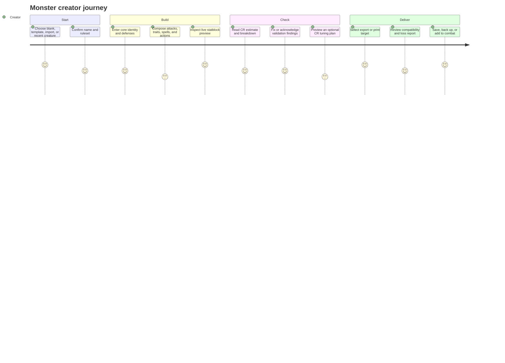

### 3.2 Secondary user: GM at the table

**Need:** Find the creature quickly, read its statblock clearly, add it to initiative, and record combat changes without corrupting the authored source.

```text
Open local library/recent -> select creature -> add snapshot to encounter
  -> set initiative -> advance round -> apply damage/healing/conditions
  -> close tracker -> source statblock remains unchanged
```

### 3.3 Information architecture

```text
DNDSheet
├── Create / Open (default)
│   ├── Monster editor
│   │   ├── Overview and identity
│   │   ├── Defenses and movement
│   │   ├── Traits and spellcasting
│   │   ├── Attacks and action economy
│   │   ├── Encounter extensions
│   │   └── Validation / CR / preview
│   └── Character reference (secondary, explicitly limited)
├── Local library (document collection)
│   ├── Recent / all creatures
│   ├── Search and filters
│   ├── Open / duplicate / rename / delete / export
│   └── Backup / restore
├── Reusable content
│   ├── Templates
│   └── Custom spells
├── At-table tools
│   └── Combat tracker
└── Preferences / presentation
    ├── ruleset identity
    ├── screen and print layout
    └── themes and accessibility preferences
```

**Navigation constraint:** Keep `Create` one click from every surface. Library, templates, spells, and combat are destinations/tools, not replacements for the main editing loop.

---

## 4. Global interaction and visual specification

### 4.1 Desktop editor wireframe

```text
┌──────────────────────────────────────────────────────────────────────────────────────────────┐
│ DNDSheet     [Create] [Library] [Templates]                   [Undo] [Redo] [Saved] [Export ▾]│
│              [Monster ▾] [Rules: 2014 ▾] [Checks 2] [Combat] [Appearance ▾]                  │
├─────────────────────────────────────────┬────────────────────────────────────────────────────┤
│ EDITOR                                   │ LIVE STATBLOCK                                      │
│ [Overview] [Defenses] [Traits] [Spells]  │ [screen ▾] [zoom - 100% +] [print] [copy]          │
│ [Attacks] [Actions] [Encounter]          │                                                    │
│                                          │ Creature Name                                      │
│ ▼ Identity                         0/4   │ Size • Type • Alignment                            │
│   Name / nickname / size / type          │ AC | HP | Speed                                      │
│   Alignment / CR / ruleset               │ Ability scores / saves / skills                    │
│                                          │ Traits / spells / actions                         │
│ ▼ Defenses & movement              2/5   │                                                    │
│   AC / HP / saves / senses               │                                                    │
│                                          │                                                    │
│ ▶ Traits & spellcasting            1/6   │                                                    │
│ ▶ Attacks & actions                3/8   │                                                    │
│ ▶ Encounter options                0/4   │                                                    │
├─────────────────────────────────────────┴────────────────────────────────────────────────────┤
│ CR estimate 4 (open breakdown)     Checks: 2 warnings · View checks           Undoable changes │
└──────────────────────────────────────────────────────────────────────────────────────────────┘
```

**Behavior:** The section strip is sticky within the editor region. Selecting a section scrolls/focuses its heading without collapsing another user-opened section. Issue counts are text plus icon/semantic color. Preview selections MAY navigate to the corresponding editor section; no preview selection mutates data.

### 4.2 Narrow-screen wireframe

```text
┌──────────────────────────────────┐
│ DNDSheet       Saved       [⋮]   │
│ [Monster ▾] [Rules: 2024 ▾]      │
│ [Editor] [Preview]               │
├──────────────────────────────────┤
│ [Overview] [Defenses] [Traits] → │
│                                  │
│ ▼ Identity                       │
│ Name                             │
│ [____________________________]   │
│ Size          Type               │
│ [________]    [______________]   │
│                                  │
│ CR 4 · Checks 2            [Open]│
├──────────────────────────────────┤
│ [Checks] [Undo] [Export]         │
└──────────────────────────────────┘
```

**Behavior:** At the measured narrow breakpoint, do not render a squeezed editor/preview splitter. Editor and Preview become explicit tabs. Keep save state and checks available without covering inputs. Breakpoint MUST be determined from rendered content and accessibility checks, not assumed from a device model.

### 4.3 Design tokens and reusable UI patterns

Do not impose a new brand palette during this product specification. First inventory existing Quasar variables and themes. Consolidate only repeated semantics.

| Token family | Proposed contract | Notes |
|---|---|---|
| Color | `surface`, `surfaceRaised`, `textPrimary`, `textMuted`, `border`, `accent`, `success`, `warning`, `error`, `info` | Status color is always accompanied by label/icon. Theme palette can vary; semantic meaning cannot. |
| Space | 4 px base rhythm; component values drawn from a small token set | Audit before replacing existing spacing. Avoid mass style rewrite. |
| Type | Display / section / body / control / caption / mono | Do not render small captions as the only explanation of a mechanic. |
| Focus | One visible focus-ring token across Quasar controls and custom widgets | Must remain visible on dark, light, printer, and theme surfaces. |
| Motion | Short state transitions only; respect `prefers-reduced-motion` | No motion needed for calculation feedback. |
| Component states | default, hover, focus, active, disabled, loading, error, saved/dirty | Inputs and icon-only controls need labels and accessible names. |

---

## 5. Feature specifications

Each feature includes the user outcome, concept, implementation technique, alternatives, data/operations, states, acceptance contract, and predicted change scope. Proposed names below are design contracts, not claims that functions already exist.

### F-01 — Contextual app navigation and toolbar hierarchy

**Outcome:** Users can find create/open/export and current document status immediately; infrequent presentation tools do not compete with primary work.

**Concept:** Separate document actions (create/open/save/export), editing actions (undo/redo/checks), mode/rules context, and presentation/GM tools.

**Technique:** Keep a compact primary toolbar. Move appearance, A4 composition, and less-frequent utilities into labeled menus/drawers. Retain direct one-click controls for Undo, Redo, Checks, and Export. In character mode, hide monster-only tools and label the mode clearly.

**Alternatives:** (A) Keep all controls in one toolbar with visual grouping; smallest code change but weak scalability. (B) Toolbar + contextual menus; recommended. (C) Full sidebar navigation; more room but adds persistent chrome and changes the app’s fast-editor feel.

| Design contract | Specification |
|---|---|
| Inputs | `activeMode`, active document ID/name, `ruleset`, dirty/save status, undo/redo availability |
| Proposed view model | `ToolbarViewModel { mode, documentLabel, saveState, canUndo, canRedo, ruleset, issueCount }` |
| Operations | `openCreate`, `openLibrary`, `undo`, `redo`, `openChecks`, `openExport`, `openAppearance`, `openCombat` |
| States | create/no document; editing/dirty; saving; saved; save error; character mode; narrow viewport |
| Accessibility | Icon controls have visible tooltip and accessible name; keyboard focus order follows visual order; menus support Escape and return focus to trigger. |
| Acceptance | A first-time user can identify current mode/ruleset and find Open, Checks, and Export without opening Appearance. Monster-only controls are absent or disabled with explanation in Character mode. |

**Predicted code scope:** `MainLayout.vue`, `AppDrawer.vue`, a small toolbar state selector, editor store only if current mode/preferences are missing. Do not rewrite the application shell.

### F-02 — Create, open, and local library entry flow

**Outcome:** A creator can resume work or create a new creature without losing the current document.

**Concept:** A lightweight document picker, not a wizard. Offer Blank, From Template, Import, and Recent. Current draft is always recoverable before switching.

**Wireframe:**

```text
┌────────────────────────────── My Creatures ──────────────────────────────┐
│ [Search name, type, CR…] [CR ▾] [Type ▾] [Ruleset ▾]      [Import] [+New]│
├──────────────────────────────────────────────────────────────────────────┤
│ NAME                   CR    TYPE          UPDATED          ACTIONS       │
│ Ash-Maw                 5    monstrosity   Today            Open ···      │
│ Clockwork Bailiff       2    construct      Yesterday        Open ···      │
│ [Empty state: Create blank / Browse templates / Import a statblock]       │
└──────────────────────────────────────────────────────────────────────────┘
```

**Technique:** Define stable document IDs; persist a summary index; keep full records in the selected repository. Add duplicate/rename/delete with confirmation proportional to recoverability. Deletion should be recoverable through an undo/trash interval if the repository design supports it; otherwise require explicit confirmation and a backup affordance.

**Alternatives:** (A) Keep one autosaved working document and file import/export only; simplest and honest, but no in-app library. (B) Integrate IndexedDB adapter as a local library; recommended only after IDs, migration, and save status are hardened. (C) Add cloud account sync; out of scope.

| Data / operation | Contract |
|---|---|
| `MonsterDocument` | `{ id: MonsterId, envelopeVersion, contentRevision, ruleset, monster, userMetadata }` |
| `MonsterMetadata` | Retired shorthand; use `userMetadata: { title?, tags?, favorite? }` for display metadata. `createdAt`/`updatedAt` are envelope lifecycle fields; source/provenance belongs to `ruleset` provenance or import report. |
| Repository | `listSummaries(query)`, `load(id)`, `save(document)`, `duplicate(id)`, `rename(id,title)`, `delete(id)`, `exportBackup()`, `restoreBackup(file)` |
| Save identity | Immutable UUID; title/name is editable and never a persistence key. |
| Acceptance | Create two same-name records; both remain distinct. Reload and reopen each. Rename does not break links or backups. Search/filter is deterministic. |

**Predicted code scope:** `StoragePort.ts`, `IndexedDbStorageAdapter.ts`, `LocalStorageAdapter.ts`, backend selection/composition, `monster-store.ts` boundary, library route/page, explicit inventory/migration adapter for Pinia + prefixed LocalStorage + existing IndexedDB. Preserve a startup-selected LocalStorage session where required; do not use silent per-operation failover.

### F-03 — Guided section navigation and responsive editor workspace

**Outcome:** Users reach an editor section directly and retain the preview without repeatedly scrolling a long panel list.

**Concept:** Keep a form editor, but add an index and clear completion/issue summaries. Preserve the current split-view metaphor on desktop.

**Technique:** Register section metadata (`id`, label, icon, order, optional `isRelevant`, `summary`, focus target). Use anchor/scroll behavior with reduced motion. Panel open state is presentation preference, not monster data. At narrow widths, switch to Editor/Preview tabs.

**Alternatives:** (A) Add a contents list only; lowest risk. (B) Add list + issue/completion summaries; recommended. (C) Replace forms with a node/diagram canvas; high learning cost and poor fit for dense statblock data.

| Variable / operation | Definition |
|---|---|
| `EditorSectionId` | Stable union of section IDs; not localized labels. |
| `EditorSectionDescriptor` | `{ id, labelKey, order, elementId, summarySelector?, issueCodes?, visibleWhen? }` |
| `activeSectionId` | Ephemeral UI state; may be URL hash only if deep-link behavior is proven useful. |
| `sectionCompletion` | Derived presentation state: `empty | partial | complete | attention`; never changes the model. |
| Operations | 
avigateToSection(id)`, `focusFirstIssue(issue)`, `toggleSection(id)`, `setWorkspaceTab(tab)` |
| Acceptance | Section navigation lands at the right heading and can be reversed with normal scroll. No duplicate IDs. Narrow view has no horizontal overflow and retains accessible editor/preview switch. |

**Predicted code scope:** `MonsterBuilder.vue`, the editor component list, section metadata/selector, CSS breakpoints, targeted editor heading IDs. Avoid extracting every component in the same slice.

### F-04 — Action, trait, attack, and multiattack composition

**Outcome:** Build rich abilities with less repeated typing and fewer broken references.

**Concept:** Common mechanics remain visible; optional mechanics are discoverable through named, summarized disclosure. Ability composition should be structured data plus authored text, not an unbounded custom rules language.

**Technique:** For every repeated ability row support add, duplicate, reorder, delete, and convert-to-template. Provide a template picker with preview. In multiattack fields, show referenced attack/action names with stable IDs underneath; dangling references surface inline and in global checks. Preserve free-form descriptions and token autocomplete.

**Alternatives:** (A) Current large forms, improved labels/disclosure; safest. (B) Categorized subpanel with quick presets and advanced details; recommended. (C) Visual flow builder for every action; defer because it adds a second authoring grammar and a synchronization burden.

| Domain input | Behavior / function contract |
|---|---|
| `MonsterAction`, `MonsterTrait`, `DndAttack`, `Multiattack` | Canonical domain types; entity references use IDs. |
| `TemplateMetadata<T>` | Adds origin, tags, and display information without changing imported ability semantics. |
| `addAbility(kind, initial?)` | Creates a valid default with stable ID; UI selects/focuses the first field. |
| `duplicateAbility(kind,id)` | Deep-clones user data and creates new IDs for the ability and nested ID-bearing records. |
| `reorderAbility(kind,id,destination)` | Reorders within one semantic section and preserves all references. |
| `resolveMultiattackReferences(monster)` | Returns resolved names and unresolved IDs; no mutation. |
| `applyTemplate(template, policy)` | Returns a proposal/report; applies only when user accepts. |
| Acceptance | Duplicate and reorder leave references valid; deleting referenced ability gives an immediate issue and safe repair choices. Keyboard users can add, name, describe, reorder, and remove an ability. |

**Predicted code scope:** Existing editor panels, template store/picker, stable-ID factories, linter target IDs, and one history command boundary. No new rules engine required.

### F-05 — Unified checks, issue navigation, and safe repair

**Outcome:** Catch invalid structure and suspicious content before export and show where/how to resolve it.

**Concept:** “Checks” is always advisory except for structural conditions that make the selected export invalid. It does not judge creativity. Warnings must explain the risk and offer a path to the relevant field.

**Current baseline:** `CrFooter.vue` mounts the dialog and computes `lintMonster(monsterData, spells)` reactively. `MonsterLintDialog.vue` already lists code/severity/message and offers a bulk Auto-Fix button. `LintMonster.ts` emits `targetId` for some findings, but no field/section deep link is rendered. `autoFixMonster` currently removes invalid/empty multiattacks only; the dialog reports every `fixable` issue (including CR drift and spell-slot findings) as included in the bulk count, then writes only `multiattacks`. This means the displayed fixable count can exceed the changes actually applied. The “healthy” state currently uses absolute-sounding 100%-healthy copy. Fix these behavior and copy gaps; do not add a second linter or duplicate a mount point.

**Technique:** Keep `lintMonster(monster, spells)` as the pure evaluator in the first increment. Normalize each finding at the presentation/application boundary to a stable code, severity, target entity/field path, short message key, and an action that is actually implemented for that issue. Recompute when relevant source data changes; prevent expensive CR recalculation on every transient render if profiling requires it, but never delay a visible save. Keep a full breakdown in the existing dialog or promote it to a drawer only after a screen review. Replace the broad bulk action with per-fix proposal/selection and one undoable command; do not mark CR drift auto-fixable unless the fix operation changes a defined CR field.

**Wireframe:**

```text
┌──────────────────────────── Checks · 2 warnings ────────────────────────┐
│ ERROR     Multiattack refers to a deleted action                         │
│           [Go to Multiattack] [Remove missing reference…]                 │
│ WARNING   Bite damage type is empty                                       │
│           [Go to Bite]                                                    │
│ INFO      Printed CR differs from estimated CR                            │
│           Estimated 4; printed 5. See the inputs used. [CR breakdown]     │
│                                        [Recheck] [Close]                   │
└──────────────────────────────────────────────────────────────────────────┘
```

**Alternatives:** (A) Only a manual lint button; simple but easy to forget. (B) Live count plus on-demand details; recommended. (C) Hard-block every warning; rejected because it removes creative control and treats an estimate as authority.

| Data / state | Contract |
|---|---|
| `ValidationIssue` | `{ id, code, severity, category, entityId?, fieldPath?, messageKey, params?, safeFixId? }` |
| `ValidationSnapshot` | `{ sourceRevision, issues, evaluatedAt }` |
| `checksState` | `idle | evaluating | current | stale | failed`; stale findings MUST not be described as current. |
| Operations | `evaluateMonster`, 
avigateToIssue`, `previewRepair`, `applyRepair`, `dismissNotice` (dismissal never erases source issue). |
| Repair contract | `RepairProposal { sourceRevision, changes, explanation, affectedIds }`; reject if sourceRevision changed before apply. |
| Acceptance | Issues remain stable across repeated calculation; navigation focuses the target; repair preview is non-mutating; accepted repair is undoable; export reports target-blocking errors without blocking on advisory warnings. |

**Predicted code scope:** `CrFooter.vue`, `MonsterLintDialog.vue`, `LintMonster.ts` fixability/action contract, selected editor target components for deep-link IDs, history/command boundary, and only the export integration needed for blocking structural issues. Do not add an event bus; use a derived selector/composable at the presentation boundary. The dialog is already wired; wire-up is not implementation scope.

### F-06 — Explainable CR breakdown and preview-first tuner

**Outcome:** Creators can interpret an estimate and safely explore adjustments without believing the app guarantees balance.

**Current baseline:** `CrFooter.vue` already displays estimated/offensive/defensive CR and damage/attack breakdown popovers. It opens `AutoTuneDialog.vue`, which calls `generateAutoTunePlan` reactively and lists recommendations. `applyTuning` then writes `CR`, proficiency, AC, HP fields, and optionally attacks directly to Pinia; it does not show a statblock preview, per-recommendation selection, stale-source guard, or one explicit history transaction. The planner recommendation for attack bonus is not itself applied to an attack modifier. Preserve its existing formula and tests while correcting the application boundary and copy; do not implement a second tuner.

**Concept:** Preserve the existing DMG-inspired estimate. Present its components and assumptions, then make tuning a proposal with selective changes.

**Technique:** `calculateCr` yields one immutable breakdown. A tuning session stores original monster revision, target CR, recommendation selection, and a preview copy. Selecting a recommendation changes preview only. Apply uses one command and one named history transaction; cancel discards preview.

**Wireframe:**

```text
┌──────────────────────── Tune CR · current 2 → target 4 ─────────────────┐
│ This is a DMG-based estimate. Review each suggested change.              │
│ [✓] HP     45 → 72       Target tier midpoint; CON retained              │
│ [✓] AC     13 → 14       Defensive tier                                 │
│ [ ] Damage 18 → 27       Scales selected attacks; review spell damage     │
│ [ ] PB     +2 → +2       No change                                      │
│                                                                         │
│ [Reset] [Cancel]                  [Preview selected changes] [Apply]      │
└─────────────────────────────────────────────────────────────────────────┘
```

**Alternatives:** (A) Existing one-click application; fastest but high surprise. (B) Full attribute-by-attribute wizard; more control but burdensome. (C) Selective plan + live statblock/CR preview; recommended.

| Contract | Definition |
|---|---|
| Existing calculation | `calculateCr(monster, spells?) -> CrEvaluationResult` |
| Existing planner | `generateAutoTunePlan(monster,targetCr,options) -> AutoTunePlan` |
| Proposed session | `AutoTuneSession { baseRevision, plan, selectedRecommendationIds, previewMonster }` |
| Proposed operations | `beginTune`, `selectRecommendation`, `recomputePreview`, `cancelTune`, `applyTune` |
| Invariants | Original state is unchanged until `applyTune`; plan becomes stale when source revision changes; every applied field is listed; user overrides are not silently discarded. |
| Acceptance | Can tune up/down across CR boundary cases, inspect result, cancel with no diff, apply with one undo, and undo back to byte-equivalent semantic data. |

**Predicted code scope:** `CrFooter.vue`, `AutoTuneDialog.vue`, `AutoTuneCr.ts` only if plan/result shape needs explicit selected changes, main editor transaction boundary, history and preview selectors. The dialog is already wired; upgrade it from immediate direct-store apply to preview/selection/atomic apply. Validate dice rounding and interaction with limited use, spells, legendary actions, paragon/extended HP before claiming CR parity.

### F-07 — Save status, repository integration, backup, and recovery

**Outcome:** Users trust that their current draft and saved library record are recoverable.

**Concept:** “Current working document” and “library record” are different lifecycle states. A local-first app can keep autosave, but it must show successful completion and recover from errors.

**Current baseline:** `IndexedDbStorageAdapter` delegates each missing-IndexedDB or caught-operation path to a `LocalStorageAdapter`; `LocalStorageAdapter` uses the `dndsheet_monster_` key prefix and both adapters synthesize identity from `id || name || 'unnamed'`. This creates at least three distinct state surfaces to inventory before migration: Pinia's persisted current monster, records under the adapter prefix, and any IndexedDB records. The app has no adapter composition call site in `src`, so runtime availability of those adapter records is unverified.

**Technique:** Add a repository service with a backend selected once at application startup. If IndexedDB opens successfully, use it; if it is absent/unavailable at startup, select LocalStorage for the session and expose its lower capacity. Once a backend is selected, an operation failure returns a visible typed error; do not silently switch backend per operation. Migrate adapter-prefix LocalStorage and the current Pinia document as separate discovered sources: snapshot, parse/migrate, assign non-conflicting stable IDs, copy, re-read, semantically compare, then mark each source migrated. Keep originals until backup/verification is complete. Use an outbox/retry only for unsaved writes on the selected backend if justified; no network sync.

**Alternatives:** (A) Keep Pinia persistence and both adapter stores; least migration work but split ownership continues. (B) Select one repository backend per startup session, preferring IndexedDB and using LocalStorage only when selected at boot; recommended transition. (C) IndexedDB only with LocalStorage as explicit import/restore source; simpler steady state but weaker operation on browsers without IndexedDB. (D) Persist everything, including preferences, in IndexedDB; increases migration blast radius and is not needed.

```text
dirty edit -> save queued -> write pending -> saved
                                  ├── quota -> save error -> retry / export backup
                                  └── transient failure -> retry -> saved or visible error
```

| State / operation | Contract |
|---|---|
| `SaveState` | `{ phase: clean|dirty|saving|saved|error, documentId, lastSavedAt?, errorCode? }` |
| `saveCurrentDocument(document)` | Returns `{ ok, documentId, updatedAt }` or typed `SaveFailure`; no swallowed catch. |
| `flushPendingSave()` | Resolves only after pending write succeeds/fails visibly; idempotent. |
| `selectStorageBackend()` | Chooses one stable adapter per app session; exposes selected backend/capability. Never retries a failed write against a second backend implicitly. |
| `migrateLegacySources(sources[])` | Separately copies current Pinia state and prefixed LocalStorage records; validates/migrates, assigns stable IDs, re-reads/compares, then records source-specific completion; each original remains until verified. |
| `exportBackup()` / `restoreBackup()` | Versioned envelope; restore validates all entries before replacing or merges by explicit policy. |
| Acceptance | Simulated write failure shows persistent error and retry; successful state only follows durable adapter result. Legacy data survives migration failure. Duplicate titles and reopened records remain separate. |

**Predicted code scope:** `StoragePort`, adapters, composition root, `monster-store`, boot/init, save-status component, backup importer, IndexedDB migration tests. This is a cross-layer slice and must follow stable IDs.

### F-08 — Export target preview and compatibility report

**Outcome:** The creator knows what will be exported and which extended fields are unsupported by a target.

**Concept:** The canonical document remains the source; each output is a projection with declared capabilities.

**Technique:** Define `ExportTargetAdapter` returning content, media type, extension, warnings/losses, and optional required fixes. Build a preview without downloading. Markdown, text, HTML, Foundry, Tarrasque, PNG/print remain distinct adapters; do not force them into a generic renderer that erases target semantics.

**Alternatives:** (A) Existing export menu; minimal. (B) Target chooser + preview/report; recommended. (C) Arbitrary export plugin SDK; not justified.

| Contract | Definition |
|---|---|
| `ExportRequest` | `{ document, targetId, ruleset, options }` |
| `ExportResult` | `{ fileName, contentType, payload, warnings[], omittedFields[], sourceRevision }` |
| Operations | `prepareExport`, `renderExportPreview`, `downloadPreparedExport`, `copyPreparedExport` |
| Invariant | Exported result records source revision. If document changes while preview open, mark preview stale and regenerate. |
| Acceptance | Each existing format has a representative fixture; unsupported fields are named; `.5emm.json` round-trips losslessly; user can cancel before download. |

**Predicted code scope:** `ExportStatblock.ts`, `DownloadButton.vue`, existing output renderers, target capability definitions, tests and docs. Do not change their public formats in one bulk migration.

### F-09 — Explicit ruleset identity and provenance

**Outcome:** Users can distinguish rules assumptions from visual style and understand imported/exported edition provenance.

**Concept:** `ruleset` describes mechanical/editorial assumptions; `visualTheme` describes appearance; `rendererStyle` describes output grammar where required. These are separate axes.

**Technique:** Introduce a typed `RulesetId` with explicit supported values (`5e-2014`, `5e-2024`, `homebrew`). Unknown/legacy is provenance status, not a ruleset ID. Route only rules-sensitive calculations/labels through a ruleset policy. Preserve unknown provenance on import. Add an explicit conversion operation only when a conversion mapping and warnings exist.

**Alternatives:** (A) Keep `style` as rendering-only and label it accordingly; safe bridge. (B) Persist ruleset metadata with each document and add conversion services; recommended gradual path. (C) Automatically infer/convert imported edition; reject because inference can silently misstate rules.

| Variable / function | Contract |
|---|---|
| `RulesetId` | Closed union: `5e-2014 | 5e-2024 | homebrew`; unknown is represented by `RulesetProvenance.status`, never by a fake ruleset value. |
| `DocumentProvenance` | `{ sourceKind, sourceName?, importedAt?, claimedRuleset?, confidence? }`; do not claim factual source when absent. |
| `resolveRulesPolicy(ruleset)` | Returns explicit calculation/render policies; unknown route uses documented compatibility default plus warning. |
| `convertRuleset(document,target)` | Returns proposed converted document and issue/loss report; never mutates original. |
| Acceptance | Theme switch leaves ruleset/model unchanged. Ruleset change is visible, persisted, undoable, and does not masquerade as conversion. |

**Predicted code scope:** document envelope, editor store naming compatibility, CR calculation input, renderer/export paths, import adapters, tests. Begin by renaming UI control copy; metadata migration only after storage identity.

### F-10 — Combat tracker identity and source snapshot behavior

**Outcome:** Run a compact encounter without initiative-order changes selecting the wrong combatant or mutating source sheets.

**Concept:** Encounter combatants are snapshots with their own runtime state and a source reference. They are not aliases to authored records.

**Technique:** Store stable `CombatantId` for active turn, derive display order, reconcile active identity after sort/remove, and define what happens when a combatant is removed. On add, capture name/HP/initiative baseline and source document ID/revision. If source changes after encounter add, do not alter current encounter silently.

**Alternatives:** (A) Keep numeric active index; simple but unstable under sorting/removal. (B) Stable active ID; recommended. (C) Rebuild initiative order by round on every edit; predictable only if explicitly requested.

| Contract | Definition |
|---|---|
| `Combatant` | `{ id, sourceRef?, sourceRevision?, name, initiative, currentHp, maxHp, tempHp, conditions[], deathSaves, isMonster }` |
| `EncounterState` | `{ id, round, activeCombatantId?, combatants[], startedAt?, updatedAt }` |
| Operations | `addSnapshot`, `setInitiative`, `applyDamage`, `applyHealing`, `toggleCondition`, `advanceTurn`, `previousTurn`, `removeCombatant`, `resetEncounter` |
| Invariant | Sorted order is a projection; active identity is stable ID. Healing/damage mutate encounter copy only. |
| Acceptance | Changing initiative and removing another combatant preserve active identity; round transition is correct; a source monster remains unchanged after encounter edits. |

**Predicted code scope:** `CombatTracker.ts`, `combat-store.ts`, `CombatTrackerDrawer.vue`. Campaign-level encounter persistence remains out of scope.

### F-11 — Character reference mode scope and correctness

**Outcome:** Character mode is useful and truthful about the values it displays.

**Concept:** Near term: compact player reference, not full character generation. Values must be editable or derived from modeled inputs.

**Technique:** First add explicit armor/AC configuration and speed to the character model or label AC as a baseline estimate and allow manual override. Render speed/AC from canonical selectors. Ensure hit points, spell slots, resources, and equipment have clear manual-versus-derived rules. Keep class/subclass text free-form until a rules dataset and legal data policy exist.

**Alternatives:** (A) Clearly label “reference sheet, values may be manual”; lowest risk. (B) Complete a limited character sheet with explicit inputs and derived values; recommended if user prioritizes it. (C) Full character builder with automation/content database; defer.

| Contract | Definition |
|---|---|
| `CharacterActor` | Existing domain object; proposed additions must be versioned and defaulted. |
| `CharacterDefense` | `{ acMode: manual|unarmored|armor, manualAc?, armorItem?, shield?, bonuses? }` only if full derivation is in scope. |
| `CharacterMovement` | `{ walk, climb?, swim?, fly?, burrow? }` with units and display rules. |
| Operations | `deriveCharacterAc(actor)`, `deriveCharacterSpeed(actor)`, manual override setters. |
| Acceptance | Every displayed value has a visible source or an “estimate/manual” marker; no hardcoded speed/AC presented as computed truth. |

**Predicted code scope:** `CharacterActor`, `defaultCharacterActor`, migration/defaulting, `character-store`, `CharacterEditor.vue`, `CharacterSheet.vue`, character exports. Keep this independent of monster schema.

### F-12 — Appearance, print composition, and preview behavior

**Outcome:** Authors can publish attractive statblocks while screen and print outputs remain readable and semantically stable.

**Concept:** Separate semantic content, layout, and art layers. Presentation settings never change CR math or rules data.

**Technique:** Add named presets (`Screen`, `Ink saver`, `Art plate`) that map to existing `visualTheme`, `visualTemplate`, and A4 layout controls. Advanced layer editing remains in an inspector. Preview controls show fit/actual size and a clear reset. Missing art falls back to a readable neutral surface.

**Alternatives:** (A) Keep current granular A4 controls; powerful but discovery cost. (B) Add presets over existing controls; recommended. (C) Replace composition studio with a general graphics editor; out of scope.

| State | Contract |
|---|---|
| `PresentationPresetId` | `screen | inkSaver | artPlate | custom` |
| `PresentationSettings` | Layout/theme/zoom/layers, stored separately from mechanical data unless artifact portability is intentional. |
| Operations | `applyPreset`, `resetComposition`, `setPreviewScale`, `toggleActualSize`, `reportAssetFailure` |
| Acceptance | Switching preset cannot change serialized monster mechanics; A4 print scale is measurable; image failure leaves text readable. |

**Predicted code scope:** `editor-store.ts`, `A4LayerStudio.vue`, `WebRenderer.vue`, app styles, print stylesheet. Do not rework all theme CSS before capturing current baseline screenshots.

### F-13 — Keyboard, accessibility, responsive quality, and error recovery

**Outcome:** Keyboard, touch, zoom, and screen-reader users can complete the primary workflow; failures explain recovery rather than losing work.

**Technique:** Audit semantic controls and labels; implement focus return, dialog Escape behavior, visible focus, non-color issue labeling, adequate hit areas, reduced motion, 200% zoom, and narrow layout. Centralize application error display by error class (validation, storage, import, export, rendering) with action-oriented messages.

**Alternatives:** (A) Opportunistic fixes per feature; fragmented. (B) Acceptance checklist and shared tokens/components applied as features change; recommended. (C) Build a new design system package; unnecessary for this app’s scale.

| Error class | User-facing response |
|---|---|
| Validation | Identify field/section; preserve input; offer a safe fix only when deterministic. |
| Storage | Show unsaved state; retry and export backup; never claim success. |
| Import | Preserve source file; report line/field/record and whether any records were applied. |
| Export | Keep editor intact; show target failure and allow retry/copy where safe. |
| Rendering | Keep editing available; show fallback preview and diagnostic detail behind a disclosure. |

**Acceptance:** Full create → check → preview → export can be completed without a pointer; dialogs restore focus; color alone never communicates error; at 200% zoom and the agreed narrow viewport the primary controls remain available.

---

### F-14 — Spellcasting accuracy, provenance, and compact projection

**Outcome:** Creators can select, describe, and present spellcasting without false counts, misleading class/subclass options, or layout that hides the relationship between spell levels, slots, and recovery.

**Concept:** Keep authored spell choices, data-source candidates, class/subclass eligibility, granted spells, preparation limits, remaining resources, and rendered summary as distinct concepts. A curated catalog can assist selection, but it is not proof of complete rules legality. Manual and homebrew entries remain first-class.

**Technique:** Audit the current spell data and `useSpellLevels`/`AutoSyncSpellcasting` behavior before changing calculations. Return a typed success/unavailable/error result instead of plausible fallback counts. Filter candidates only by verified catalog metadata; label unsupported/custom entries. Project one semantic spellcasting model into editor, preview, and supported exports, preserving cadence, class/subclass provenance, slot model, order, and source text. Keep overrides visible and distinguish selected, allowed, granted, prepared, remaining, and maximum values only where each concept is actually represented by current product scope.

**Alternatives:** (A) Keep manual spell prose only; lowest data/legal risk but weak selection assistance. (B) Add curated, provenance-labeled selection and truthful metrics while preserving manual entries; recommended incremental path. (C) Claim complete official spell lists and legality enforcement; defer until coverage, rules edition, data rights, and exhaustive fixtures are demonstrated.

| Contract | Definition |
|---|---|
| `SpellSourceRef` | `{ sourceId?, sourceName?, ruleset?, confidence: known|user-supplied|unknown }`; no provenance is fabricated for legacy/custom text. |
| `SpellMetricResult` | Discriminated success/unavailable/error result with metric values, assumptions, provenance, and source revision; never substitute a plausible default after calculation failure. |
| `SpellcastingProfile` | Proposed view/domain boundary for class/subclass context, ability, progression/slot model, selected/granted entries, recovery cadence, and explicit user overrides. Confirm ownership and schema need at WP-11 before persistence. |
| Candidate filtering | Level/class/subclass/source filters apply only to fields verified in the curated dataset; custom text remains selectable and visibly custom. |
| Projection | Editor, preview, print, and claimed export derive from one revision-bound semantic view model; renderer does not own spell rules. |
| Acceptance | Primary/multiclass/subclass/custom-source fixtures; calculation failure is explicit; no false official-completeness claim; counts and cadence match source semantics; narrow/print/export projections preserve meaning and authored order. |

**Predicted code scope:** `ClassCastingEditor.vue`, `SpellcastingEditor.vue`, `useSpellLevels.ts`, `AutoSyncSpellcasting.ts`, spell data/provenance, `useTextRenderer.ts`, `WebRenderer.vue`, `statblock-grammar.scss`, focused fixtures and any export adapters actually consuming the projection. Keep spell catalog lifecycle separate from monster document identity; do not persist a schema expansion unless migration/round-trip evidence requires it.
## 6. Architecture and data contracts

### 6.1 Proposed dependency lattice (outer UI to inner policy)

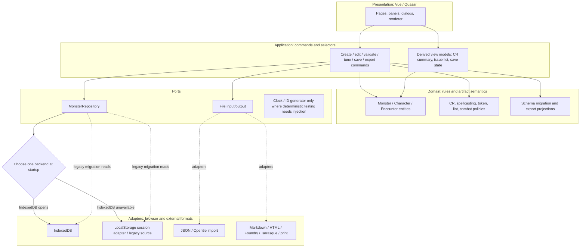

**Dependency rule:** Domain and use cases MUST NOT import Vue, Quasar, Pinia, DOM APIs, IndexedDB, `window`, file download helpers, or localized UI strings. Presentation adapters may import domain contracts. Browser adapters implement ports. The current code is mid-transition; enforce this rule on touched modules, not through a risky wholesale move.

### 6.2 Current model field map and ownership

The canonical `Monster` object is already broad. Before adding fields, group the existing schema by user meaning and assign each group an owner. This prevents UI labels, calculated values, print layout, and persistence metadata from being mixed together.

| Current field group | Observed fields/state (owner varies: `Monster`, editor/feature store, or derived view) | Intended owner and boundary |
|---|---|---|
| Identity and semantics | 
ame`, 
ickname`, `size`, `type`, `alignment`, `languages`, `alphaTraits`, `useArticleInToken` | Rules content; identity metadata such as document ID and provenance belongs in the envelope. |
| Compatibility | `saveVersion` | Persistence/migration metadata. Retain compatibility during envelope migration; do not use this as UI state. |
| CR and defenses | `AC`, `ACType`, `acConfig`, `CR`, `lairCr`, `lairCrNote`, `useCrDisplayOverride`, `crOverride`, `proficiency`, `proficiencyOverride`, `HP`, `hpModifierOverride`, `hpDieTypeOverride`, `extendedHp`, `paragonConfig` | Domain rules data; `calculateCr` derives estimates and should not rewrite these values. |
| Ability and checks | `stats`, `saves`, `skills`, `tools`, `initiativeConfig`, `passivePerception` | Domain rules data; calculated modifiers are selectors/use-case results. |
| Movement, senses, defenses | `speeds`, `speedTraversal`, `senses`, `sensesNotes`, `sensesList`, `resistances`, `immunities`, `vulnerabilities`, `conditions`, typed defense lists, `detailedDamageModifiers`, `specialCommunicationArchetype` | Domain rules data. Human-readable renderer strings should be projections, not a second source of truth where structured input exists. |
| Ability content | `traits`, `attacks`, `actions`, `multiattacks`, `multiattackOptions`, `reactions`, `legendaryActions`, `mythicActions`, `lairActions`, `regionalEffects`, `villainActions`, `bloodiedActions`, `reactiveActions`, `comboActions`, `actionOrientedPassives`, `anatomyParts`, `runehammerTrack` | Nested domain entities with stable IDs and explicit references. |
| Spellcasting | `spellcasting.stat`, save/modifier/attack overrides, `class`, `level`, `slots`, `atWill`, `standard`, notes/preambles, multiclass/classes, resource cadence, display mode, cadence maps, metamagic and cantrip-switch fields where used by the active store | Domain content/configuration. A type parity audit is required: the inspected `Monster` interface does not declare every spellcasting field initialized in `monster-store.ts`. |
| Equipment and portrait | `inventory`, `portrait` | Inventory is domain/rendered content; portrait source and crop may be artifact presentation metadata. Decide what travels with export/document. |
| Calculated policy flags | `autoEstimateDefenseCr` and user override booleans | Domain/configuration only where they alter calculation; values should be labeled and documented. |
| Presentation state | `visualTheme`, `visualTemplate`, `a4PreviewMode`, zoom, layer arrangement, open panels, splitter width | `editor-store.ts` preference state is the observed owner; a user-selected presentation profile may become document data only after an explicit per-device/per-document decision. Never CR inputs. |
| Runtime state | combatants, round, active turn, modal state, focus/active section, current checks snapshot, pending save | Feature stores/view models; never embed ephemeral UI state in `Monster`. |

**Type-contract migration requirement:** Compare `defaultMonster()`, Pinia initial state, all editor writes, import migrations, renderers, and export paths against `Monster`. Generate a field-coverage matrix before closing the gap. Avoid assuming TypeScript currently catches every mismatch; several paths use casts/`any` and defaults are partially generated outside the domain type.

### 6.3 Existing state and derived behavior inventory

| Existing owner | Current state variables / behaviors | Target ownership |
|---|---|---|
| `monster-store.ts` | Full monster object, persisted with Pinia; computed/save/skill/attack/spell modifiers, references, CR-oriented summaries, nested add/delete/reorder mutation actions | Keep reactive object temporarily; move pure derivation to core selectors/use cases; keep mutation entrypoints in commands/application layer. |
| `character-store.ts` | `actor`, reset/set stat, saves/skills/spells/items/features; persisted with Pinia | Character feature store; selectors pure; correct visible AC/speed source. |
| `combat-store.ts` | `combatants`, `currentRound`, `activeTurnIndex`, `isEncounterActive`, sorted/active computed values, damage/heal/condition/death-save/turn actions; persisted with Pinia | Encounter state; replace index identity with stable ID and preserve source snapshot. |
| `history-store.ts` | `HistoryLedger<Monster>(50)`, undo/redo flags, `isExecutingHistory`, debounced snapshots | Command transaction history; make state boundaries named and revision-aware; define history lifetime and non-monster scope explicitly. |
| `editor-store.ts` | `statBlockColumns`, `style`, `visualTemplate`, `visualTheme`, `activeMode`, A4 view/zoom/orientation/layout/layers and composition values; persisted | UI preferences plus explicitly selected per-document presentation profiles; avoid mixing with rules document state. |
| `spells-store.ts` | spell catalog and custom spells; persisted through store | User content collection with stable IDs, source/provenance and independent backup/export behavior. |
| `templates-store.ts` | template library and v1 update path; persisted through store | User content collection, distinct stock/user origin and conflict-safe import. |

**Existing core function inventory relevant to this design:** `calculateCr`, `buildAttackInfo`, `expectedAttackDamage`, `attackModifier`, `legendaryCombo`, `generateAutoTunePlan`, `lintMonster`, `autoFixMonster`, `migrateMonsterSchema`, `processTokens`, `ingestAiStatblock`, `extractJsonFromText`, `autoSyncSpellcasting`, `calculateMulticlassSpellcasting`, `exportToMarkdown`, `exportToPlainText`, `exportToHtml`, `exportToFoundryActor`, `exportToFoundryJson`, character export functions, combat operations (`applyDamage`, `applyHealing`, `advanceTurn`, `previousTurn`, `recordDeathSave`), and `HistoryLedger` methods (`pushSnapshot`, `undo`, `redo`, `clear`). Their existence does not prove UI wiring or end-to-end behavior.

### 6.4 Entity model (conceptual UML)

```mermaid
classDiagram
  class MonsterDocument {
    +MonsterId id
    +int envelopeVersion
    +int contentRevision
    +datetime createdAt
    +datetime updatedAt
    +RulesetProvenance ruleset
    +DocumentProvenance provenance
    +Monster monster
    +PresentationData presentation
    +UserMetadata userMetadata
  }
  class UserMetadata {
    +string title
    +string[] tags
    +boolean favorite
  }
  class Monster {
    +string name
    +int CR
    +DndDice HP
    +AbilityScores stats
    +MonsterDefense defenses
    +MonsterTrait[] traits
    +DndAttack[] attacks
    +MonsterAction[] actions
    +Multiattack[] multiattacks
    +Spellcasting spellcasting
  }
  class PresentationData {
    +VisualTheme visualTheme
    +RendererStyle rendererStyle
    +PrintLayout printLayout
  }
  class DocumentProvenance {
    +SourceKind sourceKind
    +string sourceName
    +string claimedRuleset
    +Confidence confidence
  }
  class MonsterAction {
    +EntityId id
    +string name
    +string description
    +CrAnnotation crAnnotation
  }
  class MonsterTrait {
    +EntityId id
    +string name
    +string description
    +LimitedUse limitedUse
    +CrAnnotation crAnnotation
  }
  class DndAttack {
    +EntityId id
    +string name
    +Damage damage
    +AttackModifier modifier
  }
  class Multiattack {
    +EntityId id
    +EntityId[] attackIds
    +EntityId[] actionIds
  }
  class ValidationSnapshot {
    +Revision sourceRevision
    +ValidationIssue[] issues
    +datetime evaluatedAt
  }
  class AutoTunePlan {
    +Revision sourceRevision
    +string targetCr
    +Recommendation[] recommendations
  }
  class Encounter {
    +EncounterId id
    +int round
    +CombatantId activeCombatantId
    +Combatant[] combatants
  }
  class Combatant {
    +CombatantId id
    +SourceRef sourceRef
    +int initiative
    +int currentHp
    +int maxHp
    +Condition[] conditions
  }
  class MonsterRepository {
    <<interface>>
    +listSummaries(query)
    +load(id)
    +save(document)
    +delete(id)
  }
  MonsterDocument *-- Monster
  MonsterDocument o-- PresentationData : optional; persist only by decision
  MonsterDocument o-- DocumentProvenance : optional
  MonsterDocument o-- UserMetadata : optional
  Monster *-- MonsterAction
  Monster *-- MonsterTrait
  Monster *-- DndAttack
  Monster *-- Multiattack
  Multiattack ..> DndAttack : references by ID
  Multiattack ..> MonsterAction : references by ID
  ValidationSnapshot ..> MonsterDocument : evaluates revision
  AutoTunePlan ..> MonsterDocument : proposes changes against revision
  Encounter *-- Combatant
  Combatant ..> MonsterDocument : source snapshot reference
  MonsterRepository ..> MonsterDocument : persists
```

**Entity boundaries:** `MonsterDocument` is the persistence/version/provenance envelope; `Monster` is rules content; `PresentationData` is optional and must not affect rules calculations. `ValidationSnapshot` and `AutoTunePlan` are derived/proposal records, not embedded in monster content unless the user explicitly saves an audit annotation. `Combatant` is encounter-owned runtime state.

### 6.5 Canonical variables and identity

| Name | Type | Owner | Persistence | Rule |
|---|---|---|---|---|
| `MonsterId` | UUID-like opaque string | document/repository | persistent | Immutable; never derived from name. |
| `EntityId` | UUID-like opaque string | nested monster entity | within document | Stable across edit; new ID on duplication. |
| `envelopeVersion` | positive integer | document envelope | persistent | Monotonic; migrates envelope fields sequentially and explicitly. |
| `monster.saveVersion` | current monster-payload version (legacy field name; confirm actual owner before changing) | `Monster` payload | persistent | Existing monster migration chain only; not interchangeable with `envelopeVersion`. |
| `ruleset` | `RulesetProvenance` containing a closed `RulesetId` only when explicit | document envelope | persistent | Unknown is explicit provenance status; never inferred from theme or UI default. |
| `contentRevision` | monotonic non-negative integer | application/document lifecycle | persistent | Increment on every accepted semantic mutation, including undo/redo; never decrement/reuse. Used to stale previews. |
| `activeSectionId` | `EditorSectionId` | editor UI | preference optional | Never persisted in monster data. |
| `activeCombatantId` | `CombatantId?` | encounter | encounter persistence | Identity, not sorted-array index. |
| `saveState` | `SaveState` | repository service/view model | runtime | Success only after adapter resolution. |
| `validationSnapshot` | `ValidationSnapshot?` | derived/application | runtime | Invalidated when source revision differs. |
| `visualTheme` | `VisualTheme` | presentation prefs/document setting | user preference or doc metadata by choice | Never influences CR or mechanics. |
| `exportTargetId` | closed union | export UI | runtime | Each target owns its projection/loss report. |

### 6.6 Application operation contracts

These signatures describe the proposed application boundary, not a requirement to break existing core APIs. Existing pure use cases may continue receiving `Monster`; the application operation unwraps `MonsterDocument.monster`, supplies an explicit rules policy/catalog revision, and binds the result to the captured document revision. Preserve existing behavior first; change a core signature only when a concrete invariant cannot be enforced at the application boundary.

| Operation | Inputs | Output | Mutation rule |
|---|---|---|---|
| `createMonsterDocument(source)` | blank/template/import source, IDs, clock | valid document + creation report | New stable document and nested IDs. |
| `applyMonsterCommand(document, command)` | current document/revision and typed command | next document + change summary | Pure or transactionally applied; one undo boundary per user-intent operation. |
| `calculateCr(document, spells)` | rules content and ruleset policy | CR breakdown | Pure; deterministic for same inputs. |
| `lintMonster(document, spells)` | rules content | issues | Pure; does not auto-repair. |
| `proposeRepairs(document, issueIds)` | current revision and selected issues | repair proposal | Non-mutating; deterministic fixes only. |
| `buildAutoTunePlan(document,target,options)` | document/revision | plan | Non-mutating. |
| `applyProposal(document,proposal)` | document and proposal revision | new document or stale conflict | Rejects stale proposal; one undo item. |
| `migrateMonsterDocument(raw)` | unknown JSON envelope | migrated document + migration report or typed error | Never mutates input; never discards original backup before successful validation. |
| `prepareExport(document,target)` | document/revision/target options | export payload + warnings/losses | Non-mutating; reports unsupported data. |
| `saveDocument(document)` | document and expected persisted base revision/hash | `Result<{ documentId, contentRevision, updatedAt }, SaveFailure>` | Async compare-and-write; updatedAt comes from durable adapter success; visible pending/error states. |
| `addCombatantSnapshot(document, initiative)` | current document and encounter | encounter combatant | Copies runtime baseline and stores source reference/revision. |

### 6.7 Module/folder target

```text
src/
  app/                         # Composition root, repository/service construction
  features/
    monster-editor/            # Pages, panels, editor section registry, view models
    library/                    # Search/list/open/duplicate/backup UI
    checks/                     # Issue presentation and focus navigation
    tuning/                     # Preview-first tuning UI/session
    combat/                     # Encounter store and HUD
    character-reference/        # Explicitly scoped character workflow
    export/                     # Target selection and compatibility report
  core/
    domain/                     # Canonical models, IDs, ruleset and invariant types
    usecases/                   # Pure calculations, lint, migration, transforms
    ports/                      # Repository, file IO contracts
    adapters/                   # IndexedDB/local migration/import/export adapters
  components/                   # Shared Quasar primitives only
```

**Migration rule:** Do not move every file to this target at once. Introduce one canonical type barrel; make the old `src/components/models.ts` re-export it; move a module only when its imports and tests are updated in the same change. Keep Vue-only computed adapters outside `core`.

---

## 7. Data-flow diagrams

### 7.1 Edit → calculate → validate → render

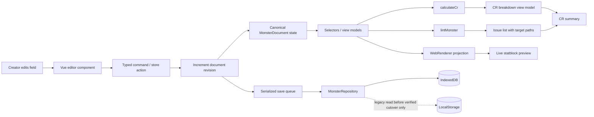

**Flow rules:** Calculation, lint, and rendering consume the same revision. If a result arrives for an older revision, discard it or mark it stale. Saving is independent from validation so a warning cannot prevent draft recovery. Select exactly one durable backend for the app session. LocalStorage may be the selected backend only when chosen at startup; after an operation failure, report the error rather than switching backends. A migration reads source data and writes only to the selected destination until it is verified.

### 7.2 Import / migration / user acceptance

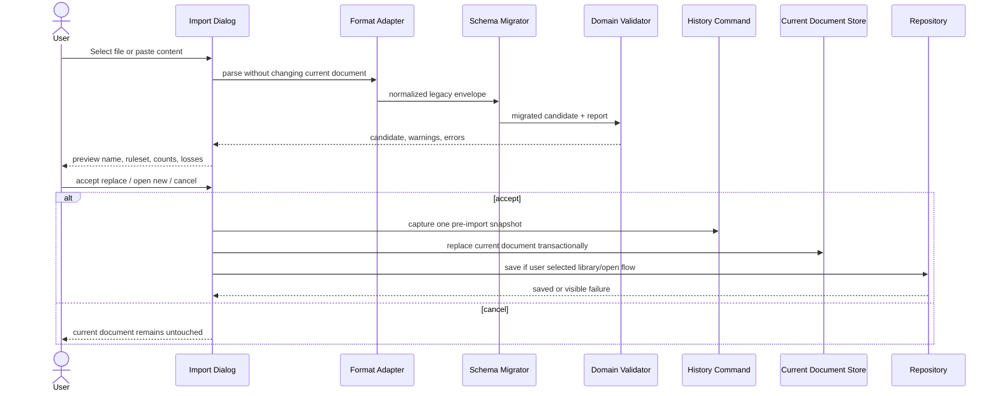

### 7.3 Export preparation

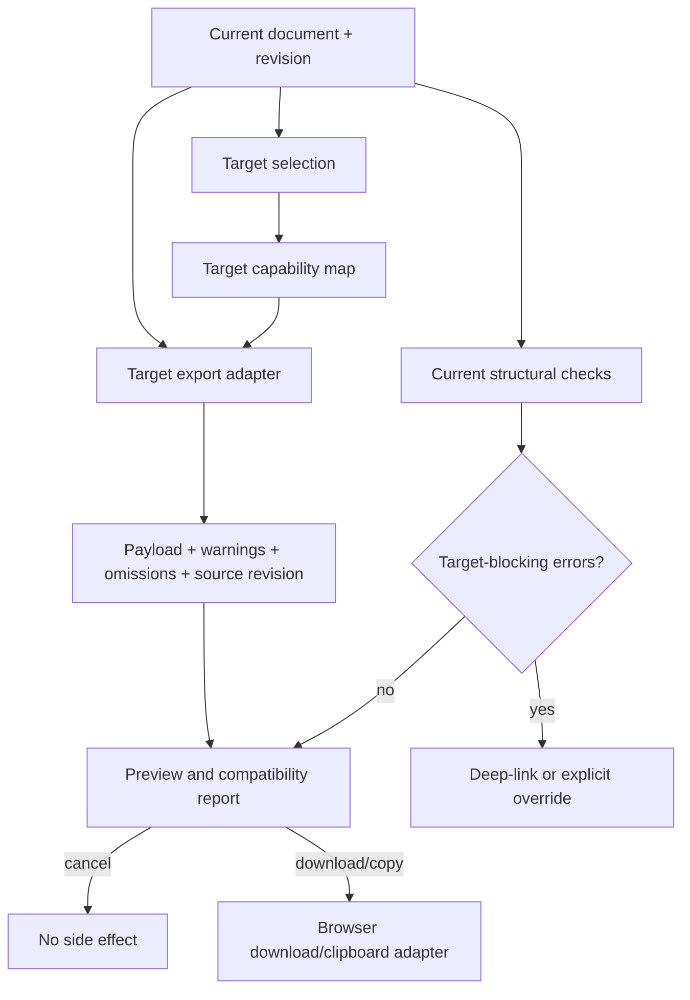

### 7.4 Save failure recovery

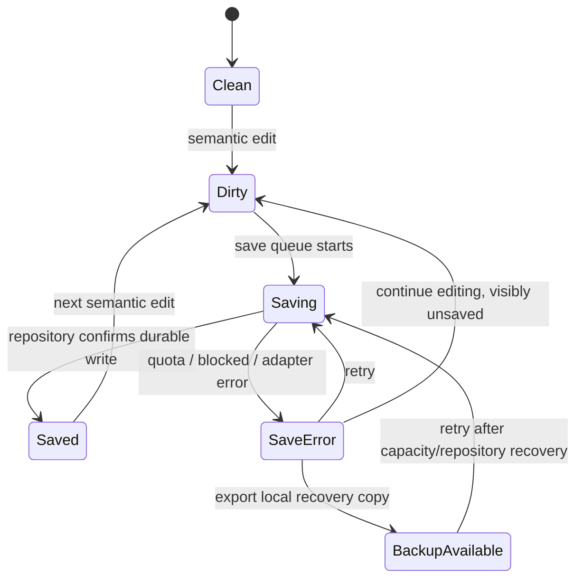

---

## 8. UML state and behavior specifications

### 8.1 Document lifecycle

```mermaid
stateDiagram-v2
  [*] --> BlankDraft
  BlankDraft --> Editing: create
  LibraryRecord --> Editing: open(id)
  Editing --> Dirty: applyCommand
  Dirty --> Saving: repository request
  Saving --> Saved: write confirmed
  Saving --> SaveError: write rejected
  SaveError --> Saving: retry
  Dirty --> ImportCandidate: begin import in separate buffer
  ImportCandidate --> Editing: accept as current / create separate record
  ImportCandidate --> Dirty: cancel; preserve prior draft
  Editing --> ExportPrepared: prepare target output
  ExportPrepared --> Editing: cancel or preview stale
  ExportPrepared --> Exported: user confirms output
  Editing --> LibraryRecord: save/create library record
```

### 8.2 Validation lifecycle

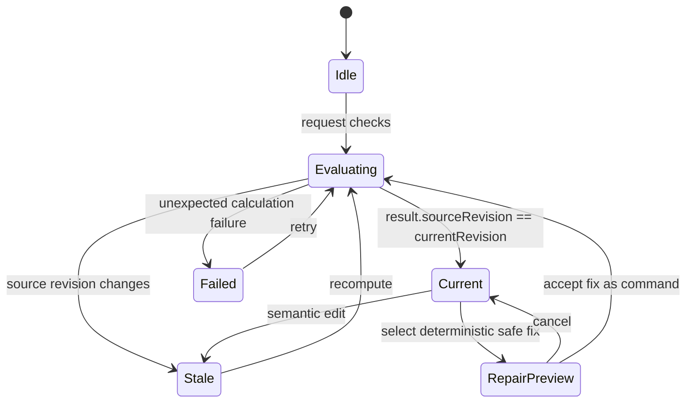

### 8.3 Interaction sequence for an issue

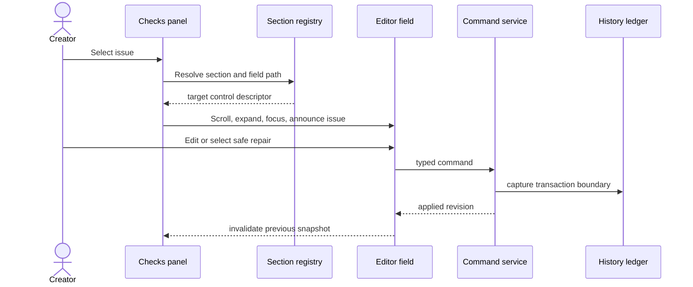

---

## 9. Current-to-target mapping and predicted change inventory

This is a prediction for planning. Work-package IDs WP-00 through WP-12 are canonicalized in §25.1 and reused throughout this specification. The current active diff was inspected at `be0cf3f`; estimates exclude integration or completion of the in-progress renderer plate changes. Recalculate impact before implementation if that diff changes.

| Work package | Existing anchors | Predicted additions/changes | Breaking risk |
|---|---|---|---|
| WP-00 Baseline | `package.json`, `STACK_STATE.md`, current source diff | Working-tree inventory, runnable status evidence, primary workflow baseline; no product behavior change | Low if no generated churn |
| WP-01 Identity contract | `core/domain/types.ts`, `components/models.ts`, `monster-store.ts`, migrations | Canonical exports, `MonsterId`, envelope/content revision contract, compatibility re-exports; no schema increment unless required | High for legacy imports/shared data |
| WP-02 Checks slice | `LintMonster.ts`, `CrFooter.vue`, `MonsterLintDialog.vue`, editor panels/history | Correct fixability/action mapping, issue view model, target registry, stale handling, selected repair proposal/apply/undo | Medium for issue targeting and history semantics |
| WP-03 Tuning slice | `AutoTuneCr.ts`, `CrFooter.vue`, `AutoTuneDialog.vue`, CR display/history | Refine existing breakdown, source revision, selective preview, apply/cancel/undo | High for mechanics; preserve calculation in first UI slice |
| WP-04 Repository/recovery | `StoragePort.ts`, adapters, monster store, app boot | Repository construction, migration, save state, recovery backup; single writer | High: migration and data-loss risk |
| WP-05 Library | repository, router, pages, stores | Search/open/duplicate/rename/delete and empty/error states | Medium/high: identity and recovery policy |
| WP-06 Export compatibility | `ExportStatblock.ts`, `DownloadButton.vue`, render adapters | Target capability map, preview result, omissions/loss report | Medium/high: output interoperability |
| WP-07 Rules provenance | `editor-store.ts`, document type, CR and renderer | Explicit/unknown provenance, rules policy seam, theme separation | High: users may mistake appearance for conversion |
| WP-08 Combat stability | `CombatTracker.ts`, `combat-store.ts`, HUD | Active ID, source snapshot metadata, encounter migration | Medium: encounter-state migration |
| WP-09 Workspace/accessibility | `MonsterBuilder.vue`, `MainLayout.vue`, A4, renderer, styles | Section registry, responsive tabs, keyboard/focus fixes | Medium; rendered visual review required |
| WP-10 Character boundary and final docs | `CharacterActor`, character store/editor/sheet/export, README and release docs | Explicit AC/speed provenance or honest labels; verified feature matrix | Medium; character scope decision required |
| WP-11 Spellcasting truth/projection | class/spell data, metric use cases, spell editors, renderer and fixtures | Provenance-aware candidates, truthful metric result, compact semantic projection | Primary/subclass/custom/error data and output fixtures agree. |
| WP-12 Typed references/ability grammar | formula core, one editor family, ability projection/import-export seams | Bounded typed catalog/evaluator/completion with literal and legacy compatibility | Round-trip and stale/error cases pass without arbitrary evaluation. |

### 9.1 Predicted data migration

1. Introduce a versioned document envelope without changing monster payload shape.
2. Inventory and separately snapshot the Pinia-persisted current monster, the `dndsheet_monster_` LocalStorage adapter records, and any existing `DndSheetDB/monsters` IndexedDB records. Preserve each source until its destination is verified.
3. Assign stable IDs to existing local current monster and all imported/library records with fresh UUIDs; use deterministic mapping only where the same legacy source must be re-read idempotently. Preserve old data as a migration backup.
4. Distinguish absent ruleset from confirmed ruleset; do not auto-label legacy files 2024 solely because UI default is 2024.
5. Keep legacy `.5emm.json` import/export compatibility. The outer file version and internal `saveVersion` responsibilities must be documented separately before adding another version.
6. Read one source, validate/migrate it, write into the startup-selected destination, re-read and semantically compare, then record that source's migration completion.
7. If any migration step fails, keep the original source and show recovery actions; never clear source state or fall through to another writer as part of a failed transaction.

### 9.2 Predicted dependency graph

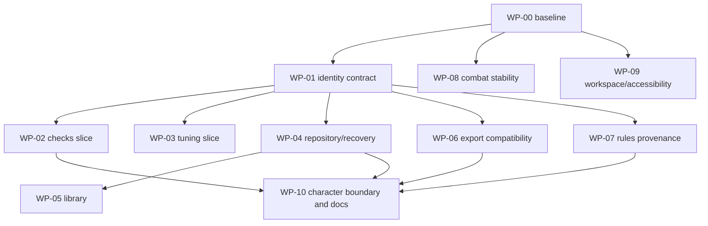

**Independent delivery rule:** WP-02 and WP-03 can ship on the existing Pinia-backed current document after WP-01 defines the minimal identity/revision contract; neither waits for WP-04/WP-05. WP-06 can ship through the existing file-download path after target capability review. WP-08 and WP-09 can ship independently after WP-00. Do not make checks, tuning, combat, or workspace improvements wait on the library rewrite.

---

## 10. Release sequencing and acceptance gates

These release cut lines use the same loop numbers and user outcomes as the implementation backlog. The backlog owns task IDs, status, estimates, and task dependencies; this section owns the release rationale and gates. Packages that the dependency graph marks independent may be scheduled separately, but each must satisfy its own gate before release.

| Release | Backlog loops | User outcome | Release gate |
|---|---|---|---|
| R0 — Evidence baseline | 00 | Know the exact running source, data, renderer, and local changes before diagnosing screenshots. | Revision, dirty paths, launch/test evidence, viewport and fixture state recorded; no screenshot root cause asserted without same-record reproduction. |
| R1 — Creator confidence | 01–03 | Keep identity stable; understand checks and CR recommendations; apply or cancel safe changes without losing work. | Identity/revision contract is usable; issue targets resolve; stale results are blocked; repair/tuning cancel is inert and accepted changes undo as one operation. |
| R2 — Portable output | 04 | Understand what each supported output preserves, transforms, or omits. | Each claimed target has a same-revision fixture and capability/loss report; unsupported fields are explicit; no source mutation. |
| R3 — Keep and reuse | 05–06 | Reliably save, recover, find, reopen, and duplicate local records. | One selected writer; migration/recovery verified; save status is truthful; same-name records remain distinct through library workflows. |
| R4 — Trustworthy authoring and presentation | 07–09 | Use spellcasting and ability content accurately, navigate the sheet, and present readable outputs across supported contexts. | Spell source/metric provenance and failure states are explicit; semantic content survives projections; toolbar, navigation, presets, responsive behavior, and accessibility pass the declared evidence matrix. Typed authoring is bounded to one measured field family and preserves literal/legacy content. |
| R5 — Honest breadth | 10–12 | Distinguish rules provenance from appearance, run encounters without changing authored sheets, and understand character-mode limits. | Legacy provenance remains unknown where unsupported; combat mutations affect snapshots only; character values have sources or honest labels; documentation claims match exact released evidence. |

### Release discipline

- Every loop ends at a usable stopping point; later loops are not required to make an earlier release truthful.
- Shared dependencies are implemented before dependent behavior, but independent packages need not wait for the full roadmap.
- Data-changing work includes compatibility, cancellation, and recovery behavior in the same loop.
- Keep changes scoped to the user outcome and its necessary architecture seam; defer unrelated formatting, dependency upgrades, and broad theme rewrites.
- Do not claim production readiness from static inspection, design artifacts, or historic test counts; use the evidence boundary in §26.

---
## 11. Verification matrix

| Area | Required scenario | Evidence |
|---|---|---|
| Create flow | blank, template, import, duplicate | observed workflow and persisted semantic document |
| Check navigation | orphan action, orphan attack, missing damage type, CR drift | issue code, target field, repaired result, undo result |
| Tuning | cancel, partial select, apply, source changed mid-preview | before/after values, stale-plan rejection, undo |
| Persistence | reload, duplicate title, migration, quota/error, blocked DB | repository result, user status, recovery copy integrity |
| Import | supported legacy versions, malformed file, unsupported future version | migration report; source remains untouched on failure |
| Export | JSON, Markdown, text, HTML, Foundry, Tarrasque, print/PNG as applicable | fixture comparison, omissions report, target acceptance |
| Ruleset | ruleset switch, theme switch, unknown imported provenance | metadata and mechanics diff; no implied conversion |
| Combat | initiative reorder, remove active/non-active, heal/death, source edit | stable active identity; source document unchanged |
| Accessibility | keyboard-only create/check/export, screen reader names, 200% zoom | interaction recording/checklist, focus path, no color-only statuses |
| Responsive | baseline desktop, chosen narrow viewport, print | screenshots and overflow/legibility review |
| Performance | large spell/template/ability lists, long descriptions, multiple documents | measured interaction responsiveness and memory/storage observation |

**Quality statement:** “Error-free” cannot be proven. Release notes should state exactly which automated and live checks passed, on which revision and browser. Known gaps remain visible.

---

## 12. Risks, failure modes, and mitigations

| Risk | Likelihood / impact | Mitigation / stop condition |
|---|---|---|
| Existing local uncommitted work gets overwritten during broad edits | High / high | Never reset/checkout/format entire tree; patch only scoped hunks; review diff before and after. |
| Legacy IDs absent or non-unique break library persistence | High / high | Add envelope and migration fixtures first; reject duplicate ID conflicts with a clear recovery plan. |
| Existing Pinia persistence and new IndexedDB repository diverge | High / high | Define a single writer and one-time migration; do not dual-write indefinitely without reconciliation semantics. |
| Linter produces stale or inaccurate target navigation | Medium / medium | Use stable issue codes and explicit path mapping; keep “go to section” even when exact focus target unavailable. |
| Auto-fix deletes meaningful custom content | Medium / high | Proposal preview; precise affected IDs; undo; no silent application. |
| CR tuner gives a false sense of balance | Medium / high | Explain model assumptions; label estimate; expose changed fields; never gate publication on CR target. |
| Edition field is interpreted as conversion | Medium / high | Separate ruleset from style; conversion is explicit, previewed, lossy-reporting operation. |
| Added complexity makes editor less discoverable | Medium / medium | Keep default surface short; progressive disclosure; test findability; no always-open advanced panel. |
| Character scope expands into incomplete rules platform | High / medium | Limit to reference sheet until product evidence supports a complete rules engine. |
| Accessibility fixes regress themed/print layouts | Medium / medium | Validate high-contrast and printer themes separately; semantic status labels. |
| Documentation promises unimplemented features | High / medium | Feature matrix derived from visible wiring and release evidence; docs shipped after verification. |

---

## 13. Delivery strategy (derived task tracking lives in the backlog)

The plan defines product value, architecture, constraints, requirements, and acceptance boundaries. The backlog alone owns task IDs, checkboxes, dependencies, estimates, and implementation statuses; handoffs own loop readiness and closeout evidence. These release cuts align with the backlog and §18.5.

| Release | Loops | User outcome | Independent stopping point |
|---|---|---|---|
| R0 — Evidence baseline | 00 | Establish the exact app, data, renderer, source revision, and preserved local work before diagnosing screenshots. | Static inventory and reproducible launch/fixture status recorded; no runtime cause asserted without reproduction. |
| R1 — Creator confidence | 01–03 | Identify a document safely; understand checks and CR recommendations; preview, apply, cancel, undo, and recheck focused changes. | Working checks and tune flows do not wait for repository migration or the library. |
| R2 — Portable output | 04 | Understand what each supported output preserves, transforms, and omits. | Same-revision fixture and target report for each claimed format; source remains unchanged. |
| R3 — Keep and reuse | 05–06 | Durably save, recover, find, reopen, and duplicate local records. | Selected writer and migration verified before library depends on it; same-name records remain distinct. |
| R4 — Trustworthy authoring and presentation | 07–09 | Preserve truthful spell options/counts and ability meaning; navigate the editor and produce readable, accessible screen/print output. | Spell, UI, preset, typed-reference, and round-trip criteria close at their own loop boundaries; future typed authoring is not required for ordinary manual authoring. |
| R5 — Honest breadth | 10–12 | Distinguish rules provenance from appearance, track encounters without changing authored records, and state character capabilities accurately. | Source snapshots and unknown provenance are explicit; final product claims reflect only completed, evidenced packages. |

Re-estimate at each loop boundary. A release is complete only when its backlog acceptance criteria and handoff evidence are recorded; design coverage alone is not implementation proof. Every loop must deliver a usable stopping point and must not rely on a future loop to make its enabled behavior functional.

---
## 14. Decision log: preferred approaches and alternatives

| Decision | Preferred | Alternative rejected/deferred | Reason |
|---|---|---|---|
| UI framework | Keep Vue/Quasar/Pinia | Rewrite to React/Vite | Existing project dictates stack; rewrite has no user value. |
| Core architecture | Modular monolith, pure use cases, real ports | Microservices/event sourcing/global bus | Single-user local app; distributed complexity adds no proven value. |
| State boundaries | Pinia as reactive UI/document adapter; core owns pure rules | Move all state to a new state framework | Incremental seam is safer and sufficient. |
| Persistence | One startup-selected backend per session, preferring IndexedDB with LocalStorage as the selected low-capacity backend only when needed; preferences remain separate | Cloud sync or per-operation silent failover | Preserves offline access without split-brain writes. |
| Validation | Live summary, explicit detail and fixes | Hard-block every warning | Preserves creator agency; errors and advisories differ. |
| Auto tune | Plan, preview, apply atomically | Mutate immediately | Reversible and understandable. |
| Responsive UI | Split view wide; Editor/Preview tabs narrow | Squeeze both panels at all widths | Protects legibility and touch operation. |
| Export | Per-target adapters and loss report | One generic serialization layer | Different targets have distinct semantics and capabilities. |
| Character feature | Honest compact reference first | Full builder now | Keeps current promise grounded and avoids scope ballooning. |

---

## 15. Change-control and anti-debt rules

1. Every feature request must link to a user job and one or more `F-*` requirements.
2. Every new domain field must name its owner, default, serialization version, migration behavior, rendering behavior, and export behavior.
3. Every calculation change must identify ruleset assumptions and produce deterministic examples. UI copy must call estimates estimates.
4. Every new issue code must have severity, stable code, explanatory text, entity/field target, and safe-fix policy.
5. Every stateful dialog must define cancel, stale-source, loading, error, focus entry, and focus return behavior.
6. Every repository write must return an observable result; do not silently catch and route to a different backend without surfacing degraded persistence state.
7. Every external format adapter must declare supported and omitted fields; do not overclaim import/export fidelity.
8. Every feature must be independently usable on the release that introduces it; do not ship a button that promises a later implementation.
9. Refactors must be pulled by a concrete dependency or defect. Avoid speculative abstractions and unused generic extension points.
10. Documentation is updated after observed behavior is verified; historical `STACK_STATE.md` results are not automatically current evidence.
11. Before editing, inspect the active diff and preserve all existing changes. After each slice, review only the intended diff and record actual validation results.
12. Feature completion means the user path works from visible intent through persistence/output, including failure and recovery states—not merely that a core function exists.

---

## 16. Open decisions to resolve from product evidence

These do not block Release A but must be decided before their dependent work:

1. Is IndexedDB explicitly intended as an in-app creature library, or is the adapter experimental? ADR says library; source wiring does not confirm it.
2. Should ruleset default follow each document, global preference, or explicit choice on creation? Legacy provenance must remain `unknown` until confirmed.
3. Should a safe linter repair apply immediately to one issue or always require preview? Recommended: preview if deleting/relinking content; direct apply only for lossless deterministic changes with Undo.
4. Should local library delete use soft-delete/trash or immediate deletion with backup? Choose based on storage cost and recovery expectations.
5. Is character mode a maintained product feature or a local experiment? If maintained, decide the minimum supported character model and ruleset boundary.
6. Which export targets are release-critical? Existing functions do not prove equal fidelity across targets.
7. Which UI states should follow a document to another device/file (art layers, theme) versus remain local preferences (splitter width, open panels)?

---

## 17. Specification completeness checklist

- [x] Product promise, primary user jobs, non-goals, and delivery guardrails.
- [x] Verified observations separated from unverified behavior and speculative predictions.
- [x] Whole-product journeys, information architecture, desktop and narrow wireframes.
- [x] Individual feature contracts with concepts, techniques, alternatives, data/operations, states, acceptance, and predicted code scope.
- [x] UML-like entity/class relationships, state machines, and sequence behavior.
- [x] Dependency lattice, component boundaries, and explicit import/export/persistence data flows.
- [x] Current-to-target change inventory, migration forecast, dependencies, rollout order, risks, and per-slice gates.
- [x] Verification matrix tied to user-visible behavior and known validation boundaries.
- [x] Change-control rules intended to prevent speculative architecture and accumulated debt.
- [x] Stable requirement classes and traceability from product outcomes through releases and evidence.
- [x] Screen-by-screen, modal, empty/loading/error, navigation, focus, and dirty-draft contracts.
- [x] Field ownership, persistence lifecycle, typed errors, stale-result handling, and privacy/abuse-case contracts.
- [x] User-facing status copy and measurable provisional performance/accessibility/reliability budgets.
- [x] File-level impact forecast, package sequencing, critical path, rollback, and bounded production-readiness gates.
- [x] Two-way macro-to-nano-to-macro trace audit for validation, save, tuning, combat, and presentation/export workflows.
- [x] Canonical package IDs and aligned envelope, ruleset provenance, revision, and presentation ownership terms across sections.
- [ ] Live visual inspection and usability baseline; not established in this specification pass. A prior local-server attempt failed to connect; repeat the check during WP-00 and record the viewport, launch path, and result.
- [ ] Active runtime/build/test verification; intentionally not performed during this documentation-only revision. WP-00 must establish a clean, reproducible baseline before implementation claims are updated.

**Completion criterion:** This document is an implementation specification, not proof that the system implements it. Each delivered slice must update the requirement status with source changes and current verification evidence.

---

## 18. Delivery-grade requirement traceability

The earlier sections state user value, design and architecture. This section is the implementation control plane: every change must map from a user outcome through a requirement, feature, work package, acceptance evidence, and release. Requirement IDs are normative and stable; visual labels, translated copy, and source filenames may change without changing an ID.

### 18.1 Requirement classes and IDs

| Prefix | Requirement class | Verification owner |
|---|---|---|
| `PRD-*` | Product boundary, value, non-goal | Product review against §1 and §3 |
| `UX-*` | Navigation, screen behavior, interaction, responsive behavior | UI flow and accessibility review |
| `DOM-*` | Domain invariant, calculation, validation, identity | Core-level deterministic examples plus integration evidence |
| `DATA-*` | Serialization, persistence, import, migration, backup | Versioned fixtures and browser storage scenarios |
| `ARC-*` | Dependency direction, ports, module boundaries | Import graph/static review |
| `SEC-*` | Untrusted input, privacy, data loss, browser boundary | Abuse-case review and failure scenarios |
| `NFR-*` | Performance, accessibility, reliability, portability | Measured target on recorded environment |
| `COMP-*` | Canonical content and projection consistency | Semantic fixture and cross-renderer comparison |
| `REF-*` | Typed references, expressions, dependency behavior | Parser/evaluator examples, cycle/error cases, revision checks |
| `SPELL-*` | Spellcasting model, provenance, limits and rendering | Versioned content coverage report plus primary/multiclass fixtures |
| `VIS-*` | Visual fit, hierarchy, status encoding and responsive rendering | Viewport/content matrix, accessibility and print review |
| `HELP-*` | Help and tooltip behavior | Control inventory and keyboard/touch review |
| `PARITY-*` | Source-to-runtime and semantic-to-renderer parity | Reproduction packet and matching fixture evidence |
| `REL-*` | Release, rollback, documentation claims | Release checklist and artifact evidence |

### 18.2 Traceability matrix

| Requirement | Testable contract | Feature / work package | Evidence required before release |
|---|---|---|---|
| `PRD-001` | Create/edit/check/preview/export is possible without account or network dependency. | F-01..F-09; WP-01..WP-07 | Full local workflow with network disabled; no outbound call required. |
| `PRD-002` | Monster authoring remains the default; character mode is labeled limited. | F-01, F-11 | Startup route and mode labels inspected. |
| `PRD-003` | Character mode is a reference tool unless and until a complete supported character rules contract is separately approved. | F-11 | Character UI copy and feature matrix show the declared support boundary. |
| `UX-001` | Current document, mode, rules provenance, and save status are identifiable from every editor state. | F-01/F-07/F-09; WP-04/WP-07/WP-09 | Keyboard and screen reader walkthrough with saved/dirty/error states. |
| `UX-002` | At wide viewport, editor and preview are simultaneously available; at narrow viewport, they are explicit tabs with no horizontal overflow. | F-03; WP-09 | Screenshots at declared viewport widths; overflow and focus review. |
| `UX-003` | Every validation issue has a readable explanation and either an actionable target or explicit no-target reason. | F-05; WP-02 | Issue catalog coverage review and keyboard navigation record. |
| `UX-004` | Every destructive or replacing action names affected content and offers cancel; recoverability is stated. | F-02/F-07/F-08; WP-04/WP-05/WP-06 | Dialog state review and cancellation scenarios. |
| `UX-005` | Changing theme, art, page layout, or zoom changes presentation output only; it does not mutate monster rules content. | F-12; WP-07/WP-09 | Semantic document comparison before/after each presentation setting. |
| `DOM-001` | Rules calculations and linting are pure with respect to supplied inputs and deterministic for identical versioned inputs. | F-05/F-06; WP-02/WP-03 | Domain examples compare output and confirm no input mutation. |
| `DOM-002` | Every persisted top-level document has immutable ID; mutable display name is never identity. | F-02/F-07; WP-01/WP-04/WP-05 | Two same-name records survive save/reload/rename. |
| `DOM-003` | Tuning and repair proposals apply only to the revision they were computed against. | F-05/F-06; WP-02/WP-03 | Edit between preview and apply yields stale conflict and no mutation. |
| `DOM-004` | Ruleset identity and source provenance are explicit or unknown; appearance style never establishes ruleset. | F-09/F-12; WP-07 | Legacy import remains unknown; theme change leaves rules policy/output unchanged. |
| `DOM-005` | Encounter turn identity is stable under sorting/removal, and combat HP/conditions operate on an encounter snapshot rather than mutating its source monster. | F-10; WP-08 | Sort, remove active/non-active actor, and edit source while encounter is open. |
| `DOM-006` | Character AC/speed and any other derived display value name their input source or remain unset; unsupported legality is not implied. | F-11; WP-10 | Missing-input and equipped/modified-value cases show explicit provenance. |
| `DATA-001` | Every schema change has sequential migration from supported prior versions and preserves source on failure. | F-07; WP-01/WP-04 | Fixture table for every supported source version and failure injection. |
| `DATA-002` | Export declares target, supported fields, omissions, and lossy transformations before download. | F-08; WP-06 | Target capability matrix plus fixture review for each shipped target. |
| `DATA-003` | Backup restore validates all entries before commit and follows an explicit duplicate-ID conflict policy. | F-07; WP-04 | Malformed, partial, duplicate, and valid backup scenarios. |
| `ARC-001` | `core/domain` and `core/usecases` import no Vue, Pinia, Quasar, browser storage, or UI modules. | §6; WP-01/WP-02 | Dependency graph review; violations block merge. |
| `ARC-002` | Feature UI invokes application operations; features do not instantiate persistence adapters directly. | §6; WP-02/WP-03/WP-04 | Composition-root and import review. |
| `SEC-001` | Imported JSON/text is treated as untrusted data; it cannot execute markup/script or silently trigger navigation/download. | F-02/F-08; WP-04/WP-06 | Import adversarial fixtures and rendered-output sanitization review. |
| `SEC-002` | User-authored monster data stays local unless an explicitly named export or external transfer is invoked. | F-07; WP-04 | Network inspection of baseline workflow; privacy copy reviewed. |
| `NFR-001` | Common editor input visibly responds within 100 ms at p95 on the agreed reference device; CR/lint recalculation completes within 250 ms for the declared typical fixture at p95. | F-03/F-05/F-06; WP-02/WP-03/WP-09 | Measured, repeatable profile. Targets are provisional until baseline; large fixture size must be reported. |
| `NFR-002` | Core editing, checks, and export are keyboard operable; status is not conveyed by color alone; zoom to 200% retains task completion. | F-01/F-03/F-05/F-08; WP-02/WP-06/WP-09 | Scenario-based accessibility evidence, not automated scan alone. |
| `NFR-003` | A failed durable write never displays “Saved”; the app exposes retry and a user-controlled recovery/export path. | F-07; WP-04 | Storage failure injection in supported browsers. |
| `NFR-004` | Presentation respects reduced-motion preference, visible focus, non-color status, and reflow at 200% zoom for declared primary workflows. | F-12/F-13/F-14; WP-09/WP-11 | Manual reduced-motion, focus, zoom, and theme review. |
| `REL-001` | Every shipped work package works without a later package; enabled UI has an implemented action and visible outcome. | All | Release gate per WP. |
| `REL-002` | User-facing claims match verified behavior for the exact released revision. | F-13; WP-10 | README/feature matrix reviewed against release evidence. |
| COMP-001..003 | Structured and narrative ability content has one stable interpretation and legacy round-trips without silent loss. | F-04/F-08; WP-01/WP-02/WP-06 | Golden semantic fixtures and projection comparison. |
| REF-001..002 | References/formulas are typed, deterministic, safe, cycle-aware, and bound to the current revision. | F-04; WP-12, with WP-02 issue targets where applicable | Parser/evaluator/preview scenarios for valid, invalid, missing, cyclic and stale cases. |
| SPELL-001..002 | Selected, allowed, granted and remaining spell counts are distinct; authoring/rendering preserve source and cadence semantics. | F-14/WP-11; F-12/F-13 consume the projection | Primary/multiclass/subclass/custom-source fixture and rendered parity review. |
| VIS-001..002 | Content fits supported viewports and semantic status is not color-only. | F-12/F-13; WP-09 | Declared viewport, zoom, theme, long-content and print matrix. |
| HELP-001 | Contextual help is concise and available without hover-only dependence. | F-13; WP-09 | Control inventory, keyboard focus and touch review. |
| PARITY-001 | A visual mismatch is closed only against the same data fixture and source revision across editor, semantic output and target renderer. | WP-00; affected feature | Reproduction packet includes document/revision, mode, viewport, expected semantic output and renderer evidence. |

### 18.3 Feature-to-requirement coverage

| Feature | User value represented by | Primary requirement(s) | Canonical work package(s) | User-visible proof |
|---|---|---|---|---|
| F-01 Navigation/toolbar | Find current work and primary actions | `UX-001`, `NFR-002` | WP-09 | Mode, document, status, Checks, and Export are findable by keyboard. |
| F-02 Create/open/library | Resume and reuse work | `DOM-002`, `UX-004`, `DATA-003`, `SEC-001` | WP-04/WP-05 | Same-name records remain distinct; replacing/deleting/importing is explicit and recoverable. |
| F-03 Editor navigation | Reach fields and inspect output | `UX-002`, `NFR-001`, `NFR-004` | WP-09 | Desktop split view; narrow Editor/Preview tabs; no hidden horizontal overflow. |
| F-04 Ability composition | Build complex statblocks with fewer broken links | `DOM-002`, `UX-003`, `COMP-001..003`, `REF-001..002` | WP-01/WP-02/WP-06/WP-09/WP-12 | Typed effects and prose agree across projections; legacy round-trip preserves content. |
| F-05 Checks and repair | Find and safely repair structural problems | `UX-003`, `DOM-001`, `DOM-003` | WP-02 | Targeted issue, stale handling, preview, apply, undo. |
| F-06 CR and tuning | Understand estimate and try controlled changes | `DOM-001`, `DOM-003` | WP-03 | Breakdown reproducible; cancel no diff; apply one undoable transaction. |
| F-07 Save/repository/recovery | Keep and recover authored work | `DATA-001`, `DATA-003`, `NFR-003`, `SEC-002` | WP-01/WP-04 | Durable acknowledgment, migration preservation, backup and restore outcomes. |
| F-08 Export | Know what target output contains | `DATA-002`, `SEC-001`, `UX-004` | WP-06 | Exact target report, current-revision preview, explicit omissions, cancel/no source mutation. |
| F-09 Ruleset/provenance | Avoid false edition/conversion assumptions | `DOM-004` | WP-07 | Explicit or unknown provenance and no silent conversion. |
| F-10 Combat | Track turns without altering authored statblock | `DOM-005` | WP-08 | Active identity survives list changes; encounter uses a source snapshot. |
| F-11 Character reference | Present supported character values honestly | `DOM-006`, `PRD-003` | WP-10 | Missing assumptions are visible; no complete-builder claim. |
| F-12 Appearance/print | Produce readable screen/print output safely | `UX-005`, `NFR-004`, `VIS-001..002`, `SPELL-002`, `COMP-001` | WP-06/WP-09/WP-11 | Preview matches selected layout and semantic source; no clipping; rules data unchanged. |
| F-13 Accessibility/recovery | Complete primary jobs across input modes and failure states | `NFR-002`, `NFR-003`, `NFR-004`, `HELP-001`, `VIS-001..002`, `REL-002` | WP-02/WP-04/WP-06/WP-09/WP-10 | Keyboard, zoom, screen-reader, contextual help, save failure, and accurate release claims. |
| F-14 Spellcasting truth/projection | Select and present spells and resource cadence without false counts | `SPELL-001..002`, `NFR-004`, `REL-001` | WP-11 | Metrics, candidate options, provenance, manual entries, and output agree or clearly disclose unavailable data. |
### 18.4 Release-to-requirement mapping

| Release | Loops | Included requirement families | Explicitly excluded |
|---|---|---|---|
| R0 Evidence baseline | 00 | `PARITY-001`, `REL-001` evidence baseline | Behavior changes before source/runtime/fixture baseline |
| R1 Creator confidence | 01–03 | `DOM-002`, `DOM-003`, `DOM-001`, `UX-003`, `NFR-002` | Repository/library cutover, rules conversion, guaranteed encounter balance |
| R2 Portable output | 04 | `DATA-002`, `SEC-001`, `COMP-001..003`, `UX-004` for output | Lossless claims for unverified targets or source mutation during export |
| R3 Keep and reuse | 05–06 | `DOM-002`, `DATA-001`, `DATA-003`, `NFR-003`, `SEC-002`, `UX-004` | Cloud sync, multi-user editing |
| R4 Trustworthy authoring and presentation | 07–09 | `SPELL-001..002`, `COMP-001..003`, `REF-001..002`, `UX-001..002`, `UX-005`, `NFR-001`, `NFR-002`, `NFR-004`, `VIS-001..002`, `HELP-001` | Complete official spell legality/catalog claims; giant formula DSL; unsupported device-wide promises |
| R5 Honest breadth | 10–12 | `DOM-004..006`, `REL-002`, applicable `DATA-*` and `SEC-*` | Full character builder, VTT, campaign manager |
## 19. Complete screen and interaction inventory

These are screen contracts, including transient and failure states. A screen means a route, dialog, drawer, or workspace tab. Keep labels and domain meaning stable; exact styling follows the design system audit in §4.3.

| Screen ID | Entry / primary job | Required content and primary actions | Empty/loading/error/exit contract |
|---|---|---|---|
| `SCR-EDITOR` | Default route; author current monster | Identity, sections, preview, save state, checks count, CR estimate, undo/redo | Blank document has instructive empty sections; loading existing doc has skeleton; save failure remains visible; route switch invokes dirty guard only if unsaved data cannot be recovered. |
| `SCR-LIBRARY` | Open/reuse records | Search, filter, sort, record identity/name, type, CR, updated time, open/menu | Empty library offers Blank/Template/Import; loading exposes cancel/return; storage unavailable explains current-document-only mode and recovery. |
| `DIA-CREATE` | Create blank/template/import | Source choice, ruleset provenance choice where known, cancel/create | Template load failure retains prior document; creation starts only after draft guard is resolved. |
| `DIA-IMPORT` | Read a local file or pasted content | Source, detected format/version, name, parse result, warnings, preview, Import/Cancel | File-read, parse, unsupported-future-version, and partial-import states preserve current document and offer download of diagnostic report where useful. |
| `DIA-CHECKS` | Understand and repair issues | Error/warning/info groups, stable message, target, source revision, repair preview | Empty means “No checks found” plus caveat about limits; stale results say recheck; evaluator failure retains last known result marked stale. |
| `DIA-CR` | Understand estimate | Defensive/offensive breakdown, assumptions, manual CR comparison, input links | Missing inputs labeled unavailable; no number fabricated; calculation failure offers retry and underlying inputs. |
| `DIA-TUNER` | Explore CR changes | Current/target, selectable proposals, original/preview values, changed-field list, Apply/Cancel | Stale source blocks apply; no proposal explains why; cancel discards preview and leaves editor history unchanged. |
| `DIA-EXPORT` | Choose target and presentation | Target, preview, supported/omitted fields, file name, output type, Export/Cancel | Unsupported target cannot silently fallback; render/download error leaves source untouched and allows retry. |
| `SCR-TEMPLATES` | Discover reusable starting points/content | Categories, search, tags, template preview, apply-as-copy | No matches distinct from no templates; applying never overwrites current source until user confirms. |
| `SCR-SPELLS` | Manage custom spell data | Search, source/provenance, edit/duplicate/delete, import/export | Missing catalog is distinct from empty list; spell edits invalidate dependent CR/lint. |
| `SCR-COMBAT` | Run at-table encounter | Round, stable active actor, initiative order, HP, conditions, add/remove/next/previous | Empty encounter prompt; source record missing uses snapshot; persistence error visible without losing current round. |
| `SCR-CHARACTER` | Lightweight character reference | Explicitly supported values with source/assumption labels; no implied full legality | Missing AC/speed inputs display “not set” or explicit fallback label; no fabricated rules-complete value. |
| `SCR-PRESENTATION` | Prepare screen/print appearance | Named screen/ink/art presets, preview, paper settings | Preset failure retains previous presentation; theme change cannot mutate rules data or document revision. |
| `DIA-DELETE` | Remove a saved record | Exact record name/ID context, recovery policy, Delete/Cancel | If soft delete, undo deadline; if permanent, explicitly state no app recovery and offer backup before confirmation. |
| `DIA-RESTORE` | Restore backup | Source summary, record count, conflicts, merge/replace choice, validation report | No writes until full validation; conflict resolution is explicit; failed restore preserves all current and source data. |
| `DIA-RECOVERY` | Respond to migration/storage failure | Error category, last known safe source, Retry/Export backup/Continue limited mode | Never label recoverable data lost before checks; no destructive retry loop. |

### 19.1 Global interaction states

Every data-backed view must be designed for: `initial`, `loading`, `ready-empty`, `ready-populated`, `dirty`, `saving`, `saved`, `stale`, `partial`, `error-recoverable`, `error-blocking`, `read-only`, and `offline/local-only`. A state may be inapplicable, but the decision must be recorded rather than omitted. Transitions must preserve user-entered values or state plainly why they cannot.

### 19.2 Navigation and dirty-draft contract

1. Switching a section/tab within the same document never prompts and never resets scroll unexpectedly.
2. Opening another document checks the current document save result; if save is pending, wait or offer explicit cancel. Do not open the new document over an unresolved save.
3. If autosave is durable and successful, route change requires no dialog. If persistence is unavailable, offer `Keep editing`, `Export recovery copy`, and `Discard draft` with discard visually secondary.
4. Browser reload/close cannot be guaranteed as a save boundary; display unsaved status continuously and flush on visibility change as best effort.
5. Focus is moved to a dialog heading on open and returned to its trigger on close unless the initiating target no longer exists.

---

## 20. Detailed domain, persistence, and state contracts

### 20.1 Canonical document envelope (proposal)

The envelope is additive around the existing monster payload and must not require changing combat/renderer payload semantics in the same release.

```ts
type MonsterDocument = {
  id: MonsterId;
  envelopeVersion: number;
  createdAt: string;          // ISO-8601 UTC
  updatedAt: string;          // ISO-8601 UTC, adapter-confirmed on save
  ruleset: RulesetProvenance; // explicit | unknown; never inferred from theme
  provenance?: DocumentProvenance;
  contentRevision: number;    // monotonic semantic edits, not panel expansion
  monster: Monster;
  presentation?: PresentationData; // serialize only if product selects per-document presentation
  userMetadata?: { title?: string; tags?: string[]; favorite?: boolean };
};

type RulesetProvenance =
  | { status: 'explicit'; rulesetId: '5e-2014' | '5e-2024' | 'homebrew'; declaredAt: string }
  | { status: 'unknown' };

type DocumentProvenance = {
  sourceKind: 'created' | 'imported' | 'duplicated' | 'restored';
  sourceName?: string;
  importedAt?: string;
  claimedRuleset?: string;
  confidence?: 'user-declared' | 'format-declared' | 'unknown';
};

type Result<T, E> = { ok: true; value: T } | { ok: false; error: E };
```

`createdAt` is assigned once. `updatedAt` records successful durable save, not each keystroke. `contentRevision` increments on every accepted semantic mutation, including undo/redo, and is monotonic even when content returns to an earlier value. `envelopeVersion` belongs to the storage envelope; existing monster `saveVersion` remains a distinct payload version. Confirm the existing field's exact owner at WP-00 before changing it. Content equality may be measured with a hash for conflict detection, but a hash is not the revision token. `presentation` is a proposed optional field only; until the preference-scope decision is made, keep it in local presentation preferences and omit it from serialized documents.

### 20.2 Field ownership and lifecycle matrix

| Data | Owner | Saved in monster schema? | Affects rules/CR? | Invalidated/updated by | Export behavior |
|---|---|---:|---:|---|---|
| Monster rules content | `Monster` domain | Yes | Yes, as calculation inputs | Explicit editor command/import/accepted proposal | Each target adapter declares support/loss |
| Monster/document ID | repository envelope | Envelope | No | Create/duplicate/migration only | Included only in editable backup/native format |
| Content revision | application/document lifecycle | Envelope or persistence metadata (decision before build) | No | Accepted semantic command | Omitted from presentation output |
| Ruleset provenance | document envelope | Envelope | Potentially, when a versioned formula policy is implemented | Explicit user declaration/import mapping | Reported in editable format; human-readable label only if known |
| Presentation settings | presentation domain | Separate optional record/document setting, decision open | No | User appearance action | Applied to render/print outputs; omitted from rules payload |
| Expanded panels/active section | UI preference | No | No | UI navigation | Never exported |
| Validation findings | derived state | No by default | No | Source revision or spell catalog change | Export warnings recomputed at export time |
| CR breakdown | derived state | No by default | Derived from rules input | Source revision/rules policy/spell input | Optional informational summary only; not used as source of truth |
| Tuning/repair proposal | transient application session | No | Candidate only | Source revision or user selection | Never exported before apply |
| Encounter HP/conditions/initiative | encounter-owned runtime entity | Encounter store | No mutation to source monster | Combat actions | Encounter backup only; not monster statblock export |
| Character derived display | character feature | Character data or explicit calculation output | Depends on specified support | Character inputs/rules policy | Never imply complete legality without modeled inputs |

### 20.3 State ownership and allowed dependency direction

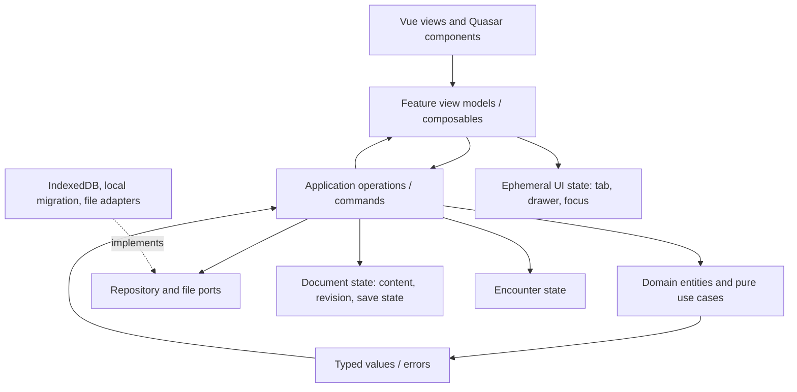

Forbidden: domain imports UI/store/browser APIs; feature pages instantiate adapters; presentation preferences write monster rules fields; combat mutates source documents; stale derived work is applied to a new revision.

### 20.4 Error taxonomy

| Error code family | Example | Retry? | Recovery/UX rule |
|---|---|---:|---|
| `IMPORT_*` | malformed JSON, unknown format, unsupported future version | Usually no | Preserve current state; explain line/field if available; allow original download/diagnostic. |
| `MIGRATION_*` | unsupported source, migration invariant failure | No until code/data changes | Keep original bytes/record; no partial overwrite; show export backup. |
| `STORAGE_*` | quota, blocked upgrade, unavailable, transaction failure | Sometimes | Never show saved; offer retry, recovery export, or read-only/current session mode. |
| `CONFLICT_STALE_*` | repair/tune/export snapshot out of date | Recompute | Do not auto-merge; show source changed and rebuild proposal/preview. |
| `EXPORT_*` | target unsupported, render/download failure | Yes for transient | Source is unchanged; disclose unsupported fields before download. |
| `VALIDATION_*` | evaluator failure vs found issue | Recheck | Distinguish “could not check” from “issues found” and from “no issues found”. |
| `RULES_UNAVAILABLE_*` | unknown ruleset provenance or unsupported formula | No | Mark unavailable/estimate scope; never silently substitute 2014/2024 semantics. |

### 20.5 Concurrency and stale-result policy

Each asynchronous evaluation captures `(documentId, contentRevision, spellCatalogRevision, rulesPolicyVersion)`. Results are committed to view state only if all captured inputs still match. Otherwise discard and mark pending recalculation. This applies to lint, CR, template-derived validation, import preview after source choice, export preview, and tuning. If two tabs edit the same document, compare the persisted base revision/content hash at write time; reject a conflicting write and offer `Reload saved version`, `Keep my edits as a copy`, or `Cancel`. Do not claim multi-tab merge.

---

## 21. Import, export, privacy, and abuse-case contracts

### 21.1 Import pipeline

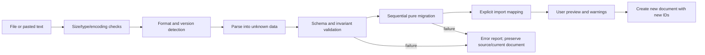

Rules: no parse-time side effects; no imported ID may overwrite an existing document; IDs are regenerated where the file is imported as a new document, while internal references are remapped consistently; unknown fields are either preserved in an extension bag only if round-trip support is verified or disclosed as ignored; imported text is escaped in rendered HTML; no network lookup is implicit.

Suggested first release guardrails (must be benchmarked against actual expected files): maximum input size 10 MiB, UTF-8/UTF-16 detection only where parser supports it, reject archive/binary inputs unless a dedicated adapter exists, cap nested depth and collection counts, and return actionable error rather than blocking main UI. These values are provisional defaults, not existing product behavior.

### 21.2 Export capability report

Each target has a reviewed capability descriptor:

```ts
type ExportCapability = {
  targetId: ExportTargetId;
  formatVersion?: string;
  supportedPaths: string[];
  transformedPaths: Array<{ path: string; transformation: string }>;
  omittedPaths: Array<{ path: string; reason: string }>;
  unsupportedConditions: string[];
};
```

Preview must be based on exact current content revision. If revision changes, preview is stale and download must regenerate. Native editable backup should preserve schema-known fields and provenance. Presentation exports may omit interactive/editor metadata, but must disclose mechanical omissions. Download filename must be sanitized from title and collision-safe; never derive executable paths from user input.

### 21.3 Privacy and local-first behavior

- No telemetry, analytics, account, or external API is introduced by this specification.
- AI/statblock ingestion remains explicitly scoped to currently implemented behavior; pasted text is not evidence of an external model call. Any future network-assisted ingestion requires separate consent, outbound-data description, failure behavior, and settings.
- Local browser storage is not a backup guarantee; the UI must provide user-controlled backup/export and say which data is included.
- Clearing site data can delete records. Mention this in recovery/help copy where repository storage is introduced.

---

## 22. User-facing copy and state-message catalog

Copy is a contract: it must describe current state, consequence, and next action without claiming rules certainty. Exact localization keys can follow implementation.

| State | Suggested copy | Action |
|---|---|---|
| No document | “Create a creature, open a saved one, or import a statblock.” | `Create creature`, `Open library`, `Import` |
| Saving | “Saving…” | No competing “Saved” signal. |
| Saved | “Saved on this device · 10:42 AM” | Optional `Back up` |
| Save failed | “Couldn’t save this creature. Your current edits are still open.” | `Retry`, `Download recovery copy` |
| No checks | “No issues found by these checks. This does not guarantee rules accuracy or balance.” | `Recheck` |
| Check failure | “Checks couldn’t finish, so these results may be out of date.” | `Retry checks` |
| Stale proposal | “This creature changed after the preview. Review an updated proposal before applying.” | `Refresh preview`, `Cancel` |
| Unknown ruleset | “Rules version not recorded. The app will not assume a rules conversion.” | `Choose ruleset`, `Keep unknown` |
| Export omissions | “This file leaves out 2 fields that this format does not support.” | `Review omitted fields`, `Export anyway` |
| Empty search | “No creatures match these filters.” | `Clear filters` |
| Delete | “Delete ‘{title}’? {recoveryPolicy}” | `Cancel`, explicit delete action |
| Import rejected | “This file could not be imported. Your open creature was not changed.” | `View details`, `Choose another file` |
| Restore conflict | “Some backup records share IDs with saved creatures.” | `Keep both as copies`, `Replace selected`, `Cancel` |

The UI must not use “valid”, “balanced”, “rules-correct”, “saved”, or “lossless” unless the corresponding contract and evidence support that exact claim.

---

## 23. Performance, accessibility, and reliability budgets

Targets here are initial budgets to make design trade-offs testable. Record hardware/browser and fixture size for every measurement; do not present provisional values as existing performance.

| Budget | Initial target | Measurement boundary | Fallback if missed |
|---|---:|---|---|
| Text input to visible value/preview update | p95 ≤100 ms | Representative monster with 20 abilities and 40 spell references | Profile reactivity/render path; isolate heavy derived work; avoid framework rewrite. |
| CR/lint calculation | p95 ≤250 ms for declared typical fixture | Core operation excludes browser paint; report fixture and rules policy | Debounce non-critical repeated invocation, memoize by stable inputs only if correctness tests cover invalidation. |
| Save acknowledgment | p95 ≤500 ms for typical document after debounce | Adapter completion; distinguish queue wait from durable result | Keep pending state, serialize writes, allow explicit retry; never optimistic “Saved”. |
| Import parse/preview | ≤1 s for 1 MiB fixture | Local parse/migrate/validate, no network | Move large processing off main thread only after profiling; enforce bounded input. |
| Initial usable editor | ≤3 s on agreed reference browser/device | Cold cache production build, no network | Inspect bundle and startup work; do not set target from dev server. |
| Keyboard completion | 100% primary create/check/export scenarios operable | No pointer required; focus always visible and restored | Fix interaction semantics before visual polish. |
| 200% zoom | No loss of primary task or content | Editor, checks, export, library | Reflow, allow vertical scroll; avoid fixed pixel clipping. |
| Save reliability | No silent loss on acknowledged save; recoverable failure | Inject transaction failure and quota/blocked state | Preserve source and provide export recovery. |

Accessibility specifics: form labels expose name/description/error; field errors link to field and are announced; dialog traps focus only while modal; `Escape` closes only if cancel is safe; reduced motion honored; touch targets target 44 CSS px where practical; status includes words/icons; print contrast checked separately. Automated scans are supplemental evidence, not a pass by themselves.

---

## 24. Code impact and architecture delta estimate

### 24.1 Estimation method and confidence

The source tree and active working diff were inspected read-only at `be0cf3f`; current runtime and file-by-file change coupling were not measured. Forecasts below are engineer-days for one engineer familiar with Vue/Quasar, excluding waiting for product decisions and release operations. Confidence remains low-to-medium until Loop 00 records a live baseline. The figures align with backlog loop forecasts; re-estimate at each loop boundary and do not add separate file-count estimates to these effort ranges. Shared-file impact is expected and must be counted once in the owning loop’s implementation/verification plan.

| Backlog loop / work package | Likely touched/new files | Main seams | Forecast | Confidence |
|---|---:|---|---:|---|
| Loop 00 / WP-00 Evidence baseline | 0–5 evidence/docs/config artifacts; no product code required | README, STACK_STATE, launch path, active diff, fixtures | 2–4 engineer-days | Medium |
| Loop 01 / WP-01 Identity and revision | 6–12 | domain types, schema migration, session/history, imports and tests | 5–10 engineer-days | Low-medium |
| Loop 02 / WP-02 Checks and safe repair | 8–16 | linter, CR footer/dialog, target panels, command/history, fixtures | 5–10 engineer-days | Medium-low |
| Loop 03 / WP-03 CR breakdown and tuner | 6–12 | CR footer/tuner, view model, store/history, preview selectors | 3–7 engineer-days | Medium-low |
| Loop 04 / WP-06 Export and semantic parity | 8–16 | export application path, adapters, renderer projection, fixtures | 5–10 engineer-days | Low |
| Loop 05 / WP-04 Repository and recovery | 10–18 | storage ports/adapters, composition, migration, status, backup/recovery | 8–15 engineer-days | Low |
| Loop 06 / WP-05 Local creature library | 6–12 | repository queries, route/drawer, list and record actions | 3–6 engineer-days | Low-medium |
| Loop 07 / WP-11 Spellcasting data truth and projection | 6–14 | class/spell data, metric use case, editor, renderer and fixtures | 4–9 engineer-days | Low |
| Loop 08 / WP-09 Workspace and accessibility | 8–18 | shell/toolbar, builder navigation, panel focus, responsive, tokens/presets/print | 7–13 engineer-days | Medium-low |
| Loop 09 / WP-12 Typed references and ability grammar | 8–18 | typed catalog/evaluator, editor bridge, semantic adapter and round-trip fixtures | 8–16 engineer-days | Low |
| Loop 10 / WP-07 Rules provenance | 3–7 | document provenance, import/export metadata, settings and migration | 2–4 engineer-days | Low-medium |
| Loop 11 / WP-08 Combat identity and snapshots | 4–9 | combat domain/use case/store/HUD and migration | 2–5 engineer-days | Medium |
| Loop 12 / WP-10 Character boundary and final documentation | 4–10 | character model/store/sheet/editor, README and feature matrix | 2–5 engineer-days | Low |

**Whole roadmap forecast:** 56–114 engineer-days (sum of loop ranges), approximately 11–23 five-day focused engineering weeks for one engineer. This is not a calendar commitment; decisions, release operations, and interruption time are excluded. R1 (Loops 01–03) is approximately 13–27 engineer-days after the 2–4 day R0 baseline. The current renderer plate work is protected and its completion/replacement is excluded; any additional integration work discovered during R0 must be estimated separately before touching those paths.
### 24.2 Impacted surface map

| Layer | Expected code changes | Compatibility hazard | Change rule |
|---|---|---|---|
| Presentation | Toolbar, editor workspace, dialogs, library and export pages, empty/error states | User sees controls without working behavior; focus/layout regression | Wire every enabled action to an operation before release. |
| Feature/application | Commands, view models, stale-result handling, repository orchestration | Duplicate logic in stores/composables | One operation contract per user action; Pinia adapts, not owns domain policy. |
| Domain | IDs, envelope, ruleset provenance, repair/tune result types | Existing importer/types depend on legacy structures | Add compatibility facade; avoid simultaneous rename/migration. |
| Persistence | IndexedDB construction, current Pinia state migration, backup | Loss/duplication or split-brain current state | One writer per record; retain source until verified; no indefinite dual-write. |
| Interop | Import detectors/migrations/export projections | Silent field loss or wrong ruleset semantics | Per-format capability fixtures; explicit unknown preservation policy. |
| Combat | Stable actor identity and snapshot metadata | Existing persisted index/state migration | Migrate active index to ID deterministically; define if actor removed. |
| Quality/release | Fixtures, browser storage scenarios, docs and release evidence | False claim from historic checks | Record exact revision, environment, and scenario results. |

### 24.3 Likely target files by work package

File names below are observed where stated and proposed where marked. The implementation team must confirm exact paths at R0; no path is permission to bulk-move files.

| WP | Observed likely files | Proposed additions or touch points | Required file-level output |
|---|---|---|---|
| WP-00 Baseline | `README.md`, `STACK_STATE.md`, package scripts, git status | `docs/spec/verification-baseline.md` (proposed) | Revision/hash, active diff boundaries, existing runnable evidence and limitations. |
| WP-01 Identity contract | `src/core/domain/types.ts`, `src/components/models.ts`, `MigrateMonsterSchema.ts` | `src/core/domain/MonsterDocument.ts`, ID/revision factory (proposed) | Canonical envelope/content revision, compatibility exports, migration ownership. |
| WP-02 Checks | `src/core/usecases/LintMonster.ts`, `src/components/cr/CrFooter.vue`, `src/components/cr/MonsterLintDialog.vue`, selected target panels, history store | issue target map and repair proposal contract (proposed) | Existing mount retained; fixability aligned with action; stable issue catalog, stale guard, atomic undo. |
| WP-03 Tuning | `src/core/usecases/AutoTuneCr.ts`, `src/components/cr/CrFooter.vue`, `src/components/cr/AutoTuneDialog.vue`, CR display/history | tuning session/view model (proposed) | Existing mount retained; non-mutating preview, selected changes, atomic apply/undo. |
| WP-04 Repository/recovery | `src/core/ports/StoragePort.ts`, local and IndexedDB adapters, monster/spell/template/editor Pinia persistence, app boot | startup backend selector, source inventory/migration, repository service (proposed) | One stable backend per session; Pinia/local prefix/IndexedDB sources migrated and verified; truthful save state and recovery. |
| WP-05 Library | repository, router, library page and stores | summary index/search/record actions (proposed) | Identity-safe open/duplicate/rename/delete and empty/error states. |
| WP-06 Export | `src/core/usecases/ExportStatblock.ts`, `DownloadButton.vue`, renderer adapters | capability descriptors and preview report (proposed) | Output projection, omissions/transforms report, per-target fixtures. |
| WP-07 Rules provenance | domain types, schema migration, editor ruleset/style controls | `RulesetProvenance` and policy contract (proposed) | Unknown preserved; theme/style mechanically isolated. |
| WP-08 Combat | `src/core/usecases/CombatTracker.ts`, `src/stores/combat-store.ts`, combat HUD | combat migration function (proposed) | Active identity/snapshot source and migration. |
| WP-09 Workspace/accessibility | `src/pages/MonsterBuilder.vue`, `src/layouts/MainLayout.vue`, panels, renderer/styles | section registry and responsive state (proposed) | Section navigation and Editor/Preview mode, verified layouts. |
| WP-10 Character/final docs | `CharacterActor`, character store/editor, `CharacterSheet.vue`, `README.md` | explicit AC/speed inputs or labeled assumptions; final feature matrix | No unsupported fixed values; claims match verified release evidence. |
| WP-11 Spellcasting truth/projection | `ClassCastingEditor.vue`, `SpellcastingEditor.vue`, `useSpellLevels.ts`, `AutoSyncSpellcasting.ts`, spell data, renderer | typed metric result, data provenance, compact projection and fixtures | Verified source coverage, explicit failure state, primary/subclass/custom parity. |
| WP-12 Typed references/ability grammar | `formula.ts`, one selected editor family, `MonsterTextEditor.vue`, ability projection/import/export | typed catalog/evaluator/completion and round-trip adapter | No eval; literal and legacy semantics preserved; invalid/stale/cyclic cases visible. |

---

## 25. Implementation package plan and dependency lattice

### 25.1 Canonical packages and independently shippable value

Work-package IDs are stable labels, not execution rank. The backlog’s loop number gives the recommended delivery order; its task dependency column and dependency graph govern what can proceed independently. `WP-10` deliberately closes the character boundary and final claim reconciliation, so its final documentation step follows evidence from the relevant feature packages.

| Package | User value | Depends on | Work included | Acceptance / evidence |
|---|---|---|---|---|
| `WP-00 Baseline` | Prevents loss and scope drift | None | Inspect active diff, runtime, routes, current features, browser baseline, data fixtures | Exact revision/current behavior recorded; preserve all local changes. |
| `WP-01 Identity contract` | Makes records and stale detection safe | WP-00 | ID/envelope decision, compatibility exports, schema ownership | New/imported docs receive stable IDs; legacy payload remains readable; no repository cutover. |
| `WP-02 Checks vertical slice` | Faster confidence/repair | WP-01 | Refine mounted linter, target navigation, stale/error states, safe repair | Issue navigation, recheck, repair preview/apply/undo; ships without library. |
| `WP-03 Tune vertical slice` | Explore changes without risk | WP-01 | Refine mounted tuner, breakdown, transient preview, apply/cancel | Cancel no mutation; apply one history transaction; undo restores; stale blocked. |
| `WP-04 Repository and recovery` | Preserve/resume records | WP-01 | One writer, repository wiring, save state, migration, backup/restore | Reload, migration and failure evidence; no loss on rejected write. |
| `WP-05 Library` | Find/reuse creatures | WP-04 | Search/sort/filter/open/duplicate/rename/delete policy | Two same-name records; identity and recovery policies proven. |
| `WP-06 Export compatibility` | Carry usable content to other tools | WP-01; target inventory | Per-target capability and preview/loss report | Claimed targets have fixtures and reviewed omissions; may ship before repository cutover. |
| `WP-07 Rules provenance` | Avoid misleading edition semantics | WP-01 | Unknown/explicit provenance, style/theme separation | Legacy unknown remains unknown; style leaves rules payload unchanged. |
| `WP-08 Combat stability` | Reliable table turns | WP-00; encounter migration design | Active combatant ID, source snapshot and missing-source policy | Sort/remove semantics hold; encounter changes do not mutate source. |
| `WP-09 Workspace/accessibility` | Faster navigation and readable narrow use | WP-00 | Toolbar hierarchy, navigator/focus targets, narrow tabs, presets and accessibility | Keyboard and visual scenarios pass; no clipping; presentation remains separate from rules. |
| `WP-10 Character boundary/final docs` | Accurate character values and product promise | WP-00 for character scope; applicable packages for final matrix | Character AC/speed semantics and capability boundary; reconcile docs after relevant evidence | No invented value; final docs match exact verified feature evidence. |
| `WP-11 Spellcasting truth/projection` | Trust spell options, counts, cadence, and output | WP-00; WP-06 semantic projection where export is claimed | Catalog/provenance audit, truthful metrics, subclass-aware candidates where supported, compact view model | Primary/multiclass/subclass/custom/error fixtures; no unsupported completeness claim. |
| `WP-12 Typed references/ability grammar` | Safer dynamic authoring with literal/legacy compatibility | WP-06 semantic adapter; WP-11 only for spell-reference scope | One measured typed field family, safe evaluator/completion, ability round-trip | No eval; valid/error/stale/cycle cases; legacy prose and data preserved. |

### 25.2 Dependency graph and critical path

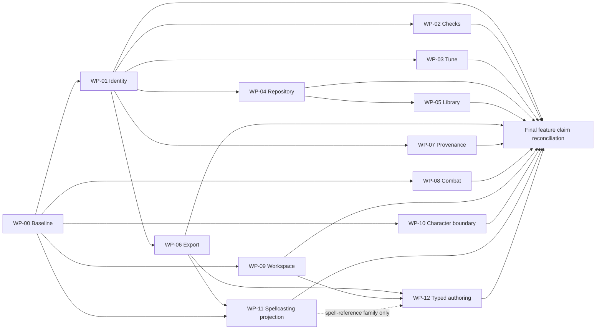

The all-record library path is `WP-00 → WP-01 → WP-04 → WP-05`. The WP-12 completion UI also uses WP-09 focus/label/responsive contracts; its pure parser/evaluator can be developed independently after WP-06. The earliest creator-confidence paths are `WP-00 → WP-01 → WP-02` and `WP-00 → WP-01 → WP-03`. Workspace and combat can proceed after WP-00; neither waits on export or persistence. Spellcasting projection depends on verified baseline data and semantic projection. Typed authoring depends on the projection contract, and on WP-11 only for spell-reference fields. Final feature-claim reconciliation is last; it does not block independently verified feature releases.
### 25.3 Package entry/exit protocol

**Entry:** named owner; exact revision and active diff recorded; requirement IDs selected; current behavior and data fixture preserved; dependencies complete; acceptance evidence specified; rollback path reviewed.

**Exit:** all package criteria met against current source; UI operation is reachable; typed failures and stale paths work; migration/backward compatibility evidence recorded where applicable; known gaps documented; only intended diff remains; docs claims match actual behavior. “Error free”, “refactor free”, and “future proof” are not exit states; each has a bounded substitute in §26.

---

## 26. Quality, rollout, and rollback contract

### 26.1 Bounded production-readiness definition

A package may be called production-ready only for a declared supported browser/runtime and scope when all of these hold:

1. Each traceable requirement in scope has acceptance evidence on the same revision.
2. User-facing success signals occur after the real operation succeeds, not because it was requested.
3. Data changes have compatibility, failure, retry, and recovery behavior appropriate to their persistence boundary.
4. Accessibility and responsive criteria are evaluated for the affected path; source-only reasoning is not substituted for rendered evidence.
5. No known high-severity defect remains in the package; all remaining issues and unsupported data are plainly stated.
6. The package does not depend on a later package to finish its visible workflow.
7. Rollback preserves user data and does not require a destructive downgrade.

This is bounded evidence, not an assertion of zero defects or future-proofing.

### 26.2 Data compatibility and rollback matrix

| Change | Rollback rule | Forward compatibility rule |
|---|---|---|
| UI grouping/section navigation | Revert UI code; document data unchanged | Persisted UI preference may be ignored if unknown. |
| Lint/check catalog | Keep findings derived, no schema migration required | Unknown issue codes render generic message; never hide blocking unknown export failures. |
| Tune/repair operation | Undo transaction and source revision; proposals are transient | Old document fields remain preserved; no hidden destructive normalization. |
| Envelope/ID migration | Keep immutable migration backup; write completion marker only after verification | Older app may not read envelope; show unsupported-version recovery, never overwrite. |
| Repository backend | Retain original Pinia/local record until record-count/content verification | One canonical writer; downgrade instructions must export backup before removal. |
| Export capability | Adapter rollback does not alter document | Target format/version remains explicit; unknown new fields are reported or retained under verified policy. |
| Combat identity | Preserve previous index/state in migration backup | Missing active ID resolves to explicit no-active state, not arbitrary first actor. |

### 26.3 Release evidence record template

```text
Package / version:
Requirement IDs:
Source revision:
Supported browser / OS:
Fixtures and data versions:
Functional scenarios passed:
Keyboard/screen reader/zoom evidence:
Storage/import/export failure scenarios:
Performance fixture and measurements:
Known limitations:
Migration/rollback path:
Reviewer:
```

### 26.4 Decision closure gates

| Decision | Must be decided before | Default if not decided |
|---|---|---|
| Is IndexedDB a supported library or experimental adapter? | WP-04 | Keep current working document model; do not expose library promises. |
| What is authoritative schema version and migration ownership? | WP-01 | No schema increment; add non-persisted adapter types only. |
| Which supported input versions/formats? | WP-01/WP-04 | Keep existing supported list; do not imply broader support. |
| Which export targets are contractual? | WP-06 | Only targets with fixtures/capability reports ship as supported. |
| What is the local library delete recovery policy? | WP-05 | Soft delete or backup required; do not silently hard-delete. |
| Is character mode maintained and what rules are supported? | WP-10 | Label reference-only; no new derived mechanics. |
| Does ruleset choice affect formulas now? | WP-07 | Store explicit/unknown provenance only; do not change calculations. |
| Are art/layout preferences per-device or per-document? | Before export/presets | Keep local preference; no new serialized preference field. |

---

## 27. Final completeness and gap register

| Area | Status | Evidence or closure condition |
|---|---|---|
| Product/feature intent and alternatives | Specified | §§1–5; retain a user outcome per feature. |
| Existing code observations | Specified as prior read-only observations | §§2, 30.2; revalidate at WP-00 before editing. |
| Full screen inventory and interaction states | Specified | §§19, 29.2–29.4, 30.7; visual details require live UI inspection. |
| Domain types, identity, variables, function contracts | Proposed in detail | §§6, 20; reconcile exact current shapes at WP-01. |
| UML, behavior/state, DFD, dependency lattice | Specified | §§6–9, 20–21, 25, 29.5–29.8, 30.3–30.6. |
| Storage migration/recovery/security/privacy | Specified with explicit unknowns | §§20–21, 26; actual browser behavior must be tested in implementation. |
| Traceability | Specified | §§18, 29.6, 30.10 map requirement→feature/WP→screen→state/core/adapter→evidence. |
| File-level impact forecast | Estimated, low-to-medium confidence | §§24, 29.9, 30.9; actual count and active diff must be recalibrated at WP-00. |
| Incremental delivery and independent completion | Specified | §§25–26; no package waits on an unbuilt successor. |
| Live visual/interaction validation | Open | Screenshots identify symptoms but not runtime revision or matching fixture; reproduce in WP-00 before code diagnosis. |
| Current build/test evidence | Open | Not run for this documentation task; historical status is not proof for current revision. Static component inventory in §29 is not runtime verification. |
| Screenshot concern and system-cause audit | Added, source facts distinguished from hypotheses | §§30–31; exact source/revision/data fixture must be captured in WP-00. |
| Typed effect/reference and projection architecture | Proposed, staged and compatibility-gated | §§30.3–30.5, 31; prove adapter and legacy round-trip before schema changes. |
| Spellcasting data/view-model parity | Specified as F-14; catalog completeness unverified | §§5, 18, 30.2, 30.6, 31; WP-11 audits subclass/spell source coverage, then verifies exact UI. |
| Screenshot-specific runtime root cause | Open | Screens show symptoms only; same-record reproduction required before attributing. |
| Rules content/fidelity and legal/source provenance | Open per data catalog | No rule assertions added without verifying corpus/license/source support. |

**Interim readiness judgment:** The file is a technical-team specification and planning baseline, not proof of implementation. Decisions and evidence gaps remain visible. The scale-coherence audit follows.

---

## 28. Multi-scale coherence audit: down, then back up

This audit makes the requested movement between scales explicit. Each descent turns intent into a more concrete contract; each ascent checks that the concrete contract still serves the product without adding a disconnected abstraction.

### 28.1 Scale definitions for this project

| Scale | DNDSheet meaning | Typical artifact | Main failure if skipped |
|---|---|---|---|
| **Nano** | One value, ID, message, operation result, error code, or state transition | `contentRevision`, `updatedAt`, issue `fieldPath`, save `Result`, focus target | Ambiguous ownership, mutation, or user feedback |
| **Micro** | One control/component and its immediate interaction | Name field, Add Attack row, Checks issue action, save indicator | Control looks complete but does not behave correctly in context |
| **Meso** | A user workflow/feature spanning related screens and modules | Import-to-editor flow, repair flow, export flow, combat turn | Feature seams disagree; partial workflow leaves dead ends |
| **Macro** | Product promise, information architecture, architecture, and releases | Local-first authoring product, R1–R5, modular monolith | Scope expands into cloud/VTT/full character rules without value proof |
| **Meta** | Rules governing change, evidence, compatibility, prioritization, and the spec itself | Requirement traceability, decision gates, rollback, no-false-claims policy | Technical detail accumulates without a coherent product or verifiable delivery |

### 28.2 Downward pass: promise to smallest implementation unit

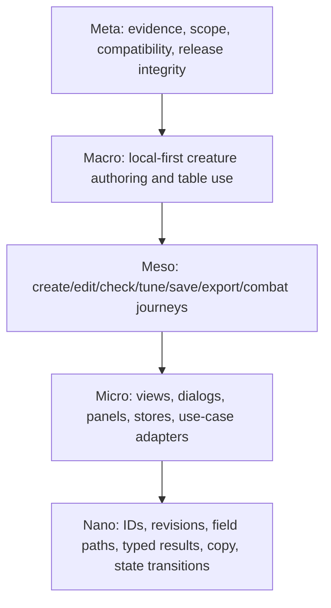

| Downward step | Question answered | Spec sections that carry the answer |
|---|---|---|
| Meta → Macro | What user promise and evidence boundaries govern all work? | §§1–2, 15, 18, 26 |
| Macro → Meso | Which user journeys deliver that promise and which do not belong? | §§3, 5, 10, 25 |
| Meso → Micro | Which screens/modules/operations make each workflow real? | §§6–9, 19–21, 24 |
| Micro → Nano | What exact values, owners, transitions, and messages prevent ambiguity? | §§18–23; feature contracts in §5 |

### 28.3 Nano-to-meta reverse pass: verify small choices serve the whole

| Reverse step | Review test | Reject when |
|---|---|---|
| Nano → Micro | Does this field/result/state have exactly one owner and a consuming control? | It is duplicated, dead, silently persisted, or has no visible user consequence. |
| Micro → Meso | Does the control complete a workflow including cancel, stale, and failure paths? | It launches a dialog/action that cannot complete or recover. |
| Meso → Macro | Does the workflow improve creation, confidence, portability, or table use? | It adds a second authoring model or broad product area without demonstrated job value. |
| Macro → Meta | Does the feature obey local-first, no silent mutation/loss, compatibility, and evidence gates? | It requires cloud assumptions, unsupported rules claims, unreviewed schema writes, or a future package to become useful. |

### 28.4 Full two-way trace examples

#### Trace A — Validation issue to a corrected export

| Scale | Forward specification |
|---|---|
| Meta | `DOM-001`, `DOM-003`, and `REL-001`: checks are deterministic, proposals are revision-bound, and a visible feature must work end-to-end. |
| Macro | Deliver “Build with confidence” before the library: R1, WP-01 then WP-02. |
| Meso | Creator opens Checks, understands an issue, navigates to the exact field, repairs it, rechecks, then exports. |
| Micro | `DIA-CHECKS` lists stable code/severity/target; section registry scrolls/expands/focuses the field; repair preview is a command; export reevaluates current revision. |
| Nano | Issue carries `sourceRevision`, `entityId`, `fieldPath`, `messageKey`, optional `safeFixId`. Accepting repair increments `contentRevision`, creates one history boundary, invalidates old validation/export previews, and reports outcome. |

**Reverse check:** Starting at `fieldPath`, verify a registered editor target exists; starting at an unsupported export field, verify the compatibility report names it; starting at either user-visible outcome, verify it advances the core promise and is independently shippable. A finding without a target is allowed only with an explicit reason; a stale finding cannot be called current.

#### Trace B — Field edit to truthful durable save

| Scale | Forward specification |
|---|---|
| Meta | `SEC-002`, `NFR-003`, `DATA-001`, `REL-001`: user data remains local, failed writes are visible, migration preserves source, and saved slices stand alone. |
| Macro | R2 Keep and Resume; WP-01 identity → WP-04 repository/recovery → WP-05 library. |
| Meso | User edits creature, sees pending state, receives durable saved state or explicit retry/recovery, closes/reopens the same record. |
| Micro | Editor command updates canonical document; save queue serializes writes; repository compare-and-writes; status component exposes clean/dirty/saving/saved/error. |
| Nano | `MonsterId` immutable; `contentRevision` increments; write includes expected base revision/hash; adapter resolves to `updatedAt`; on rejection, neither saved status nor success timestamp advances. |

**Reverse check:** A “Saved” label must be backed by adapter success; adapter success must correspond to same document ID and revision; a migration must not create a second writer; library list summary must reflect the persisted record; recovery export must be able to serialize unsaved current work. If any link is absent, the smallest correct behavior is to keep editing visibly unsaved and offer a recovery copy.

#### Trace C — Tune preview to reversible mechanics change

| Scale | Forward specification |
|---|---|
| Meta | Creator agency and rules humility; no balance guarantee; no silent edits. |
| Macro | R1/R1b Build with confidence; WP-03 may ship before repository migration. |
| Meso | Choose target CR, inspect a proposal, select adjustments, compare preview, apply or cancel. |
| Micro | Tuner dialog owns transient `AutoTuneSession`; editor preview is derived from selected proposal; Apply calls one command and history transaction. |
| Nano | Session records `baseRevision`, selected recommendation IDs, and derived preview. Cancel writes nothing. Apply checks `baseRevision`, lists affected fields, advances revision, and pushes one undo item. |

**Reverse check:** Each proposed field must correspond to a current plan output; unsupported spells/legendary actions are disclosed; the display says estimate; applying changes only listed fields; undo restores semantic content; cancel leaves source revision unchanged. If tune requires a future library package, the boundary is too coupled.

#### Trace D — Combat round to unchanged authored source

| Scale | Forward specification |
|---|---|
| Meta | The table aid should reduce handling friction without becoming a VTT or corrupting authored content. |
| Macro | R5 tabletop utility; WP-08 is independent of editing and library UI, apart from source identity. |
| Meso | Add creature snapshot, set initiative, sort, run turns, change encounter HP/conditions, close/reopen encounter. |
| Micro | Combat store owns encounter; combat HUD issues encounter commands; renderer uses snapshot; source link opens the authored creature separately. |
| Nano | `CombatantId` and `activeCombatantId` are stable; combatant carries source document ID/revision and copied baseline; damage/condition operations mutate encounter only. |

**Reverse check:** Sorting cannot change active actor; removing active actor chooses a specified next/previous/no-active policy; source edit cannot alter current snapshot; missing source still allows snapshot play; all these states must remain within a lightweight tracker workflow.

#### Trace E — Presentation option to portable output

| Scale | Forward specification |
|---|---|
| Meta | A GM needs readable table and print outputs; presentation must not imply rules conversion. |
| Macro | F-12 in the authoring/preview product; R4 export and workspace improvements. |
| Meso | Choose a preset, inspect screen/print preview, export selected target and understand omissions. |
| Micro | Presentation controls write only presentation preferences; export adapter declares target capabilities; print preview reports page/overflow conditions. |
| Nano | `visualTheme`, `rendererStyle`, target ID, source revision, `omittedPaths`, and `transformedPaths` have distinct types and ownership. |

**Reverse check:** Theme change leaves rules payload and calculations unchanged; export preview corresponds to current revision; each omission is stated; file name is safe; an unverified format is not displayed as supported. This keeps visual polish tied to usable, portable output.

### 28.5 Cross-scale invariants (apply at every layer)

1. **One source of truth:** authored rules content belongs to `Monster`; lifecycle/provenance belongs to `MonsterDocument`; encounter runtime belongs to `Encounter`; presentation belongs to presentation state.
2. **One semantic mutation path:** any accepted user change passes through a typed command/application operation, advances revision, invalidates derived results, enters history where appropriate, and schedules persistence where that feature is enabled.
3. **No stale success:** checks, previews, exports, save states, and active combat identities must be bound to the exact current entity/revision they describe.
4. **No silent destructive transform:** import, migration, repair, tune, restore, and rules conversion preview or report their affected data and preserve a recovery route.
5. **No future-dependent UI:** an enabled action has a complete outcome in its release slice; disabled future concepts do not masquerade as active features.
6. **No scale-only abstraction:** introduce a module, generic interface, or event only when it closes a traced need; otherwise keep the current local boundary.
7. **One vocabulary:** `envelopeVersion` means document envelope; `Monster.saveVersion` means legacy monster payload; `contentRevision` means semantic edit sequence; `RulesetProvenance` is explicit/unknown; `PresentationData` never changes rules.

### 28.6 Coherence findings and resolutions

| Finding from reverse review | Resolution in this revision |
|---|---|
| Work package numbers assigned different work in §§9, 24, and 25. | §§9, 18, 24.3, and 25 now use the canonical WP-00 through WP-12 map from §25.1. |
| Document used both `schemaVersion` and `envelopeVersion`; class diagram disagreed with the proposed envelope. | `envelopeVersion` is the envelope field; `Monster.saveVersion` remains the legacy payload field; UML and field matrix align. |
| Ruleset included “unknown” as an ID in one place and as provenance elsewhere. | `RulesetId` is closed to supported values; `RulesetProvenance` carries explicit or unknown status. |
| Revision could be either integer or hash and undo might decrease it. | `contentRevision` is monotonic integer and increments on accepted edits/undo/redo; hash is only an optional equality/conflict aid. |
| Existing per-operation storage fallback could create split-brain records. | Select one backend once per session; LocalStorage may be the startup-selected low-capacity backend; operation failures never trigger silent cross-backend writes. |
| Existing core functions were shown with proposed document-level signatures. | §6.6 now distinguishes application facade from existing pure core APIs and prohibits unnecessary signature churn. |
| Screen states, backend semantics, and release evidence could be read as all verified. | Proposed behavior and verification requirements remain distinct from source observations; §§2, 24, 26, 27 record limits. |

### 28.7 Final upward check: product-level acceptance

The entire plan remains coherent only if each implementation release answers “yes” to all of these:

- Does it shorten or de-risk a real creator/GM job named in §3?
- Can the user complete that job on the release without a later package?
- Does the change use the existing Vue/Quasar/Pinia and pure-use-case architecture before proposing a wider refactor?
- Are authored rules, derived calculations, presentation, and encounter runtime separated at the data boundary?
- Are failure, stale, cancel, undo, migration, and export-loss behaviors explicit where applicable?
- Is every requirement backed by evidence on the same source revision, with unknowns still visible?

If an answer is no, reduce the package until its end-to-end path is complete. The implementation starts at WP-00, then WP-01; the earliest independent user-facing slices are WP-02 and WP-03. Live UI, current build behavior, exact file counts, and the provisional performance budgets remain to be verified during implementation baseline, not inferred from this specification.

---

## 29. Source-grounded outer-to-inner implementation ledger

This section is the derivation bridge between the product-level proposal and file-level implementation. It records the application shape observed in the repository, then specifies the smallest migration path that can serve the release slices without a broad rewrite. “Observed” means statically inspected source at the revision recorded in §2; it does not mean that a route or behavior was run in a browser during this documentation task.

### 29.1 Evidence boundary and active working-tree overlay

The static source map is anchored to branch `statblock-overhaul`, revision `be0cf3f`. At inspection time, the source tree also contained a modified `src/components/rendering/useProcessTokens.ts` and an untracked `src/components/rendering/plate.ts`. Those changes form an in-progress statblock-rendering plate refactor and are part of the implementation context. They are not included as fresh proposed edits, must be preserved, and must be inspected before any implementation branch or estimate is finalized. Do not reset, overwrite, or infer authorship/intent for them.

The plate path affects `WebRenderer` output and therefore screen preview, print styling, and any export adapter that consumes renderer HTML. WP-00 must capture the diff and render fixtures first. WP-06 export work and any F-12 presentation work must explicitly test both the current renderer path and the plate path, or document which path is authoritative. Keep transformation logic in the renderer pipeline, not in `Monster`, and keep print/export adapters from silently reapplying transformations already performed by the plate.

### 29.2 Outer application map: routes and composition

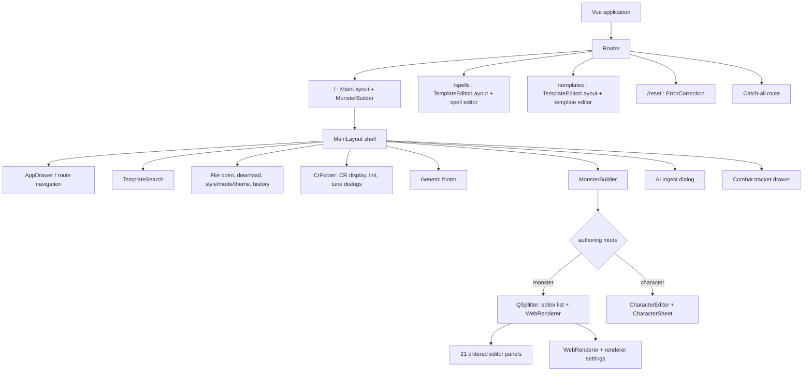

Observed route facts: `/` composes `MainLayout` and `MonsterBuilder`; `/spells` and `/templates` compose `TemplateEditorLayout`; `/reset` loads `ErrorCorrection`; an unmatched path reaches the catch-all. `MainLayout` owns the application shell and mounts toolbar-level workflows, global `CrFooter`, AI ingest, and combat UI. `MonsterBuilder` branches between monster and character modes. Monster mode uses a `QSplitter` with a `q-list` of 21 ordered editor components and `WebRenderer`; character mode composes `CharacterEditor` and `CharacterSheet`.

The proposal must preserve this mental model: edit on one side, inspect the rendered result on the other, with global actions in the established shell. Add a section navigator as a thin index over the existing panels; do not replace the builder with a new multi-step wizard. A focused issue action should activate/scroll to an existing panel and focus a registered field. On narrow layouts, collapse the preview behind an explicit tab/drawer while retaining the same document and panel order.

### 29.3 Editor panel roster and dependency contracts

All 21 listed panels directly import/use `useMonsterStore` today. This is an observed coupling, not a recommendation to perform a 21-file rewrite. The release architecture first adds an application/session boundary around the existing Pinia store; panels migrate only when touched for a user-facing requirement. The “owned section” column identifies the natural feature boundary, not an exclusive type ownership claim.

| Order / component | Natural section | Observed direct dependencies beyond `useMonsterStore` | Proposed seam when touched |
|---|---|---|---|
| 01 `A4LayerStudio` | Print/layout presentation | editor store, `RadialOffsetController`, `DualKnobCropSlider` | Presentation command/preferences; no mutation of rules fields. |
| 02 `BasicsEditor` | Identity, size, type, alignment, AC/HP | editor store, data picklists/filters, `LockToggleButton`, `SwapButtons`, `DynamicReferenceSelect`, `validateNumber`, average-HP/math helpers, UUID, model types | Stable field targets + typed field update; validate before accepting derived formula. |
| 03 `InventoryEditor` | Equipment/inventory text | `MonsterTextEditor` | Keep narrative/free-text editing within canonical Monster content; register focus target. |
| 04 `SavesEditor` | Saving throw bonuses | `saveModifierForStat`, `validateNumber`, `DndStat` | Field target includes stat identity; preserve explicit bonus versus derived display. |
| 05 `SpeedsEditor` | Movement modes | movement data, i18n, filter, validation, `SwapButtons` | Stable row ID; preserve units and custom movement labels. |
| 06 `SkillsEditor` | Skill bonuses | skill data, `skill-action-groups.ts`, math rendering, validation, models, `SwapButtons` | Stable skill key/row target; do not conflate calculated proficiency with authored override. |
| 07 `SensesEditor` | Senses and passive perception | validation, models/domain types | Stable sense target; passive value remains derived unless source model says otherwise. |
| 08 `ResistancesEditor` | Damage/condition defenses | models, `formatDefenseList`, UUID, `SwapButtons` | Stable defense row identity; normalization must preserve qualifiers and custom text. |
| 09 `TraitsEditor` | Traits and recharge | recharge data, `MonsterTextEditor`, `useAutoUpdateCr`, `CrAnnotationCard`, templates store, i18n, `NewTemplateDialog`, validation, `SwapButtons` | Reuse text/template behavior; CR annotation is derived and revision-bound. |
| 10 `SpellcastingEditor` | Spellcasting blocks | spells store, STAT/CLASS data, lock control, Quasar, `NewSpellDialog`, `ClassCastingEditor`, `AtWillCastingEditor` | Explicit spell references and source text; do not let library lookup silently rewrite authored blocks. |
| 11 `AttacksEditor` | Attack collection | `AttackPanel` | Commands target stable attack ID; panel-level operations remain shared with actions as appropriate. |
| 12 `ActionsEditor` | Actions and action text | `MonsterTextEditor`, `useAutoUpdateCr`, Quasar, templates store, i18n, validation, `SwapButtons`, stats, UUID | Add/edit/remove through one transaction; CR annotation invalidates on content change. |
| 13 `VillainActionsEditor` | Villain actions | `MonsterTextEditor`, `SwapButtons` | Stable action ID and focus target; source content unchanged by encounter use. |
| 14 `MultiattackEditor` | Multiattack references | `MonsterTextEditor`, i18n | Validate references against current attack IDs; rename/delete policy explicit. |
| 15 `ReactionsEditor` | Reactions | templates store, i18n, models, `NewTemplateDialog`, `MonsterTextEditor`, `SwapButtons`, Quasar, validation, recharge | Keep reaction identity stable; template application is an explicit edit. |
| 16 `LegendaryActionsEditor` | Legendary action pool | `MonsterTextEditor`, validation, i18n | Preserve cost and ordering; checks report exact entity/field. |
| 17 `MythicActionsEditor` | Mythic actions/traits | `MonsterTextEditor`, validation, i18n | Treat mythic data as separate authored section, not ordinary legendary data. |
| 18 `LairActionsEditor` | Lair actions | `useAutoUpdateCr`, `MonsterTextEditor`, `CrAnnotationCard`, `SwapButtons` | Derived CR display remains advisory; field focus uses stable IDs. |
| 19 `RegionalEffectsEditor` | Regional effects | `MonsterTextEditor`, `SwapButtons` | Preserve prose and radius/duration semantics as represented by current model. |
| 20 `AnatomyEditor` | Body/anatomy description | `SwapButtons` | Text/presentation only unless current domain type demonstrates mechanical effect. |
| 21 `EncounterDynamicsEditor` | Encounter dynamics | `MonsterTextEditor`, `SwapButtons` | Authoring notes remain distinct from runtime `Encounter` mutations. |

**Component-level implementation rule:** Every panel migration is scoped to one interaction and one direct dependency seam. Do not convert all direct store accesses merely to satisfy an architectural diagram. For each touched panel, capture: fields read; fields written; list identity strategy; validation; emitted side effects; undo grouping; renderer impact; focus registration; and whether edits affect derived CR.

### 29.4 Shared UI and store dependency catalog

| Component/helper | Observed responsibilities and dependencies | Required architectural treatment |
|---|---|---|
| `AttackPanel` | Uses monster store, game data, templates, lock state, `MonsterTextEditor`, validation, `SwapButtons`, `DynamicReferenceSelect`. | Centralize attack edits in existing model/store behavior first; add stable ID and command adapter without duplicating attack rules in Vue. |
| `MonsterTextEditor` | Token-aware text editor using `useTokens`. | Keep authored text literal/source of truth; token rendering is a projection. Editing or copying rendered HTML must not lose token syntax. |
| `DynamicReferenceSelect` | Reads monster store, calls `evaluateSafeFormula`, emits update/evaluated values. | Formula evaluation is pure; rejected/invalid input must not be committed as a plausible numeric zero. Keep raw formula and evaluated result distinguishable. |
| `SwapButtons` | Mutates/reorders through monster store. | Reorder by stable IDs; order change is one semantic history operation and should not regenerate item identity. |
| `SearchableSpellSelect` | Uses spells store and `useSpellLevels`. | Spell catalog is lookup/reference data; selection must not mutate spell definition or silently drop unsupported spell text. |
| `NewSpellDialog` / spell editor dialogs | Quasar dialog + spell store workflows. | Spell data lifecycle remains separate from Monster document lifecycle; import/export support must be explicit. |
| `NewTemplateDialog` / template dialogs | Use templates store for reusable snippets. | Applying a template copies content into the current document; template identity and document identity stay separate. |
| `useAutoUpdateCr` | Recomputes/updates CR-related authored fields in response to edits. | WP-03 baseline must trace every callsite and define which values are authored versus derived. No hidden recalculation on unrelated edits. |
| `useHistoryShortcuts` | Mounted in `MainLayout`; subscribes to monster store `$subscribe`; schedules snapshots after a 400 ms debounce. Uses `HistoryLedger<Monster>(50)`; undo/redo applies `$patch`. | Retain current behavior as baseline; formalize semantic transaction boundaries, monotonic `contentRevision`, and debounced persistence separately. Do not make UI keystrokes generate an unbounded history list. |
| `CrFooter` | Uses `useCr`, monster/spells stores, linter use case; reactively displays CR and mounts both lint and auto-tune dialogs. | Keep existing CR readout; layer issue focus and preview semantics onto mounted dialogs. CR estimates remain advisory. |
| `MonsterLintDialog` | Uses Quasar and lint use case/stores; invokes `autoFixMonster`; currently assigns only `monsterStore.multiattacks`. | Do not advertise all `fixable` issues as actionable until a concrete repair mapping exists. Map each supported repair ID to a typed operation; unsupported fixable flags remain informational. |
| `AutoTuneDialog` | Mounted; calls `AutoTuneCr`; writes selected CR/proficiency/AC/HP and optional attacks directly to Pinia. | Refine current workflow into transient proposal → changed-fields preview → Apply/Cancel; one undo transaction; stale-base rejection. Keep current formula and limitations visible. |
| `WebRenderer` | Uses monster/editor stores, `useTextRenderer`, `useProcessTokens`, CR data, spell metadata, math utilities. | Treat as read-only projection of `Monster` plus presentation state; renderer must not mutate document. Bind rendered snapshot to `contentRevision`. |
| `WebRendererSettingsButton` | Uses editor/monster stores. | Split styling/presentation mutations from rules content; decide device-local vs per-document setting before serialization. |
| Character editor/sheet | Uses character store and domain types. | WP-10: state what is supported; character feature growth requires independent model/calculation boundaries. Do not infer complete character rules from visible fields. |
| `CombatTrackerDrawer` | Uses combat store and Quasar. | Encounter state is separate from Monster store/history; imported statblock becomes a combat snapshot. |
| `useFileLoader.ts` | Uses JSON schema, Quasar, Monster/spells stores, legacy models; imports directly into Monster store. | Keep file selection and parsing at UI edge; schema/migration and validation flow through import application operation; preview/recovery before destructive replace. |
| `DownloadButton.vue` | Uses Markdown/Homebrewery/LaTeX/Tarrasque/Improved Initiative renderer adapters, stores, `ExportStatblock`, `download`, clipboard, snapdom, `json-url`. | Use target capability registry; each target declares inputs, transformation, omissions, filename/MIME, and failure; export consumes immutable current snapshot. |
| AI ingest dialog | Calls core `ingestAiStatblock`; uses Monster/history stores and captures before/after snapshots. | Preserve parse/preview boundary; ingest result is a proposal until explicit apply; one transaction; retain original input only under documented privacy/retention choice. |

### 29.5 Inner state path: current implementation and target adaptation

**Observed current path:** editor panels mutate Pinia-backed Monster state directly; `WebRenderer` reads the same state; `useHistoryShortcuts` observes store subscriptions and snapshots after debounce; CR-related composables may update state; file loader imports into the store; export button calls target renderers/core export functions. Core pure functions exist for calculation, lint, migration, token processing, combat operations, and export, but source inspection did not show a fully wired application-command/repository boundary around every feature. `monster-store` itself imports UI/rendering/math/data/Quasar/file-loader and `components/models.ts`, so it is a current coupling point. `src/components/models.ts` overlaps with core types and should be reconciled selectively, not renamed wholesale without callsite proof.

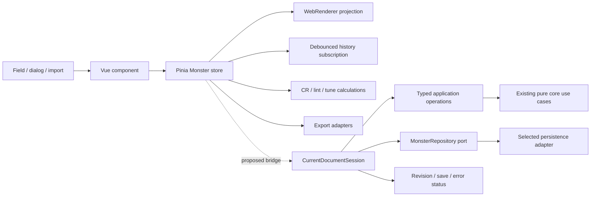

**Target adaptation without a flag-day rewrite:**

1. WP-00 maps store actions and direct mutations for the feature in scope, captures the active renderer diff, and builds before/after fixtures.
2. WP-01 defines `MonsterDocument` identity/envelope and `contentRevision` without forcing core functions to accept a new envelope. A session adapter can wrap the existing Monster store and expose document identity/revision separately.
3. Add typed application operations for checks, tune apply, import replace, and export snapshot at their feature seams. Existing editor panels can continue to use the store for routine fields initially; high-risk operations use the command seam first.
4. Have history subscribe to semantic operations where practical; until migrated, maintain compatibility with direct Pinia patches. Deduplicate subscription feedback so incrementing a session revision does not itself create a second content history entry.
5. Introduce repository port only for WP-04. Since no source callsite/adapter construction was found, do not assume IndexedDB is currently active. Select one backend during startup; make the selected adapter explicit in capability/status UI. On write error, surface failure and preserve current in-memory work; never silently route the same record to a second backend.
6. Migrate an individual panel to typed operations only when its touched workflow benefits from issue focus, compound undo, conflict detection, or persistence correctness. Record remaining direct-write callsites in a living ledger until none remain or the team accepts them as stable.

### 29.6 Feature-to-layer implementation matrix

The `F-*` identifiers below are the canonical features from §5 and §18. Infrastructure capabilities are labeled as cross-cutting contracts, not assigned a reused feature ID. Task status remains authoritative only in the backlog.

| Feature / contract | User-facing surface | State owner and event path | Existing core/dependency anchor | New/changed boundary | Completion proof / backlog trace |
|---|---|---|---|---|---|
| F-01 Navigation and toolbar | `MainLayout`, editor shell, mode/status/actions | Navigation and focus state separate from Monster content | Existing shell controls and Quasar layout | Primary/contextual action hierarchy, labels, focus behavior | Keyboard findability and contextual grouping; Loop 08 TASK-044, TASK-047 |
| F-02 Create/open/library | Default editor, import/create, library | Selection → dirty guard → document session/repository | Existing drawer/routes, file loader, templates, persistence | Identity-safe create/open/duplicate/rename/archive/delete and recovery | Same-name records stay distinct; Loop 06 TASK-026–035 |
| F-03 Editor navigation | `MonsterBuilder` panel stack and narrow Editor/Preview tabs | Section/focus state independent from document values | Existing panel roster and preview | Section registry, focus anchors, responsive mode | Every section reachable, no clipped primary fields; Loop 08 TASK-045–046 |
| F-04 Ability composition | Actions/traits/attacks/multiattacks editors and preview | Authored structured fields + authored prose → semantic projection | `ActionsEditor`, `MonsterTextEditor`, token pipeline, export adapters | Read-only normalized ability adapter first; typed references only for one measured family | Same fixture/role/order/raw text/unknown data across projections and round-trip; Loops 04 and 09, TASK-021–025 and TASK-049–054 |
| F-05 Checks and safe repair | `CrFooter` → mounted `MonsterLintDialog` | Current Monster snapshot → lint result → issue target/repair proposal | `LintMonster`, `autoFixMonster`, `CalculateCr`, `monster-store` | `IssueTargetRegistry`, revision-bound issue DTO, supported `RepairOperation` map | Each actionable issue resolves to a real control; stale blocked; one-step undo/recheck; Loop 02 TASK-012–016 |
| F-06 CR breakdown and tuning | `CrFooter` → mounted `AutoTuneDialog` | Dialog-local proposal; Apply writes selected patch | `AutoTuneCr`, CR tables/math, current direct Pinia writes | Explainable breakdown, transient `AutoTuneSession`, one `ApplyTune` operation | Cancel inert; only previewed fields change; stale blocked; one undo; Loop 03 TASK-017–020 |
| F-07 Save/repository/recovery | Shell save status, library, restore flow | Current document session → selected repository adapter | `StoragePort`, local/IndexedDB adapters; no application construction callsite found | Document-aware repository, selected writer, truthful save/error state | Reopen/migration/failure recovery verified; Loops 01 and 05, TASK-007–011 and TASK-026–031 |
| F-08 Export compatibility | `DownloadButton`, target chooser, preview/report | Immutable document/revision → target capability/adapter → payload | `ExportStatblock`, renderer adapters, clipboard/download | Target capability and `ExportResult` with omissions/source revision | Same-revision target fixtures, sanitation and named omissions; Loop 04 TASK-021–025 |
| F-09 Ruleset/provenance | Rules metadata/settings and export labels | Explicit user/import claim or unknown provenance | Existing style/rules controls, schema and import paths | `RulesetProvenance` distinct from theme/style | Legacy unknown remains unknown; style leaves mechanics unchanged; Loop 10 TASK-055–056 |
| F-10 Combat | `CombatTrackerDrawer` | Encounter commands mutate combatant snapshots | Core `CombatTracker`, `combat-store` | Stable combatant/active IDs, source snapshot/revision | Sort/remove/advance/reload semantics; source Monster unchanged; Loop 11 TASK-057–059 |
| F-11 Character reference | Character editor/sheet and support help | Character model/store → displayed values with source/override | `CharacterEditor`, `CharacterSheet` | Explicit capability matrix and AC/speed value provenance | No fabricated value; claims match bounded model; Loop 12 TASK-060–062 |
| F-12 Appearance/print | Renderer settings, A4 composition, preview | Presentation settings → screen/print projection; rules remain unchanged | `A4LayerStudio`, `WebRenderer`, token pipeline and active plate diff | Named presets over existing controls; print/output fixture contract | Presets do not mutate Monster; scale/fallback readable; plate path verified; Loops 04/08, TASK-025, TASK-048 |
| F-13 Accessibility/recovery | Editors, toolbar, dialogs, save/import/export errors | Focus/navigation + operation-specific recoverable error states | Quasar controls, editor registry, operation results | Accessible names, focus return, concise help, touch/zoom/recovery | Declared keyboard/touch/zoom/screen-reader/failure scenarios pass; Loops 02/05/08, TASK-014–016, TASK-028–031, TASK-043–047 |
| F-14 Spellcasting truth/projection | `ClassCastingEditor`, `SpellcastingEditor`, preview and supported exports | User selections/catalog facts → typed metrics → revision-bound semantic projection | `useSpellLevels`, `AutoSyncSpellcasting`, spell data, renderer | `SpellMetricResult`, provenance-labeled candidates, compact view model | Primary/multiclass/subclass/custom/error fixtures and projection parity; Loop 07 TASK-036–041 |
| Cross-cutting: document identity/revision | Shell status and all document workflows | Current Monster + session envelope → monotonic revision | Legacy `Monster.saveVersion`, history ledger | `MonsterDocumentId`, `envelopeVersion`, `contentRevision` adapter | Same-name IDs; edit/undo/redo monotonic; stale operations rejected; Loop 01 TASK-007–011 |
| Existing workflow: AI ingest (not a new feature) | Mounted AI ingest dialog | Parsed candidate → review → explicit apply | `IngestAiStatblock`, migration/lint, history | Preserve candidate/preview/one-apply semantics if touched by import or repair work | Cancel unchanged; accepted candidate one history item; no expanded AI scope without a new requirement |

**Signature caution:** the matrix describes boundaries, not permission to force every current function into a new signature. Preserve pure `LintMonster(monster)`, CR calculation, migration, and export APIs where useful; normalize results into application DTOs. Repository methods become document-aware only at the repository boundary; do not conflate identity/revision with current `StoragePort` methods that accept `Monster`.
### 29.7 Nano contracts that prevent cross-layer ambiguity

| Contract | Required owner | Mutation rule | Consumer/invalidation rule |
|---|---|---|---|
| `MonsterDocumentId` | Session/repository envelope | Created once; never derived from mutable name after adoption | Library, history, save, combat source reference use ID. |
| `contentRevision` | Current document session | Monotonic on accepted semantic edit, undo, and redo; not on theme-only preference | Lint/tune/export/save previews carry base revision. |
| `updatedAt` | Persistence adapter after successful write | Set only after committed write; not on edit scheduling | Save badge may say saved only for matching current revision. |
| `fieldPath` / entity target | Core issue or proposal DTO | Stable machine address plus optional row/entity ID; never translated from display text | Navigator resolves to registered panel/control or returns explicit unresolvable reason. |
| Raw formula / evaluated value | Formula-bearing domain field and pure calculator | Preserve raw expression; invalid expression is an error state, not numeric zero | UI may show prior valid result only with stale/error disclosure. |
| Renderer snapshot | Render/export operation | Immutable input includes Monster revision and presentation revision | Result discarded or marked stale if either input changed. |
| Selected storage adapter | Application startup composition root | Chosen once for current session; failures do not silently change writer | UI reports backend/capability limits and write/migration errors. |
| `RepairOperation` | Application layer | Validates base revision and target precondition; one operation per accepted repair | History records one repair; re-lint and export consume new revision. |
| `AutoTuneSession` | Dialog-local state | Proposal selection is transient; Apply checks base revision | Cancel leaves document unchanged; stale session requires refresh. |
| `Encounter` / `Combatant` IDs | Combat domain/store | Runtime edits only; source statblock copied at add time | Renderer can use source snapshot when library source disappears. |

### 29.8 Dependency direction and forbidden shortcuts

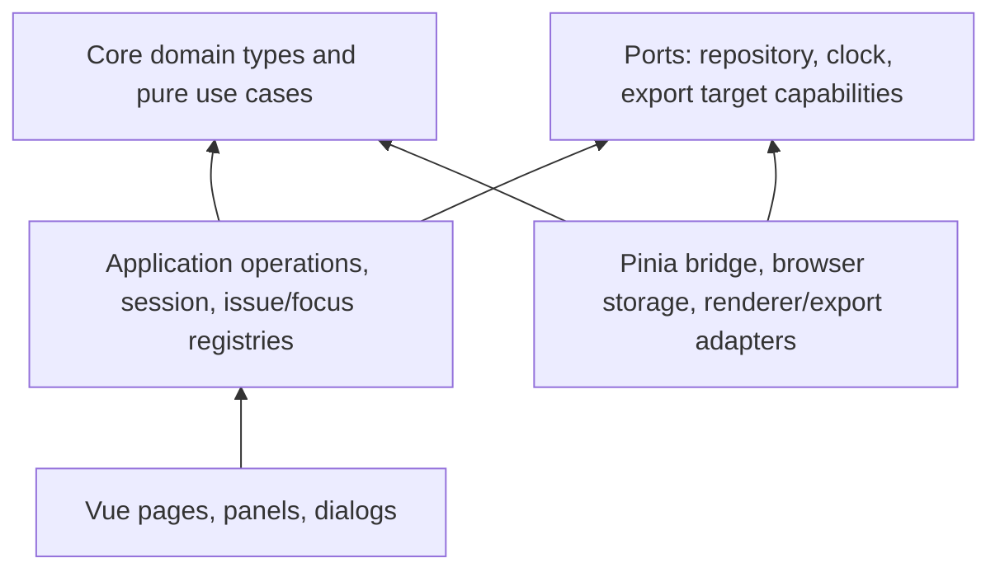

Treat this as a direction constraint for new code, not a claim that current imports already satisfy it. Specifically:

- Core `LintMonster`, `AutoTuneCr`, `CalculateCr`, `MigrateMonsterSchema`, `CombatTracker`, `ExportStatblock`, and `ProcessTokens` should not import Vue, Quasar, browser storage, or components.
- UI may call application operations; application operations may call pure core functions and ports; browser adapters implement ports.
- Domain/core must not import `src/components/models.ts`. Reconcile duplicate types by evidence-driven adapters or aliases first; do not create a mass rename migration.
- Do not move `monster-store` wholesale into a “domain” folder while it still imports UI, renderer, Quasar, data and file-loading code. Extract one coherent boundary at a time.
- Do not let renderer HTML become canonical content, let local presentation leak into rules calculations, or let CombatStore write into MonsterStore.
- Avoid generalized event buses, CQRS/event sourcing, microservices, remote sync, plugin systems, and generic form frameworks unless a measured requirement exceeds the existing modular Vue/Pinia application. A modular monolith with pure core operations and explicit adapters is the proportionate target.

### 29.9 Impact forecast calibration and precedence

File counts remain estimates until WP-00 recounts exact callsites. The highest variance comes from legacy direct writes and active worktree changes. Separate “must touch to ship slice” from “eventual cleanup”; do not inflate every release with a panel migration.

| Work package | Minimum likely touch set | Conditional expansion | Precedence and guard |
|---|---|---|---|
| WP-00 baseline | route/shell/store/core inventory, renderer fixtures, current diff record | broader callsite search if hidden imports/aliases found | First; no source rewrite. |
| WP-01 identity | core/domain types, session adapter, migration tests/fixtures | individual stores/history if identity currently leaks into name | Before revision-bound features; avoid requiring persistence. |
| WP-02 checks | lint DTO/application facade, `CrFooter`, lint dialog, builder navigation/focus registry, selected panels | each issue-specific editor panel only when a focus target or repair control is absent | Independent of WP-04; do not enable unsupported auto-fixes. |
| WP-03 tune | `AutoTuneDialog`, tune facade/session, store/history seam | renderer preview only if changed-field comparison cannot use current projection | Independent of repository; one patch/undo transaction. |
| WP-04 persistence | storage port/repository, startup composition, save status, migration/recovery UI, import/schema fixtures | all writers only if inventory finds hidden persistence callsites | One selected backend, no split-brain, source-preserving migration. |
| WP-05 library | drawer/route/list row, repository queries, rename/duplicate/delete flows | shell navigation only if current drawer cannot host the library | Depends on WP-04 identity/repository. |
| WP-06 exports | `DownloadButton`, export application facade/registry, each adapter claimed as supported, fixtures | renderer pipeline when target consumes HTML/plate changes | Preserve current plate diff; target claims require fixture proof. |
| WP-07 provenance | document metadata UI/model/migration, theme preference boundary | exports only when target supports provenance | No rules-engine conversion implied. |
| WP-08 combat | combat store/core usecase/drawer/encounter serialization boundary | source library link only if it becomes part of encounter interaction | Use WP-01 source identity only when linking a source document; runtime snapshot remains independent of document edits. |
| WP-09 workspace | `MonsterBuilder` navigator/layout, panel header registration, responsive styling | up to each touched panel if focus semantics require explicit refs | Split navigation-only scope from per-control focus expansion. |
| WP-10 character/docs | character components/store/model, help/docs | calculations only when supported mechanics are evidenced | No expansion beyond verified character workflow. |
| WP-11 Spellcasting truth/projection | class/spell data, metric use cases, spell editors, renderer and fixtures | subclass/custom source audit, typed metrics, compact semantic projection | Catalog coverage and output parity are evidenced; custom authoring remains available. |
| WP-12 Typed references/ability grammar | formula core, selected editor family, ability projection/import/export | bounded typed catalog/evaluator/completion and compatibility adapters | One measured family works without eval and preserves literal/legacy content. |

Re-estimate before implementation as: `files touched = mandatory seam files + per-feature UI files + per-target adapters/fixtures + discovered compatibility writers`. Report low/base/high counts separately; never use one exact-looking number while the source tree has an active diff or unenumerated direct writes.

### 29.10 Derivation walk: macro back to nano, then back to macro

**Downward derivation:**

1. **Meta:** prevent silent data loss, unsupported rules claims, and work packages that cannot ship; require source-revision evidence.
2. **Macro:** keep the product a local-first monster authoring and table utility with the existing editor/preview workflow.
3. **Meso:** prioritize complete checks, tune, keep/resume, library, export, and combat journeys with explicit independent release boundaries.
4. **Micro:** map each journey to the current route, shell action, dialog/panel, store, core use case, adapter and error state in §§29.2–29.8.
5. **Nano:** bind edits and derived results to stable IDs, field paths, base revisions, typed operation outcomes, and visible state transitions in §29.7.

**Upward derivation:**

1. Each nano ID/path/revision must resolve to one existing or intentionally added owner; otherwise remove it or identify the consuming workflow.
2. Each micro control must have loading/empty/invalid/stale/success/failure/cancel behavior appropriate to its operation; a decorative control is not a shipped feature.
3. Each meso workflow must close with a durable, reversible, or explicitly recoverable outcome and stand alone in its release.
4. Each macro release must reduce authoring uncertainty or table handling time without breaking the familiar editor, making network assumptions, or broadening into unsupported full-system rules.
5. The meta plan must be recalibrated from actual diffs and evidence after each slice; any discrepancy updates this specification before dependent packages proceed.

This is the governing implementation discipline: descend until the exact data and code owner are named, then ascend until every local detail still serves the creator/GM job. “Production ready” is earned per completed slice through source-revision-specific build, focused behavior, migration/compatibility where applicable, and target-facing verification—not asserted by this plan.


---

## 30. Concern-driven audit: from visible defects to systemic causes

### 30.1 Request boundary and evidence classification

The pasted text contains commands and requests to modify application code, run broad work loops, or add features. For this turn, those passages are treated as **input describing desired outcomes**, not as instructions to execute. The active request is to compare the current specification against those concerns, identify their causes, and evolve the specification toward an end-to-end product/architecture approach. No source code is changed in this turn.

The screenshots are visual evidence of one rendered state and one editor state. They do not establish source revision, data fixture, renderer mode, viewport, loaded theme, active ruleset, or whether editor and output came from the same record. They are sufficient to identify visible symptoms and define reproduction evidence; they are not sufficient to claim a particular implementation root cause.

### 30.2 Concern coverage matrix

| Concern from the pasted material / screenshots | Current source/spec status | Root-level interpretation | Spec disposition |
|---|---|---|---|
| Cropped/overlapping/overflowing labels, dense editor controls, insufficient negative space | F-03/F-13 and design tokens cover responsive navigation/accessibility, but not systematic content-density and overflow contracts across every panel/renderer. Screenshots show dense action rows and horizontally overflowing token chips. | Components are optimized locally; no shared content-fit contract for narrow widths, long localized text, rich-text toolbars, badges, or nested panels. | Expand F-13 acceptance: no clipping/overlap at declared widths and zoom; use responsive control groups, wrap/scroll only with visible affordance, and density tiers. Define screenshot matrices and page-specific visual acceptance. |
| Verbose or inconsistent labels and tooltips on all controls | Existing controls already include many tooltips; existing spec asks for labels and accessible names but does not distinguish when a tooltip adds value from when it duplicates visible text. | Tooltip coverage is treated as an element count instead of an information architecture and accessibility problem. Hover-only help can hide essential meaning and become unusable on touch/keyboard. | Use concise visible labels; provide contextual help for non-obvious decisions; accessible descriptions for icon-only controls; keyboard/touch equivalent; avoid tooltips for self-evident controls. Tooltips are not a substitute for labels, inline errors, or documentation. |
| Numeric fields should bind to other creature values, with freeform custom formulas | Existing code already has token/formula utilities, `DynamicReferenceSelect`, typed stat references in attack data, and token autocomplete in `MonsterTextEditor`; current spec mentions formulas and safe evaluation but does not specify an end-to-end authoring language or dependency model. | Independent numeric fields cannot express intent and are copied as literals; ad hoc token systems can diverge in syntax, typing, contexts, and rendering. A universal dropdown of every integer is not scalable or meaningful. | Specify a context-aware, typed expression/reference system as a shared capability, not a giant list. Author chooses a compatible reference or formula; system shows type/unit, preview, validation, dependency, and fallback semantics. Keep literal entry as first-class and preserve original source text. |
| Every reference chooser/dropdown should be exhaustive, alphabetical, grouped, color coded and composable | Current code has domain catalogs and categories; this is not a universal product contract. | A single giant enumerable list creates choice overload, couples unrelated domains, and cannot handle context/permission/scale. Alphabetical order alone does not optimize common choices. | Define list behavior by domain: group by semantic scope, filter by field type/context, rank common/recent results, provide alphabetical browse within groups, keyboard search, custom/manual route, empty/no-match state, and stable IDs. Color/icon coding is semantic and accessible, never the only signal. |
| Dynamic references should update everywhere when values change | Current token pipeline processes fields in multiple UI/render contexts, but the screenshots do not show dependency behavior or stale/cycle handling. | Computation and presentation are mixed; dependencies are implicit strings and may not invalidate consistently. | Add a typed dependency graph, topological evaluation, cycle detection, deterministic context snapshot, dirty propagation, and revision-bound preview. Report unresolved/deleted references and fallback behavior; never silently substitute zero. |
| Skill groups and generic Skills row duplicate or misclassify skills | Source `skill-action-groups.ts` already places Investigation and Medicine under Study and Acrobatics/Athletics/Sleight of Hand/Stealth under Hide; `computeSkillGroupLayout` places only ungrouped skills in Skills, and `mergeIdenticalEntries` coalesces equivalent checks. Screenshot appears to show Insight in both Search and Skills. | There is a source-to-runtime or input-key parity discrepancy, not a justified request to rewrite group rules from the screenshot alone. Could be stale build, imported legacy key, custom skill, duplicate projection, or fixture. | Add F-05/F-13 regression evidence: same fixture through web preview and every claimed export; assert each recognized skill appears in exactly one semantic group, grouped and bonus-action exceptions have defined rules, and equivalent checks can merge without losing labels. Capture actual key/ID and runtime revision first. |
| Actions & Traits Studio is busy, inconsistent, and disconnected from separate panels | `ActionsEditor.vue` already presents one studio with role tabs for action, bonus action, trait, reaction, legendary, mythic, lair; other legacy editor panels and distinct domain collections remain. Existing F-04 proposes a unified composer but does not define semantic compatibility, migration, or preservation of distinct display/action-economy behavior. | A unified screen is not yet a unified authoring/rendering contract. Parallel models and renderer-specific ordering cause duplicated controls, inconsistent behavior, and risk of data loss if categories are collapsed indiscriminately. | Evolve toward one schema-driven ability composition system with typed role/category, trigger/cadence, target, resolution, costs, tags, damage/effects, and prose. Keep role distinctions as semantic variants and preserve legacy round-trip through adapters. Consolidate authoring infrastructure and validation before consolidating persisted arrays. |
| Macro tokens/intellisense are wrong or live in an awkward bottom bar | `MonsterTextEditor.vue` has token-category menus, token search, previews and suggestions; the screenshot shows a separate horizontal “Intellisense” strip in the action editor. Existing spec says tokenization stays pure but not that suggestions must appear at the caret or remain context-valid. | Autocomplete is implemented as a token catalog UI, not an editor language service with cursor context and semantic diagnostics. | Specify inline completion at caret, context-aware suggestions, completion acceptance, docs/tooltips, syntax highlighting, preview, diagnostics and keyboard controls. Keep a browsable reference catalog as a secondary aid, not a permanent bottom bar. Respect ordinary text editing and screen-reader behavior. |
| Soul Barrage/Veil of Radiance rendered text or fields are mismatched | Screenshot shows an editor entry with Veil of Radiance text and a separate rendered example with an attack-shaped heading/body; another reference uses Soul Barrage. They may be different creatures/entries. Static source has separate role/action rendering, token processing, and multiple output adapters; no screenshot fixture/source revision is available. | The end-to-end renderer contract is unproven: structured fields, prose, parser output, and display templates may not agree. This is not yet attributable to one component. | Add a canonical acceptance fixture for each complex example, containing document ID/revision, entry IDs, role, structured fields, raw text, expected semantic model, expected preview, and export expectations. Assert field-to-output mapping, no cross-entry leakage, escaped content, preserved prose, stable order, and consistent modern/legacy display policy. |
| Multi-cell statblock badges use inconsistent headers, colors, borders, spacing, striping, and advantage/disadvantage emphasis | F-12 and the active plate refactor cover presentation generally; detailed semantic visual grammar and field precedence are not captured. | Renderer styles have grown by section and target rather than from stable semantic tokens and reusable cell grammars. CSS decoration is carrying meaning with inconsistent hierarchy. | Define a renderer grammar: panel/header/body/cell/status semantics, spacing, borders, text hierarchy, emphasis, and long-content behavior. Advantage/disadvantage color applies to the entire labeled semantic unit with icon/text cue; numeric emphasis is consistent; striping is subtle and tested for print/contrast. Do not hard-code one screenshot palette as universal across themes. |
| Spellcasting is positioned/structured awkwardly; subclass, spell count, cadence, and output formatting inconsistent | Current source inserts `SpellcastingEditor` after Traits in the edit list; `WebRenderer.vue` renders spellcasting in the modern Traits region above Actions. `ClassCastingEditor` has primary/extra subclass selectors, displays `knownSpellsOfLevel(level).length`, and provides Long Rest cadence. However, `spellOptionsByLevel` filters by spell level and optionally primary class, not selected subclass; the `metrics` error branch returns plausible fixed defaults (3 cantrips, 4 prepared, slot level 1). The screenshot/runtime relationship remains unverified. | Editing and rendering are separate projections; displayed counts do not distinguish selected from allowed/granted/remaining, subclass filtering lacks an explicit contract in this picker, and a calculation failure can look like valid class data. Data coverage and output parity remain unproven. | Specify the spellcasting view model in §30.6. Replace plausible fallback with explicit unavailable/error state; distinguish selected/allowed/granted/remaining counts; bind spell candidates to class/subclass/source coverage; preserve custom text with a custom provenance label. Keep spellcasting semantically in the trait region while editor navigation may be elsewhere. Test primary/multiclass/subclass and custom/homebrew states. |
| Duplicate spell entries and repetitive level rows in rendered example | Screenshot example includes a repeated level row and repeated spell name; it is not established as a current data defect. | Data normalization, identity, grouping and renderer ordering may permit duplicates or may simply be reflecting copied input. | Define duplicate policy at selection boundary (warn/allow by ruleset or custom mode), stable spell identity, grouping by level/resource, and deterministic sort. Never silently dedupe authored entries where repetition could carry meaning; surface duplicates in Checks. |
| “Fix every location” leads to repeated local patches and future regressions | Current plan has cross-cutting requirements, but earlier feature contracts still leave room for separate panel/render/export fixes. | There is no single contract that compiles canonical semantic data into editor, preview, print and export projections while preserving legacy input. | Add a versioned semantic presentation pipeline and contract fixtures shared across all projections. Changes to a semantic field or grammar must update the canonical adapter, validators, editor view model and projection fixtures in one dependency-reviewed package. |

### 30.3 Current-to-target architecture: one semantic source, several honest projections

The architecture target is not one monolithic editor component or one universal action object. It is one canonical semantic contract for authored content, with typed variants where behavior genuinely differs, and deterministic projections for authoring, validation, preview, print and export.

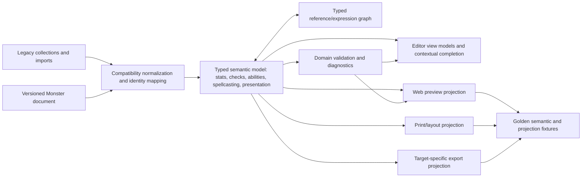

**Canonical semantic model responsibilities:** preserve authored content and stable entity IDs; represent structured mechanics explicitly; retain raw/manual prose and unknown extension fields; attach ruleset/source provenance where known; distinguish authored values from derived values and display-only choices. The model MUST NOT become a generic bag of arbitrary key/value pairs.

**Projection responsibility:** each renderer/export target declares which semantic fields it consumes, how it renders them, which transformations it applies, and what it omits. Projections are pure with respect to the source document. One semantic example fixture feeds screen, print and supported exports so the same defect cannot be patched in only one visual location.

**Compatibility responsibility:** existing trait/action/reaction/legendary/mythic/lair/spell collections are normalized at a boundary into typed semantic entries and projected back only where legacy consumers require it. A persisted schema migration is a separate decision from the editor unification. Start with a read-only normalization adapter and round-trip fixtures; change persistence only after mapping unknown fields, ordering, IDs and old exports.

### 30.4 Typed references and formulas: safe, incremental capability

Do not replace every integer field with a dropdown. A field should support only input modes that make sense for its semantic type. A numeric literal remains quickest for fixed authored values. A compatible reference is available where the rule benefits from binding. A formula is available only for explicitly formula-capable fields.

| Expression concept | Contract |
|---|---|
| `ValueType` | Number, DiceExpression, Distance, Duration, AbilityScore, AbilityModifier, Bonus, SaveDC, AttackBonus, Text, Boolean, SpellReference, EntityReference; units and contexts are explicit. |
| Reference catalog | Exposes stable IDs, type, display label, source path, scope, availability, provenance and preview. Suggestions are filtered by expected type and current context. |
| Expression grammar | Small documented grammar with arithmetic, dice notation where supported, parentheses and registered references. No arbitrary JavaScript/eval, property traversal or implicit cross-domain access. |
| Dependency graph | Edges from expression owner to referenced entity/value; topological recompute; cycle detection; deleted/unavailable reference diagnostic; stable deterministic calculation context. |
| Fallback | Preserve the authored literal/formula and show last valid result only as stale; never silently substitute zero or an unrelated default. |
| User control | Literal, choose reference, or enter custom expression where enabled. Preview the resolved value and source. Explicitly detach/bake to literal. |
| Completion UX | Inline, caret-aware suggestions; exact token insertion; keyboard navigation; concise explanation; accessible announcement; visible error/valid state; no mandatory bottom strip. |
| Scope limits | A reference must be semantically and temporally valid in the current scope. An attack entry cannot depend on a runtime combat value unless that context is explicitly supplied. |

**Incremental delivery:** first inventory every numeric/formula-capable field and categorize it as fixed scalar, derived display, override, dice expression, formula-capable, or untrusted imported string. Then support references in one high-value, bounded family (for example attack/save/damage fields) with tests and preview. Expand only when user scenarios justify it. Do not create dozens of low-value dropdown items merely because values are integers.

### 30.5 Ability authoring: unify the grammar, preserve domain distinctions

F-04 should evolve from “unified composer” into a semantic ability authoring contract with two coordinated ways to author:

1. **Structured composition:** role and action economy; trigger/recharge/uses; target/area/range; attack or saving throw; success/failure outcomes; damage/healing/temp HP/conditions/movement/resource costs; tags/timing; effect order; optional rules references. Show only fields relevant to selected effect kinds.
2. **Narrative composition:** rich text remains first-class for custom rulings, exceptions, flavor and unsupported mechanics. Inline autocomplete can suggest typed references/tokens without forcing all prose through a schema.
3. **Combined entry:** structured fields generate a semantic effect and renderer presentation; author prose remains an explicit block in a declared position (intro, resolution, rider, aftermath, custom). The system must never silently overwrite prose when structured fields change.
4. **Role variants:** Trait, Action, Bonus Action, Reaction, Legendary, Mythic, Lair and Regional remain meaningful categories with distinct triggers, costs, ordering and render destinations. They may share editor controls and the effect grammar; they are not interchangeable labels.
5. **Legacy bridge:** preserve existing entry IDs, category order, custom preambles, recharge/cost strings, token content and unknown fields. Provide migration diagnostics and round-trip/export comparison before schema conversion.

**Ordering grammar:** define explicit order slots such as `title → role/cadence → tags/source → trigger or cost → targeting → resolution/effects → authored prose → notes`. Each entry type declares optional slots and its renderer. Missing fields collapse without empty separators. The editor preview displays the same semantic order as the renderer and highlights omitted/invalid slots.

**Why not use one giant dropdown chain:** the possible composition space is too large, context changes available values, and a chain cannot express arbitrary prose or conditional semantics safely. Use a small sequence of contextual typed controls with progressive disclosure, relevance-ranked suggestions, and manual text escape hatches. Keep catalogs alphabetized within groups; default ordering follows common workflow and semantic precedence.

### 30.6 Spellcasting parity contract (F-14/WP-11)

Spellcasting is semantically a trait-like rules block in the rendered statblock. The editor may place it according to the creator's workflow, but navigation and output order must be intentionally mapped and explained. Current source already renders spellcasting before Actions in the modern statblock and exposes several requested authoring controls; implementation must first prove which issue remains in the exact runtime.

Static source review narrows the remaining work: the level picker filters available spell options by level and optionally the primary class, but its current method does not use the selected subclass; the component displays current selected-per-level counts and a separate prepared-spell metric, but does not label a selected/maximum/remaining trio. A caught metrics error currently falls back to ordinary-looking numeric defaults. These are direct code-level targets for the spellcasting slice. The selector accepts custom subclass text (`add-unique`), which is useful flexibility but must be labeled as unverified custom provenance. The available subclass/spell corpus still needs a coverage audit before claims about completeness or official expanded lists.

A spellcasting view model MUST distinguish:

- Caster identity: class(es), subclass(es), level(s), ability, spell source, rules provenance, homebrew/unknown sources.
- Spell relationship: selected known/prepared spells, always-prepared spells, subclass-expanded/granted spells, innate spells, at-will spells, ritual-only or other tagged access; source feature and whether counts toward a limit.
- Resource relationship: slot/pact/focus/point pool, level, quantity, recovery cadence, uses, and whether per spell, per level, or per block.
- Derived metrics: allowed/maximum count, selected count, granted count not consuming allowance, remaining capacity, slot maximum; every displayed number labels the metric and calculation source.
- Author override: manual value remains possible but is marked as override and does not masquerade as a calculated entitlement.
- Rendering: one compact hierarchy with caster/save/attack/resource summary, then trait text, then grouped spell lists; no redundant nested panels or repeated headers; narrow/print layout has a deterministic wrap policy.

**Data governance and alternatives:** the project’s current subclass/spell data sources and licensing/provenance must be audited before claiming comprehensive official subclass lists. Alternative A: ship user-entered subclass text and manual spell choice with no automatic entitlement claims (safe baseline). Alternative B: curated, versioned rules dataset with source/provenance and coverage indicators (recommended only with rights and maintenance plan). Alternative C: remote catalog (out of scope for local-first baseline). A selector that accepts arbitrary text must label it custom rather than implying verified catalog membership.

### 30.7 Visual and interaction grammar additions to F-12/F-13

Define shared semantic tokens for canvas, panel, panel heading, data cell, cell label, primary value, secondary metadata, status, advantage, disadvantage, warning, invalid, focus, separators, and long-form body. Map these to themes rather than hard-code screenshot colors. Design output rules for long names, long tags, multi-valued cells, wrapping, overflow, print pagination and localization expansion.

For advantage/disadvantage, color and icon/text apply to the complete affected semantic phrase (label plus value/context), while numeric values receive consistent emphasis. Include a text label or accessible name so color is never the sole cue. For dense tables, retain clear header/value distinction, explicit cell boundaries, and stable reading order.

**Tooltips and inline help:**

- Every icon-only control has an accessible name and concise tooltip; essential behavior is also visible or programmatically described.
- Non-obvious controls receive concise context help with one-line purpose and optional “learn more” disclosure.
- Tooltips are usable on hover, keyboard focus and touch; they do not contain the only error, rule caveat or required action.
- Rich formatting is reserved for content where formatting improves scanability; color-coded text must maintain contrast and have semantic labels.
- Do not attach verbose help to every text label. Help density is measured by task success and interruption, not tooltip count.

### 30.8 Source-to-runtime parity, test fixtures and drift control

Every user-facing semantic example used in screenshots, docs, release notes or product demos should be stored as a fixture with: source document, stable IDs, schema version, active rules/presentation mode, viewport, expected semantic projection, expected checks, and expected output per supported target. Fixture names must distinguish illustrative examples from rules-authoritative examples.

**Minimum parity suite for the concerns raised:**

- Skills: Investigation/Medicine in Study, Hide membership, duplicate keys/legacy aliases, advantage/disadvantage labels, grouped and ungrouped rows, tools, and bonus-action overrides; one recognized skill appears once unless an explicit second check is authored.
- Action composition: one attack-shaped Soul Barrage fixture; one save/effect-shaped Veil of Radiance fixture; one entry per role variant; structured fields and prose both survive reload/import/export; role and effect render order matches contract.
- Tokens/formulas: insert suggestions at caret; resolve valid references after source edits; report missing/cyclic/invalid references; preserve input on parse failure; reject unsafe syntax; update preview only for matching content revision.
- Spellcasting: primary and multiclass entries, subclass selection, custom subclass, selected vs granted spells, count/remaining labels, Long Rest/Short Rest/Downtime cadence, duplicates, unsupported spell sources, and compact renderer layout.
- Visual: wide/narrow viewports, 200% zoom, long translated strings, long names/effects, high contrast, keyboard focus, print output, dark/light themes if supported, and renderer plate branch.

A screenshot regression is evidence of geometry/style drift, not a substitute for semantic assertions. Semantic fixture tests are evidence of model/projection correctness, not a substitute for live visual inspection. Both are needed for F-04, F-12 and F-13.

### 30.9 Cause-oriented prioritization and revised delivery order

| Priority | Work increment | Scope | Value and dependency |
|---|---|---|---|
| P0 | Reproduce screenshot states against exact revision and data | WP-00; capture editor/preview pair, document IDs, modes, viewport and console/runtime errors | Prevent fixing a stale build or unrelated entries; prerequisite for claiming a screenshot defect is fixed. |
| P1 | Close existing semantic parity gaps | WP-02/F-05, WP-06/F-08, WP-09/F-13; skill/action/spell fixtures and renderer parity | Fix cross-projection truth before expanding composition features; ships useful validation and reliable display. |
| P1 | Visual fit and comprehension foundation | WP-09 + F-12/F-13; shared tokens, density/overflow contracts, focus/help grammar | Addresses recurring clipping/density across components, rather than one-off CSS patches. |
| P2 | Contextual authoring language spike | New sub-slice under F-04, after fixture baseline; typed reference catalog and caret completion for one numeric/text field family | Demonstrates safe reusable capability without blanket schema migration or universal dropdown explosion. |
| P2 | Structured ability grammar spike | F-04; normalization adapter for one representative attack and one save/effect entry | Proves the editor and renderer can share an order/effect contract while preserving legacy round-trip. |
| P3 | Expand ability grammar and migrate legacy categories | F-04; role variants, imports, history, exports, schema decision | Only after adapter proves parity and content preservation; migrate in category batches. |
| P3 | Spellcasting view-model/data-governance expansion | Existing `SpellcastingEditor` and `ClassCastingEditor`, domain types/data, renderer | Depends on current coverage audit and source/license decision; preserve existing supported data and manual override. |

### 30.10 New or revised acceptance requirements

| ID | Requirement | Linked feature/package | Evidence |
|---|---|---|---|
| `COMP-001` | One authored ability produces one stable semantic interpretation across editor preview, modern/legacy statblock views, print and each claimed export. | F-04/F-08, WP-06 | Golden fixtures with entry IDs and per-target projections. |
| `COMP-002` | Legacy ability collections import and round-trip without dropping unknown fields, text, IDs, order, role, trigger/cost or category. | F-04/F-08, WP-01/WP-06 | Before/after semantic comparison and legacy fixture matrix. |
| `COMP-003` | Structured composition and authored prose coexist; changing one never silently replaces the other. | F-04 | Edit/reload/undo/import/export fixture. |
| `REF-001` | Reference/formula inputs declare expected type, unit, scope, grammar and dependency semantics; invalid references never become silent zero/default values. | F-04/F-05 | Valid/invalid/cyclic/deleted-reference scenarios. |
| `REF-002` | Dynamic results and completion candidates are computed from a deterministic document/context revision; stale results are identifiable. | F-04/F-05 | Change source during completion/preview and verify stale behavior. |
| `SPELL-001` | Spell counts distinguish selected, allowed, granted/always prepared, and remaining values, with provenance for each. | F-14/WP-11 | Primary/multiclass/subclass fixture and content source report. |
| `SPELL-002` | Spellcasting editor and renderer preserve the same class/subclass/resource/cadence/spell relationships and deterministic order. | F-14/WP-11, F-12 | Semantic projection fixture plus screenshot review. |
| `VIS-001` | No primary editor or statblock content clips, overlaps, leaks or becomes unreachable at supported widths, zoom, font scale and long content. | F-12/F-13, WP-09 | Declared viewport/content matrix, keyboard run and visual evidence. |
| `VIS-002` | Status, advantage/disadvantage and semantic grouping remain understandable without color alone. | F-12/F-13 | Contrast review plus grayscale/accessibility inspection. |
| `HELP-001` | Help is contextual, concise and available by keyboard/touch where needed; visible labels and accessible names remain authoritative. | F-13 | Control inventory, focus walkthrough and assistive-technology spot checks. |
| `PARITY-001` | A screenshot-reported mismatch is not closed until the same data fixture and source revision agree in editor, semantic output and target renderer. | WP-00 and affected feature | Reproduction packet linked to pass evidence. |

### 30.11 Multi-scale sanity check on the proposed evolution

**Meta → macro:** The product remains a local-first monster authoring and table aid; no mandatory code language or official-data promise is introduced.

**Macro → meso:** Creator workflow becomes: define creature → compose typed mechanics or prose → inspect one semantic preview → resolve checks/references → save/export with projection differences shown.

**Meso → micro:** Action/spell editors expose only context-appropriate controls, with inline completion and preview; skill groups and renderer share one semantic projection; responsive layout preserves the reading order.

**Micro → nano:** Each entry/reference has a stable ID; formula fields have declared type/unit/context; output has source revision; duplicate/missing reference diagnostics target the actual field; structured changes and prose have independent history operations.

**Nano → meta:** Stable identity, typed references and shared fixtures reduce local patches only if each solves a real repeated workflow and remains backward-compatible. If a proposed abstraction increases the number of concepts a creator must understand without reducing errors or authoring time, simplify the UI and keep the complexity internal.


## 31. Code change ledger for the screenshot-driven evolution

This ledger translates the concern audit into bounded code change candidates. Paths are source-inspected and indicate likely touch points, not a mandate to edit every listed file. Do not execute this ledger as a bulk refactor. WP-00 first captures exact runtime state and current worktree diffs; only then should each vertical slice be sized against its acceptance criteria.

| Work slice | Likely existing source files | Likely additions | Required code change | Scope guard / dependency |
|---|---|---|---|---|
| Reproduce skill duplication | `src/core/domain/skill-action-groups.ts`, `src/components/rendering/useTextRenderer.ts`, `src/components/rendering/WebRenderer.vue`, `src/components/editor/SkillsEditor.vue` | Fixture-backed projection test using existing `test/core/SkillActionGroups.test.ts`; browser screenshot scenario | Build fixture from the screenshot’s actual skill IDs, keys, passive overrides, advantage and bonus-action flags; trace from Monster through `computeSkillGroupLayout` to `actionPassivesGroups` and DOM. Correct the earliest semantic/projection defect only. | Current group definitions already put Investigation/Medicine in Study and Acrobatics/Athletics/Sleight of Hand/Stealth in Hide. The pure layout already filters grouped skills from generic Skills. Do not change these memberships unless a verified rules/product decision requires it. |
| Cross-output semantic fixture | `src/core/usecases/ExportStatblock.ts`, `src/components/rendering/useTextRenderer.ts`, `src/components/rendering/useProcessTokens.ts`, `src/components/rendering/WebRenderer.vue`, renderer/export adapters used by `DownloadButton.vue` | Canonical fixture bundle: document JSON, semantic expected output, per-target expectations, visual viewport metadata | Add the Soul Barrage and Veil of Radiance examples as separate, ID-bound entries; verify role, structured fields, freeform text, ordering, sanitation, and output for each target. Prevent output adapters from resolving tokens differently. | The two screenshots do not prove a single entry was mismatched. Requires exact data and mode reproduction first. Preserve active `useProcessTokens.ts`/`plate.ts` work. |
| Ability composition model spike | `src/components/editor/ActionsEditor.vue`, `src/components/editor/MonsterTextEditor.vue`, `src/components/editor/AttackPanel.vue`, `src/core/domain/types.ts`, `src/components/models.ts`, `src/components/rendering/useTextRenderer.ts`, `src/components/rendering/useProcessTokens.ts` | Proposed `AbilitySemanticAdapter` and schema/grammar metadata; tests alongside `test/core/ProcessTokens.test.ts`, `test/core/Formula.test.ts`, `test/core/ExportStatblock.test.ts` | Normalize one attack-shaped entry and one save/effect entry into a typed preview model; define role/economy/cadence/target/resolution/prose order; make editor preview and renderer consume the same normalized representation. Preserve legacy category storage and unknown fields in the spike. | Begin read-only normalization and round-trip checks. Do not migrate all traits/actions/reactions/legendary/mythic/lair arrays or replace all existing panels yet. |
| Caret-aware completion and typed reference spike | `src/components/editor/MonsterTextEditor.vue`, `src/components/editor/widgets/DynamicReferenceSelect.vue`, `src/core/domain/formula.ts`, `src/components/rendering/useProcessTokens.ts`, `src/core/domain/types.ts` | Proposed `ReferenceCatalog`, expression parser/evaluator contract, caret completion adapter, diagnostics DTO | Inventory and type eligible fields; implement completion at caret for one context; filter references by expected type/unit; render valid preview and parse errors; report cycles/missing IDs; retain literal and raw expression. | Existing token menus and formula helpers are assets to consolidate. Do not add arbitrary JavaScript, enumerate every numeric value, or force ordinary prose into a DSL. |
| Spellcasting counts and safe derived metrics | `src/components/editor/ClassCastingEditor.vue`, `src/components/editor/SpellcastingEditor.vue`, `src/core/usecases/AutoSyncSpellcasting.ts`, `src/core/domain/types.ts`, `src/stores/monster-store.ts` | Proposed spellcasting metrics result with `{status, source, selected, allowed, granted, remaining}`; fixture/report for rules data | Replace the catch branch’s plausible default metrics with explicit unavailable/error state. Keep selected-per-level counts distinct from class allowance. Surface override/source and avoid displaying fabricated `0` or default values as authoritative. | Use existing `test/core/AutoSyncSpellcasting.test.ts` as a domain baseline; add UI/view-model coverage without changing established calculations absent evidence. |
| Subclass-aware catalog and provenance | `src/components/editor/ClassCastingEditor.vue`, `src/components/editor/widgets/SearchableSpellSelect.vue`, spell data modules, `src/components/spell/useSpellLevels.ts`, `src/core/usecases/AutoSyncSpellcasting.ts` | Versioned class/subclass/spell coverage metadata and selection provenance | Extend candidate resolution from level/primary class to selected class/subclass and source features where data exists. Distinguish catalog-verified, expanded/granted, imported, and custom entries. Show missing data coverage instead of implying no spell or complete support. | Audit source rights, version and completeness before shipping official-content claims. Keep user-authored custom subclass and spell paths. |
| Spellcasting compact view-model and projection | `src/components/editor/ClassCastingEditor.vue`, `src/components/editor/SpellcastingEditor.vue`, `src/components/rendering/useTextRenderer.ts`, `src/components/rendering/WebRenderer.vue`, `src/css/statblock-grammar.scss` | Spellcasting semantic fixture set and projection result | Build the summary cells (caster/source, save/attack, resource/recovery, spell counts) from one view model; group spell levels and cadence deterministically; define duplicate warning policy; keep spellcasting in the rendered Traits region. | Current source already renders spellcasting before Actions in modern mode and contains Long Rest cadence options. Do not duplicate those features; fix gaps proven by fixtures. |
| Shared visual grammar and overflow | `src/css/statblock-grammar.scss`, `src/css/app.scss`, `src/css/quasar.variables.scss`, `src/components/rendering/WebRenderer.vue`, `src/components/rendering/plate.ts` (untracked in inspected source), relevant editor components | Semantic token/role map and visual regression set | Add reusable panel/cell/label/value/status tokens; enforce wrapping and min-width rules; visually couple advantage/disadvantage semantics; define long-content and print break behavior; replace local one-off styling only when touched. | Preserve working identity and current plate work. Scope screenshot matrix to declared viewports/themes/content; avoid palette rewrites driven by one example. |
| Tooltip/help/accessibility inventory | `src/components/editor/*.vue`, shared widgets, `src/components/layouts`/shell components as found at WP-00 | Control inventory with accessible name, visible label, help source, focus/touch path | Correct unlabeled icon-only actions; move essential help into visible/accessible context; make supplementary help concise and keyboard/touch available. | No mass tooltip injection. Do not duplicate visible labels or make hover the only way to learn/operate. |
| Compatibility and migration decision | `src/core/domain/types.ts`, `src/components/models.ts`, `src/core/usecases/MigrateMonsterSchema.ts`, schema JSON, import/export adapters | Migration decision record and legacy fixture matrix | Decide whether the semantic adapter remains a non-persisted projection or warrants a new schema version. If persisted, define sequential migration, unknown-field preservation, rollback, ID and order policy. | This is a gate after the adapter proves value; do not bump schema for an editor-only abstraction. |

### 31.1 Existing test assets to reuse, without assuming they are current proof

Source inspection found these relevant existing suites: `test/core/SkillActionGroups.test.ts`, `test/core/Formula.test.ts`, `test/core/ProcessTokens.test.ts`, `test/core/AutoSyncSpellcasting.test.ts`, `test/core/ExportStatblock.test.ts`, `test/core/ExtendedFeatures.test.ts`, and `test/core/MigrateMonsterSchema.test.ts`. Their presence is not evidence they pass at the inspected revision or cover the screenshot fixtures. The implementation package should extend the closest pure-core suite and add integration/visual evidence at the boundary where the defect occurs. Do not replace deterministic domain checks with screenshot-only assertions, or claim renderer correctness from core tests alone.

### 31.2 Code impact forecast for this new scope

These are additive planning estimates for the concern-driven work and are not retroactively counted as measured edits. Low/base/high counts exclude existing active plate changes and shared files reused across slices; WP-00 must recalibrate them.

| Slice | Low / base / high files | Confidence | Why the range varies |
|---|---:|---|---|
| Screenshot reproduction + skill parity | 2 / 4 / 7 | Medium-low | A core grouping defect stays local; a stale-data/runtime mismatch needs import fixture and renderer route coverage. |
| Shared semantic output fixtures | 4 / 7 / 12 | Low | Number depends on how many export targets consume different transformation paths. |
| Ability semantic adapter spike | 5 / 9 / 16 | Low | Type duplication, legacy arrays, custom token behavior, and renderer dependencies are still being reconciled. |
| Caret completion/reference spike | 4 / 8 / 14 | Low | Depends on editor caret API, type catalog, error UI and existing formula limitations. |
| Spell metrics and subclass coverage | 4 / 8 / 15 | Low | Depends on source-data provenance/rights and whether metric calculations need domain changes. |
| Visual grammar/overflow | 4 / 8 / 18 | Low | The upper range applies only if multiple panels need structural responsive changes; do not conflate with token-only styling. |
| Compatibility migration | 2 / 5 / 12 | Low | Zero schema migration may be correct; persistent semantic storage would require broader import/export coverage. |

These low/base/high file-count ranges are not additive effort estimates. Their scope is already included in the §24.1 loop-level 56–114 engineer-day forecast: screenshot reproduction/skill parity in Loops 00 and 04; action projection and typed references in Loops 04 and 09; spell metrics/catalog/projection in Loop 07; visual grammar/help/accessibility in Loop 08; compatibility decisions in Loops 01, 04, and 09. Shared files appear in multiple file-count ranges by design. Recalibrate both per-loop effort and per-slice file counts after the fixture, semantic-adapter spike, and data-coverage audit; do not add the estimate systems together.


---

## 32. Three-artifact roadmap governance

The output set has three distinct documents and one authority order. The specification is the source of truth; the backlog decomposes it into executable tasks; the handoff guide prepares each work loop and records what must be returned to the next loop. The shorter predecessor roadmap is superseded by these documents and is not a fourth active plan.

| Artifact | Purpose | Owns | Must not become |
|---|---|---|---|
| `DNDSheet-Professional-Product-and-Architecture-Spec.md` | Authoritative product, UX, architecture, data, quality, and release contract (“roadmap bible”) | Problem/value, scope, requirements, current observations, target architecture, alternatives, decision gates, impact forecasts and acceptance evidence | A task-status tracker or claim that proposed behavior is already implemented. |
| `DNDSheet-Implementation-Backlog.md` | Ordered, trackable work queue derived from the specification | Task IDs, loop order, status, prerequisites, files, task acceptance, estimates and blockers | A second copy of long design contracts or permission to alter out-of-scope user work. |
| `DNDSheet-Development-Handoffs.md` | Ready-to-execute context for each incremental development loop | Preparation, exact sections/tasks to read, skills/research to load, loop boundaries, verification/rollback, closure packet and next-loop handoff | A parallel backlog, a ritual skill list, or an assumption that future code exists. |

**Authority and conflict rule:** Plan requirements and decisions win over backlog summaries; backlog task IDs and dependencies win over handoff shorthand. If a loop discovers a source fact or requirement gap, pause dependent work, update the source-of-truth plan and traceability, then regenerate the affected backlog/handoff material. Do not resolve specification conflicts by silently editing only a task title.

**Status vocabulary:** `Done` requires evidence at a named source revision; `In progress` means a change is actively being worked; `Ready` means dependencies and preparation gates have passed; `Blocked` names the repeated external condition and next resolution; `Pending` is unstarted; `Deferred` is intentionally outside the current release. A checked box cannot mean “planned,” “code exists,” “tests once passed,” or “looks correct in a screenshot.”

**Loop contract:** each loop starts with a clean scope statement, exact baseline and preserved changes; identifies its required skills/research before implementation; changes one coherent workflow boundary; verifies behavior and regressions against the same source revision; updates requirements/decision records if assumptions changed; and emits a closure packet with revision, files changed, evidence, known limitations, rollback point, and next-loop readiness. A loop is independently releasable only when its user outcome works without a later loop.

**Current portfolio state at 2026-10-29:** the specification and source inventory are written; latest read-only source status is `statblock-overhaul` at `be0cf3f`, modified `src/components/rendering/useProcessTokens.ts`, untracked `src/components/rendering/plate.ts`. Runtime screenshot reproduction, current build/test evidence, and user-work ownership for the renderer diff remain open. No implementation task in the new backlog is marked done merely because its design is specified.

The backlog carries per-loop engineer-day forecasts, not task-level low/base/high estimates; WP-00 recalibrates loop ranges and file counts against exact callsites and dependency changes.

**Completion rule for this specification set:** there are exactly three active deliverables in `outputs/`. The original short roadmap is superseded by the derived backlog; no plan detail that remains authoritative may exist only in that superseded file.
